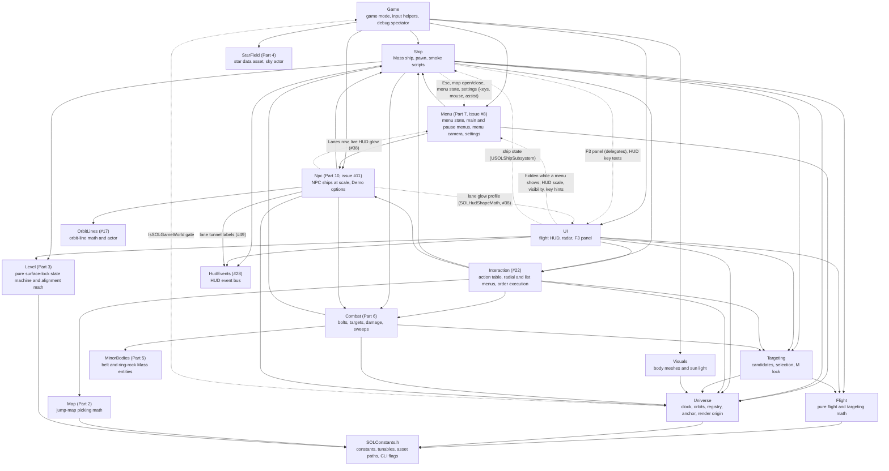
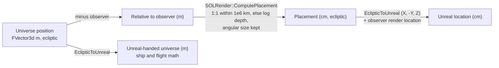
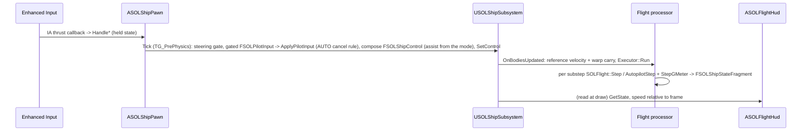

<!-- SOLTest / Copyright © 2026 Acid Rain Studios LLC -->

# SOLTest architecture

A high-level map of how the game's systems fit together: modules, the per-frame update order, coordinate frames, key types and the main data flows. It is a living reference, not a design record. The *why* behind each decision lives in the SDDs ([`SDDs/1-solar-system-architecture.md`](SDDs/1-solar-system-architecture.md) for the cross-cutting decisions, [`SDDs/2-foundations-flight-scaffold.md`](SDDs/2-foundations-flight-scaffold.md) section 3 for what Part 1 actually built, [`SDDs/3-jump-map.md`](SDDs/3-jump-map.md) for Part 2, [`SDDs/4-surface-lock.md`](SDDs/4-surface-lock.md) for Part 3). Exact numbers and bindings are in [`GAME_MECHANICS.md`](GAME_MECHANICS.md).

**Status:** Part 1 (foundations, ship flight, HUD) and Part 2 (jump map) are complete. Part 3 (surface-lock) is built: the pure logic (`Level/SOLSurfaceLock`, 3a) and its engine integration (3b: the `L` key, `USOLShipSubsystem` stepping the lock state, the flight processor applying the alignment per substep, the HUD status/hint line, and the jump clearing the lock). Part 4 (star field) is built: the offline bake and import (`Tools/StarField/`, 4a/4b) and the runtime sky actor `ASOLStarField` (4c). Part 6 (weapons, issue #7; its sub-parts are labelled 7a-7f after the issue's plan file, commits say "Part 6x") is built: the pure combat math (7a), the combat subsystem with fire/drop input (7b), visuals (7c), audio (7d) and asteroid/ring-rock hits (7e); 7f (docs, review, verification) is closing out the adversarial-review fixes (SDD 7 Amendment 4).

---

## 1. Overview

SOLTest is a 1:1-scale solar-system space sim: the player flies a small ship in third person among the Sun, eight planets, five dwarf planets and their major moons on real Keplerian orbits, with a sim clock and time-warp, gravity, a reference-frame/target system and a sim-style HUD. The core architectural bet has three parts:

1. **Double-precision universe coordinates.** Every authoritative position is an `FVector3d` in meters in a right-handed ecliptic frame, far beyond what Unreal's world can hold.
2. **Observer-relative rendering.** Unreal's world is only a render view. A render origin near the observer maps to Unreal (0,0,0), and every body is re-placed from universe coordinates each frame. Far bodies are depth-compressed with their angular size preserved.
3. **MassEntity for scale.** The ship is a Mass entity stepped by a Mass processor. The Pawn is a thin input and camera proxy. The same pattern is meant to extend to NPC ships, asteroids and projectiles, with ~1M entities as the goal.

Throughout the code, the rule is **pure logic in plain C++, engine glue in thin UObjects** (see [section 7](#7-testing-architecture)).

---

## 2. Module map

All code is in the single game module `Source/SOLTest/`, organized by feature folder (`Docs/STYLE_GUIDE.md` §14.2). Arrows point from a module to what it depends on.

`Npc` reads `USOLSettingsSubsystem` (in `Menu/`) directly too (issue #38 part 38b, SDD 38 D23): `ASOLNpcVisuals` reads the Lanes overlay row and the live (pending) HUD glow every frame (since 38c it no longer reads `USOLMenuSubsystem`: the lane dashes never freeze, D15 amended; only the verification script `FSOLNpcLaneSmoke` drives the menu); `Menu/` also depends on `Npc/` (the Demo page), so the two folders now reference each other. `Npc` also uses `OrbitLines/` beyond its pure math: the lane ribbon is a `USOLOrbitLineComponent` built with `SOLOrbitLineMesh::ApplyRibbonToMesh`, and it tells `ASOLOrbitLineVisuals` (given to it by `ASOLGameMode`) when lanes draw, so the shared occluders stay current (D24).

`Ship` and `UI` read `USOLSettingsSubsystem` (in `Menu/`): the pawn maps its keys from the applied key bindings, scales mouse look, starts its steer toggle from "Mouse steering at start" and marks the session's first steering (issue #31), the ship subsystem reads the default flight assist at spawn, and the HUD reads the HUD scale, visibility and key hints. The ship pawn and the flight HUD never include each other (issue #28, SDD 21 D4; checked with `grep "Ship/SOLShipPawn.h" Source/SOLTest/UI/SOLFlightHud.* Source/SOLTest/UI/SOLSpeedPanelWidget.*` and `grep "UI/SOLFlightHud.h" Source/SOLTest/Ship/SOLShipPawn.*`, both empty; only the verification smoke scripts include both, and the pawn header includes `UI/SOLHudSmoke.h` because the pawn owns the smoke scripts; see the CLAUDE.md tech-debt list): they talk through `USOLHudEventSubsystem` (`HudEvents/`), whose plain-C++ `FSOLHudBus` carries the pawn's coalesced pilot snapshot (joystick, steering, free look, steer icon, steer hint; published once per pawn tick, read by `DrawHUD`), the HUD commands (orbit lines, radar zoom and AUTO, broadcast when the pawn handles the key) and the HUD's jump-map body overlay (published by the HUD, read by the pawn's map picking). The pawn still opens the F3 panel, which applies the cap and closes itself through delegates the pawn binds, and the HUD still reads the ship's state from `USOLShipSubsystem`. `Ship` and `Combat` also point both ways: the pawn hands the trigger, aim and drop requests to `USOLCombatSubsystem`, which reads the player ship's state from `USOLShipSubsystem`. The Universe subsystems ask `ASOLGameMode::IsSOLGameWorld` whether to exist at all. `Menu` depends on `Npc`: the Demo page reads and edits the pure demo options (`SOLNpcScale`) and the menu subsystem starts, stops and re-reads `USOLNpcSubsystem`; `Npc` reads the player ship (`USOLShipSubsystem`, it spawns around it) and reuses `Combat`'s pure grid and bolt math (`SOLCombatGrid`, `SOLBoltMath`, `SOLFireCadence`). The NPC lane-line math (`Npc/SOLNpcLaneMath`, issue #38 part 38a) also reuses two pure headers of other folders: `UI/SOLHudShapeMath` (the HUD glow profile and its glow-scale sanitizer, so the lanes glow like the HUD) and `OrbitLines/SOLOrbitLineMath` (the box-filtered dash coverage), hence the `Npc -> UI` and `Npc -> OrbitLines` edges; neither folder includes `Npc/`. The lane tunnels (issue #49,
SDD 49) add `Npc -> HudEvents`: `USOLNpcTunnelComponent` publishes the wall-label snapshot on `FSOLHudBus`
(`PublishLaneTunnelLabels`, `ClearLaneTunnelLabels`: plain numbers, body indices and the dot rows with their world dot diameters), which the flight
HUD reads at draw time, so the label alpha and anchors are computed on the Npc side and `UI/SOLLaneTunnelLabel` needs
only `SOLHudFormat` and `SOLMenuText`. Every module includes `SOLConstants.h`. Only the pure leaves are drawn above.

| Folder | Responsibility | Key files |
|---|---|---|
| `Universe/` | Sim clock, Kepler orbits, body registry, anchor selection, render origin and far placement, and the subsystem that drives the frame | `SOLAnchorSubsystem`, `SOLBodyRegistry(Subsystem)`, `SOLSimClock(Subsystem)`, `SOLKepler`, `SOLRenderOrigin`, `SOLRenderPlacement`, `SOLBodyFrameCache` |
| `Flight/` | Pure flight model (issue #18 Newtonian core, pilot G model, autopilot guidance, #32 Chase Down policy and planner), gravity, collision, warp carry, and target-picking math | `SOLNewtonianFlight`, `SOLFlight`, `SOLChase`, `SOLFlightMode`, `SOLShipState`, `SOLTargeting` |
| `Ship/` | Player ship as a Mass entity, its processor and subsystem (including the surface-lock state and its per-substep alignment), the Pawn proxy, scripted smoke tests | `SOLShipSubsystem`, `SOLShipFlightProcessor`, `SOLShipFragments`, `SOLShipPawn`, `SOLShipSmokeFlight`, `SOLShipSmokeInput`, `SOLSurfaceLockSmoke` |
| `Targeting/` | Target candidates, selection, the M frame lock, reference velocity | `SOLTargetingSubsystem`, `SOLTargetable` |
| `UI/` | Hologram flight HUD (Canvas fallback), 3D hologram radar (#30), F3 speed panel, and their pure layout and format math (Alt+O and the hint read the orbit-line actor); the batched glow-shape renderer (issue #28, SDD 21: pure shape math and the custom-vertex batch, the Slate layer drawing it with `M_SOLHudShape` from `Tools/UI/create_hud_shape_material.py`; issue #29 adds the fixed-capacity glow-text list, panel backings and the panel fill / flicker / tone mirror; cvars `sol.HudRenderer`, `sol.HudComposite`, `sol.HudTextGlow`) | `SOLFlightHud`, `SOLSpeedPanelWidget`, `SOLRadarLayout`, `SOLHudFormat`, `SOLLaneTunnelLabel` (pure placement and text of the lane tunnel wall labels, SDD 49), `SOLSpeedStepper`, `SOLHudShapeMath`, `SOLHudShapeBatch`, `SOLHudShapeLayer`, `SOLHudTextList`, `SOLHudSmoke`, `SOLOverlayModel`, `SOLOverlayIcons`, `SOLOverlayIconLayer`, `SOLOverlayMenuWidget`, `SOLHologramCursorSubsystem`, `SOLOverlaySmoke`, `SOLActionListWidget` |
| `Interaction/` | Interaction menus (issue #22 Part 2): the pure action table (what each object type offers and when it is blocked), the pure radial and list menu geometry, and the world subsystem that holds hover and menu state and runs the chosen action through existing APIs (targeting, autopilot, jump, frame lock) | `SOLActionTable`, `SOLInteractMenus`, `SOLInteractionSubsystem`, `SOLDroppedTargetTargetable`, `SOLInteractSmoke` |
| `HudEvents/` | The HUD event bus between the ship pawn and the flight HUD (issue #28, SDD 21 D4); also the NPC lane tunnels' wall-label snapshot (`FSOLHudLaneTunnelLabels`, issue #49) | `SOLHudBus`, `SOLHudEventSubsystem` |
| `OrbitLines/` | World-space orbit lines (issue #17): pure line math, ribbon packing, the line component and actor; HLSL in `Shaders/Private/SOLOrbitLine.ush` | `SOLOrbitLineMath`, `SOLOrbitLineLogic`, `SOLOrbitLineMesh`, `SOLOrbitLineComponent`, `SOLOrbitLineVisuals` |
| `Visuals/` | Places body meshes each frame and sets their per-body sun direction; the map hologram look (proxy bodies and ring discs, map post-process, its cvars and pure math); the space dust speed cue (#43: `USOLSpaceDustComponent` on the ship pawn, its pure maths `SOLSpaceDustMath`, its smoke script `SOLSpaceDustSmoke`; assets in `Content/SOL/SpaceDust/`, built by `Tools/SpaceDust/`; cvar `sol.SpaceDust`) | `SOLBodyVisuals`, `SOLHologramVisuals`, `SOLHologramMath`, `SOLSpaceDustComponent`, `SOLSpaceDustMath`, `SOLSpaceDustSmoke` |
| `StarField/` | Star field (Part 4, issue #5; quality pass issue #13): the baked star data asset (4b), the runtime sky actor (4c) that draws the bright-star sprites and the faint-star cubemap sphere as pixel-sized points, and the pure brightness/size math. Content is produced offline by `Tools/StarField/` (bake, then `import_star_field.py`, then `create_star_field_materials.py`) | `SOLStarFieldData`, `SOLStarField`, `SOLStarBrightness` |
| `MinorBodies/` | Minor bodies (Part 5, issue #6): the asteroid belt's pure-logic generator (5b), the shared minor-body orbit math, Mass fragments and orbit processor, the subsystem that spawns and steps the belt entities, and the belt's instanced-mesh visuals (5c); real ring structure/gap data (5d) and the near-field ring-rock patch system (pure logic plus a streaming Mass pool, 5e-i/ii) | `SOLAsteroidBelt`, `SOLMinorBodyOrbit`, `SOLMinorBodyFragments`, `SOLMinorBodyOrbitProcessor`, `SOLMinorBodySubsystem`, `SOLAsteroidBeltVisuals`, `SOLPlanetRing`, `SOLRingPatch`, `SOLRingDense`, `SOLRingShadowMath`, `SOLRingSubsystem`, `SOLRingVisuals` |
| `GasGiants/` | Gas giant fidelity (issue #14): the pure band/storm/near-layer math (14a), the per-giant band-shell visuals (14c) and the near volumetric cloud layer (14d) | `SOLGasGiantMath`, `SOLGasGiantVisuals` |
| `Combat/` | Weapons, targets and destruction (Part 6, issue #7): pure bolt, damage, grid, drop and fire-cadence math (7a), and the combat subsystem that owns the pooled bolts and targets, sweeps bolts against targets and minor bodies, and queues one-shot events for the visuals and audio (7b, 7e); the combat visuals actor that draws them (7c) and the combat audio actor that plays their placeholder sounds (7d) | `SOLBoltMath`, `SOLDamageMath`, `SOLCombatGrid`, `SOLTargetDrop`, `SOLFireCadence`, `SOLCombatTypes`, `SOLCombatSubsystem`, `SOLCombatVisuals`, `SOLCombatAudioRules`, `SOLCombatAudio` |
| `Map/` | Map (Part 2, #20): picking, orbit-camera and warp-curve math, the map mode (Jump / Move / Patrol) and its camera, the jump sequence, routes (model, planner, the route subsystem driving the autopilot), the smoke scripts | `SOLMapPicking`, `SOLMapCamera`, `SOLWarpCurve`, `SOLMapModeState`, `SOLMapModeSubsystem`, `SOLJumpSubsystem`, `SOLRoute`, `SOLRoutePlanner`, `SOLRouteSubsystem`, `SOLRouteOverlayMath`, `SOLMapRouteOverlay`, `SOLMapHologramOverlay`, `SOLMapSmoke`, `SOLMapPickSmoke`, `SOLMapAlignSmoke`, `SOLJumpSmoke`, `SOLRouteSmoke`, `SOLRouteOverlaySmoke`, `SOLHologramSmoke` |
| `Level/` | Surface-lock (Part 3) pure logic: the engage/warn/release state machine and the up-alignment math. Its engine integration lives in `Ship/`, `Targeting/` and `UI/` (no new subsystem) | `SOLSurfaceLock` |
| `Menu/` | Menus and settings (issue #8, Parts 8a-8d): the pure menu state machine, info-text, settings, key-label, key-binding and settings-rules logic; the menu subsystem that owns the flow (main menu, Play, Esc pause, Quit to menu), the main-menu camera pawn, the C++-built UMG main and pause menus with their Controls/Info/About/Settings pages and the Demo page (SDD 11 Part 10e: the NPC demo options, session-only, kept in the menu subsystem and pushed to `USOLNpcSubsystem::StartDemo`; Ctrl+F1 acts as Esc in both menus and the ship pawn), the settings subsystem and its save game, all menu strings in one file, and the `-SOLMenuSmoke` script | `SOLMenuState`, `SOLInfoText`, `SOLSettingsModel`, `SOLBindingLabel`, `SOLKeyBindings`, `SOLSettingsRules`, `SOLMenuSubsystem`, `SOLSettingsSubsystem`, `SOLEngineSettingsSnapshot`, `SOLSettingsSave`, `SOLMenuCameraPawn`, `SOLMainMenuWidget`, `SOLPauseMenuWidget`, `SOLDemoPageWidget`, `SOLSettingsPageWidget`, `SOLSettingsTabs`, `SOLMenuButton`, `SOLMenuContent`, `SOLMenuText`, `SOLMenuSmoke` |
| `Npc/` | NPC ships at scale (Part 10, issue #11, SDD 11; 10a-10f): the pure tier/distribution/ramp/demo-option logic (10a), the motion model's rail half and the Mass fragments, the tier processor (group, temporal and per-chunk cull, budgeted hysteresis tiers, archetype moves by tag; a serial chunk walk records the active chunks, then the work runs in a ParallelFor over them, SDD 11 Amendment 6) and the Mid deviation processor (10b; since 18c a Newtonian point-mass return to the rail), the Full AI and NPC-vs-NPC combat (gather/scatter processor, flat-list steering, guns, bolt pool, statistical model, respawn; the NPC combat renderer; 10d), the subsystem that spawns the population (entities created in time slices, 10f) and runs them on `OnUniverseUpdated`, the renderer (GPU rail points evaluated in the `M_SOLNpcPoints` vertex shader from a rail texture re-based to a recent epoch, CPU points, instanced and pooled placeholder hulls, 10c/10f), the stats overlay (pure line formatting and a C++ UMG widget refreshed at 4 Hz, 10e), the pure NPC lane-line math (issue #38 part 38a, SDD 38: fade, width, dashes, the lane parameter under a pixel, the per-lane ship histogram, the per-frame lane frame and the renderer's pure feed), and the lane lines in `ASOLNpcVisuals` (part 38b: one ribbon mesh per population, placed and shaded on the GPU by `M_SOLNpcLanes` / `Shaders/Private/SOLNpcLane.ush`, the HLSL mirror of `SOLNpcLaneMath`; the far points' crossfade; the `-SOLSmokeNpcLanes` script `FSOLNpcLaneSmoke`), and the lane guidance tunnels (issue #49, SDD 49: the pure `SOLNpcTunnelMath` (fade, basis, accordion ring warp, slots, fades, label lanes, renderer feed), `USOLNpcTunnelComponent` (a slot mesh built once, one fixed-bounds ISM instance per lane in range, `M_SOLNpcTunnel` / `Shaders/Private/SOLNpcTunnel.ush`, the HLSL mirror of `SOLNpcTunnelMath`, the per-lane tunnel texture `NpcTunnelTex` also read by the lane and point materials, the label snapshot) and the `-SOLSmokeNpcTunnel` script `FSOLNpcTunnelSmoke`) | `SOLNpcScaleMath`, `SOLNpcLaneMath`, `SOLNpcTunnelMath`, `USOLNpcTunnelComponent`, `FSOLNpcLaneSmoke`, `FSOLNpcTunnelSmoke`, `SOLNpcStatsText`, `SOLNpcStatsWidget`, `SOLNpcRail`, `SOLNpcFragments`, `USOLNpcTierProcessor`, `USOLNpcMidProcessor`, `SOLNpcAiMath`, `USOLNpcFullAiProcessor`, `FSOLNpcCombat`, `USOLNpcSubsystem`, `ASOLNpcVisuals`, `USOLNpcHullInstances`, `ASOLNpcCombatVisuals` |
| `Game/` | Game mode (default pawn and HUD, spawns the body visuals, the star field, the asteroid-belt visuals, the NPC visuals and the NPC combat visuals, smoke screenshot), shared Enhanced Input helpers, debug spectator | `SOLGameMode`, `SOLInputHelpers`, `SOLSpectatorPawn` |
| `Tools/` | Editor-only authoring helpers the Python asset scripts call (`USOLEditorAuthoring`: setting a string property by name, and, since issue #37 part 37b, connecting a material's Customized UV input, whose `EMaterialProperty` entries are hidden from Python; `Tools/UI/create_hud_shape_material.py` uses it for `M_SOLHudShape`'s Customized UV 2) | `SOLEditorAuthoring` |
| root | Module boilerplate, log category, central constants | `SOLTest.h/.cpp`, `SOLConstants.h`, `SOLTest.Build.cs` (the `ImageCore` module since issue #33 part 33e-ii: the crop writer's `FImage`) |

---

## 3. Frame update order

The whole universe is advanced by **one tickable world subsystem, `USOLAnchorSubsystem::Tick`**, which ticks after `TG_PostPhysics`. The clock, registry and targeting subsystems do not tick themselves. The ship's Mass processor is **not** registered with a Mass processing phase. Instead, `USOLShipSubsystem` runs it explicitly from the anchor's `OnBodiesUpdated` event, so the ship always steps against this frame's bodies.

```mermaid
sequenceDiagram
    autonumber
    participant Pawn as ASOLShipPawn (TG_PrePhysics)
    participant Anchor as USOLAnchorSubsystem::Tick
    participant Clock as USOLSimClockSubsystem
    participant Reg as USOLBodyRegistrySubsystem
    participant Ship as USOLShipSubsystem
    participant Tgt as USOLTargetingSubsystem
    participant Proc as USOLShipFlightProcessor
    participant Vis as ASOLBodyVisuals / pawn
    participant HUD as ASOLFlightHud::DrawHUD

    Pawn->>Ship: SetControl(composed input)
    Note over Pawn: publishes its pilot snapshot on the HUD event bus (FSOLHudBus::PublishPilot, coalesced, once per tick)
    Note over Anchor: dt = min(realDelta, MAX_FRAME_DELTA_S)
    Anchor->>Clock: AdvanceFrame(dt) (sim time += dt x warp)
    Anchor->>Reg: UpdateFromClock() (Kepler positions, then refresh Unreal-handed FSOLBodyFrameCache)
    Anchor->>Ship: OnBodiesUpdated(dt)
    Ship->>Tgt: RefreshCandidates(), GetReferenceVelocityMps()
    Ship->>Ship: ComputeFrameInputs (warp carry, previous body positions)
    Ship->>Ship: UpdateChase (#32: resolve the chase target, refresh the plan)
    Ship->>Proc: Executor::Run (substeps: gravity, SOLFlight::Step or AutopilotStep or ChaseStep, swept collision, G meter)
    Ship->>Ship: UpdateSurfaceLock (state machine on this frame's ship and bodies, and engaging calls Tgt LockToBodyIndex)
    Ship->>Anchor: SyncObserverPositionM(ship position)
    Ship->>Ship: OnShipsStepped broadcast (end of StepShips, after the observer sync)
    Note over Ship: USOLRouteSubsystem::HandleShipsStepped runs here (an autopilot arrival advances the route and orders the next waypoint this frame, and AUTO lost pauses it)
    Note over Ship: USOLRingSubsystem::UpdateRings runs here (ring-rock pool streaming, reads this frame's real ship position)
    Note over Anchor: OnBodiesUpdated also runs USOLMinorBodySubsystem (Executor::Run of USOLMinorBodyOrbitProcessor, raw ecliptic positions) - this also places USOLRingSubsystem's ring-rock entities, since they share the same fragments and Mass matches by composition, not by creator
    Anchor->>Anchor: anchor selector update (25% hysteresis), RebaseRenderOrigin
    Anchor->>Vis: OnUniverseUpdated (place bodies, pawn follows ship, ASOLAsteroidBeltVisuals bulk-updates its ISMs, ASOLGasGiantVisuals places its shells and near cloud layer, ASOLOrbitLineVisuals writes its per-line data and occluders, USOLSpaceDustComponent on the ship pawn places its Niagara box at the ship's render location and pushes the dust parameters)
    Note over Anchor: OnUniverseUpdated also runs USOLCombatSubsystem::Update (targets, drop, bolts, grids, parallel sweep, hits, guns), which then broadcasts OnCombatUpdated for the combat visuals and audio
    Note over Anchor: OnUniverseUpdated also runs USOLNpcSubsystem::Update (respawn if requested, group and temporal cull, USOLNpcTierProcessor Evaluate and Select, USOLNpcMidProcessor, USOLNpcFullAiProcessor Gather, FSOLNpcCombat::Step, Scatter, then Collect), which then broadcasts OnNpcsUpdated for ASOLNpcVisuals and ASOLNpcCombatVisuals
    Note over HUD: after the world tick, at draw time
    HUD->>HUD: read subsystems and the bus's pilot snapshot, draw reticle, markers, bracket, radar, text
    Note over HUD: glow shapes, panels and text lines (every element but the map overlays, SDD 21) go into SSOLHudShapeLayer, drawn by Slate's paint as panel backings, one custom-vertex draw, then the text (same frame, or the next if Slate painted first)
    HUD->>HUD: BeginMenuFrame - USOLHoloMenuSubsystem::UpdateMaterialForFrame (menu MID strength, view size and composite, first caller in the frame)
    Note over HUD: menus and cards go into the menu layer (second SSOLHudShapeLayer, menu MID), and each open SSOLHoloFrame paint calls UpdateMaterialForFrame too (a no-op after the first call in a frame)
```

**Why the order matters.** Each stage consumes the output of the previous one *from the same frame*. The ship needs this frame's bodies for gravity and collision, and this frame's reference velocity (so targeting is refreshed first). The anchor and rebase need this frame's ship position. The visuals and HUD need the final render origin. If the processor were phase-registered, the ship would step against last frame's bodies and the anchor would lag it by one frame.

- **Time-warp frame carry:** assisted and manual ship flight runs in real time, so each frame the ship also inherits the part of its reference frame's motion that warp adds beyond real time (`SOLFlight::FrameCarryDisplacement`, for both position and velocity). This keeps the ship co-moving with Earth at 1 d/s.
- **Autopilot time domain (issue #18):** a ship with an autopilot order under a user warp above 1x integrates **sim** time instead: `SOLFlight::AutopilotSubstepCount` substeps (max(10 s, frame sim time / 256), at most 256) over warp x the frame, against the bodies interpolated over the same frame (`mSimSubstepBodyPositionsM`), with no frame carry. The autopilot never changes the warp. The pilot G meter (`FSOLShipStateFragment::GMeter`) advances per substep in that substep's time (real or sim).
- **Surface-lock timing:** the lock state is advanced after the flight run, when the ship and the bodies are both at this frame's positions (before the run the ship is one body-step behind, which misreads altitude by up to the body's speed times the frame time). Its decision (the body to align to, the frame lock) takes effect from the next step; the alignment itself runs inside the processor per substep with the substep's real dt.
- **Combat timing:** `USOLCombatSubsystem` updates on `OnUniverseUpdated`, i.e. after every `OnBodiesUpdated` listener has finished (ship step, ring streaming, minor-body orbits, whatever their bind order), so this frame's ship, bodies and rocks are final; it only stores the frame's clamped real delta from `OnBodiesUpdated`. Anything that draws or plays combat state binds to its own `OnCombatUpdated`, never beside it on `OnUniverseUpdated`. Bolts fired by the gun in an update start sweeping in the next one; the pawn's trigger and aim, set in its pre-physics tick, are read by the same frame's update.
- **NPC timing:** `USOLNpcSubsystem` also updates on `OnUniverseUpdated`, so the viewpoint, bodies and render origin are final. NPCs and the player's combat never touch each other's state (SDD 11 decision 4), so their order on that delegate does not matter. `ASOLNpcVisuals` and `ASOLNpcCombatVisuals` redraw on `OnNpcsUpdated`, after the NPC update. NPC bolts and effects are held relative to the battles' body (`GetCombatFrameBodyM`), in real time.
- **Hitch budget:** the real delta is clamped once to `SOL::MAX_FRAME_DELTA_S` (0.5 s) and fed to both the clock and the ship. It is split into at most `SHIP_MAX_SUBSTEPS` (16) substeps of 1/30 s, which cover that budget exactly (a `static_assert` enforces this), so a hitch slows the universe uniformly and no ship time is dropped.

To change this order, update this section, SDD 2 section 3, and the tick comments in `SOLAnchorSubsystem.cpp` together.

---

## 4. Coordinate systems and conversions

| Frame | Handedness and units | Used by |
|---|---|---|
| **Universe (ecliptic)** | Right-handed J2000 ecliptic (+X vernal equinox, +Z north ecliptic pole), meters, double, Sun at origin | Body registry, anchor, observer, map picking |
| **Unreal-handed universe** | Ecliptic with Y negated (`EclipticToUnreal`), meters, double | Ship state, flight math, targeting candidates, body frame cache. `FQuat4d` works as in Unreal (X forward, Y right, Z up) |
| **Unreal render** | Left-handed, centimeters, relative to `FSOLRenderOrigin::OriginM` (within 10 km of the observer) | Actor locations, HUD projection |

Every screen-space projection the game does itself (HUD, map icons and picking, exposure) treats the camera FOV as horizontal across the viewport; `Config/DefaultEngine.ini` sets the local player's `AspectRatio_MaintainXFOV` so the renderer does the same at every aspect ratio (issue #25, tested in `SOLTest.ViewProjection.*`).

"Observer" in the pipeline above is really the **render viewpoint**: the observer (ship) normally, or the jump-map camera while the map is open (`USOLAnchorSubsystem::SetViewpointOverrideM`). Anchor selection always uses the observer. The render origin snaps to the viewpoint when the anchor body changes, when the override is cleared, or when the viewpoint drifts `SOL::RENDER_REBASE_DISTANCE_M` (10 km) from it. Unreal's own `SetNewWorldOrigin` is deliberately not used: its int32 cm origin is too small for AU-scale distances. Beyond `SOL::DEFAULT_MAX_RENDER_DISTANCE_CM`, depth is compressed as `d' = Max * (1 + 0.1 * ln(d / Max))` and the radius is scaled by `d'/d`, which keeps depth order and angular size (SDD 2 Amendment 1). Positions stay `FVector3d` until the final conversion to `FVector`.

---

## 5. Key types per module

Each type is marked **pure** (plain C++, unit-tested without a world) or **engine** (UObject, Actor, subsystem or Mass type, covered by smoke checks).

**Universe** (`Source/SOLTest/Universe/`)
- `FSOLSimClock` (pure, `SOLSimClock.h`): Julian date and the warp ladder. `USOLSimClockSubsystem` (engine) wraps it.
- `FSOLKeplerElements` / `FSOLSecularElements` / `SOLKepler` (pure, `SOLKepler.h`): JPL secular elements and the Kepler solver that turns them into a state.
- `FSOLBodyRegistry` (pure, `SOLBodyRegistry.h`): structure-of-arrays bodies (name, radius, GM, **parent index**, elements, Sun-frame position and velocity, and — issue #12 — sidereal rotation period/axial tilt/W0 with a computed orientation via `GetOrientation`). `SOLBodyRotation` (pure, `SOLBodyRotation.h`): the tilt-plus-spin quaternion math `Update()` calls per body. `USOLBodyRegistrySubsystem` (engine) owns the registry plus the Unreal-handed `FSOLBodyFrameCache` (positions only as of #12; visuals convert orientation separately via `SOLRender::EclipticToUnreal(FQuat4d)`).
- `FSOLAnchorSelector` (pure, `SOLAnchor.h`): picks the nearest body with 25% hysteresis.
- `FSOLRenderOrigin` / `SOLRender::ComputePlacement` (pure, `SOLRenderOrigin.h`, `SOLRenderPlacement.h`): rebasing and far-placement math.
- `USOLAnchorSubsystem` (engine, `SOLAnchorSubsystem.h`): the frame driver. It holds the observer position and the render origin, and exposes `OnBodiesUpdated`, `OnUniverseUpdated` and `OnRenderOriginShifted`.

**Flight** (`Source/SOLTest/Flight/`)
- `FSOLShipState` (pure, `SOLShipState.h`); `FSOLShipControl`, `FSOLFlightParams` (thrust envelope + pilot G limits), `FSOLFlightStepOutput` (pure, `SOLFlight.h`): the ship's state, input and tuning.
- `SOLNewtonian` (pure, `SOLNewtonianFlight.h`, issue #18): the shared Newtonian core: `StepNewtonian` (torque, per-axis thrust box with a total cap, gravity), rate/attitude commands, `AllocateThrust`, the pilot G meter (`GLoadG`, `StepGMeter`, warnings, vision loss), the rendezvous guidance (`ComputeRendezvousGuidance`, `MakeGuidanceParams`, `EstimateTimeToArrivalS`, `SampleRendezvousTrajectory`) and the NPC hand-off helpers. Players use it now; NPCs from 18c.
- `SOLFlightMode` (pure, `SOLFlightMode.h`, issue #19): the player's flight mode state machine (`ESOLFlightMode` MANUAL / ASSISTED / AUTO, `FSOLFlightModeState`; `ToggleAssist`, `EngageAuto`, `DisengageAuto`, `NotifyAutopilotArrived`, `FlightAssistFor`), the cancel-on-manual-input rule with its per-channel input latch (`ApplyPilotInput`, `ActiveChannels` / `CHANNEL_*` over the gated `FSOLPilotInput`, `RelatchInput`), the mouse steering gate (`FSOLSteerGateState`: hold OR toggle, suspension, recenter edge; `SteerIconFor`) and the boost toggle. The mode lives in `USOLShipSubsystem`; the gate and the boost toggle in `ASOLShipPawn`.
- `SOLFlight` (pure): `Step` (the player front end: assisted = rate command + velocity hold at the pilot limit, manual = torque + thrust, stop spin, surface-lock attitude target), `AutopilotStep`, `ChaseStep` (#32, the autopilot's step with the chase's per-substep G limit), `AssistThrustAccelMps2`, `ContactAccelMps2`, `AutopilotSubstepCount`, `GravityAcceleration`, swept sphere collision, `FrameCarryDisplacement`, `BodyPositionAtSubstep`, `MakeCircularOrbitState`.
- `FSOLTargetInfo` / `SOLTargeting` (pure, `SOLTargeting.h`): `PickUnderReticle`, `Cycle`, `ResolveReferenceVelocity`.

**Ship** (`Source/SOLTest/Ship/`)
- `FSOLShipStateFragment`, `FSOLShipControlFragment`, `FSOLShipParamsFragment` (const shared), `FSOLPlayerShipTag` (engine, `SOLShipFragments.h`): the Mass data for the ship. `FSOLShipChaseFragment` (#32, optional, carried only by the player ship's archetype): the chase inputs, policy, run state and last substep limit; the flight processor reads it as an optional fragment, so NPC ships pay nothing for the chase.
- `USOLShipFlightProcessor` (engine, `SOLShipFlightProcessor.h`): the substepped gravity, flight (or autopilot), collision and pilot G loop (`FSOLShipControlFragment::AlignBodyIndex` names the surface-lock body, used as the assisted attitude target; `AutopilotBodyIndex` the autopilot's body; G-LOC zeroes the input and the ship coasts), with a parallel chunk loop that allocates nothing per run. `USOLShipSubsystem` owns the autopilot order and, since issue #19, the player's flight mode (`GetFlightMode`, `ToggleAssist`, `EngageAutopilot` enters AUTO with the last pilot input latched, `DisengageAutopilot` / arrival / the cancel rule in `ApplyPilotInput` hand back to ASSISTED; the `sol.Autopilot` console command goes through the same API) and exposes the G meter and guidance to the HUD; the pawn blends a `UPostProcessComponent` by `GVisionLoss`.
- `USOLShipSubsystem` (engine, `SOLShipSubsystem.h`): spawns the entity, runs the processor on `OnBodiesUpdated`, computes the warp carry, owns and steps the player's `FSOLSurfaceLockState` (L presses arrive via `RequestSurfaceLockToggle`; `ClearSurfaceLock` for a jump), syncs the observer, fires `OnShipsStepped` after each step, and is the Pawn's API (`SetControl`, `GetState`, `SetState` and so on). Chase Down (#32): `EngageChase` / `DisengageChase` / `GetChaseStatus`; `StepShips` resolves the chase target and refreshes the plan (`UpdateChase`) before the processor run, which flies `SOLFlight::ChaseStep` per substep; every autopilot cancel ends a chase and a lost target ends it in ASSISTED. `USOLJumpSubsystem::StartJump` calls `DisengageChase`, so a jump's warp is flown in ASSISTED. Game-thread cycle stats `SOL_ChasePlan`, `SOL_ChaseUpdate` and `SOL_ShipFlightRun` (`STATGROUP_SOLShip`). On a jump arrival and on despawn, `ResetPilotState` cancels the autopilot order (back to ASSISTED), refills the G meter (SDD 18 Amendment 7) and bumps the pilot reset count that turns the pawn's boost off (SDD 19); the autopilot's arrival point comes from `SOLFlight::AutopilotStandoffM` (moved out until the body's gravity can be held).
- `ASOLShipPawn` (engine, `SOLShipPawn.h`): Enhanced Input (created in C++), virtual joystick, chase camera, placeholder mesh, and (issue #43) the `USOLSpaceDustComponent` that draws the space dust. It carries no universe coordinates. Since issue #19 it owns the mouse steering gate (Space hold, wheel-click toggle; suspended by the map, menus, the F3 panel, a jump warp and focus loss; it captures the cursor only while steering or free-looking, else shows it locked inside the viewport with the viewport focused) and the boost toggle (cleared when `USOLShipSubsystem::GetPilotResetCount` changes and at G-LOC), and each tick hands the gated `FSOLPilotInput` to `USOLShipSubsystem::ApplyPilotInput` before `SetControl`, taking `bFlightAssist` from the mode. When the map, a menu, the F3 panel or a jump warp gives control back, it passes the flight keys still held to `USOLShipSubsystem::RelatchPilotInput` (latched in AUTO, re-applied for `SOL::SHIP_RELATCH_GRACE_FRAMES`). Input notes (issue #34): `IA_ShiftChord` is mapped to both Shift keys and `IA_RightShiftChord` to Right Shift only, for the `EKeyChord::RightShift` binding (RShift+O, cycle overlay profiles); so that Left Shift+O does nothing, each plain mapping whose key a RightShift chord also uses gets an explicit Shift chord blocker, and `SOLInput::BlockPlainMappingsUnderChord` re-adds those plain mappings at the end of the ship context (Enhanced Input orders chord-triggered mappings first and injects automatic blockers only into same-key mappings after a chorded one). `EndPlay` calls `USOLSettingsSubsystem::FlushSave` through `FlushSettingsAtLeave` (a write only if one is owed; not on quit or PIE end, where the subsystem's `Deinitialize` writes synchronously right after); the master O is no longer forced on at `BeginPlay`.
- `FSOLShipSmokeFlight` / `FSOLShipSmokeInput` / `FSOLSurfaceLockSmoke` (engine test scripts): the `-SOLSmokeFlight`, `-SOLSmokeInput` and `-SOLSmokeLevel` runs.

**Targeting** (`Source/SOLTest/Targeting/`)
- `SOLChase` (pure, `SOLChase.h`, #32, SDD 32): Chase Down's G policy and planner: `ChaseMaxG` (the cap), `EffectiveMeterFloor` / `MaxSafeGForStep` (the safety margin as a meter floor), `ChaseGLimit` (burst / cool per substep), `PredictChase` / `PlanChase` / `ShouldReplacePlan` (the time-to-intercept planner), `ChaseAimPointM` (the tail point), `EstimateTargetAccelMps2`; `FSOLChaseStatus` (HUD snapshot) lives with `USOLShipSubsystem`.
- `ISOLTargetable` (engine interface, `SOLTargetable.h`): for non-body targets. It returns an `FSOLTargetInfo` each frame; `IsTargetAlive` (a chase ends when it turns false) and `GetTargetFrameBodyIndex` (the body whose frame the target moves in, `INDEX_NONE` by default; #32).
- `USOLTargetingSubsystem` (engine, `SOLTargetingSubsystem.h`): the candidate list (registry bodies at their body index, then registered targetables), the selection, the M lock (also set by surface-lock through `LockToBodyIndex`) and the reference velocity.

**UI** (`Source/SOLTest/UI/`)
- `ASOLFlightHud` (engine, `SOLFlightHud.h`): everything laid out in `DrawHUD` with its own pinhole projection. With the shape renderer active (`sol.HudRenderer 1`) lines, dashed lines, rings, ellipses, bars and hologram panels go into `SSOLHudShapeLayer`'s `FSOLHudShapeBatch` and every text line (its cached `FText`, shared by reference count) into its `FSOLHudTextList`; the jump map's overlays still draw on Canvas. It does not tick. HUD glow (issue #37, SDD 37): `BeginShapeFrame` reads the live (pending) `HudGlow` setting once a frame, maps it to the glow scale g (`SOLHudShapeMath::HudGlowScale`: slider x `SOL::Hologram::HUD_GLOW_DEFAULT_LEVEL` 0.3, in units of the issue #31 glow) and pushes it to its material's `GlowScale` parameter and the HUD layer's text glow alpha only on a change; the route overlay takes g as `FSOLRouteOverlayInputs::GlowScale`, and the hologram cards' readouts on the menu layer carry g per shape and per line (`BeginReadoutGlow` / `EndReadoutGlow`: `FSOLHudShapeBatch::SetGlowOverride` writes `(g, 1)` into each vertex's `MaterialTexCoords`, read by the material through Customized UV 2; `FSOLHudTextList::SetGlowAlphaOverride` sets each line's outline alpha), while the card frames keep the menu material's `GlowScale` 1.
- `SSOLHudShapeLayer` (engine Slate leaf widget, `SOLHudShapeLayer.h`): paints the frame's panel backings (solid boxes), the shape batch (one custom-vertex draw with `M_SOLHudShape`) and the glow text (GEngine's fonts via `MakeText`: drop shadow, then a hot core with an outline glow). Buffers reserved once. Its `PaintBacking` / `PaintBatch` statics are the one draw path the hologram frames reuse. Retain mode (issue #33 part 33d-i, SDD 33 section 8.3: `SetRetainBatch`, `MarkBatchChanged`, the pure `ShouldPaintBatch`) keeps a batch across frames for a widget that rebuilds it only on change (the 33d-ii glossary views); the HUD stays in its per-frame mode. Since 33d-ii it takes optional `MaxTexts` / `MaxBackings` / `PaintScratch` arguments (a shared paint-vertex scratch, so a retained view holds no vertex buffer of its own) and reports `GetLastPaintOrigin`. Since issue #37 `SetTextGlowAlpha` sets the glow text's outline alpha (default `HUD_TEXT_GLOW_ALPHA`, so the menu layer is unchanged; no outline at 0), and a text item's own `GlowAlpha` (0 or more) wins over it. `M_SOLHudShape` has a `GlowScale` scalar parameter (default 1, so every instance that never sets it keeps the issue #31 glow) and reads a per-shape override from Customized UV 2 (SDD 37 sections 4.3 and 4.6).
- HUD menu layer (#42, SDD 42 section 4.3): `ASOLFlightHud` owns a second `SSOLHudShapeLayer` (`mMenuLayer`, z 1, just above the HUD layer and below the UMG menus) drawn with the hologram menu material. It is emptied only after a frame that drew on it and stamped only when a `Menu*` helper (`MenuArc`, `MenuHoloShapes`, `MenuText`) or `BeginCardContent` writes to it; since 42g the two always-on cards are on it every flight frame (and on the map), so it draws whenever the flight HUD does. It is sized `SOL::HoloMenu::MENU_LAYER_MAX_SHAPES` and carries the HUD fonts, so a menu's text paints above its own backing and fill; menu lines pad by `SOLHoloFrameBuild::LinePad` (flat at strength 0); under `sol.HudRenderer 0` the helpers fall back to the HUD batch or Canvas. The radial menu draws on it since 42d: `UpdateRadialMenu` runs every `DrawHUD` right after `BeginShapeFrame` and before the early returns (so a release that starts the jump warp still plays its select cue that frame), through the pure `SOLHoloRadial` logic (`UI/SOLHoloRadial.h`: `Update` drives an `FSOLHoloMenuAnim` and the open / hover / select cues from the interaction's radial open and confirm counters and keeps a value-type copy of the last drawn menu, `FSOLHoloRadialState`, to draw the close from; `SectorLook` / `LabelColor` / `Faded` give each sector's draw-in aperture, glow and colour and the text fade); `DrawInteraction` then draws it from that cached state through `MenuArc` / `MenuText`. **Which layer draws which panel (42g, SDD 42 D15):** the four frameless hologram cards are on the menu layer, each built by `SOLHoloFrameBuild::BuildCard` (fill in `BACKDROP_TINT`, 8 corner ticks, the idle sweep, its tint backing) into one reused `FSOLHoloFrameOutput` member and drawn by `DrawCard` through `MenuHoloShapes`, so they follow `HoloMenuEffects`, not the HUD slider: the **info card** (`DrawInfoCard`, text via `MenuText`) and the **target card** (`DrawTarget` -> `DrawTargetCard`) each run an `FSOLHoloMenuAnim` (a file-local `HudCardUpdate`: a new object restarts it from Closed, the same one changes nothing, a gone one closes from a value-type cache of the object and its facts / readout, a frame gap snaps it Closed; the info card plays the open cue, the target card none); the **speed card** (`DrawSpeedBlock` and the G meter of `DrawPilotBlock`, `mLeftBlockRect`) and the **date-and-anchor card** (`DrawInfoBlock`'s panel) are always Open: their content (text through `DrawBuffer`, bars, steer icon) is sent to the menu layer between `BeginCardContent` / `EndCardContent` (which swap the HUD's batch and text list for the menu layer's), so it paints above the card's backing. The HUD layer keeps `AddHoloPanel` panels for the rest: the autopilot / route block, the G warning, the controls notice, the profile tag, the steer hint, the Attack hint, the "TARGET none" line (shown once the target card has closed), the target's on-screen label and the radar label; the key hints under the date-and-anchor card have no panel. `GetLastCard` / `CountHudBackingsOverlapping` report what each card drew for the smokes.
- `USOLHoloMenuSubsystem` (engine world subsystem, `SOLHoloMenuSubsystem.h`, #42): owns the menu MID of `M_SOLHudShape` (effects strength = `HoloMenuEffects`; strength, the game viewport size and the `sol.HudComposite` switch pushed only on a change, once per frame through `UpdateMaterialForFrame`), loads the three cue sounds (`SOL::HoloMenu::CUES`) and plays them 2D through `PlayCue` (rate limited per cue by `FSOLHoloCueGate`, at any strength, D21). The pure frame and card builders are `SOLHoloFrameBuild` (`SOLHoloFrameBuild.h`) over the `SOLHoloMenu` maths (`SOLHoloMenuMath.h`).
- `SSOLHoloFrame` / `USOLHoloFrameWidget` (engine Slate leaf and its UMG wrapper, `SOLHoloFrame.h`, `SOLHoloFrameWidget.h`, #42): one option (c) hologram frame behind a C++ UMG menu's content. The Slate widget owns the menu's `FSOLHoloMenuAnim`, reads the time once per paint, builds the frame with `SOLHoloFrameBuild` (reusing the build while Open and only the time changed, then rewriting only the sweep quad's vertices) and draws the tint backing (`SOL::HoloMenu::BACKDROP_TINT`) and one custom-vertex element with the menu MID; no tick, no per-frame allocation in project code (Slate's `MakeCustomVerts` copies the arrays, as for the HUD layer). Its UI scale is the viewport height rule of the HUD without the Settings HUD scale; both widgets are volatile; `sol.HudRenderer 0` does not apply to it (no Canvas fallback). The UMG wrapper takes the layout and hovered item in the frame's local units and requests the open and hover cues; the owning menu polls `AdvanceAnim` to remove itself after a close.
- `FSOLHudTextList` (pure, `SOLHudTextList.h`): fixed-capacity text lines of one frame (drops and counts past capacity, never reallocates); since issue #37 each line carries a glow alpha (-1 = the layer's) set through `SetGlowAlphaOverride` / `ClearGlowAlphaOverride`. `SOLHudShapeMath` holds the glow-scale maths of issue #37 (`HudGlowScale`, `SanitizeGlowScale`, `GlowProfile(d, g)`, `TextGlowAlpha`) and `FSOLGlowScaleFeed` (the glow scale of a setting, a change reported once, used by the pointer and the Settings glow sample). Tested in `SOLTest.HudPanels.*` with the panel fill, pad fade, flicker, tone curve, blue grade and panel rectangle mirrors of `SOLHudShapeMath`.
- `USOLSpeedPanelWidget` (engine, `SOLSpeedPanelWidget.h`): the F3 UMG panel, built in C++. A hologram menu (issue #42, part 42f) like the standalone Overlay Menu: a `USOLHoloFrameWidget` behind its panel, laid out in its `NativeTick` only after a change or a list scroll (`SOLHoloFrameBuild::MakeSpeedLayout`: title step and the stepped broken divider between the stepper and list sections; `TextItemRect` for the centre-tick mark on the highlighted digit or unit field and the pointer mark on the highlighted body row), the content's render opacity and the screen dim following the frame's fill, the select cue on each applied cap. The pawn's `CloseSpeedPanel` calls `BeginClose` and restores ship control at once; the panel plays its close and removes itself (F3 during the close reverses it; `DismissSpeedPanel` still removes it at once on teardown).
- `SOLOverlay` (pure, `SOLOverlayModel.h`, issue #22, profiles #34): the data-driven overlay table (15 Overlay Menu rows; Space Dust is no longer an overlay), the overlay profiles (`FOverlayPrefs`: up to 5, with per-profile row masks and enabled, used, master-O and orbit-lines bit sets plus the active profile; `SetProfileEnabled` copies Profile 1 on a first enable and restores the slot's own content on a re-enable, `CycleActiveProfile`, `Sanitized`, `AreEqual`, `ProfileTagAlpha`) and `IsShown` / `IsOrbitShown` (active master x row x parent row, orbit rows also x the active profile's orbit-lines switch). `USOLSettingsSubsystem` owns the prefs (saved, schema 10) including each profile's master and orbit-lines state; the HUD, the orbit-line actor and the pawn read them there.
- `SOLOverlayIcons` / `SOLHologramCursor` (pure, `SOLOverlayIcons.h`): icon categories, size fade, distance darkening, edge pinning, budgeted nearest-first selection, the icon and edge-arrow vector shapes, the cursor arrow. `FSOLOverlayIconLayer` (`SOLOverlayIconLayer.h`) gathers the bodies, named asteroids, dropped targets (`USOLCombatSubsystem`) and nearest NPC ships (`USOLNpcSubsystem::GetCpuShips`) each frame into the HUD's shape batch (`ASOLFlightHud::DrawOverlayIcons`, also the radar's ship contacts); `FSOLMapBodyOverlay` draws the same icons on the map.
- `SOLHudSymbols` (pure, `SOLHudSymbols.h`, issue #33 part 33a, SDD 33 section 8.1): `ESOLHudSymbol` (every symbol the Help page's HUD glossary draws) and `Build(symbol, centre, scale, FSOLHudSymbolPrims&)`, a fixed-capacity list of primitives (line, ring, arc, box, dot, dashed line, ellipse, text sample) in HUD palette roles, replayed into an `FSOLHudShapeBatch` by `AddToBatch`; the overlay icons, edge arrows and cards reuse `SOLOverlayIcons::AddIconShapes` / `AddEdgeArrow` (with `IconExtent` / `EdgeArrowExtent`) and `SOLHoloFrameBuild::BuildCard` (with `CardRect`), no second copy of any geometry. Since 33d-i (SDD 33 D39-D42) the HUD's inline symbol geometry lives here as per-element builders (`AppendReticle`, `AppendJoystick`, `AppendSteerIcon`, `AppendPrograde` / `AppendRetrograde`, `AppendTargetBracket`, `AppendTargetEdgeArrow`, `AppendRadarScope`, `AppendRadarContact`, `AppendBar`, `AppendChaseTicks`, `AppendWarpStreak`, `AppendRadialSector`) with their constants in `SOL::HudGeometry` (`SOLConstants.h`); `ASOLFlightHud` holds one `FSOLHudSymbolPrims` scratch and replays each builder's prims through its `Glow*` / `MenuArc` calls (`ReplaySymbolPrims`, the same calls and order as before, both renderers), so the HUD and the glossary share one geometry. `Build` (the glossary entry point) also covers the hologram cursor, list frames (a `Frame` prim through `BuildFrame`) and map body icons, and raises any feature below `SOL::Help::GLOSSARY_MIN_FEATURE_PX` (D42; never the HUD path). The orbit-line and map-overlay symbols have no builder (D39); their glossary rows show screenshot crops of the real game instead (33e-ii, D47: `FSOLGlossaryCropWriter`, the `T_SOLGlossary*` textures).
- `ESOLHudLine` / `ESOLHudCard` (`SOLHudLines.h`, issue #33 part 33a): the flight HUD's text line and card ids, moved out of `ASOLFlightHud` to namespace scope (values unchanged) so the glossary coverage tests can name them (`ESOLSteerIcon` and `ESOLFlightMode` gained a `Count`); the HUD reads `SOL::Hologram::HUD_VELOCITY_MARKER_MIN_MPS` and `SOL::HudPalette::DIM_INTENSITY` directly (its 33a aliases were removed in 33d-i).
- `USOLOverlayMenuWidget` (engine UMG, `SOLOverlayMenuWidget.h`): the Ctrl+O checkbox list with 5 vertical profile tabs (issue #34; opened by the pawn like the F3 panel; PgUp / PgDn and the RShift+O cycle key work inside it; embedded, mouse-driven, in the Settings page's Overlays tab, where it takes the solid Settings look in 46e: the menu font and colours, the profile tabs on the Small hull with the viewed one selected, the hovered tab or row in the settled solid hover look). Standalone it is a hologram menu (issue #42, part 42e): it puts a `USOLHoloFrameWidget` behind its panel (an overlay slot; never in the embedded copy, D17), lays the frame out from its arranged content in its `NativeTick` only after a change (`SOLHoloFrameBuild::MakeOverlayLayout`: title step, dashed column divider open at the viewed tab, tab markers, hint divider; `TextItemRect` for the hover mark around the highlighted row or the tab under the mouse), follows the frame's fill with the content's render opacity, and asks for the select cue on a toggle, tab switch or cycle (the frame asks for open and hover). Its close does not block input (SDD 42 section 4.5): the pawn's `CloseOverlayMenu` calls `BeginClose` and restores ship control at once; the widget turns hit-test invisible and unfocusable, hands keyboard focus to the game viewport, and removes itself from its `NativeTick` once the frame reads Closed (a Ctrl+O during the close reverses it; `DismissOverlayMenu` still removes it at once on teardown). The cycle key's HUD tag goes through the HUD bus (`ESOLHudCommand::ShowOverlayProfileTag` -> `ASOLFlightHud::NotifyOverlayProfileShown`), so the pawn and the menu never include the HUD.
- `USOLActionListWidget` (engine UMG, `SOLActionListWidget.h`, issue #22): the map's list interaction menu, built in C++; it shows the action table's rows for a body and reports the chosen row to `USOLInteractionSubsystem`. A hologram menu (issue #42, part 42g, D16) like the standalone Overlay Menu: a `USOLHoloFrameWidget` behind its panel, laid out in its `NativeTick` only after a change (`SOLHoloFrameBuild::MakeOverlayLayout` with no tabs: the title step and the hint divider; `TextItemRect` for the pointer mark on the highlighted row), the content's render opacity following the fill, the open, hover and select cues (select only when an enabled action runs). The pawn's close calls `BeginClose` (input back at once, the close plays, the widget removes itself); the map's close and teardown call `Dismiss`.

**Interaction** (`Source/SOLTest/Interaction/`, issue #22 Part 2)
- `SOLActionTable` (pure): `ESOLObjectKind` / `FSOLObjectRef`, `ESOLObjectType`, `ESOLAction`, the block reasons, `FSOLActionContext`, the fixed-capacity `FSOLActionList` (10 rows), and `SOLActionTable::Build` / `Evaluate` / `Offers` plus the label, reason and type-name texts; `SOLActionOrders` holds the Follow / Jump arrival math.
- `SOLInteractMenus` (pure): `SOLRadialMenu` (icon hit test, sector angles, placement, open / move / release / cancel) and `SOLListMenu` (highlight, confirm, panel placement).
- `USOLInteractionSubsystem` (engine world subsystem): the HUD hands it each frame's icon hits; it keeps hover, the radial state, the info card and the Attack hint, and runs the chosen action through `USOLTargetingSubsystem`, the autopilot, `USOLJumpSubsystem` and the frame lock. While a dropped target is targeted it registers one `USOLDroppedTargetTargetable` proxy (position = live frame-body position plus offset) with targeting, and unregisters it on `OnCombatUpdated` once the slot is gone or the selection moved. The pawn opens the radial on a Fire press over an icon and the list on a map right click; the HUD draws the menu, card and hint (`DrawInteraction`). Chase Down (#32): the Chase Down action engages `USOLShipSubsystem::EngageChase` (body or dropped target, selection untouched); for a dropped target it uses a second proxy (`ChaseProxy`, not registered with targeting) so the chase does not depend on the selection; `IsChaseTargetLostNoteShown` times the 3 s "CHASE ENDED" note the HUD shows; the console command `sol.Chase <Body [Name]|<BodyName>|Target|Drop|Off|Status>` lives here too.
- `USOLHologramCursorSubsystem` / `SSOLHologramCursor` (engine world subsystem and Slate leaf, `SOLHologramCursorSubsystem.h`): installs the hologram pointer as the game viewport's software cursor for every cursor type at world begin play and removes it at teardown. Its row-jitter strength is read each paint from the Hologram menu effects setting (`HoloMenuEffects`, #42), not the HUD effects slider; its glow scale from the pending HUD glow (`HudGlow`, issue #37 D17, `FSOLGlowScaleFeed`), each pushed to its material instance only on a change.
- `SOLRadar` / `FSOLRadarContact` (pure, `SOLRadarLayout.h`): radar projection into the ship-horizontal frame, AUTO range and power-of-ten manual zoom, above/below style, dashes, the contact budget, crowding and the sonar pulse.
- `SOLHudFormat`, `SOLSpeedStepper` (pure): unit and distance formatting, odometer stepping.
- `ASOLOrbitLineVisuals` (engine actor, spawned by `ASOLGameMode`, which exposes it as `GetOrbitLineVisuals`; issue #17, SDD 17): one `USOLOrbitLineComponent` (a `UStaticMeshComponent` with fixed huge bounds, vertices all at zero, translucency sort priority `ORBIT_LINE_TRANSLUCENCY_SORT_PRIORITY`) per permanent line (every registry body with a parent, then the 50 largest named asteroids from `SOLAsteroidBelt::RealAsteroids`, `SOLOrbitLineMath::BuildPermanentLines`) plus one transient component for a target without a permanent line (latent until minor bodies are targetable). Each ribbon is built once in `BeginPlay` (`SampleOrbit` uniform in eccentric anomaly, `SOLOrbitLineMesh::BuildRibbon` and `ApplyRibbonToMesh`, which fills the static-mesh LOD resources directly with full-precision UVs holding each point as a double-float pair; no ray tracing). Secular drift of the orbit's orientation is a per-line rotation (`SOLOrbitLineLogic::OrbitRotationBetween`) applied in the vertex shader; only shape drift (`NeedsShapeRebuild`) rebuilds a mesh, at most 4 per frame round robin (`SelectDriftRebuilds`). On `OnUniverseUpdated` it rebuilds drifted lines first, then writes per registry line custom primitive data (parent minus viewpoint as a double-float pair, semi-major axis, highlight, colour, rotation), writes the asteroid lines' data only when their highlight changes (their shared Sun offset goes to the collection), hides a line wholly beyond its fade distance (`IsLineBeyondFade`), and writes `MPC_SOLOrbitLine` (viewpoint render location, the Sun offset, up to 8 occluder spheres from `SelectOccluders`, and the scene-depth trust limit `SceneDepthTrustLimitCm`). The occluders and the trust limit are shared with the NPC lane lines (SDD 38 D24): while every orbit line is hidden they are still written each update if `ASOLNpcVisuals` reported lanes drawn (`SetLanesDrawn`, `SOLOrbitLineLogic::ShouldWriteOccluders`), and written at once when the lanes turn on, since the two actors' universe-update handlers run in no fixed order. `M_SOLOrbitLine` (translucent in the after-motion-blur pass, so unjittered and outside TSR's history (issue #25), unlit, depth test off; `Tools/OrbitLines/create_orbit_line_assets.py`, whose collection defaults are read from `SOLConstants.h`) rebuilds the camera-facing ribbon in its WPO (double-float sum plus the rotation offset, `PlaceLinePointCm`, constant pixel width) and computes coverage, multi-scale dashes, distance fade, analytic sphere occlusion and the scene-depth test (only below the trust limit) per pixel. Visibility: the setting (`USOLSettingsSubsystem::AreOrbitLinesShown`, the active overlay profile's orbit-lines bit since #34, followed each update; Alt+O goes `ToggleLines` -> `SetOrbitLinesShown`), hidden while the main menu shows (`AreLinesVisible` with `USOLMenuSubsystem`), and `sol.OrbitLines 0` for A/B profiling; smokes call `BeginVerificationOverride` so they never read or change the saved setting. Target mapping is `SOLOrbitLineLogic::TargetKeyForCandidate`. Outside a SOL game world it builds nothing. Tested in `SOLTest.OrbitLineMath.*`, `SOLTest.OrbitLinePacking.*` and `SOLTest.OrbitLineLogic.*`.
- `FSOLHudSmoke` (engine test script, `SOLHudSmoke.h`): the `-SOLSmokeHud` run.
- `FSOLUiProfileCapture` (engine log output device, `SOLUiProfileCapture.h`, SDD 42 section 11, SDD 46 section 13.1): the profiling smokes' shared capture: pins the `ProfileGPU` table settings, runs one pass at a time (three `ProfileGPU` frames, median by the game window's `SlateUI` pass, then one `stat dumpave -num=240` window per root stat) and reads its own output back from `GLog` (any thread, locked).
- `FSOLHoloMenuProfileSmoke` (engine test script, `SOLHoloMenuProfileSmoke.h`, SDD 42 section 11): the `-SOLSmokeHoloMenuProfile` run, measuring through `FSOLUiProfileCapture`.
- `FSOLHoloMenuSmoke` (engine test script, `SOLHoloMenuSmoke.h`, SDD 42 section 12): the `-SOLSmokeHoloMenu` run.

**Visuals** (`Source/SOLTest/Visuals/`)
- `ASOLBodyVisuals` (engine, `SOLBodyVisuals.h`): owns the unbound post-process (bloom and a manual exposure; since issue #13 it moves the exposure bias itself each universe update in `UpdateExposure`: the view's mean radiance from every body's disc in the last camera view (share of the view × mean radiance at its phase angle, from its appearance colors), a target EV100 in `EXPOSURE_MIN_EV100`..`EXPOSURE_MAX_EV100` above `EXPOSURE_KEY_RADIANCE`, approached exponentially with `EXPOSURE_TIME_CONSTANT_SECONDS`; math in the pure `SOLSceneExposure`, tested in `SOLTest.SceneExposure.*`. The engine's eye adaptation is not used: the rebase resets the previous view every frame at speed, so it would snap) and one sphere mesh and material instance per body, re-placed on `OnUniverseUpdated` (a giant's mesh is hidden by its `ASOLGasGiantVisuals` via `SetBodyMeshHidden`; exposure still counts it), with `SunDirection` set per body and — issue #12 — its world rotation set each update from `SOLRender::EclipticToUnreal(registry.GetOrientation(index))`, so every body spins visibly on its real axial tilt. Issue #16 (16d): it also owns `ShipSunLight`, a second shadowless directional light on lighting channel 1, where the ship's parts and `ASOLCombatVisuals`' target ISM live (the ship's fill light covers channels 0 and 1). `UpdateShipSunlight` multiplies `SOLRingShadow::BodySunTransmittance` over every body (planet eclipse; ring shadow for the ringed planets, normal = the body's pole) at the observer once per update. Lit (`SOLRingShadow::NextShipShadowedState`, hysteresis between `SHIP_SUN_SHADOW_ENTER_BELOW` and `SHIP_SUN_SHADOW_LEAVE_AT`): `SunLight` lights channels 0 and 1 and `ShipSunLight` is hidden, so no extra light pass; shadowed: `SunLight` keeps channel 0 (the ring rocks, which shadow themselves per pixel) and `ShipSunLight` lights channel 1 at `SunIlluminanceLux × T`. Visibility and channel flips (light proxy rebuilds) happen only on transitions. `SOLShipSunlight::PutOnShipLightingChannel` is the one place that puts a primitive on channel 1. `sol.RingShadows 0` (`SOLRingShadow::AreShadowsEnabled`, `MinorBodies/SOLRingShadowSwitch`) turns every ring and planet shadow off, this one included. Tested in `SOLTest.ShipSunlight.*`. `SOLBodyAppearance::FindBaseColor` exposes each body's base color so the map icons match the meshes.

**StarField** (`Source/SOLTest/StarField/`, Part 4)
- `FSOLBrightStar` / `USOLStarFieldData` (engine data asset, `SOLStarFieldData.h`): the bright-star (V < 8) list, brightest first (ecliptic unit direction, V, flux relative to mag 8, luminance-1 linear color), plus the cube's face size and face-center texel solid angle (used only by the sky material, to turn texel values into pixel flux) and the CC BY-SA attribution. No logic; written only by `Tools/StarField/import_star_field.py` into `/Game/SOL/StarField/DA_SOLStarField` next to the `T_SOLStarFieldCube` TextureCube (paths in `SOL::Paths`).
- `SOLStarBrightness` (pure, `SOLStarBrightness.h`, issue #13): the star-field display math, unit-tested in `SOLTest.StarBrightness.*` and mirrored by the two materials' Custom HLSL: Pogson flux, the brightness scale for `STAR_FIELD_WHITE_MAGNITUDE`, the on-axis pixel angular size, the pixel-sized point kernel (its pixel area and peak per unit flux, so a star's pixel sum is flux × scale at any FOV/resolution), the cube texel-to-pixel factor and the cube's point-mode blend. `ASOLStarField` calls the brightness scale; the rest is the reference the HLSL mirrors.
- `ASOLStarField` (engine actor, `SOLStarField.h`, 4c, reworked by issue #13): spawned by `ASOLGameMode` next to `ASOLBodyVisuals`. It doesn't tick, binds no events, and never moves after `BeginPlay`. `BeginPlay` loads the data asset once, computes the brightness scale (`SOLStarBrightness::BrightnessScaleForWhiteMagnitude`) for both layers, and fills one `UInstancedStaticMeshComponent` once: 45,653 quads at `STAR_FIELD_SPRITE_RADIUS_CM` (2e12 cm), built at `STAR_SPRITE_ANGULAR_DIAMETER_RAD` (bounds only) and turned to face the center, with custom data = flux × color and material `M_SOLStarSprite`, whose vertex shader resizes each quad every frame (world position offset, never above the built size) to `STAR_POINT_DIAMETER_PX` output pixels and sets its peak so the pixel sum is flux × scale. It also sets up a two-sided sphere of radius `STAR_FIELD_SKY_RADIUS_CM` (4e12 cm, inside `HALF_WORLD_MAX`) with `M_SOLStarSky`, skipped with an error if the data's cube face size or texel solid angle is not positive. The sky material samples the cube along the view direction with one hardware-filtered sample where a pixel is at least one local texel across, and rebuilds pixel-sized point stars from the bilinear splat where texels are magnified (narrow FOV / high resolution / off-axis, chosen per pixel). Both components use absolute transforms pinned at the Unreal origin. Moving the 45k-instance ISM cost ~4 ms of game thread per frame, and the sky gains nothing from moving. The render-origin rebase keeps the camera within ~10 km of the origin, which is a ≤5e-7 rad error. Keep `RENDER_REBASE_DISTANCE_M` small (SDD 5 §3.2). Nothing rotates: the directions are already ecliptic, converted once with `SOLRender::EclipticToUnreal`. The sprites use a very low translucency sort priority, so later world-space translucency draws over them.

**Map** (`Source/SOLTest/Map/`, Part 2)
- `FSOLMapPickState` / `SOLMapPicking` (pure, `SOLMapPicking.h`): ray-plane intersection, planar decomposition, destination composition, body picking under a ray.
- `FSOLOrbitCameraState` / `SOLMapCamera` (pure, `SOLMapCamera.h`): orbit-camera position, look-at orientation, orbit, ground-plane pan and log zoom.
- `USOLMapModeSubsystem` (engine, `SOLMapModeSubsystem.h`): the open map's orbit state, its `ACameraActor` view target, and the anchor's render-viewpoint override (set on `OnBodiesUpdated` before the rebase; the camera is placed on `OnUniverseUpdated`). The ship pawn owns Shift+M / Shift+J / Esc, the `IMC_Map` mapping and the cursor, and forwards drags and wheel notches. Destination picking lives here too (pick state recomputed on `OnUniverseUpdated`), and the map mode (#20): `FSOLMapModeState` (pure `SOLMapModeState`: Jump / Move / Patrol, patrol shape, the draft route kept while closed); in Move / Patrol each planar lock appends a waypoint (a ship reference becomes the anchor body) and Enter hands the draft to `USOLRouteSubsystem`.
- `USOLRouteSubsystem` (engine, `SOLRouteSubsystem.h`, #20): the player's active route (waypoints following their bodies, `FSOLRouteCursor` sequencing from pure `SOLRoute`, the current corner plan from pure `SOLRoutePlanner`). Listens to `USOLShipSubsystem::OnShipsStepped`: on an autopilot arrival (the ship's arrival count moved) it advances and orders the next waypoint via `USOLShipSubsystem::EngageAutopilotPoint` (a body + fixed offset point order with a pass speed and capture radius, flown by `USOLShipFlightProcessor` through `SOLFlight::AutopilotStep`; a pass-through order keeps AUTO on arrival); when the ship is no longer in AUTO on one of its orders it pauses; `Resume` re-plans. Also owns the route-overlay visibility (P). `sol.Route` console hook.
- `USOLJumpSubsystem` (engine, `SOLJumpSubsystem.h`): the jump's warp sequence. Enter makes the pawn hand it the pick and close the map; its real-time clock advances on `USOLShipSubsystem::OnShipsStepped` (end of the ship step, before the anchor update), and at 3 s it teleports the ship through `SetState` (which re-anchors and force-snaps the render origin). The pawn drives the camera FOV and post-process from the clock; the HUD draws the streaks instead of the flight HUD.
- `FSOLBodyLodParams` / `SOLMapBodyLod` (pure, `SOLMapBodyLod.h`): apparent diameter in pixels and the mesh/icon cross-fade alpha.
- `SOLMapPickRadius` (pure, `SOLMapPickRadius.h`): `ComputeMapPickRadiusM`, a body's pick radius that never drops below a minimum on-screen size.
- `FSOLMapBodyOverlay` (engine, `SOLMapBodyOverlay.h`): owned and drawn by `ASOLFlightHud` while the map is open. It evaluates each body's LOD from the map camera and draws its icon disc (one translucent Canvas triangle batch, in the body's material base color from `SOLBodyAppearance::FindBaseColor` in `Visuals/`) and a decluttered name label, and keeps each body's pick radius for the frame.
- `FSOLMapSmoke` (engine test script, `SOLMapSmoke.h`): the `-SOLSmokeMap` run.
- `FSOLMapRouteOverlay` (engine, `SOLMapRouteOverlay.h`, #20): owned and drawn by `ASOLFlightHud` on the map and, while `USOLRouteSubsystem::IsOverlayVisible` (P), in the flight view. Draws the active / paused / finished route, the map draft and the draft's cursor segment as one additive canvas triangle batch (glow lines with the directional fade, waypoint rings, arrows, dashed Loop closing leg), projected through `USOLAnchorSubsystem::ComputePointRenderLocationCm` like the pick overlay. Legs are visited in priority order around the active leg with per-frame caps and a fixed triangle budget (pure helpers in `SOLRouteOverlayMath`). The HUD also draws the route marker line (progress, ETA, PAUSED) under the autopilot marker.
- `FSOLMapHologramOverlay` (engine, `SOLMapHologramOverlay.h`, #20 step 6): owned and drawn by `ASOLFlightHud` on the map under the body icons while `sol.Hologram` is on: the ecliptic grid through the map camera focus (two scales from `SOLHologramMath::ComputeGridLevel`, LT distance-field fade) and a stem from every body and route / draft waypoint to that plane, one additive canvas triangle batch (at most `SOL::Hologram::OVERLAY_MAX_TRIANGLES`), projected like the route overlay.
- `ASOLHologramVisuals` (engine actor, `Visuals/SOLHologramVisuals.h`, #20 step 6, spawned by the game mode): follows `OnUniverseUpdated` (another bind-order-dependent listener; it only reads the final placement). While the map is open and `sol.Hologram` is on (`SOLHologramMath::NextTransition`) it shows one hologram proxy sphere per body (`M_SOLHologramBody`) and one ring disc per ringed planet (`M_SOLHologramRing`), placed like `ASOLBodyVisuals` places the bodies, enables its unbound post-process (`M_SOLHologramPost` after tonemapping, priority above the body visuals', fixed exposure; strength `sol.HologramPostStrength`) and adds the `ASOLBodyVisuals`, `ASOLRingVisuals` and `ASOLGasGiantVisuals` actors to the player controller's `HiddenActors` (the renderer skips them for that view only; their own visibility state is untouched), removing them again on close, cvar off or `EndPlay`. Materials from `Tools/Map/create_hologram_assets.py`. `FSOLHologramSmoke`: the `-SOLSmokeHologram` run.
- `USOLSpaceDustComponent` (engine actor component on `ASOLShipPawn`, `Visuals/SOLSpaceDustComponent.h`, issue #43, SDD 43; another `OnUniverseUpdated` listener, it computes the ship's render location itself from the final render origin so it needs no other listener first): owns one `UNiagaraComponent` (`NS_SOLSpaceDust`, a GPU emitter holding a fixed particle count in a world-aligned 400 m wrap volume). The component sits at the ship's render location, the accumulated offset is wrapped in double on the CPU, and the user parameters (offset, smoothed apparent velocity, opacity, streak length) are pushed each frame. Activated once, then shown or hidden and paused by the gate (the Settings "Space dust" option read through `USOLSettingsSubsystem::IsSpaceDustOn` since #34, time warp, jump, map, pause, `sol.SpaceDust`, stopped relative to the reference frame); the particle count follows the effects quality. The dust maths is the pure `SOLSpaceDust` (`SOLSpaceDustMath.h`); `FSOLSpaceDustSmoke` is the `-SOLSmokeDust` run.
- `FSOLMapPickSmoke`, `FSOLJumpSmoke`, `FSOLRouteSmoke` and `FSOLRouteOverlaySmoke` (engine test scripts): the `-SOLSmokeMapPick`, `-SOLSmokeJump`, `-SOLSmokeRoute` and `-SOLSmokeRouteOverlay` runs.

**Level** (`Source/SOLTest/Level/`, Part 3)
- `FSOLSurfaceLockParams` / `FSOLSurfaceLockState` / `SOLSurfaceLock` (pure, `SOLSurfaceLock.h`): `UpdateSurfaceLockState` (the auto/manual engage-warn-release state machine, with a suppression latch so a manual release can't be immediately overridden by auto-engage), and `TargetUpDir` (up = away from the locked body; since issue #18 the flight flies it as an assisted attitude target, and the old `ApplyAlignmentCorrection` rotation is removed). Called by `USOLShipSubsystem` (state machine, once per step), `USOLShipFlightProcessor` (`TargetUpDir`, per substep) and `ASOLFlightHud` (`ComputeManualRangeM` for the hint line).

**MinorBodies** (`Source/SOLTest/MinorBodies/`, Part 5)
- `SOLAsteroidBelt` (pure, `SOLAsteroidBelt.h`, 5b): the 500 real asteroids plus the deterministic family-cluster fill (`GenerateBelt(seed)`).
- `SOLMinorBodyOrbit::ComputePositionM` (pure, `SOLMinorBodyOrbit.h`, 5c): parent position + `SOLKepler::ElementsToState(elements.AtCenturies(t))`, in raw ecliptic meters.
- `FSOLMinorBodyOrbitFragment` / `FSOLMinorBodyRenderFragment` / `FSOLMinorBodyStateFragment` / `FSOLMinorBodyAppearanceFragment` (Mass, `SOLMinorBodyFragments.h`): immutable elements + parent index (processor-only); radius + per-variant `InstanceIndex` plus a `bActive` flag (visuals-only, split out from the orbit fragment in 5c's review so neither consumer's hot loop drags the other's unused bytes through cache; `bActive` added in 5e-iii, always true for belt asteroids, explicitly set false at spawn and again by `USOLRingSubsystem::AssignGroup` for a ring-pool group with no assigned cell, an all-gap cell, or a gap-reduced cell's excess entities, so `ASOLRingVisuals` skips it instead of rendering a stale or duplicate instance); the per-frame position (raw ecliptic universe meters, NOT the Unreal-handed `FSOLBodyFrameCache` frame); the const-shared rendering variant (`SOLMinorBodyVariant`: 0 real, 1 family fill). `FSOLBeltRockTag`/`FSOLRingRockTag` (Mass tags, same file, 5e-iii): let each of `ASOLAsteroidBeltVisuals`'s and `ASOLRingVisuals`'s per-ring queries match only their own population at the archetype level.
- `USOLMinorBodyOrbitProcessor` (Mass, not phase-registered): one Kepler solve per entity per run, parallel chunks, parent positions from `FSOLBodyRegistry::GetPositionsM`.
- `USOLMinorBodySubsystem` (world subsystem): at `OnWorldBeginPlay` generates the belt with `SOL::ASTEROID_BELT_SEED` and batch-creates one entity batch per variant; runs the processor from `OnBodiesUpdated`; destroys its entities in `PreDeinitialize` (in `Deinitialize` the Mass entity manager may already be gone).
- `ASOLAsteroidBeltVisuals` (engine actor, spawned by `ASOLGameMode`): one `UInstancedStaticMeshComponent` per variant (generic body sphere and material, placeholder grays), pinned at the Unreal origin. On `OnUniverseUpdated` it runs its own read-only parallel query, converts each position with `USOLAnchorSubsystem::ComputeRenderPlacement`, and pushes each variant with one `BatchUpdateInstancesTransforms`.
- `SOLPlanetRing` (pure, `SOLPlanetRing.h`, 5d): `RealRings()` (the four gas giants' real ring radius ranges), `KnownResonanceGapBandsM`/`MoonShepherdGapBandsM`/`AllGapBandsM` (the hybrid gap mechanism — fixed cited data for resonance gaps with no corresponding moon, e.g. Saturn's Cassini Division via its 2:1 Mimas resonance, plus a generic per-moon-radius band exclusion for real shepherd-moon gaps, e.g. Pan/Daphnis's Encke/Keeler gaps); decoupled from the registry (callers pass each moon's semi-major axis, computed once, not looked up live). Two tiny Saturn shepherd moons, Pan and Daphnis, were added to `FSOLBodyRegistry` in 5d specifically so this mechanism has real moon data to exclude bands around (registry total is now 36 bodies).
- `SOLRingPatch` (pure, `SOLRingPatch.h`, 5e-i/ii): the near-field ring-rock patch system. Cells are indexed in a frame **co-rotating** with each radial band's own local circular mean motion (not the planet's non-rotating equatorial frame — a ring rock orbits too fast, tens of km/s, for a fixed-frame cell grid to stay meaningful for more than a fraction of a second). `ComputeActiveCell`/`GenerateCellRocks` both take `planetGM`/`secondsSinceJ2000` to compute this frame; `GenerateCellRocks`'s rocks carry J2000-epoch `FSOLSecularElements` (their "right now" mean longitude is rolled back to T=0 before returning, since the elements type is always defined at that epoch). `ActiveCellWindow` returns a window of cells around a center cell, correctly re-deriving each neighboring band's angular index through world angle (not a naive index offset or same-band-circle-fraction — two review-caught co-rotating-frame bugs, SDD 6 Amendments 7 and 9). `ReassignPoolSlots` is pure index bookkeeping deciding which pool "slot" (a whole group of rocks, not one) represents which cell next, preferring to leave an already-correct slot alone.
- `USOLRingSubsystem` (world subsystem, 5e-ii/iii): owns a fixed-size Mass entity pool per ringed planet (grouped into `SOLRingPatch::ROCKS_PER_CELL`-sized chunks, one per cell the pool can represent at once; `SOLRingPatch::PoolEntityCountPerRing()` is the single source of truth for the size, shared with `ASOLRingVisuals` so the pool and its ISM instance count can never disagree), reserved once at `OnWorldBeginPlay`. Every `USOLShipSubsystem::OnShipsStepped` (not `OnBodiesUpdated` — this needs the ship's position already current this frame) it checks the ship against each ring's volume and reassigns groups whose cell the desired window no longer covers, rewriting their `FSOLMinorBodyOrbitFragment`/`FSOLMinorBodyRenderFragment` data in place (never creating/destroying entities at runtime); a group with no cell, or an all-gap cell, instead gets `FSOLMinorBodyRenderFragment::bActive` cleared. Shares the belt's three core fragments so `USOLMinorBodyOrbitProcessor`'s existing per-frame run also places ring entities for free (same fragment composition, and Mass matches by composition, not creator) — `USOLRingSubsystem` deliberately does **not** run its own processor instance, which would reprocess the same global entity set a second time. Ring entities carry `FSOLRingRockTag` (no `FSOLMinorBodyAppearanceFragment`) so `ASOLAsteroidBeltVisuals`'s belt-tagged query and `ASOLRingVisuals`'s ring-tagged query each match only their own population at the archetype level, not per-entity. `SOLRingPatch::ActivationMarginM()`/`HalfThicknessM()` are likewise shared with `ASOLRingVisuals` (the activation margin doubles as the near-field cross-fade's transition band, so the visual fade finishes exactly when the pool itself would stop considering the player inside the ring).
- `SOLRingShadowMath` (pure, `namespace SOLRingShadow`, issue #16): analytic ring and planet shadows (SDD 16). `RingShadowTransmittance` (ray to the Sun through the ring plane, real optical-depth profile, `exp(-tau/mu)`, penumbra box-filtered from the Sun's real angular size, optional Gaussian layer for self-shadowing), `PlanetShadowTransmittance` (Sun-disc/planet-disc overlap, spherical planet), `RealTauProfile` (the 52-band table, single source of truth), `ComputeViewpointShadowState` (per-frame state at the viewpoint for the rocks), `BodySunTransmittance` (one body's planet and ring shadow at a point in any frame, for the ship's sunlight), host helpers, and `BuildShaderProfileSource`, which generates `Shaders/Private/SOLRingShadowProfile.ush`. `Shaders/Private/SOLRingShadow.ush` mirrors it function for function and is included by the materials' Custom nodes as `/Project/SOLTest/Private/SOLRingShadow.ush` (the module maps `SOL::SHADER_VIRTUAL_DIRECTORY` to `<Project>/Shaders` in `FSOLTestModule::StartupModule`). Tested in `SOLTest.RingShadowMath.*`.
- `SOLRingDense` (pure, `SOLRingDense.h`, issue #6 5e-v): the dense rock layer's per-frame maths: `WindowPhaseCm` (tile modulo), `AdvanceSpinAngle` (Keplerian co-rotation integration), `ComputeDenseAlpha` (smoothstep fade by distance from the ring volume), `RingFramePositionCm` (camera position in the ring's co-rotating frame), `ShouldShowDenseTier`, `DenseFillFraction`.
- `ASOLRingVisuals` (engine actor, one per ringed planet, spawned deferred by `ASOLGameMode` with `PlanetName` set before `BeginPlay`, 5e-iii): near field is a `UInstancedStaticMeshComponent` over `USOLRingSubsystem`'s pool (same bulk-transform pattern as `ASOLAsteroidBeltVisuals`, filtered per-entity to its own planet since the shared tag matches all 4 rings, scaled to zero for an inactive entity or when the cross-fade alpha is 0 rather than hidden a different way); far field is one `UNiagaraComponent` on the shared, parameterized `/Game/SOL/Rings/NS_SOLRingFar` system (SDD 6 Amendments 11 and 15: since Amendment 15 a single analytic-profile disc mesh whose material computes the real radial ring profile per pixel, not sprites), given this ring's radii/colour/gap bands, profile index, planet radius and (every frame) Sun direction as Niagara User Parameters (since issue #16 the Sun vector's length is 1 + the Sun's angular radius, which the material's soft planet shadow reads back), and always rendering. A third layer, the dense rock layer (SDD 6 Amendments 14-15), is a second `UNiagaraComponent` on `/Game/SOL/Rings/NS_SOLRingDense`: ~1M GPU-simulated rock meshes in a wrapped window around the camera, activated once in `BeginPlay`, then shown/hidden and paused/resumed (never deactivated, which would respawn every rock) by `SOLRingDense::ComputeDenseAlpha` / `ShouldShowDenseTier` (near the ring and at low time warp only); `UpdateDenseLayer` integrates its co-rotation angle (`SOLRingDense::AdvanceSpinAngle`), places it at the viewpoint, and feeds the window phase/centre parameters. While its dense layer is shown it also writes the ring-shadow state at the viewpoint (`ComputeViewpointShadowState`: planet shadow, slant optical depth, Sun side, height, plus the ring normal and viewpoint render position) to `MPC_SOLRingShadow`, which `M_SOLRingRock` combines with each pixel's height for the planet shadow and the layer's self-shadowing (issue #16); it resets the collection once when the layer hides. The near-field ISM uses the same `M_SOLRingRock` (SDD 16 Amendment 4) through a material instance whose `RockTint` is the ring colour; the material and the collection are built by `Tools/Rings/create_ring_shadow_assets.py`. The far-field disc's material fades out near the camera so the rocks show through. `SOLRingPatch::ComputeNearFieldAlpha` (from the ring's own `DistanceOutsideRingVolumeM` helper) drives the near-field scale every `OnUniverseUpdated`.

**Combat** (`Source/SOLTest/Combat/`, Part 6)
- `SOLBoltMath`, `SOLDamageMath`, `SOLTargetDrop` (pure, 7a): muzzle velocity, crosshair convergence, bolt integration and lifetime, swept sphere (stationary and moving) hit times; shield-then-health damage and shield regeneration; drop position, drop cooldown and oldest-first eviction.
- `SOLCombatGrid::FGrid` (pure, 7a; internals reworked in 7b): uniform spatial hash over double positions. Cells are linked lists threaded through one flat entry array with an int-valued cell map, so `Clear` keeps every allocation and a rebuild allocates nothing however far objects moved; queries de-duplicate in place and are safe to run from several threads at once.
- `SOLFireCadence` (pure, 7b): the gun's shot timeline (shots per step, cooldown, each shot's age within the step), frame-rate independent.
- `FSOLCombatEvent` / `ESOLCombatEventType` (`SOLCombatTypes.h`): the one-shot events (fired, target hit, shield broken, destroyed, absorbed by a rock, dropped, evicted) with a universe position and velocity, plus the frame body the event is held relative to and its offset from it, so lingering effects and sounds recompute their position from the body each frame (correct under time warp).
- `SOLCombatRules` (pure, 7f): the subsystem's decision rules, unit-tested in `SOLTest.CombatRules.*`: sweep start and teleport rule, minor-body previous-position validity (including the ring-rock `Generation` check), bolt range, target-hit resolution with the double-kill guard, event trim and cap, the end-of-frame hit point, an event's current position, the drawn bolt count, and a target instance's previous transform (motion vectors).
- `USOLCombatSubsystem` (engine world subsystem, 7b/7e): owns the bolt pool (packed structure-of-arrays, reserved to `COMBAT_MAX_BOLTS`) and the target pool (fixed `COMBAT_MAX_TARGETS` slots), deliberately not Mass entities (see the class comment: cross-population writes, spawn/destroy churn, and a packed render array). Each bolt and target is stored relative to the player's reference body at the time it was fired or dropped, so both keep their frame's motion, including the time-warp carry the ship gets. Each update sweeps every bolt segment in a ship-centred frame against the targets and the minor bodies (belt asteroids and active ring-pool rocks, read through its own Mass query into a snapshot that supplies last frame's positions) as they move, through two `FGrid`s filled only with what the frame's bolt bounding box can reach; the sweep is a `ParallelForWithExistingTaskContext` over bolts with per-task scratch; hits are applied serially in bolt order (a bolt whose target an earlier bolt destroyed is re-swept on the game thread). New shots are swept from their muzzles in the frame they are fired; bolts more than `COMBAT_BOLT_MAX_RANGE_M` (20 km) from the ship expire; a ring rock whose render fragment `Generation` changed (reassigned by `USOLRingSubsystem::AssignGroup`) is treated as teleported. Read API for 7c/7d: packed bolt positions/velocities/owners, per-slot target flags/positions/shield and health fractions/hit flash/spawn serials (unique per drop, so a renderer can tell a new target in a slot without the capped events), the queued events, and `OnCombatUpdated`. Input API: `SetPlayerTriggerHeld`, `SetPlayerAim`, `RequestPlayerTargetDrop`, plus `FireBolt` and `DropTarget` for scripts.
- `ASOLCombatVisuals` (engine actor, `SOLCombatVisuals.h`, 7c): spawned by `ASOLGameMode`, never ticks, redraws on `USOLCombatSubsystem::OnCombatUpdated`. Bolts: one `NS_SOLBolts` component (CPU sim, one particle per drawn bolt, spawned once at `COMBAT_BOLT_RENDER_CAP` = 2,048; paused and hidden while no bolt is live; bolts past the cap fly and hit undrawn) fed each frame with the packed bolt positions (render cm) and ship-relative velocities through two Niagara float3 arrays plus `User.BoltCount`; particles past the count are hidden through the sprite renderer's visibility tag, and streaks widen with camera distance (`DistanceToCamera`) so they stay a few pixels wide. Targets: one `UInstancedStaticMeshComponent` (instance i = target slot i, instances added only as the highest used slot grows, hidden while no target is active; `M_SOLTarget`) with three custom floats (shield, health, hit flash) written only when they change and transforms pushed with one `BatchUpdateInstancesTransforms` without a render-state rebuild, together with per-instance previous transforms (last frame's placement, or the current one when the slot's spawn serial changed or it was hidden last frame; `SOLCombatRules::SelectTargetPrevTransform`) so targets write real motion vectors as they ride through render space with their frame (issue #15). Effects: fixed pools of pre-registered Niagara components (impact 32, shield break 8, spark 32, explosion 8) started round-robin from the frame's events, re-placed every update from the event's frame body (aged with the combat update's clamped delta) and retired after their duration. Niagara gotcha found here: a `User.*` parameter read only from an HLSL expression input (or from a Set Parameters input linked straight into a `Particles.*` attribute) reads as zero at runtime; each system links its user parameters once into `Emitter.*` attributes in the emitter update script (or links them somewhere in the system) and the particle expressions read those.
- `SOLCombatAudioRules` (pure, 7d): which `ESOLCombatSound` an event plays (shot, shield hit, hull hit, shield break, explosion, spark, target drop; an eviction is silent) and the per-kind minimum-interval throttle `MayPlay`.
- `ASOLCombatAudio` (engine actor, `SOLCombatAudio.h`, 7d): spawned by `ASOLGameMode` next to the visuals, never ticks, plays on `USOLCombatSubsystem::OnCombatUpdated`. One fixed pool of pre-registered `UAudioComponent`s per sound kind (sizes, volumes, minimum intervals and asset paths in the `SOL::COMBAT_SOUNDS` table; 21 voices), each set once to its placeholder `USoundWave` under `/Game/SOL/Combat/Audio/` and one of two transient `USoundAttenuation`s (normal: 300 m inner, 2 km falloff; long range for explosions: 1.2 km / 8 km). A new sound reuses the oldest voice of its kind (stop-oldest concurrency) unless the kind's minimum interval drops it. Voices are 3D at the event's position (render-origin snapshot) and are re-placed every update from the event's frame body (the player's own shots keep their offset from the ship) until the sound ends. Logs one played/dropped summary per kind at end of play.

**Menu** (`Source/SOLTest/Menu/`, issue #8)
- `SOLMenuState` / `SOLInfoText` / `SOLSettingsModel` / `SOLBindingLabel` (pure, 8a): menu state machine (MainMenu, Playing, Paused, map-open flag, input-suspension, cursor and spawn rules), Info-page formatting, settings clamping and dirty tracking, key display names.
- `SOLKeyCaps` / `SOLKeyboardLayout` / `SOLKeyDiagram` / `SOLGlossary` / `SOLPlayerGuide` (pure, `Menu/`, issue #33 part 33a, SDD 33 sections 6-10): a `CONTROL_ROWS` bindings cell parsed against the live keys into alternatives of chords of key caps and laid out in a width with wrapping; the static keyboard (with the numpad) and mouse table with its hit test and unit scaling; each diagram key's assignments, primary area (ten area colours, `SOL::Help::AREA_COLORS`), short label, `+N` count and lock flag, and the unbound and off-layout keys; the Help tabs and HUD glossary entries resolved from `SOLMenuText::GLOSSARY_TABS` / `GLOSSARY_ENTRIES`, their token formatter and coverage tables; the deterministic `Docs/PLAYER_GUIDE.md` text (`BuildMarkdown`, `IsGuideCurrent`) and, since 33e, the guide run's pieces (all pure but `WriteGuideFile`, which writes the file: `IsWriteRequested`, `Shots`, `ImagePath` / `CapturePath`, `ReferencedImages`, `WriteGuideFile`), used by `FSOLPlayerGuideWriter` (the `-SOLWritePlayerGuide` row below). Event-driven inputs for the Help page widgets of 33b-33e (33b draws the key caps, below). `SOLBindingLabel::AssignKeyDisplayName` writes a key's display name into a reused buffer; `SOLKeyBindings::FindById` (an `FStringView`) is shared by the cell parsers.
- `USOLMenuSubsystem` (engine world subsystem, 8b): owns the `FMenuState`. The game starts in the main menu unless a `-SOL*` verification switch is present (`ShouldStartInMenu`). Requests (Play, Esc, Resume, Quit to menu) are queued and applied next frame: Play calls `USOLShipSubsystem::SpawnPlayerShip` for the picked start body and swaps the controller's pawn to the ship pawn; Quit to menu cancels a running jump warp (`USOLJumpSubsystem::CancelJump`), swaps back to `ASOLMenuCameraPawn`, then `DespawnPlayerShip` and clears target and frame lock. While a menu shows it sets UI-only input with a visible cursor and focuses the widget; in flight the pawn owns input and cursor. `OnStateChanged` tells the ship pawn to suspend or restore its control (as the map does); the simulation is never paused. The pawn reports map open/close (`NotifyMapOpen`), so Esc then belongs to the map. It pushes the settings' volume mix on its world at begin play and pops it in `Deinitialize` (`USOLSettingsSubsystem::ApplyToWorld` / `ReleaseWorld`).
- `ASOLMenuCameraPawn` (engine, 8b): the main-menu pawn and observer. On `OnBodiesUpdated` it places the observer 4.5 radii from the start body on its lit side (slow real-time sway; a new start body teleports it), on `OnUniverseUpdated` it moves to the render location and looks at the body. No tick, no input.
- `USOLMainMenuWidget` / `USOLPauseMenuWidget` / `USOLMenuButton` (engine UMG, built in C++, 8c): main menu column (Play, Demo, Start location picker over every registry body, Controls, Help, Settings, About, Quit; `EMainMenuEntry`, `SOLMenuState::MainMenuEntryLabel`) with a page panel; pause menu with Resume/Controls/Help/Info/Settings/Demo/About/Quit tabs (`SOLMenuState::EMenuTab`, `PauseTabLabel`). Both are 8-entry scrolling stacks; the Help page closes like Controls (Esc or Back, a further Esc resumes in the pause menu), and no binding opens it. `SOLMenuContent` builds the shared pages once (since 46f Controls, Info and About, since 33d-ii also Help, are tab pages: `BuildControlsPage` / `BuildInfoPage` / `BuildAboutPage` return a `USOLReadOnlyPageWidget` and `FillControlsTabs` / `FillInfoTabs` / `FillAboutTabs` fill its tabs from the same entries; Info values generated from `SOLConstants.h` and `FSOLFlightParams` through `SOLInfoText`); `SOLMenuText` holds every fixed string (menus, key-binding labels, the HUD and speed-panel texts that name keys) and the Controls table, whose rebindable cells are `@` binding ids rewritten from the live keys (`SOLMenuContent::ResolveLiveKeys`: the ship pawn's mapped keys in flight, the applied settings in the main menu) each time the page is shown; the Info page's key-naming texts (`{<BindingId>}` placeholders, `SOLKeyBindings::FormatKeyText`) are rewritten the same way. A menu button takes keyboard focus on hover except while a rebind listens (or while it is solid-disabled). Since issue #46 part 46c every `USOLMenuButton` is a solid hull variant (stack, tab or small, `SOLSolidStyle::MakeButtonStyle`) whose `RefreshHighlightAt` (called by its screen's tick with the frame read once by `USOLSolidMenuSubsystem::BeginFrame`) drives an `FSOLSolidButtonAnim` (hover = focus, press linger, the orthogonal selected mark, disabled) and writes the look only when it differs on screen from the look last written: the brush tint through the background colour, a render-transform lift, the label colour and the hover trace; `SOLMenuContent::MakeText` / `MakePage` use the F_SOLMenu (Rajdhani) font and the solid text colours. Layout sizes are `SOL::MenuStyle`, the palette, timings, kit sizes and the 46d column and shell constants `SOL::SolidMenu`, in `SOLConstants.h`. Since 46d `USOLMainMenuWidget` is a solid hull column (`BuildColumn`: title step, chin, hazard stripe, key hint, version recess) beside a page shell (`BuildShell`: hull with a content recess and a Back button, the same as Esc through `ClosePage`) with the start-location list on the Start page; new methods `ShowPage`, `ClosePage`, `RefreshStartBody`, `GetShellPanel`, `GetShellAnim`, `GetShownPageIndex`, `IsEntryHoverTraceShown` and `GetDefaultButton` (Play, the widget `RefreshWidgets` hands the input mode to focus; the pause menu has the same). `SOLBuildVersion` (`Menu/SOLBuildVersion.h`) formats the version line `v0.1.YYMM.N` from `Intermediate/Generated/SOLBuildVersion.generated.h`, which `SOLTest.Build.cs` writes from `git rev-list --count HEAD` and the build month (only when its content changes), with the studio credit `SOLMenuText::STUDIO_NAME_SHORT` and the engine version. Since 46g (SDD 46 section 6.6) `USOLPauseMenuWidget` is a solid side panel on the left over the dimmed live view (the simulation keeps running): the tabs in an `FSOLSolidScrollStack`, the paused text and hint or Quit's two choices under it, the page tabs (`SOLMenuState::IsPageTab`) opening their page in the main menu's shell to the right. Close flow: Esc, Ctrl+F1 or Back on an open page call `USOLMenuSubsystem::ClosePausePage` (`SOLMenuState::EscapeClosesPage` / `ClosePage`: back to the Resume tab, still paused, Resume focused); Esc with no page resumes, and `BeginClose` makes the widget hit-test invisible at once (input back on the first frame in flight) and slides it out, the widget leaving the viewport in its own tick; a re-pause during the slide-out reverses it. `SOLMenuContent::MakeSized`, `MakeEdgeTraces` and `BeginPanelOpenWithCue` (the open cue only from Closed) are shared by both menus. Every solid screen plays the #42 cues through `USOLSolidMenuSubsystem::PlayCue` (hover on a focus gained, select on a click, open), and a hover takes the focus only on a real mouse move (`USOLSolidMenuSubsystem::HasRealMouseMoveThisFrame`, a pass-through Slate input pre-processor).
- `SOLKeyBindings` / `SOLSettingsRules` (pure, 8d): the table of rebindable ship actions (id, default key; area and label from `SOLMenuText`), override resolution (unknown, axis and refused key names dropped), rebind with conflict detection, whether the default layout changed since a save schema (`DefaultLayoutChangedSince`, against `SOL::Settings::KEY_BINDING_LAYOUT_VERSION`), reserved keys and the map toggle's refusal of the jump map's fixed keys (`CanBindKeyTo`), `{<BindingId>}` text formatting; display names and formatting of settings values, the resolution list, stepper and slider snapping, mouse-look scaling, the save-schema version decision and the boot vsync / quality decision (`DecideBootGraphics`).
- `USOLSettingsSubsystem` (engine game-instance subsystem, 8d): owns the `FSettingsModel` (saved and pending values), the applied and pending key arrays and the pending resolution and window mode. It reads its `USOLSettingsSave` slot (`SOL::Settings::SAVE_SLOT`, versioned, `SOLSettingsRules::ClassifySaveVersion` + a migration hook) once at boot; only the vsync and quality preset the player chose on the page (flags in the save) are pushed to the engine then (`SOLSettingsRules::DecideBootGraphics`), so an engine custom scalability mix survives. Pending audio, mouse and HUD values preview at once (volumes through a runtime `USoundMix` overriding `SC_SOLMaster`/`SC_SOLSfx`/`SC_SOLMusic`, which the combat waves use); `ApplyPending` commits them, pushes changed vsync / quality / resolution / window mode to `UGameUserSettings` and broadcasts `OnKeyBindingsChanged` after a rebind. Writes happen only in `EndVisit` (the Settings page or a menu closes): one `AsyncSaveGameToSlot` if an Apply (or a schema migration) changed something since the last write or the overlay prefs (profiles' enabled, used, active, master and orbit-line bits and rows, since #34) differ from the file (`SetAppliedOverlayPrefs`, `IsSaveOwed`; a pawn `EndPlay` `FlushSave` is a further write point, skipped on quit and PIE end; schema 13 since issue #38 (the Lanes overlay row: the 12 -> 13 step adds `Lanes` = on to every used profile's row map, keeps an existing value and leaves an unused slot's empty map empty; no UPROPERTY change), 12 since issue #37 (`HudGlow`, the HUD glow slider; the 11 -> 12 step sets 100% and keeps every other field), 11 since issue #42 (`HoloMenuEffects`); schema 10 since issue #34, which adds `bSpaceDust` (a global Settings > Graphics option, `IsSpaceDustOn`) and the per-profile `bEnabled` / `bMasterOn` / `bOrbitLinesOn`, with a 9 -> 10 migration step; `bShowOrbitLines` stays as a legacy field; earlier: schema 3 since issue #19, `USOLSettingsSave::MigrateToCurrentVersion`: 1 -> 2 orbit lines, 2 -> 3 keeps the key overrides as they are; a save from before the #19 key layout sets the one-time controls-changed notice the HUD consumes, `ConsumeControlsChangedNotice`), one `UGameUserSettings::SaveSettings` if the engine settings changed; a failed async write is owed again; `Deinitialize` writes synchronously if a write is still owed or an async one has not reported back. It also tracks whether a Settings page is listening for a rebind key (`IsKeyCaptureActive`). `-SOLMenuSmoke` runs (and every other `-SOLSmoke*` menu run, and the `-SOLWritePlayerGuide` run) use `SOL::Settings::SMOKE_SAVE_SLOT`, deleted at start; since issue #46 part 46i they also copy the engine's `UGameUserSettings` at boot (`FSOLEngineSettingsSnapshot`, `Menu/SOLEngineSettingsSnapshot.h`: every config property as config text plus the engine's scalability levels) and write it back, not applied, with one `SaveSettings` in `Deinitialize` (the game instance's shutdown, after `UGameEngine::PreExit`'s own save), so a smoke's window resizes (`-ResX` / `-ResY`, `r.SetRes`, stored as the confirmed resolution by `UGameEngine::OnViewportResized`) never reach the player's `GameUserSettings.ini`.
- `USOLSettingsPageWidget` (engine UMG, built in C++, 8d): the Settings page both menus embed (graphics steppers and vsync, volume sliders, mouse sensitivity and invert Y, HUD scale and visibility, flight assist at launch, one key row with Rebind per binding, Reset keys, Revert / Apply, dirty indicator and status line). Rebind listens for the next key or mouse button (Esc cancels) through a Slate input pre-processor registered while the page is constructed, so the key reaches no widget (whatever has focus) and its release is swallowed too. Its public setters are the paths the controls call, which the menu smoke drives. Solid look (issue #46, part 46e, SDD 46 section 6.3): the six sections are six tabs in a vertical tab column (a tab rail recess of Tab buttons whose hover extends a trace into the rail, since 46f the shared `FSOLSolidTabRail`) beside a content recess holding one scroll box per tab in a switcher, the `SOLSolidStyle` slider and toggle styles and Small row buttons (no trace, Q15), the footer under the content on every tab; `RefreshFromSettings` opens on Graphics every time (Q8) with every tab scrolled back to its top and `ScrollToBinding` first shows the Key bindings tab. 46e follow-ups (SDD 46 section 6.4): the sliders are `USOLSolidSlider` (cyan fill), the label column is per tab (`SOLSettingsTabs::LabelColumnWidth`: narrower on Graphics, wider on Gameplay), and while the mouse is over a slider, toggle or embedded Overlay row (and the last input was the mouse, not a key, tracked by the page's input pre-processor) the focused button shows no hover look: one highlight, `FSOLSolidButtonAnim::ResolveState`'s hover-elsewhere flag from `IsHoverOnFocuslessControl`, which the main and pause menus also pass to their own buttons while Settings shows. The tab logic is the pure `SOLSettingsTabs` namespace (`SOLSettingsTabs.h`: `ESOLSettingsTab`, the opening tab, tab selection, each control's tab, the tab and row button variants). Since 33b the Key bindings rows' key cells are `USOLKeyCapRow`s wrapping in `SOLSettingsTabs::KeyCellWidth` (what the row leaves beside the label and Rebind, at most `SETTINGS_KEYCAP_CELL_WIDTH`), the rebind prompt replaces a row's caps while it waits, and the key rows grow from `SETTINGS_ROW_HEIGHT` (wrapped caps stay in their row) with the Rebind boxes held to that height.
- `FSOLSolidTabRail` (USTRUCT, `Menu/SOLSolidTabRail.h/.cpp`, 46f, SDD 46 section 6.5): the tab rail promoted out of the Settings page into the kit: `Build`, `Bind`, `Select`, `Tick`, `ClearStaleHover`, `IsTraceShown`, and the pure `SOLSolidTabRail::TraceForTab` / `RailHeight`. Used by `USOLSettingsPageWidget` (unchanged behavior) and `USOLReadOnlyPageWidget`. Since 46g its tabs sit in an `FSOLSolidScrollStack` and `Select` scrolls the selected tab into view. Since issue #33 part 33d-ii (SDD 33 D22) a page can pass non-clickable group captions (the Help page's KEYS and HUD GLOSSARY, drawn SemiBold dim above a tab, `TAB_RAIL_CAPTION_HEIGHT` 24); the pure `TabTop` / `CaptionTop` / `RailHeight` / `TraceForTab` take the caption flags and the other pages pass none (unchanged), and the stack's `SetButtonTops` places the buttons below their captions.
- `FSOLSolidScrollStack` (USTRUCT, `Menu/SOLSolidScrollStack.h/.cpp`, 46g, SDD 46 D17 and section 6.6): a scrolling stack of equal items for the tab rails, the main-menu column and the pause panel: a `UScrollBox` (the solid bar) around a vertical box, optionally in a size box capped at `STACK_MAX_VISIBLE_ENTRIES` items (applied as items are added; since 33d-ii both menu stacks have 8 entries against the cap of 7, so they scroll, and `SetButtonTops` records each button's top for rails whose rows are not equal). Its owner ticks it once per frame after refreshing the buttons: while the items fit the bar is collapsed and nothing clips; once they do not, the focused item scrolls whole into view and the scroll offset and view band are pushed (only on a change, to a weakly held layer) to the panel's `SSOLSolidTraceLayer::SetScroll`, which shifts the hover traces and LEDs and clips them to the band. The maths is the pure `SOLSolidScroll` (`Menu/SOLSolidScroll.h/.cpp`: `NeedsScroll` within `SCROLL_FIT_TOLERANCE_PX`, `OffsetToShow`, `ClampOffset`, `StackItemTop`, `IsLineInView` and the like).
- `SSOLKeyCapRow` + `USOLKeyCapRow` (Slate leaf + UMG wrapper, `Menu/SOLKeyCapRow.h/.cpp`, issue #33 part 33b, SDD 33 section 6): a row of drawn key caps from a parsed bindings cell or binding (`SOLKeyCaps`): one solid-kit hull box per cap (the Small button hull, its content right of the hull's LED, `SOLKeyCaps::ContentLeft`; an unbound cap the recess), Rajdhani legends as kept shaped text, a mouse glyph from flat boxes with the used part lit in cyan, "+" / "/" joints, wrapped in a wrap width (`SOLKeyCaps::LayoutRow`); or a message in place of the caps (the rebind prompt). Measured once per caps or style change, re-laid out on a wrap-width change, reshaped per change, paint scale or Slate invalidate-all; no tick, no paint allocation. Each cap is painted by the shared `SOLKeyCapPaint::PaintCap` (33g). The wrapper keeps the state (headless-testable) and skips a cell whose caps did not change. Used by the Controls page key cells and the Settings > Key bindings key cells (D20).
- `SOLKeyCapPaint` (paint helpers, `Menu/SOLKeyCapPaint.h/.cpp`, issue #33 part 33g, SDD 33 D3): the one key cap painter (`PaintCap`: the hull, the mouse glyph with its outline, wheel and divider dim and the used part lit, the legend right of the LED) and the shared shape, text, box, outline and measure helpers, used by `SSOLKeyCapRow` and the keyboard diagram's hover popup so a cap looks the same everywhere; allocation-free in paint.
- `SSOLKeyboardDiagram` + `USOLKeyboardDiagram` (Slate leaf + UMG wrapper, `Menu/SOLKeyboardDiagram.h/.cpp`, issue #33 part 33c, SDD 33 section 7, D32-D38): the live keyboard and mouse diagram. The wrapper keeps the state (headless-testable): the `SOLKeyDiagram` model built from `CONTROL_ROWS` and the live keys (`SetKeys`, a no-op when the keys did not change), the panel laid out in a width (`SOLKeyboardLayout::LayoutPanel`: area legend, the one-line hint (33e-iii, D45: the D36 / D43 hover strip is gone), diagram, Other keys, Unbound; the diagram stacks the clusters and the mouse under the main block at the 658-unit shell width, D34), the hovered key, the cap it was hovered on (a mirror cap such as the numpad Enter places the popup by itself) and its popup lines (`HoverAt` through `SOLKeyboardLayout::KeyAt`, `SetHoveredKey`; a hover never changes the panel). The leaf paints every key as a Small hull box from a diagram-own material with the LED off (D38, made once), an area tint and bar, the legend (an abbreviation from `SOLMenuText::DIAGRAM_LEGEND_ABBREVIATIONS` only when the full one does not fit, D38; clipped as a last resort, D35), the short label, the "+N" badge (hidden when it would overlap, D35), lock and modifier marks (D32). D45: the hovered key's detail is a popup over the page: `USOLKeyboardDiagramPopup` / `SSOLKeyboardDiagramPopupLayer` (hit-test invisible, zero desired size) is the last child of an overlay the Help page (and the 33c test page) puts over its content, and each paint asks the leaf to paint the popup in the layer's geometry (`SSOLKeyboardDiagram::PaintPopup`, after the leaf's own paint in the same frame: the key's box through absolute space, `SOLKeyboardLayout::PopupSize` / `PlacePopup` inside the layer less an edge pad, the Panel hull, the hovered key's cap through the shared `SOLKeyCapPaint::PaintCap` and the wrapped lines), so it is never clipped by the tab's scroll box. Texts are shaped once per model, unit or paint-scale change (and after a Slate invalidate-all); no tick (an active timer only while the hover ramp runs, on the menu clock `USOLSolidMenuSubsystem::GetClockS` since 33g), no paint allocation. The owner binds `USOLSettingsSubsystem::OnKeyBindingsChanged` and calls `SetKeys`; the Help page's Keyboard tab (33d-ii) hosts it. D49 (33g): the keys' legends, labels, badges and marks and the Other keys strip's texts are painted in the bright menu text (`SOL::Help::DIAGRAM_KEY_TEXT_COLOR`) over the 0.28 area tint; `SOLKeyDiagram::AssignedFaceColor` / `FreeFaceColor` / `FreeLegendColor` / `ContrastRatio` model the faces for the 3:1 contrast test.
- `USOLKeyboardDiagramSmokePage` (verification-only UMG page, `Menu/SOLKeyboardDiagramSmokePage.h/.cpp`, issue #33 part 33c): a hull panel centred on the viewport holding one `USOLKeyboardDiagram` laid out in a given content width; the diagram's owner as the Help page will be (live keys on construct, `OnKeyBindingsChanged` bound on construct and unbound on destruct). Put on the viewport by the `-SOLSmokeSolidMenu` `Diagram` step and the `-SOLSmokeSolidMenuProfile` diagram passes (P12-P15); no new command-line flag.
- `USOLHudSymbolView` + `FSOLHudSymbolScratch` (UMG widget, `Menu/SOLHudSymbolView.h/.cpp`, issue #33 part 33d-ii, SDD 33 section 8.3): one glossary symbol (or a text sample, or a grid of several symbols) drawn with the HUD's own geometry (`SOLHudSymbols` through `SOLGlossary`'s layout) in a retained `SSOLHudShapeLayer`, using the subsystem's shared `M_SOLHudShape` MID (whose `GlowScale` follows the HUD glow setting, issue #37 D11; the view's text glow alpha is set on a glow change through `SetGlowScale`, a repaint, never a rebuild). The batch is built when the view is first arranged and again only when its pixel size or the effects strength changes (never per frame, no allocation in paint), sized lazily to its symbols; the glow pad is the HUD's pixel pad, unscaled. One `FSOLHudSymbolScratch` per page holds the shared prims, output and paint-vertex scratches. Views are hit-test invisible and clip to their box. Since 33d-iii (D44) a long text sample's row box is wider and as tall as its lines at the HUD's size (`USOLHudSymbolView::SampleBoxSize` through `SOLGlossary::SampleBoxSize`, sized when the row is built and when its live keys change).
- `USOLHudGlowSample` (UMG widget, `Menu/SOLHudGlowSample.h/.cpp`, issue #37 D16, SDD 37 section 4.10): the live HUD glow preview under the Settings page's HUD glow row (Gameplay tab): a retained `SSOLHudShapeLayer` with its own `M_SOLHudShape` instance (a HUD panel backing, a ring, a line, one glow-text line); the page's tick feeds it the pending HUD glow and effects strength, pushed to the material and the layer's text alpha only on a change, rebuilt only on a pixel-size change.
- `USOLReadOnlyPageWidget` (engine UMG, `Menu/SOLReadOnlyPageWidget.h/.cpp`, 46f): hosts the Controls, Info, About and (since 33d-ii) Help pages: an `FSOLSolidTabRail` beside a content recess with one scroll box per tab in a switcher; `ShowOpening` (called by the main and pause menus when the page shows) selects the first tab and scrolls every tab to its top; the hover trace is only on the tab column. The key cells and texts still refresh from the live keys (`RefreshControlsPage` / `RefreshInfoPage`); since 33b the Controls key cells are `USOLKeyCapRow`s (`RegisterColumnCaps`, wrapping in the 230-unit column). The Help page (issue #33 part 33d-ii, SDD 33 section 5; `ESOLReadOnlyPage::Help`, tabs and captions from `SOLGlossary` through `SOLPageTabs`) shows the live `USOLKeyboardDiagram` on its Keyboard tab (`DIAGRAM_START_LAYOUT_WIDTH` so it paints on the first frame, rebuilt on `OnKeyBindingsChanged`, bound in `NativeConstruct` and unbound in `NativeDestruct`) and one row per `GLOSSARY_ENTRIES` row on the four glossary tabs, each with a `USOLHudSymbolView` in a symbol recess (built before a tab's first paint).
- `SOLPageTabs` (pure, `Menu/SOLPageTabs.h/.cpp`, 46f): `ESOLReadOnlyPage` and the tab lists: Controls = one tab per contiguous area of `SOLMenuText::CONTROL_ROWS` (Flight, Targeting, Combat, Time, Overlays, HUD, Map, Routes, Menu, Demo), Info = Flight, Time, Combat, How it works, About = Game, Credits. `IsTabChange` (here, in `SOLSettingsTabs` and in `SOLMenuState`) says whether a click changes the tab: a re-click on the selected tab, in a page's rail or on the pause-menu rail, is a no-op (no reset to the first tab, no scroll reset).
- `USOLDemoPageWidget` (engine UMG, built in C++, SDD 11 Part 10e): the Demo page both menus embed (presets, one stepper per NPC demo option plus combat model, seed and stress ramp, warnings, Reset and Start demo / Stop NPCs and Apply). Since 46f (no tab column, Q7) the presets and each option section are recess groups in one scroll box with the solid scroll bar style, and `RefreshFromMenu` scrolls back to the top. It edits `USOLMenuSubsystem`'s session-only `SOLMenuState::FDemoPage` through the pure Demo functions; the menu subsystem re-reads it from `USOLNpcSubsystem` whenever a menu opens.
- `FSOLMenuSmoke` (engine test script): the `-SOLMenuSmoke` run, including the settings walk (8d).
- `FSOLSolidMenuProfileSmoke` (engine test script, `SOLSolidMenuProfileSmoke.h`, SDD 46 sections 13.1 and 13.2): the `-SOLSmokeSolidMenuProfile` run, stepped once per frame by `USOLMenuSubsystem`, measuring through `FSOLUiProfileCapture`. Since 33c its default run also profiles the keyboard diagram test page over the main Controls page at both sizes, with and without a hover (SDD 33 section 14.3).
- `SOLSolidMenu` (pure, `SOLSolidMenuMath.h`, issue #46, 46a/46c): the solid menus' hull clamp and SDF mirror, the button look (`EvaluateButton` / `EvaluateButtonFrom`, the orthogonal selected flag) and its brush-tint encoding, panel and pause slides, trace power-up, idle pulse, trace polylines, and since 46d the panel animation (`BeginPanelOpen`, `BeginPanelClose`, `PanelProgress`, `AdvancePanel`: the #42 phases with a duration parameter, scaled by `HudEffectsStrength`).
- `SOLSolidStyle` (namespace, `SOLSolidStyle.h`, 46c): the kit's pure decisions (vertex tint packing, label and flat fallback colours, font roles, the solid text colours) and the Slate style factories built once per widget: hull brushes, `MenuFont` (F_SOLMenu, Rajdhani), button variants (stack, tab, small), slider, toggle and scroll bar styles, each with its disabled art; the slider fill's geometry (`SliderFill`) and brush (`MakeSliderFillBrush`, 46e follow-ups).
- `USOLSolidSlider` / `SSOLSolidSlider` (engine UMG slider / its Slate widget, `SOLSolidSlider.h`, 46e follow-ups): the solid slider; the Slate widget paints SSlider's groove and knob with the cyan fill between them (from the groove's start to the knob's centre), no per-frame allocation; `SetSolidStyle` applies the kit's slider style and fill brush. Used by the Settings page and the smoke board.
- `USOLSolidMenuSubsystem` (engine world subsystem, 46c): hands out the menu clock every solid screen animates on (`BeginFrame` / `GetClockS`: the real time, which the 33e-iv guide writer can pin per capture and release without it running backwards); loads the menu font, `M_SOLSolidHull`, its nine style instances and the textures the kit draws (rivet, vent, hazard: `ESOLSolidTexture::Hazard`) once (one warning per missing asset, flat fallback), owns one shared MID per style and keeps the unique panel MIDs (weakly) current; also loads the five Help glossary crop textures (`/Game/SOL/UI/Glossary/T_SOLGlossary*`, `SOL::Paths::GLOSSARY_CROPS`) once into a UPROPERTY array (`GetGlossaryCrop`; a missing one logs once and counts as a missing asset; cooked through `DirectoriesToAlwaysCook`, issue #33 part 33e-ii), and owns the one shared `M_SOLHudShape` MID the Help page's symbol views draw with (issue #33 part 33d-ii: `Composite` 1, the sanitized effects strength through `SOLSolidMenu::SanitizeStrength` and the view size pushed only on a change); pushes `HudEffectsStrength` (Q1), the viewport DPI scale and (issue #37 D11, into the glossary MID's `GlowScale`) the HUD glow scale of the live `HudGlow` into them only on a change (`FSOLSolidMenuParamCache`, `UpdateForFrame` through `BeginFrame`, the first call of a frame does the work). Every button's state travels in its brush tint, not in a MID.
- `USOLSolidPanel` / `SSOLSolidTraceLayer` (engine UMG content widget / Slate leaf, 46c): a hull panel or recess with content, rivets, vents and a hit-test-invisible trace layer (static circuit traces and the hovered button's trace, glow and core `MakeLines` passes); a panel with a step, chin or notches gets its own MID with its shape written once per `SetHull`. The owning screen drives the open look, power-up and pulse (used from 46d on). `USOLSolidPanel::MakeRecess` builds the standard recess (46e).
- `FSOLSolidMenuSmoke` / `USOLSolidMenuSmokeBoard` (engine test script and its UMG board, `SOLSolidMenuSmoke.h`, `SOLSolidMenuSmokeBoard.h`, SDD 46 section 14): the `-SOLSmokeSolidMenu` run (46c scaffold, completed through 46i): assets, the restyled main menu buttons against `SOLSolidMenu::EvaluateButton`, a board with every control type enabled and disabled side by side at strengths 1, 0 and 2, the main menu column and page shell (46d), Settings (46e), the Controls, Info, About and Demo pages (46f), the scrolling rails, the solid pause side panel and its close flow, the #42 cues (46g), and the 1000x800 fit of both menus with the settings snapshot restore (46i), with screenshots.

**Game** (`Source/SOLTest/Game/`)
- `SOLGasGiant` (pure, `GasGiants/SOLGasGiantMath.h`, issue #14 / 14a): differential band drift (`DriftRateRadPerS`, sin^2 latitude profile), phases as a pure function of sim time reduced in double (`PhaseTurns`, `BandPhaseTurns`, `ComputeBandPhases`, handed to materials as floats in [0, 1) via `PhaseToShader`), deterministic non-overlapping prefix-stable storm placement (`GenerateStorms`) and storm drift (`StormLongitudeRad`), the near volumetric layer's blend/residency rule (`NearLayerBlend`, `StepNearLayer`, `HazeFadeForNearBlend`), and the wrap-safe band lookup the materials mirror (`BandBlendAt`: each band sample's phase advects the noise rigidly, neighbours are cross-faded over the middle `2 * GAS_GIANT_BAND_BLEND_HALF_WIDTH` of the gap). Tested in `SOLTest.GasGiantMath.*`.
- `ASOLGasGiantVisuals` (engine actor, one per giant, spawned deferred by `ASOLGameMode` with `PlanetName` and `BodyVisuals` set before `BeginPlay`, issue #14 / 14c): two engine-sphere shells placed and oriented exactly like the body mesh on `OnUniverseUpdated` (same `ComputeBodyRenderPlacement`, so log-compressed alike far away): an opaque deck (`M_SOLGasGiantDeck`) at the planet radius, which replaces the body's placeholder mesh (hidden through `ASOLBodyVisuals::SetBodyMeshHidden`, shown again in `EndPlay`), and a translucent haze (`M_SOLGasGiantHaze`, `GAS_GIANT_HAZE_RADIUS_SCALE`, sort priority below the rings). Each update it sets the 16 band phases (deck and the faster haze), up to 8 storm vectors (body-frame longitude from `StormLongitudeRad`) and the Sun direction by cached parameter index (since issue #16 also `RingShadowSun`, the Sun in the shells' local axes plus its angular radius, with `RingShadowParams` = profile index and radius set once; the deck, haze and near cloud multiply their sunlight by `SOLRS_RingShadowTransmittance`; console variable `sol.RingShadows 0` switches it off for A/B profiling), only while the giant may be on screen (a shell rendered in the last `GAS_GIANT_RECENT_RENDER_SECONDS`, the near layer shown, or the giant inside the player camera's view cone, `SOLGasGiant::IsSphereInViewCone`, so the first frame back in view is current). Phases and storms are evaluated at a drift clock that follows sim time but advances at most `GAS_GIANT_BAND_MAX_TIME_WARP` times real time (`CappedDriftStepSeconds`), so bands do not alias at high warp. Per-planet look and drift rates live in its appearance table (Jupiter is the reference, with a Great Red Spot; Neptune has a dark spot). Near the giant (14d) it also owns the near volumetric layer: within 4 radii (`NearLayerBlend` from the observer distance) it creates, on first need (unique component names, so a re-activation right after a release never reuses a not-yet-collected object; the cloud material is loaded once in `BeginPlay`, and without it the layer stays inert), a zero-scattering `USkyAtmosphereComponent` (`PlanetCenterAtComponentTransform`, not rendered in the main pass, sky/aerial-perspective luminance 0) placed at the giant's render-space centre each update purely as the cloud renderer's planet-centre carrier, and a `UVolumetricCloudComponent` with `M_SOLGasGiantCloud` (centre, body axes, band phases and `NearBlend` by cached index); the haze fades out as it fades in (`HazeFadeForNearBlend`, hidden at 0), and while it is shown `ASOLBodyVisuals::SetSunDrivesAtmosphere(this, true)` registers it as a requester of the sun light's atmosphere-light flag, which stays on while any requester holds it (its sun disk is never drawn). After `GAS_GIANT_NEAR_RELEASE_DELAY_SECONDS` hidden (`StepNearLayer`, real seconds) both components are destroyed. The renderer supports one atmosphere and one cloud layer per scene; giants are far enough apart that only one near layer is ever shown. Materials are built by `Tools/GasGiants/create_gas_giant_materials.py`. World-level tests in `SOLTest.GasGiantVisuals.*`.
- `ASOLGameMode` (engine, `SOLGameMode.h`): default pawn (the menu camera while the main menu shows, else the ship, or spectator with `-SOLSpectator`) and HUD, spawns `ASOLBodyVisuals`, `ASOLStarField`, `ASOLAsteroidBeltVisuals`, one `ASOLRingVisuals` per `SOLPlanetRing::RealRings()` entry and one `ASOLGasGiantVisuals` per giant (deferred spawns, `PlanetName` set before `FinishSpawning`), spawns `ASOLCombatVisuals` and `ASOLCombatAudio`, runs `-SOLSmokeShot`, `-SOLStarSmoke` and `-SOLCombatDemo`, and provides `IsSOLGameWorld`, which gates all the SOL subsystems.
- `SOLInputHelpers` (engine, `SOLInputHelpers.h`): shared helpers that create Enhanced Input actions and mappings in C++.
- `ASOLSpectatorPawn` (engine, `SOLSpectatorPawn.h`): a debug free-fly camera that rides the ship with `-SOLSpectator`.
- `USOLNpcSubsystem` (engine world subsystem, `Npc/`, SDD 11 Amendment 1): owns the NPC population. It spawns it in batches (one const shared `FSOLNpcGroupFragment` per lane, cluster or battle; 512 KB chunks with the per-chunk `FSOLNpcChunkWakeFragment`) from `SOLNpcScale::MakeSpawn`, creating the entities in time slices of 25,000 per frame (`ContinueSpawn`) and despawning whole chunks at once (SDD 11 Amendment 6), keeps the per-population rail array, runs `USOLNpcTierProcessor` (Evaluate, Select, Collect passes), `USOLNpcMidProcessor` (Mid ships) and the Full AI (`USOLNpcFullAiProcessor` Gather and Scatter around `FSOLNpcCombat::Step`) on `OnUniverseUpdated`, logs `NpcStats` / `NpcRamp` lines, and broadcasts `OnNpcsUpdated`. `StartDemo` (the Demo page) sets the options, the combat model and the overlay and respawns or ramps; it creates and feeds `USOLNpcStatsWidget` (z-order 5, below the menus) at 4 Hz from a 240-frame window. The menu subsystem stops the NPCs on Quit to menu.
- `FSOLNpcCombat` (plain C++ owned by `USOLNpcSubsystem`, `Npc/`, SDD 11 Amendment 3): the Full tier's flat ship list. Flies every Full ship in parallel (`SOLNpcAi` pursuit, separation through a `SOLCombatGrid` and leash give a desired velocity; `SOLNpcAi::StepFullShip` flies it 6-DOF with the shared Newtonian core under the class thrust envelope, nose on the lead aim near the target, attitude in `FSOLNpcAttitudeFragment` while Full; SDD 18 section 3.7), runs the guns (`SOLFireCadence`; cone around the nose, shots swivelled at most the class gun gimbal off it), and resolves shots per `sol.Npc.CombatModel` (swept bolts reusing `SOLBoltMath` / `SOLCombatGrid`, statistical hits with cosmetic tracers, or the hybrid). Damage, death and respawn after a delay keep the population constant. The const shared `FSOLNpcClassFragment` picks the ship class.
- `ASOLNpcCombatVisuals` (engine actor, spawned by `ASOLGameMode`, SDD 11 Amendment 3): NPC bolts near the camera through its own `NS_SOLBolts` component, and pooled NPC explosions and impacts.
- `ASOLNpcVisuals` (engine actor, spawned by `ASOLGameMode`, which exposes it as `GetNpcVisuals`, SDD 11 Amendment 2): the NPC render tiers. Far ships are evaluated on the GPU by `M_SOLNpcPoints` from a once-uploaded rail texture (a point-block ISM); CPU points, instanced placeholder hulls (with previous transforms; `USOLNpcHullInstances`, an ISM with fixed render-space bounds so no per-frame bounds pass runs) and a mesh pool draw the Mid and Full ships; the per-ship placement runs in a ParallelFor. Lane lines (issue #38 part 38b, SDD 38): the lane ship counts come from a histogram folded into the rail-fill ParallelFor (per-task counts, merged once per population); one ribbon mesh of 2 lines x 65 samples x 2 sides per lane with ships (`LaneLines`, a `USOLOrbitLineComponent`, sort priority `NPC_LANE_TRANSLUCENCY_SORT_PRIORITY`) is built once per population; per frame `BuildLaneFrame` fills the lane frame (`GetLaneFrame`, the #49 extension point) and the group texture's free `.w` channels (row 0 radius, row 1 traffic weight or -1), and `M_SOLNpcLanes` (additive, unlit, depth test off, after motion blur) places both lines from the group texture ("keep right": outbound on the screen right of its travel) and shades them per pixel (the lane point under the pixel found analytically from the view ray, HUD glow profile, flowing multi-scale dashes, close-up fade, the orbit lines' occluders). The far points' `NpcParams4` cross-fades lane ships the other way. Lanes show while `IsOverlayShown(Lanes)` (read every frame; `SetLaneVerificationOverride` for smokes) and `sol.NpcLanes` is 1; the glow follows the live HUD glow through `FSOLGlowScaleFeed`; the dash flow is a real-time clock (`FApp::GetDeltaTime`, no time warp) that never stops, the pause menu included (SDD 38 D15 as amended in 38c), and the dashes go coarser down to 4 per lane on a lane short on screen (`NPC_LANE_DASH_MIN_LEVEL`, passed as `NpcLaneStyle2.z`). `STAT_SOL_NpcRedraw` and `STAT_SOL_NpcLanes` (stat group `SOLNpc`) time the redraw and its per-frame lane share. Lane tunnels (issue #49, SDD 49): `UpdateLanes` calls `USOLNpcTunnelComponent::UpdateTunnels` once per redraw (inside `Redraw`, after the lane frame is built): for each lane within 100 lane radii of the viewpoint it computes the tunnel frame in double (foot point, ecliptic-up basis, radius from traffic, fade, the lane-fixed ring phase advanced by the foot arc's change, end arcs), rewrites the ISM instances only when the set of lanes in range changes, uploads the 64 x 4 tunnel texture while a tunnel shows (and zeros once after), and publishes the wall labels on the HUD bus. `M_SOLNpcTunnel` (additive, unlit, depth test off, after motion blur, sort priority `NPC_TUNNEL_TRANSLUCENCY_SORT_PRIORITY`) places the ring ribbons, guide dots, wall chevrons and end rings on the GPU with the accordion spacing and the shared occluders. The tunnels show while the lanes do, `sol.NpcTunnel` is 1 and the jump map is closed (read from the pawn); `SetTunnelVerificationOverride` for smokes. `SetLanesDrawn` reports lane lines or tunnels drawn; the glow feed pushes to both materials. `STAT_SOL_NpcTunnel` (stat group `SOLNpcTunnel`) times the update and `STAT_SOL_HudLaneLabels` (stat group `SOLHud`) the HUD label pass. The material's look is fed by the vector parameters `NpcTunnelStyle0`-`NpcTunnelStyle3` (`SOL::NpcTunnelMaterialParams`: widths, emissive, chevron alpha and notch, the detail near fade, the dot world size, the vanishing-point screen fade and the chevron far fade). The flight HUD draws the labels (`DrawLaneTunnelLabels`: projected anchors and dot rows, `PlaceLaneLabels`, eased alpha, text rebuilt on a key change). Tested in `SOLTest.NpcLaneMath.*`, `SOLTest.NpcLaneVisuals.*`, `SOLTest.NpcTunnelMath.*` and `SOLTest.LaneTunnelLabel.*`.

---

## 6. Data flow narratives

### 6.1 Player presses W

Later in the same frame, the observer sync and `OnUniverseUpdated` move the pawn to the ship's render location. The HUD then shows the speed relative to the active frame, with the Sun-frame speed beneath it.

### 6.2 M pressed with Mars selected

1. The pawn's M callback calls `USOLTargetingSubsystem::ToggleFrameLock()`, which locks Mars's candidate index (or the anchor if nothing is selected).
2. On the next `OnBodiesUpdated`, `RefreshCandidates()` rebuilds Mars's `FSOLTargetInfo` from the body cache, and `SOLTargeting::ResolveReferenceVelocity` returns Mars's velocity.
3. `USOLShipSubsystem` writes it into `Control.ReferenceVelocityMps` and uses Mars (`GetReferenceIndex`) for the warp carry. Assist now brakes toward Mars's velocity, and the speed cap is relative to Mars.
4. The lock persists through anchor and selection changes until M is pressed again.

### 6.3 Radar draw

1. `DrawHUD` rebuilds its reused `FSOLRadarContact` array from the targeting candidates, transforming each one into the ship-horizontal frame (`SOLRadar::ToShipFrame`: X forward, Y right, Z ship-up) through the ship orientation, so the radar plane follows pitch and roll.
2. The range is `SOLRadar::AutoRangeM(bHasSelectedTarget)` in AUTO mode (10,000 km, or 1 km with a target). In MANUAL mode (`-` / `=`) it is the range set by the last press: `SOLRadar::StepManualRange` steps to the next power of ten, clamped to between `MANUAL_FLOOR_M` (1 km) and 1 AU whatever the target state, and selecting or clearing a target keeps it (SDD 36).
3. `SOLRadar::SelectContacts` picks at most `MaxDrawnContacts` (64; the selected one, then the nearest) into a reused index array; `SOLRadar::ProjectContact` maps each to a disc offset and a height stalk (whole-vector scaling onto the range sphere, with a collapse law near the center), `ContactStyle` gives its side (above: LT Primary, solid stem, filled dot; below: LT Secondary, dashed stem, hollow ring) and `IsCrowded` skips a blip on top of one already drawn.
4. With the shape renderer (SDD 21 phase C, issue #30) the scope is all glow shapes in the same batch as the rest of the HUD: ellipse rings (`ESOLHudShapeKind::Ellipse`) with a sonar pulse (`SonarRingIntensity`, scaled by the effects slider), axes, ticks, the camera's view cone, stems (dashed ones are one `DashedLine` shape each) and blips, on one hologram panel with the range label; `sol.HudRenderer 0` draws the same with Canvas.

---

## 7. Testing architecture

The project splits **pure logic** from **engine glue**. The math that decides behavior (orbits, clock, anchor, render placement, flight, targeting, radar, formatting, map picking) lives in plain C++ namespaces and structs and is unit-tested with the UE Automation Framework (`Source/SOLTest/Tests/<Topic>Test.cpp`, `SOLTest.<Topic>.<Case>`). Tests are written test-first by a separate subagent from each SDD's API appendix. The UObject, Actor and Mass glue is listed in each SDD's "Non-unit-tested pieces" section and verified with PIE smoke checks and the scripted command-line runs below, which log a PASS or FAIL per check to `LogSOL` and then quit. For rules and the runner (`Tools\RunTests.bat`), see [`CLAUDE.md` → Testing](../CLAUDE.md#testing).

| Flag | Owner | Exercises |
|---|---|---|
| `-SOLSmokeShot=<s>` | `ASOLGameMode` | Takes a screenshot after N seconds, then quits (visual check of any state) |
| `-SOLCombatDemo` | `ASOLGameMode` | From 8 s: drops a target ahead, holds the trigger until it dies, rests 2 s, repeats; the first cycle takes screenshots while firing, just after the kill and of the debris (pair with a late `-SOLSmokeShot` to quit). It tracks its own target's slot, tells a kill from a loss, and gives up on a target after 20 s of fire |
| `-SOLCombatStress=<bolts>` | `ASOLGameMode` | With `-SOLCombatDemo`: keeps about this many extra bolts alive (fired in a 25° forward cone, topped up one bolt lifetime's share per 0.1 s so the count holds steady), for load measurements |
| `-SOLCombatDemoHold=<s>` | `ASOLGameMode` | With `-SOLCombatDemo`: leaves the first target unshot for this long, saving a presented-frame screenshot (`CombatHold*.png`) every 0.1 s, and strafes the ship right for the second half, then puts it back where it was relative to the target before firing (issue #15 target look check) |
| `-SOLSmokeFlight` | `FSOLShipSmokeFlight` | Pawn-less scripted flight: hover, assisted cruise and braking at or below the 1.5 G sustained limit, manual thrust and coast, pitch with stop spin, Earth impact, 1 d/s warp co-motion, collision and surface rest under warp, a manual 9 G boost to G-LOC and back (input ignored while out), and the autopilot to the Moon under 1000x user warp (ETA counting down, arrival) |
| `-SOLSmokeInput` | `FSOLShipSmokeInput` | Simulated key, mouse and wheel events through the real mapping context and callbacks (thrust, stick, targeting, M lock, warp), with a screenshot |
| `-SOLSmokeOverlay` | `FSOLOverlaySmoke` | O master (per profile), Alt+O (orbit lines per profile, no free look), Left Shift+O (nothing) and Right Shift+O (cycles, with the HUD profile tag), Ctrl+O Overlay Menu with the profile tabs (enable, re-enable restoring, PgUp), a Slate click on a row and Esc (one settings write), one write at leaving flight, icon counts and the software cursor; screenshots; uses the smoke settings slot |
| `-SOLSmokeHud` | `FSOLHudSmoke` | HUD toggles and radar zoom via game keys (through the HUD event bus), and the F3 panel via Slate key events to the focused widget; the pilot snapshot on the bus, the glow-shape reticle, glow text and panels (SDD 21) and the `sol.HudRenderer 0` Canvas fallback, with screenshots; issue #37: a pending HUD glow (through the settings, never applied or written) reaching the HUD's material, text alpha and the card readouts, its revert, and a glow series at 0%, 100% and 200% facing the lit Earth and ecliptic north (`HudSmoke_GlowSeries_<earth\|dark>_<percent>.png`). Run it at more than one aspect ratio |
| `-SOLSmokeMap` | `FSOLMapSmoke` | Jump map via injected events: J open (cursor, ship input suspended, map camera, render viewpoint), orbit/zoom/pan drags, J and Esc close, with screenshots; body icon/label state checked at 1e13 m, ~9e10 m, ~8e8 m (Earth cross-fade) and ~5e7 m (mesh only) |
| `-SOLSmokeMapPick` | `FSOLMapPickSmoke` | Destination pick via injected events: body and empty-space references, planar drag/lock, Shift height preview/lock, X clear, OS-cursor sync after a drag, close/reopen clears; screenshots of the disc, guide line and marker |
| `-SOLSmokeRoute` | `FSOLRouteSmoke` | Map modes (Shift+M, J, P, P, M), two waypoint clicks, Ctrl+right-click undo, Enter starts the Move (AUTO on a waypoint order), Shift+M close keeps AUTO, W pauses, V resumes, P toggles the overlay, Delete clears, Shift+J opens in Jump mode, Esc closes |
| `-SOLSmokeInteract` (optional `-SOLSmokeInteractProfile`) | `FSOLInteractSmoke` | Interaction menus (issue #22 Part 2): hover, radial open with the trigger released, Target / centre / Esc outcomes, Fire off an icon, Info card, Move To, Follow, Match speed, Attack on a dropped target, Jump To arrival, the map list menu; screenshots; the profile flag adds a cost capture |
| `-SOLSmokeChase` (optional `-SOLSmokeChaseProfile`: `stat dumpsum` / `dumpmax` of the `STATGROUP_SOLShip` cycle stats during the 20 km chase, the Moon chase and a 1 d/s Moon chase and Move To) | `FSOLChaseSmoke` | Chase Down (issue #32, SDD 32 section 5): a target dropped and the ship moved 20 km away, Chase Down from the radial menu (selection kept), AUTO, a burst within 2 s, intercept within the prediction + 25%, 10 s on the tail (no arrival counted), cancels by W, Esc (a second Esc opens the pause menu), Move To and C (a Moon chase), the 30% and 25% margins from a receding start, the size-scaled standoff (a smoke-only `USOLChaseSmokeTarget` of radius 1 km holds at 3 km), 100x / 1000x warp on the target and 1000x on the Moon, the boost toggle off (at most 3 G) and on, and the target shot down (ASSISTED, target-lost note); the meter is checked against the floor every chase frame; screenshots of the radial, burst, cool, hold and target-lost HUD; uses the smoke settings slot. Run it at more than one aspect ratio |
| `-SOLSmokeRouteOverlay` | `FSOLRouteOverlaySmoke` | A paused 3-waypoint Patrol Loop in front of the camera: legs, dashes, arrows, ship leg, PAUSED tag, markers within 2 px of the engine projection and their above/below-plane flags, the HUD route marker clear of the key hints, P off/on; then the same in the map, two scripted draft picks (cursor segment while dragging, draft markers); screenshots; issue #37: the overlay's glow scale and halo are the HUD's, and a pending HUD glow of 0% drops the halo (fewer triangles, a second flight screenshot), then Revert |
| `-SOLSmokeNpcLanes` | `FSOLNpcLaneSmoke` | NPC lane lines (issue #38, SDD 38 section 8): 1M NPCs (requested unless a count already is), lanes and orbit lines detached from the saved settings (orbit lines off, so only the lanes keep the occluders written), space dust off in memory, HUD glow pending only. Views V1-V5 (the start above Earth, 0.15 AU off Venus, 3 AU above the Sun, inside the Earth-Mars lane, beside Earth): lanes on at 0 / 100 / 200% glow and off, checking the lane component, the far points' crossfade flag and the pushed glow scale, once the group texels' `.w` against a fresh histogram and `BuildLaneFrame`; then the real-time flow under time warp and under the pause menu (never frozen), `sol.NpcLanes 0`, lanes on the jump map (D18), the glow revert. Screenshots `NpcLanes_<w>x<h>_V<n>_<variant>.png`, `_cvar_off`, `_map` |
| `-SOLSmokeNpcTunnel` | `FSOLNpcTunnelSmoke` | NPC lane tunnels (issue #49, SDD 49 section 8): 1M NPCs, lanes (and so the tunnels) and orbit lines detached from the saved settings, space dust off in memory, HUD glow pending only. Views T1-T5, T4b and T5b (beside the Earth-Mars lane, on its axis toward Mars and toward Earth, 90 degrees off the axis, one tunnel radius off it, the start above Earth, beyond Earth from Mars facing it): instances, texels against the feed, the fade read back and its crossfade, the labels, keep right and the chevron directions, in T5b the end rings outside Earth and Earth among the shared occluders hiding the tunnel parts behind it; T7 at rest, flying along the axis and back, moving toward the axis; the glow and its revert, labels hidden under the pause menu, Lanes off, `sol.NpcTunnel 0`, the jump map; T6 with Demo lane fraction 0 (empty lanes keep minimum-radius tunnels); the hidden override. Screenshots `NpcTunnel_<w>x<h>_<view>.png` (with the HUD), `_map` |
| `-SOLSmokeNpcTunnelProfile` (with `-SOLSmokeNpcTunnel`, `-game` only) | `FSOLNpcTunnelSmoke` | Tunnel cost capture (issue #49 part 49c, SDD 49 section 8 item 6): after the 1M population it skips the views and checks; for T2 and T5 with every lane forced in range and T2 with its own lanes only it settles 4 s, then, with the tunnels drawn and again with `sol.NpcTunnel 0`, captures `stat dumpave -root=STAT_SOL_NpcRedraw` over 240 frames with three `ProfileGPU` frames inside it (`r.ShowMaterialDrawEvents 1`, `r.VSync 0`; a `-ResX` / `-ResY` view past the desktop is set with `r.SetRes`, as the lane profile does), then `stat dumpave -root=STAT_SOL_HudLaneLabels` over 240 frames and a screenshot; the numbers are read from the log (`SmokeNpcTunnel PROFILE` markers) |
| `-SOLSmokeNpcLanesProfile` (with `-SOLSmokeNpcLanes`, `-game` only) | `FSOLNpcLaneSmoke` | Lane cost capture (issue #38 part 38c, SDD 38 section 8 item 7): after the 1M population it skips the views and checks; for V2 and V3 it settles 4 s, then captures `stat dumpave -root=STAT_SOL_NpcRedraw` over 240 frames and three `ProfileGPU` frames inside that window (`r.ShowMaterialDrawEvents 1`, `r.VSync 0`; a `-ResX` / `-ResY` view past the desktop is set with `r.SetRes` and the window size limit lifted, as the menu profile smokes do) with the lanes drawn and again with `sol.NpcLanes 0`; the numbers are read from the log (`SmokeNpcLanes PROFILE` markers) |
| `-SOLSmokeHologram` | `FSOLHologramSmoke` | Map hologram look: nothing hidden before the map; on open every proxy visible, the body / ring / gas-giant actors in the controller's HiddenActors, the post-process on; grid drawn at six views (Earth and Moon, Earth close, Jupiter, the Sun, the inner system, Saturn with its rings), one viewport-sized screenshot each; mean GPU frame time with the look on and off; `sol.Hologram 0` restores the real visuals (screenshot), 1 brings the look back; closing the map leaves nothing hidden and the body placeholders as before. Run it at more than one aspect ratio (`-windowed -ResX=1000 -ResY=800`) |
| `-SOLSmokeJump` | `FSOLJumpSmoke` | Pick on Mars and jump: Enter with no pick ignored, warp start, midpoint FOV/post-process on the warp curve with the HUD hidden, arrival position/velocity/orientation/anchor/origin, restore; mid-warp and arrival screenshots |
| `-SOLSmokeLevel` | `FSOLSurfaceLockSmoke` | Surface-lock via injected L presses and scripted teleports above Earth: L out of range ignored, auto-engage with frame match (replacing an M lock on another candidate) and assisted attitude alignment (under 45 deg off one second in, level after 6 s), L release that stays released (suppression latch) and stops aligning, latch cleared by a climb, auto warn/release (alignment stops), hint, manual engage/warn/release, a scripted jump that drops an L pressed during the warp and releases the lock on arrival; screenshots of each HUD line |
| `-SOLSmokeDust` (optional `-SOLSmokeDustProfile`: `ProfileGPU` and `stat dumpave` with the dust shown at 50 km/s and again with `sol.SpaceDust 0`) | `FSOLSpaceDustSmoke` | Space dust speed cues (issue #43, SDD 43 section 11): stopped (no dust), 3 m/s (points), 50 km/s (streaks near the cap, velocity parameter along the relative velocity), 0.3c (apparent speed at the cap), M frame lock on a body the ship moves with (fades out, hidden and paused), 10x time warp (hidden at once) and back to 1x (fade-in reset), a Jump To the Moon (hidden for the whole warp), the map, the Settings > Graphics "Space dust" option set off and on again and applied (hidden, shown, one settings write; issue #34 moved it out of the Ctrl+O menu), master O (no effect), the pause menu, `sol.SpaceDust 0`, 50 km/s through render-origin rebases (wrapped offset continuous, Niagara tracks the ship) and a ship resting on the Moon (no dust); screenshots `DustSmoke_*.png`; uses the smoke settings slot |
| `-SOLSmokeHoloMenuProfile` (`-game` only) | `FSOLHoloMenuProfileSmoke` | In-flight menu and card cost (issue #42, SDD 42 section 11, D14), run with `-ResX=1280 -ResY=720`; the sim date is pinned (JD 2461348.5) and the ship placed above Earth facing it, the menus working on Neptune: P0 flight with no menu, P5 / P6 the same at a pending (never applied) HUD glow of 0% / 200% (issue #37, SDD 37 section 8; Revert after), then with Neptune targeted and its info card shown: P1 the radial menu held open, P2 the Ctrl+O Overlay Menu, P3 the F3 speed panel, P4 the map list menu; per pass a screenshot (`HoloMenuProfile_P<n>.png`), the info card refreshed and given `OPEN_S` + 0.1 s before each capture, three `ProfileGPU` frames (`r.ProfileGPU.ShowUI 0`; median of the game window's `SlateUI` pass) and `stat dumpave -num=240` of `HUD Time`, `Draw Window And Children Time` and `Game UI Paint`; one `HoloMenuProfile RESULT P<n> PASS\|FAIL\|NOBASE key=value ...` line per pass against the pre-#42 baseline (budget +0.1 ms CPU and GPU; FAIL also when the capture is invalid, e.g. Neptune's icon missing; P5 / P6 have no baseline, NOBASE), a `SUMMARY` line, then quit; smoke settings slot. With `-ResX` / `-ResY` other than 1280x720 it is a view run (issue #37): the smoke lifts the window size limit and sets that view with `r.SetRes` (so 3840x2160 and one Varjo XR-4 eye, 3840x3744, work on a smaller desktop), and every pass logs NOBASE with its numbers and `glow_scale` |
| `-SOLSmokeHoloMenu` | `FSOLHoloMenuSmoke` | Hologram menu kit and menus (issue #42, SDD 42 section 12), smoke settings slot: the menu subsystem and its MID (strength and view size), one request of each cue (requested, accepted, started) and the rate limit, the HUD menu layer (menu MID, holding only the cards with no menu open), a frame preview (`USOLHoloFrameWidget` on the viewport: open cue, mid-open draw-in, full frame once Open, hover cue and mark, the reused build equal to a fresh one, strength 0 whole and flat at once, strength 2, close) with screenshots `HoloMenu_Start`, `_FrameMidOpen`, `_Frame_S1`, `_Frame_S0`, `_Frame_S2`, and the cursor strength following `HoloMenuEffects` (D19). The radial menu (42d, step 5 and its part of step 9) with injected input on a body's icon: open cue and mid-open draw-in, two hover cues and the glow, a release on Info (select cue, the close drawn from the cache with the hover kept), strength 0 and 2, a cancel and a release on a disabled sector (no select cue), and a release on Jump To (the select cue on the release frame during the warp), with screenshots `_RadialMidOpen`, `_Radial_S1`, `_RadialClosing`, `_Radial_S0`, `_Radial_S2`. The Ctrl+O Overlay Menu (42e, steps 1-4, its part of step 9, step 11) with injected Ctrl+O, mouse moves and keys: open cue, mid-open draw-in and fade, the full frame with tab markers and both dividers, hover cues with the row mark (brackets and pointer) and the tab mark (brackets only), a select cue for each row toggle, tab switch and the cycle key, Esc giving input back in the same frame while the close plays, a reversed close, strength 0 (whole and flat at once, still usable, cues, closed at once) and 2, and the Settings page's embedded list without a frame, with screenshots `_OverlayMidOpen`, `_Overlay_S1`, `_Overlay_Tab`, `_OverlayClosing`, `_Overlay_S0`, `_Overlay_S2`. The F3 speed panel (42f, step 6 and its part of step 9) with injected F3, keys and a wheel notch: open cue, mid-open draw-in and fade, the full frame with the stepped divider and the centre-tick mark on the highlighted digit, a digit step (select cue) and a highlight move (hover cue), Tab and the wheel into the list (hover cues, the row mark), the wheel over the list scrolling the selected row out of view (no mark, no cue) and Enter (select cue, the row's speed applied), Esc giving input back in the same frame while the close plays, a reversed close (F3 mid-close), strength 0 (whole and flat at once, a digit step still works, cues, closed at once) and 2, with screenshots `_SpeedMidOpen`, `_Speed_S1`, `_Speed_Digit`, `_Speed_Row`, `_Speed_RowScrolled`, `_SpeedClosing`, `_Speed_S0`, `_Speed_S2`. The four cards (42g, step 7 and its part of step 9): the speed and date-and-anchor cards on the menu layer at the menu strength (8 corner ticks, no outline, no HUD-layer backing under them), Info (open cue, mid-open draw-in, Open; Info again on the same object restarts nothing), Target (draws in, no cue), all four at once, both cleared (closed from their cache, then "TARGET none" on its HUD panel), strength 0 (whole on the first frame, flat ticks and tint, no sweep, readable, closed at once) and 2, with screenshots `_Cards_Always`, `_InfoCardMidOpen`, `_TargetCardMidOpen`, `_Cards_S1`, `_CardsClosing`, `_Cards_S0`, `_Cards_S2`. The map list menu (42g, step 8 and its part of step 9) on the jump map, on the radial body: open cue, mid-open draw-in and fade, the full frame with the hint divider and the mark on the highlighted row, two hover cues (the mouse onto a row, then onto Target), Enter on Target (select cue, the action runs, the map gets its input back in the same frame while the close plays), Up onto the disabled Target row, Enter and Esc (no select cue), strength 0 (whole and flat at once, Down / Up hover cues, Enter still runs Target, removed at once) and 2, then the map closed with the list gone, with screenshots `_ListMidOpen`, `_List_Open`, `_List_Hover`, `_ListClosing`, `_List_S0`, `_List_S2`. The Settings step is logged as `HoloMenu STUB` (covered by `-SOLMenuSmoke`). Logs `HoloMenu CHECK` lines and a `HoloMenu SUMMARY`, then quits |
| `-SOLSmokeSolidMenuProfile` (`-game` only; optional `-SOLSmokeSolidMenuProfileTab=<n>`: every pass shows that Settings tab, its `ESOLSettingsTab` position, e.g. 3 = Gameplay) | `FSOLSolidMenuProfileSmoke` | Full-screen menu cost (issue #46, SDD 46 section 13.1), run with `-ResX=1920 -ResY=1080`; starts in the main menu (like `-SOLMenuSmoke`), smoke settings slot (HUD effects strength 1, checked), sim date pinned (JD 2461348.5), the cursor parked top right; P0 the main menu with Settings open at 1920x1080, P1 the same at 1280x720 (the smoke resizes with `r.SetRes`), then Play and Esc: P2 the pause menu with its Settings tab at 1280x720, P3 the same at 1920x1080; since issue #33 part 33a also the Settings Key bindings tab and the Controls page of each menu at both sizes (P4-P11: `main-settings-keys`, `main-controls`, `pause-settings-keys`, `pause-controls`, against the 33a baselines taken before their key cap restyle); per pass a screenshot (`SolidMenuProfile_P<n>.png`), three `ProfileGPU` frames (median of the game window's `SlateUI` pass) and `stat dumpave -num=240` of `Draw Window And Children Time` and `Game UI Paint`; one `SolidMenuProfile RESULT P<n> PASS\|FAIL\|NOBASE key=value ...` line per pass against the pre-46c baseline (budget +0.2 ms CPU, +0.3 ms GPU; compare medians of three runs), a `SUMMARY` line, then quit (watchdog 60 s plus 45 s a pass). With `-ResX` / `-ResY` other than 1920x1080 (46h, SDD 46 section 13.2) it is a view run: nine screens at that size (main menu alone, Settings, Key bindings, Controls, About, Demo; pause alone, Settings, Info), the verdict on the menu's share only (`dcpu` under 0.2 ms against its menu's 1920x1080 baseline, `gpu_ui` under 1.2 ms up to one Varjo XR-4 eye, 2.4 ms above), the p99 frame / game / GPU of 240 plain frames logged as `vr_frame=` (XR-4 line) and at 3840x2160 `proxy=` (the 4K / 100 Hz stand-in, p99 frame <= 10.0 ms), both informational; watchdog 180 s a pass |
| `-SOLSmokeSolidMenu` | `FSOLSolidMenuSmoke` | Solid menu kit (issue #46, SDD 46 section 14; the 46c scaffold), smoke settings slot, starts in the main menu at 1280x720: assets and fallback, hover and Down on the main menu column (one highlight, the look and tint against `SOLSolidMenu::EvaluateButton`), a comparison board of every control type enabled and disabled (selected + hovered, hover-only, selected-only), strength 0 (hover at once, no glow) and 2 (glow doubled); the main menu column, pages, shell and return from flight (46d); Settings (46e, SDD 14 step 4: opens on Graphics, every tab with its hover trace and the footer, the embedded Overlay list's solid font and hover, a stepper's hover without a trace, a slider / toggle / stepper change then Revert, `ScrollToBinding` to Key bindings with the row in view, a reopen back on Graphics with every tab at its top; the main menu at strength 0 and 2; 46f: the Controls, About and Demo pages (tab counts and fit, a tab switch, the first tab on reopen, the Demo layout) at 1000x800 and an Info page put on the viewport; the 46e follow-ups: the slider fill at 0%, 100%, 50% and during a real mouse drag, hover wins over a focused tab on a slider and an Overlay row, every stepper value and row label inside its slot at 1280x720 and 1000x800; 46i: the same on the pause menu's Settings page at 1000x800, the Controls and Info rows of every tab with a left column inside their cells and the shell at 1000x800 and 1280x720, the Gameplay and Key bindings rows' room logged as `SolidMenu NOTE` lines, and a `z-check-count` FAIL when a run logs another number of checks than a whole run; 46g: back at 1280x720 the Controls, About and Settings pages' fit and rails, the main menu column capped at 4 entries scrolling (the focused entry scrolled into view, its hover trace at the scrolled y) and a Controls page 300 units tall whose rail scrolls, then flight and the solid pause side panel: its slide-in and dim, each page in the shell with its fit and rail, Esc and Back closing a page to the Resume tab, the Quit choices, Esc resuming with the input back at once and the slide-out after, a re-pause reversing the slide-out, the simulation running while paused, strength 0 instant and strength 2 with a page open, the #42 open, hover and select cues counted, and a list scrolled under the resting real cursor keeping the focus, and the pause menu with Settings open at 1000x800 (side panel and shell inside the view); 46h: `SmallAbout`, `PauseStrengthTwo` and `PauseSmall` steps; 46i: the pause Settings page's stepper values and labels at 1000x800, the narrow Key bindings and Gameplay rows (B4), and the player's `GameUserSettings.ini` left unchanged by the run); `SolidMenu CHECK` lines, `SolidMenu_*.png` screenshots, then quit |
| `-ResX=<w> -ResY=<h>` (engine switches, read by `-SOLSmokeSolidMenuProfile`) | `FSOLSolidMenuProfileSmoke` | The profile run's view size (issue #46 part 46h): other than 1920x1080 selects the view run (nine screens at that size, window limits lifted past the desktop), see `-SOLSmokeSolidMenuProfile` |
| `-SOLMenuSmoke=<all\|screens\|flow>` | `FSOLMenuSmoke` | Main menu, start-location picker (Mars), Controls and About pages, the Settings page (two Applies, one slot write when it closes, no write for an unchanged visit, slot re-read, preview and Revert, effects-class volume probe), Play, thrust, HUD scale, Esc pause (real ship mapping), every pause tab, the rebind capture through real Slate events with the keyboard focus on the Resume tab (Space bound and nothing clicked, Enter refused for Resume, a right mouse press bound), a refused, a conflicting and a real rebind (Fire to K, checked in the pawn's mapping, the Controls tab and the HUD hints; the left mouse no longer fires, K does), Esc resume through Slate, Shift+M then Esc (closes the map, no pause), Quit to menu and Play twice more, then the settings restored; uses its own settings slot; screenshots with the UI as `Saved/Screenshots/WindowsEditor/MenuSmoke_*.png` (none for `flow`) |
| `-SOLWritePlayerGuide` (issue #33, part 33e; non-shipping) | `FSOLPlayerGuideWriter` (`Menu/`, started by `USOLMenuSubsystem`) | Starts in the main menu on the smoke settings slot (default keys, the engine settings snapshot gives `GameUserSettings.ini` back), holds the scene behind the menu still (33e-iv: the sim clock at `SOL::Help::GUIDE_SHOT_SIM_DATE` every frame, the menu camera's sway pinned, the solid menu clock pinned at a fixed idle pulse phase and the materials' game time held for each capture, the window brought to the front and required active, its focus checked before each capture), opens Help, captures one window screenshot per Help tab plus the Keyboard tab with a key hovered (`SOLPlayerGuide::Shots`), then keeps each image the capture matches within `SOLPlayerGuide::HelpShotNoise` (`PlayerGuide KEPT`, the file untouched) and stages the others next to their images, writes `Docs/PLAYER_GUIDE.md` (`BuildMarkdown`, UTF-8 without a BOM, LF) and swaps the images into `Docs/Images/` (`SOL::Paths::PLAYER_GUIDE_*`; a failure before the swap keeps the old guide and images); it lifts the window size limit and sets `r.SetRes 1920x1080w`, waits for shader compiling, logs `PlayerGuide WROTE` / `DONE` or `PlayerGuide FAIL` and quits (exit code 1 on a failure). Run by `Tools\WritePlayerGuide.bat` (`-game -windowed -ResX=1920 -ResY=1080`, editor closed); `SOLTest.PlayerGuide.UpToDate` fails while the committed guide is stale |
| `-SOLWriteGlossaryCrops` (issue #33, part 33e-ii; non-shipping) | `FSOLGlossaryCropWriter` (`Map/SOLGlossaryCropWriter`, started from `ASOLShipPawn::BeginPlay`, stepped in its Tick like the map smokes) | Captures the five map glossary crops from the real overlays: the smoke settings slot and the engine settings snapshot (`GameUserSettings.ini` untouched), the sim clock pinned to `SOL::Help::GLOSSARY_CROP_SIM_DATE` every frame, the ship parked ahead of Earth, the map open in Jump mode with a fixed camera per scene, four 1920x1080 shots (orbits, a patrol loop, a Move route for the grid stems, a destination pick in its height step); cuts the 176x176 crops with `FImage` (`ImageCore`), keeps a file within pixel noise of the old one, swaps the PNGs into `Docs/Images/` all-or-nothing; logs `GlossaryCrops WROTE` / `KEPT` / `DONE` / `FAIL`. Run by `Tools\WritePlayerGuide.bat` (then `Tools/UI/import_glossary_crops.py` imports the textures, then the guide is written; `-NoCrops` skips both) |
| `-SOLMenu`, `-SOLNoMenu` | `USOLMenuSubsystem` | The game starts in the main menu unless another `-SOL*` switch is present; `-SOLMenu` (and `-SOLMenuSmoke`, `-SOLSmokeSolidMenuProfile`, `-SOLSmokeSolidMenu`, `-SOLWritePlayerGuide`) forces the menu anyway, `-SOLNoMenu` skips it |
| `-SOLSpectator` | `ASOLGameMode` / `ASOLSpectatorPawn` | Debug free-fly camera riding the ship instead of the pawn |
| `-SOLStart=<Body>`, `-SOLAltitudeKm=<km>`, `-SOLLookAt=<Body>` | Ship subsystem / spectator | Spawn body and altitude, and the debug camera's look target, for any of the runs above |
| `-SOLStarSmoke=<fov>,<fov>,...` | `ASOLGameMode` | Locks look input (works with `-SOLSpectator`; the ship pawn ignores it), then sets each horizontal FOV (deg) in turn, one screenshot of the same view at each (issue #13 star size/brightness across zoom), then quits |
| `-SOLSmokeConsole="<cmd>[\|<cmd>...]"` | `ASOLGameMode` | With `-SOLSmokeShot`: runs these console commands (e.g. `ProfileGPU`, `memreport -full`, `stat unit`) just before the screenshot (which then waits 2 s so on-screen stats settle) |
| `-SOLSmokeWarpSteps=<n>` | `ASOLGameMode` | Steps the time warp up n times at start (1x, 10x, 100x, 1000x, ...), for visual checks of animation under warp (issue #14) |
| `-SOLNpcCount=<n>`, `-SOLNpcSeed=<n>`, `-SOLNpcRamp` | `USOLNpcSubsystem` | Spawns n NPC ships once the ship exists (`250k`, `1M` accepted), the population seed, and the stress ramp up to n (10k / 100k / 250k / 500k / 1M stages, one `NpcRamp` and `NpcRampDetail` log line per stage, then quit). `-SOLNpcBattleShips=<n>` sets the battle ship count and `-SOLNpcFaceBattle=<i>` turns the ship toward a battle after each spawn (10d). Console: `sol.Npc.Count`, `sol.Npc.Ramp`, `sol.Npc.Stop`, `sol.Npc.FaceBattle <i>`, `sol.Npc.BattleShips <n>`, `sol.Npc.Stats [0|1]` (overlay; also Ctrl+F2), `sol.Npc.Option <name> <value>` (any Demo option), cvars `sol.Npc.CombatModel 0|1|2` (bolts / statistical / hybrid; default 2) and `sol.Npc.Combat 0|1`. Benchmarks add `-corelimit=16` (SDD 11) |
| `-SOLSimDate=<date>` | Sim clock subsystem | Starts the sim clock at that UTC date instead of now (`2032-06-01`, `2032-06-01T12:00:00Z` or `2032.06.01-12.00.00`); developer verification only, e.g. ring-shadow geometry (issue #16) |
| `-SOLRingStartKm=<km>`, `-SOLRingHeightKm=<km>` | Ship subsystem | With `-SOLStart=<ringed planet>`: spawn inside its ring plane at that radius from its centre (and that height above the plane), for ring close-ups |

All flag strings live in `SOL::CommandLine` in `SOLConstants.h`.

---

## 8. Extension points for future parts

These are grounded in SDD 1, SDD 2 and the roadmap ([`Plans/1-solar-system-architecture-plan.md`](Plans/1-solar-system-architecture-plan.md)). Each part's own SDD settles the details.

- **Part 2 (jump map):** `SOLMapPicking` produces a universe-frame destination; `USOLJumpSubsystem` executes the jump through `USOLShipSubsystem::SetState` (a teleport that refreshes targeting and force-snaps the render origin). Listeners that must run after the ship step bind to `OnShipsStepped`, not beside it on `OnBodiesUpdated`. Native `TMulticastDelegate` broadcasts iterate in reverse of the *current* bind order, but any unbind compacts the list with `RemoveAtSwap`, so that order is not a durable guarantee and nothing should rely on relative bind or fire order for correctness. `OnShipsStepped` fires after the flight processor's step because of *where* it is broadcast (after `UE::Mass::Executor::Run` returns in `StepShips`), not because of delegate ordering. On arrival the jump clears the selected target, the M frame lock and any surface-lock (with its suppression latch) before the teleport, and it aborts the warp if a frame's universe update runs without a ship step.
- **Part 5 (moons, asteroids, rings):** `FSOLBodyDef::ParentIndex` already chains a child's orbit to its parent (parent GM, positions summed), so moons are more registry entries. Asteroids and ring particles are Keplerian too but are planned as Mass entities, not registry bodies. The collision broadphase is an O(bodies) reject per substep, and a spatial structure is deferred until body counts grow. `USOLRingSubsystem::UpdateRings` binds to `OnShipsStepped` specifically to get this frame's real ship position (not `OnBodiesUpdated` directly, which is where `USOLMinorBodySubsystem`'s orbit-processor run also lives) — but per the bind-order caveat above, its ordering RELATIVE to that processor run is still not guaranteed; today's bind order happens to put the ring update first, which is correct, but only by accident of subsystem dependency-initialization order (tracked in `CLAUDE.md`'s tech debt list).
- **Part 6 (weapons, targets):** bolts and targets live in `USOLCombatSubsystem`'s pools (7b) and are rendered from its packed arrays (7c: Niagara bolts, instanced target meshes). Dropped targets are not yet `ISOLTargetable`s; registering them with `USOLTargetingSubsystem` would make them selectable, M-lockable and visible on the radar with no HUD changes (a target dropped while the frame is locked to a non-body targetable already moves with that targetable's velocity).
- **Part 10 (scale demo):** superseded by SDD 11 (answers 3-4): NPC ships do not reuse the ship archetype or `USOLShipFlightProcessor`. Each NPC rides an analytic rail (`SOLNpcRail`, lane / cluster orbit / battle slot) plus a bounded deviation integrated by the Mid tier (point-mass rendezvous guidance back to the rail) and the Full tier (`FSOLNpcCombat`, 6-DOF with the `SOLNewtonian` core; SDD 18 section 3.7), behind a swappable motion seam: tiers, rendering and combat only read `FSOLNpcStateFragment::PositionM`. The same rails are also evaluated on the GPU: Far ships are never touched by the CPU, `M_SOLNpcPoints`'s vertex shader evaluates each rail from a rail texture (uploaded once per population, re-based with `SOLNpcRail::AdvancedToEpoch` whenever the rail time runs 10,000 sim s from its epoch, so the float time and phases stay small) and a tiny per-frame group-point texture. A rail change therefore touches both `SOLNpcRail::EvaluateM` and the shader.
- **Pawn/entity bridge:** any new controllable entity follows the same pattern: a thin Actor writes control state into the entity through a subsystem, and reads its state back once per `OnUniverseUpdated`.

---

## Keeping this document in sync

Like [`GAME_MECHANICS.md`](GAME_MECHANICS.md), this file must stay truthful. Update it in the same change whenever:

- a new feature folder, subsystem, Mass processor, Actor or widget is added, or one is removed (sections 2 and 5);
- a class's responsibility or a module dependency changes (sections 2 and 5);
- the frame update order, the tick driver, or the hitch/substep/warp-carry rules change (section 3, together with SDD 2 section 3);
- a coordinate frame or conversion changes (section 4);
- a `-SOL*` command-line flag is added or changes behavior (section 7).

Keep it high level. Put exact values in `GAME_MECHANICS.md` and rationale in the SDDs, and link to them instead of copying.
