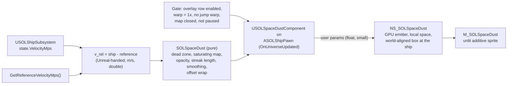

<!-- SOLTest / Copyright © 2026 Acid Rain Studios LLC -->

# SDD 43: Space dust speed cues

Issue #43. Research: [`Docs/Research/SPACE_DUST_SPEED_CUES.md`](../Research/SPACE_DUST_SPEED_CUES.md). Depends on
SDD 22 (overlay table, Overlay Menu, overlay profiles in Settings), SDD 6 Amendment 15 (the ring dense layer's wrapped
GPU window, the prior art for this effect), SDD 2 / `Docs/ARCHITECTURE.md` section 4 (render origin, Unreal-handed
frame). Plan: [`Docs/Plans/43-space-dust-speed-cues-plan.md`](../Plans/43-space-dust-speed-cues-plan.md).
Status: **design resolved (section 10); implement only after issue #32 is committed** (section 6.3).

## 1. Goal

Tiny particles drift and streak past the player's ship so the player can see that the ship is moving and in which
direction. The apparent speed only says "we are moving": it is compressed and saturating, not the true speed. A ship
at rest in its reference frame shows no dust at all.

Out of scope: NPC ships, the debug spectator, the map camera, a realistic interplanetary-medium model, an intensity
slider, any new Settings-screen field, any new key binding.

## 2. Resolved decisions (grill-me, the user's answers)

| # | Decision |
|---|---|
| D1 | **Technique:** one GPU Niagara emitter with a fixed particle count in a wrap-around volume around the ship. The wrap is a modulo in the particle update (in the shader). No spawning or killing after the first burst. |
| D2 | **Speed reference:** the ship's current reference frame, the same one the HUD speed readout and the match-speed key M use (`state.VelocityMps - USOLShipSubsystem::GetReferenceVelocityMps()`). Matching a body's speed therefore shows no dust. |
| D3 | **Speed mapping:** a smooth saturating curve (deliberately not realistic) that stays visible at very high ship speeds, with a dead zone so a stopped ship (relative speed about 0) shows **no particles at all**. |
| D4 | **Look:** round points at low speed that stretch into velocity-aligned streaks at high speed. Hidden during jumps and during time warp. |
| D5 | **Player option:** an on/off row in the Ctrl+O Overlay Menu, added through the existing data-driven overlay table (`UI/SOLOverlayModel`). **No new Settings-screen fields** (the row also appears on the Settings page, which embeds the same widget; section 10). |

## 3. Design overview

Each frame, after the render origin is final, the ship's space-dust component:

1. Reads the ship's velocity relative to the reference frame.
2. Maps it to an apparent velocity vector, an opacity and a streak length (pure functions, section 7).
3. Advances an accumulated "apparent travel" offset and wraps it into one box length on the CPU in double precision.
4. Places the Niagara component at the ship's render location with a world-aligned rotation.
5. Pushes a handful of small float user parameters.

The GPU places every particle at `wrap(anchor - offset)` inside the box. Particles never respawn, so nothing
flickers, and nothing allocates.

## 4. Engine design

### 4.1 Owner (resolved, Q8)

A new actor component **`USOLSpaceDustComponent`** (`Source/SOLTest/Visuals/SOLSpaceDustComponent.{h,cpp}`) on
**`ASOLShipPawn`**. It owns one `UNiagaraComponent` (`TObjectPtr`, `UPROPERTY`), created as a sub-component but set to
absolute location, rotation and scale (not following the pawn's transform; the placement is computed, section 4.4).

- `BeginPlay`: resolves the subsystems (ship, sim clock, jump, map mode, settings, anchor) and loads the system from
  `SOL::Paths::SPACE_DUST_NIAGARA_SYSTEM`. It sets the constant user parameters, activates the Niagara component once,
  then hides and pauses it. It binds `USOLAnchorSubsystem::OnUniverseUpdated`.
- `EndPlay`: unbinds the delegate and deactivates the Niagara component.
- `PrimaryComponentTick.bCanEverTick = false`. All per-frame work runs in the `OnUniverseUpdated` handler.
- The pawn creates the component only for the player ship (not under `-SOLSpectator`, which uses a different pawn). It
  does nothing while `USOLShipSubsystem::HasPlayerShip()` is false (main menu).

Following SDD 6 Amendment 15's lesson, the Niagara component is **activated once** and then shown or hidden with
`SetVisibility` and `SetPaused`. It is not deactivated and reactivated per show, because that re-runs the burst and
reshuffles every anchor.

The component is another listener on `OnUniverseUpdated`, so it is subject to the bind-order tech-debt item in
`Docs/TECH_DEBT.md`. It does not depend on any other listener: it computes the ship's render location itself from the
final render origin (section 4.4), not from the pawn's location. Because it lives on the pawn, the camera and ship
root are read directly from the owner, with no lookup.

### 4.2 Inputs per frame

| Input | Source |
|---|---|
| `vRel` (m/s, `FVector3d`) | `ships->GetState().VelocityMps - ships->GetReferenceVelocityMps()`: the HUD speed's exact expression (`SOLFlightHud.cpp`) |
| `dt` (s) | The anchor's clamped real frame delta (the same value the ship stepped with). Pause gives 0. |
| Time warp | `USOLSimClockSubsystem::GetClock().GetWarpFactor()` |
| Jump warp | `USOLJumpSubsystem::IsWarping()` |
| Map open | `USOLMapModeSubsystem::IsMapOpen()` (the render viewpoint is the map camera then) |
| Row enabled | The active overlay profile's `SpaceDust` flag (`IsEnabled`), **not** `IsShown`: the master O key does not affect the dust (Q2) |
| Paused | The world is paused (pause menu), read the way the HUD already reads it (Q7) |
| Ship render location | Ship universe position minus the render origin, converted with `EclipticToUnreal` and scaled to cm, in double, then cast to `FVector` (the conversion the pawn uses; section 4.4) |
| Camera offset | The camera component location minus the ship root location, both read from the pawn in the same (previous) frame (section 4.4) |

**Landed or surface-locked ships (Q7):** `vRel` is measured in the ship's locked reference frame, so a ship resting on a
spinning body reads about 0 and shows no dust. The implementer must confirm that `GetReferenceVelocityMps()` returns the
surface point's velocity (including the body's rotation) in that case. If it returns only the body's non-rotating-frame
velocity, the implementer stops and reports back rather than choosing a workaround.

The Unreal-handed universe frame and the Unreal render frame have the same axes. They differ only by an offset and
by metres versus centimetres (`ARCHITECTURE.md` section 4). So `vRel * 100` is already the velocity in render-space
cm/s, with no axis flip.

### 4.3 Visibility gate

The dust runs only when every row below says "run". A hard gate hides the dust at once (no fade). Speed-driven
opacity fades smoothly (section 5.3).

| Condition | Dust |
|---|---|
| No player ship (main menu), `-SOLSpectator` | Hidden (actor idle or not spawned) |
| Overlay row SpaceDust unchecked in the active profile (the master O is ignored: Q2) | Hidden |
| Time warp factor > `SOL::SpaceDust::MAX_TIME_WARP` (1x) | Hidden (D4) |
| Jump warp sequence running | Hidden (D4) |
| Map open | Hidden (the viewpoint is the map camera) |
| `sol.SpaceDust 0` (debug cvar, not persisted) | Hidden |
| Smoothed opacity below `OPACITY_EPSILON` and target opacity 0 (stopped: D3) | Hidden **and paused** (no GPU cost) |
| Pause menu (world paused) | Hidden (Q7); shown again, with the fade-in reset, on resume |
| Otherwise | Shown |

When the dust becomes runnable after a hard gate, the smoothed state is reset: the apparent velocity snaps to its
target and the opacity starts at 0. The dust then fades in over the smoothing time and never replays a stale vector
from before a jump.

### 4.4 Render origin, precision and placement

- **The box is world-aligned, not ship-aligned.** The component's world rotation is identity, so turning the ship
  does not sweep the dust around. Only translation relative to the reference frame moves it (D2).
- **Component location** is the ship's render location, recomputed every frame from the final render origin (in
  double, cast to `FVector` last). A render-origin rebase moves the component by exactly the rebase step, and the
  particles are in local space, so **a rebase cannot pop the dust**. No universe coordinate ever reaches Niagara.
- **Offset precision:** the accumulated offset `D` (cm) is advanced and wrapped into `[0, L)` per axis on the CPU in
  double (`SOLSpaceDust::AdvanceOffsetCm`) before it is cast to float. So it never grows over a long session, and
  every Niagara vector stays below 400 m, far under Niagara's ~10 km vec3 warning (`SOL::RingDenseParams` note).
- **Camera offset for the near fade:** at 30 km/s relative to the render origin, the ship moves ~300 m per frame
  through render space. Mixing last frame's camera position with this frame's box centre would be off by that much.
  The offset is therefore taken as camera minus ship root from the same frame. The ship's own motion cancels, and
  only the spring arm's rotation lag remains, which is a few metres at most.
- **Box size versus camera:** the camera sits 60 m behind and 15 m above the ship
  (`SHIP_CAMERA_ARM_LENGTH_CM`, `SHIP_CAMERA_HEIGHT_CM`). A `static_assert` keeps the camera inside the box's fully
  faded-in region: `RADIAL_FADE_START_FRACTION * L/2 > camera distance + NEAR_FADE_END_CM`.

### 4.5 Temporal AA and motion vectors

The component moves through render space at the ship's speed relative to the render origin, without motion vectors.
This is the regime of the `Docs/TECH_DEBT.md` item about TSR and motion-blur smear on everything that rides with the
ship's frame. To keep thin streaks from ghosting, the material draws in the **after-motion-blur translucency pass**,
as `M_SOLOrbitLine` does since issue #25 (unjittered, outside TSR's history). The known cost is that below 100% screen
percentage that pass is upsampled (also a `TECH_DEBT.md` item). The 43c PIE check must confirm there is no smear and
no shimmer. If the after-motion-blur pass aliases the 1-3 px points, the fallback is the normal translucency pass with
the renderer's motion vectors set to "Disable", measured both ways (an implementation note, not a user decision).

## 5. Look and mapping

### 5.1 Speed mapping (D3)

With `v = |vRel|` (m/s), the dead zone `v0`, the saturation speed `Amax` and the full-opacity speed `v1`:

- **Apparent speed:** `A(v) = 0` for `v <= v0`, else `A(v) = Amax * (1 - exp(-(v - v0) / Amax))`.
  - It is continuous at `v0` with slope 1 just above it. Slow manoeuvring therefore looks about 1:1 (true parallax for
    docking-speed motion).
  - It saturates smoothly towards `Amax`, so 1 km/s and 0.3c both read as "fast".
- **Opacity:** `alpha(v) = smoothstep(v0, v1, v)`: exactly 0 at or below the dead zone, 1 from `v1` up, and it never
  falls off at high speed (D3, "must stay visible at very high ship speeds").
- **Streak length (cm):** `S(A) = clamp(P + max(0, A - As) * 100 * Ts, P, Smax)`.
  - `P` is the point size, `As` the apparent speed where stretching starts, `Ts` the streak time and `Smax` the cap.
  - Below `As` a particle is a round dot. Above it, the dot stretches along the velocity.
- **Streak dimming:** `StreakAlpha(S) = max(Amin, sqrt(P / S))`. A long streak is dimmed so the field does not turn
  into a wall of lines, with a floor `Amin` so it stays visible (D3).

Constants (Q4: approved as starting values; final tuning by eye in PIE):

| Constant (`SOL::SpaceDust`) | Proposed | Meaning |
|---|---|---|
| `DEAD_ZONE_MPS` | 0.5 | `v0`: below this, nothing is drawn |
| `FULL_OPACITY_MPS` | 5.0 | `v1`: fully visible from here |
| `APPARENT_MAX_MPS` | 150.0 | `Amax`: the saturation speed of the apparent motion |
| `STREAK_START_MPS` | 10.0 | `As`: apparent speed where points start to stretch |
| `STREAK_TIME_S` | 0.12 | `Ts`: streak length = apparent travel over this time |
| `STREAK_MAX_CM` | 2000.0 | `Smax`: 20 m cap (at `Amax`, `S` ≈ 17 m) |
| `STREAK_MIN_ALPHA` | 0.35 | `Amin` |
| `POINT_SIZE_CM` | 60.0 | `P`: about 5.8 px at 100 m and 2.9 px at 200 m at screen centre (90° FOV, 1920 px). Tuned up from 30 in 43c (Amendment 1) |
| `POINT_SIZE_RANDOM_MIN` / `_MAX` | 0.6 / 1.4 | Per-particle size factor (spawn) |
| `SMOOTHING_TAU_S` | 0.15 | Time constant for the apparent velocity and the opacity |
| `OPACITY_EPSILON` | 1.0e-3 | Below this (and target 0) the component hides and pauses |
| `MAX_TIME_WARP` | 1.0 | Above this warp the dust is hidden |
| `COLOR` | (0.75, 0.80, 0.90) | Cool grey, emissive |
| `INTENSITY` | 2.0 | Emissive multiplier. Tuned up from 0.6 in 43c (Amendment 1) |

### 5.2 Volume and particles

| Constant | Proposed | Meaning |
|---|---|---|
| `PARTICLE_COUNT` | 4096 | Fixed burst at High and Epic effects quality. Mean spacing about 25 m in a 400 m box (Q5: the count scales with quality, below) |
| `PARTICLE_COUNT_LOW` / `_MEDIUM` | 1024 / 2048 | Count at Low and Medium effects quality. No new setting |
| `BOX_SIZE_CM` | 40000.0 | `L`: a 400 m cube, centred on the ship |
| `RADIAL_FADE_START_FRACTION` | 0.7 | Fully visible within 0.7 x L/2 (140 m) of the centre, 0 at L/2. The cube shape and the wrap seam never show |
| `NEAR_FADE_START_CM` / `NEAR_FADE_END_CM` | 300.0 / 1500.0 | 0 within 3 m of the camera, 1 beyond 15 m (no blobs through the lens) |

The count is read once at `BeginPlay` from the engine's effects-quality level (`sg.EffectsQuality`) and again when the
quality preset changes (Q5). A change sets `User.SpaceDustParticleCount` and re-fires the burst once, the only time
the anchors are reshuffled. There is no new Settings field.

### 5.3 Smoothing

The apparent velocity vector and the opacity are each low-passed with `SMOOTHING_TAU_S`. This covers reference-frame
switches (M lock, anchor change), a target change and the fade-out on stopping:

- The direction turns over about 0.15 s instead of snapping.
- On stopping, the dust fades out over about 1 s before the component hides.

The mapping (dead zone, opacity) is computed on the **raw** relative speed. Only its outputs are smoothed. So a frame
switch from 30 km/s to 0 fades in about 1 s, rather than the several seconds that smoothing the raw m/s would take.

### 5.4 GPU emitter (`NS_SOLSpaceDust`)

- One GPU-sim emitter in local space, with fixed bounds of ±L/2. A burst of `User.SpaceDustParticleCount` spawns
  once and never dies.
- **Spawn:** `Particles.DustAnchor` uniform in `[0, L)^3`, a size factor in `[MIN, MAX]` and a brightness seed.
- **Update** (scratch-pad or custom HLSL; the pure function `WrappedLocalPositionCm` mirrors it):
  - `Position = frac((DustAnchor - User.SpaceDustOffsetCm) / L) * L - L/2`.
  - `Velocity = -User.SpaceDustVelocityCmS` (for alignment only; the position is never integrated).
  - `SpriteSize = (P x size, max(P x size, User.SpaceDustStreakLengthCm))`.
  - `Color.a = User.SpaceDustOpacity x User.SpaceDustStreakAlpha x DustFade(Position, User.SpaceDustCameraLocalCm)`.
- **Sprite renderer:** alignment velocity-aligned, facing the camera position. No sorting (additive), motion vectors
  disabled, no shadows, no collision, no events, no per-particle CPU work.

| User parameter (`SOL::SpaceDustParams`) | Type | When set |
|---|---|---|
| `SpaceDustParticleCount` | int | BeginPlay, before `Activate`, and on an effects-quality change (Q5) |
| `SpaceDustBoxSizeCm`, `SpaceDustPointSizeCm`, `SpaceDustRadialFadeStart`, `SpaceDustNearFadeStartCm`, `SpaceDustNearFadeEndCm`, `SpaceDustColor` | float / LinearColor | BeginPlay |
| `SpaceDustOffsetCm` | vec3 | Every shown frame (wrapped, < L) |
| `SpaceDustVelocityCmS` | vec3 | Every shown frame (smoothed apparent velocity, |v| < 15,000 cm/s) |
| `SpaceDustOpacity`, `SpaceDustStreakLengthCm`, `SpaceDustStreakAlpha` | float | Every shown frame |
| `SpaceDustCameraLocalCm` | vec3 | Every shown frame |

The parameter names are `FName` constants built once (no string building per frame).

### 5.5 Material (`M_SOLSpaceDust`)

- Unlit, additive, translucent, after-motion-blur pass (section 4.5). Depth test on, no depth write, two-sided.
- Emissive = particle colour x `INTENSITY` x a soft round falloff across the sprite's width and a soft cap at each
  streak end, so streaks stay anti-aliased without TSR.
- Usage flag: Niagara sprites.

## 6. Overlay toggle and persistence

### 6.1 The row (D5)

A new `EOverlay::SpaceDust` row is **appended after `Darkening`**: id `SpaceDust`, label "Space Dust", parent
`INDEX_NONE`, default **on** (Q3).

- The table becomes 16 rows (the 32-bit mask allows 32).
- The Overlay Menu builds its rows from the table, so the row appears with no widget change. The Settings page embeds
  the same widget under "Overlays", so the row also shows there (Q6, accepted). No new Settings field.
- No new key binding. `KEY_BINDING_LAYOUT_VERSION` is unchanged.
- **The master O key does not affect the dust (Q2).** The dust is a world effect, not a HUD overlay. The component
  reads the active profile's own flag through `IsEnabled`, not `IsShown` (which applies master x row x parent). The
  overlay model needs a small table-level "not governed by the master" flag on the row, so `IsShown` for this row also
  ignores the master. The flag is part of the 43c contract and its tests.

### 6.2 What persists today (checked in code, `Menu/SOLSettingsSave.*`, `UI/SOLOverlayModel.cpp`)

- `USOLSettingsSave::OverlayProfiles` (`TArray<FSOLOverlayProfileSave>`): each profile is a
  `TMap<FString, bool>` keyed by the row's **id string** (`ToSavedProfile`). `ActiveOverlayProfile` is an index.
  Added in schema 7.
- The bit mask (`FOverlayPrefs::Masks`) is runtime only. Bit positions are **not** persisted, so the enum order does
  not affect saved data.
- `FromSavedProfile` starts from `DefaultMask()`, so a row missing from the file takes its default. Unknown ids are
  ignored.
- `SOL::Settings::SAVE_VERSION` is **8** in the working tree, but that 7 -> 8 step belongs to issue #32 (Chase Down
  safety margin), which is in progress and not committed.

### 6.3 Persistence change (Q1, APPROVED by the user)

The user approved a schema bump with an explicit migration step: **version and migrate, never discard.**

- **Sequencing:** implement #43 only after #32 is committed. State the version numbers relative to what is committed
  at that time: #43's step is "committed `SAVE_VERSION` -> that + 1". If #32 has landed as designed, that is **8 -> 9**
  (this document uses 8 -> 9). If the committed value differs, the implementer uses the committed value + 1 and
  reports it. It never reuses 8.
- **Migration step:** on loading a file whose version is below the new one, write `SpaceDust` = on (the default) into
  **every** stored overlay profile (`OverlayProfiles[i]`), keeping every other key and the active-profile index
  untouched. A profile that already has the key keeps its value. Existing players therefore get the dust on, recorded
  explicitly in the migration chain.
- **Fields changed:** none in the `UPROPERTY` layout. The content of each profile's `TMap<FString, bool>` gains one key.
- **Constants:** `SOL::Settings::SAVE_VERSION` is bumped by one and its schema comment gets the new step.
  `KEY_BINDING_LAYOUT_VERSION` is **unchanged**.
- **Write rules:** the migration runs in memory at load, and the file is first re-written at the next normal write point
  (persistence standard: no extra write at load).
- **Reporting:** the implementer reports exactly which constants and fields it changed (the new `SAVE_VERSION` value and
  the migration function), and the main session checks the report against this section.

## 7. Pure logic contract (`Visuals/SOLSpaceDustMath.{h,cpp}`, namespace `SOLSpaceDust`)

Tests go in `Source/SOLTest/Tests/SpaceDustMathTest.cpp` (`SOLTest.SpaceDustMath.*`). They are written by a separate
subagent from this contract only, with no implementation shown.

`FSOLSpaceDustParams` is a plain struct whose defaults are the `SOL::SpaceDust` constants: `DeadZoneMps`,
`FullOpacityMps`, `ApparentMaxMps`, `StreakStartMps`, `StreakTimeS`, `StreakMaxCm`, `StreakMinAlpha`, `PointSizeCm`,
`BoxSizeCm`, `RadialFadeStartFraction`, `NearFadeStartCm`, `NearFadeEndCm`, `SmoothingTauS`, `MaxTimeWarp`. Tests
may pass their own values. A pure `int ParticleCountForQuality(int effectsQuality)` maps 0/1/2/3+ (Low/Medium/High/Epic)
to 1024/2048/4096/4096 and clamps out-of-range input (negative -> Low, above 3 -> Epic).

| Function | Contract | Test cases |
|---|---|---|
| `double ApparentSpeedMps(double relativeSpeedMps, const FSOLSpaceDustParams&)` | 0 for `v <= DeadZone`, negative or non-finite (NaN, ±Inf). Else `Amax * (1 - exp(-(v - v0) / Amax))`. Monotonic non-decreasing, strictly below `Amax` for finite `v` | 0 -> 0; `v0` -> 0; `0.5 v0` -> 0; -5 -> 0; NaN and Inf -> 0; `v0 + 1` within 1% of 1 (slope ~1); continuous at `v0` (`v0 + 1e-6` -> ~1e-6); a sweep 0..1e9 never decreases; `1e8` (~0.33c) >= 0.99 `Amax` and < `Amax` |
| `double Opacity(double relativeSpeedMps, const FSOLSpaceDustParams&)` | `smoothstep(v0, v1, v)`. 0 at or below `v0` and for non-finite input, 1 from `v1` up. If `v1 <= v0`, a step at `v0` (0 at or below, 1 above) | 0, `v0` -> 0; `v1`, `10 v1`, `3e8` -> 1; midpoint -> 0.5; monotonic sweep; NaN -> 0; degenerate params step |
| `FVector3d ApparentVelocityCmPerS(const FVector3d& relativeVelocityMps, const FSOLSpaceDustParams&)` | Direction of `vRel` x `ApparentSpeedMps(|vRel|)` x 100. Zero vector in the dead zone or for any non-finite component | (+10, 0, 0) -> +X with length `A(10) * 100`; a diagonal keeps its direction (dot of the normalized vectors ≈ 1); (0.1, 0, 0) -> zero; (NaN, 0, 0) -> zero; length always < `Amax * 100` |
| `double StreakLengthCm(double apparentSpeedMps, const FSOLSpaceDustParams&)` | `clamp(P + max(0, A - As) * 100 * Ts, P, Smax)`. Non-finite or <= 0 -> `P` | 0 -> P; `As` -> P; `As + 10` -> P + 120 (defaults); `Amax` -> 1740 (defaults); huge -> `Smax`; NaN -> P; monotonic |
| `double StreakAlpha(double streakLengthCm, const FSOLSpaceDustParams&)` | `max(Amin, sqrt(P / S))`, 1 for `S <= P` or non-finite | P -> 1; 4P -> 0.5; `Smax` -> `max(Amin, sqrt(P / Smax))`; never below `Amin`, never above 1 |
| `double SmoothScalar(double current, double target, double dtS, double tauS)` and `FVector3d SmoothVector(...)` | `current + (target - current) * (1 - exp(-dt / tau))`. `tau <= 0` -> target; `dt <= 0` or non-finite -> current; non-finite target -> current | `dt = tau` -> 63.2% of the way; `dt = 0` -> current; tau 0 -> target; a step response converges below 1e-3 after `7 tau`; the vector version per component; NaN target -> unchanged |
| `FVector3d AdvanceOffsetCm(const FVector3d& offsetCm, const FVector3d& velocityCmPerS, double dtS, double boxCm)` | `WrapOffsetCm(offset + velocity * dt, box)`. `dt <= 0` or non-finite -> `WrapOffsetCm(offset, box)` | 1000 frames of `L/3` each stay in `[0, L)`; a negative velocity wraps up from 0 to near `L`; the result equals an fmod reference to 1e-3 cm after 1e6 steps; NaN velocity -> unchanged |
| `FVector3d WrapOffsetCm(const FVector3d& offsetCm, double boxCm)` | Each component into `[0, box)`; an exact `box` -> 0; a non-finite component -> 0; `box <= 0` -> zero vector | 0 -> 0; `L` -> 0; `-1` -> `L - 1`; `5.5 L` -> `0.5 L`; `-1e15` stays in range; NaN -> 0 |
| `FVector3f WrappedLocalPositionCm(const FVector3f& anchorCm, const FVector3f& offsetCm, float boxCm)` | The shader's formula `frac((anchor - offset) / box) * box - box / 2` per component, in `[-box/2, box/2)` | `anchor - offset = L/2` -> 0; equal -> `-L/2`; increasing the offset by a small `d` moves the position by `-d` away from the seam; it wraps from `-L/2` to just under `+L/2`; `L/2` itself stays in range |
| `float DustFade(const FVector3f& localCm, const FVector3f& cameraLocalCm, const FSOLSpaceDustParams&)` | `(1 - smoothstep(f * R, R, |local|)) * smoothstep(nearStart, nearEnd, |local - camera|)` with `R = box/2` | centre (camera far) -> 1; `|local| >= R` -> 0; at `f R` -> 1; on the camera -> 0; 15 m from the camera inside the core -> 1; in range [0, 1] on a random sweep |
| `bool ShouldRun(const FSOLSpaceDustGate&, const FSOLSpaceDustParams&)` | The gate has `bHasShip`, `bRowEnabled`, `bCvarEnabled`, `TimeWarpFactor`, `bJumpWarping`, `bMapOpen`, `bPaused`. True only with a ship, the row enabled, the cvar on, warp finite and `<= MaxTimeWarp`, no jump warp, the map closed and not paused (not speed: speed fades through `Opacity`) | all good -> true; each single condition flipped (including `bPaused`) -> false; the gate has no master-O input; warp 1 -> true, 10 -> false, NaN -> false; warp 0 (paused clock, if it occurs) -> true |

`OverlayModelTest` is extended from the contract in section 6.1: 16 rows, `SpaceDust` last, its id, label, default (on)
and parent; `FindById("spacedust")`; `ToSavedProfile` has 16 entries; a saved map without `SpaceDust` gives the default;
`IsShown` for `SpaceDust` is unaffected by the master O (still true with the master off), while every other row still
follows the master. `SOLSettingsRulesTest` gets the migration cases of section 6.3: a file at the previous version
gets `SpaceDust` = true in every profile with all other keys and the active index unchanged; a profile already holding
`SpaceDust` = false keeps it; the pinned "schema is 8" cases in `SOLSettingsRulesTest` and `FlightModeMathTest` become
the new version; `KEY_BINDING_LAYOUT_VERSION` is pinned unchanged; the migration is idempotent.

## 8. Assets and constants

### 8.1 Asset creation

- **`M_SOLSpaceDust`:** built by an editor-Python script, **`Tools/SpaceDust/create_space_dust_assets.py`**, in the
  style of `Tools/UI/create_hud_shape_material.py` and `Tools/Rings/create_ring_shadow_assets.py`. It is idempotent,
  deletes and re-creates both assets when `SOL_REBUILD` is set (Amendment 1, "43c fixes"), and its
  header comment lists the parameter names that must match `SOLConstants.h`. The asset goes in `/Game/SOL/SpaceDust/`.
- **`NS_SOLSpaceDust` (Q9, resolved):** built in the editor (live through unreal-mcp's `NiagaraToolsets`, the
  established route for `NS_SOLRingFar`, `NS_SOLRingDense` and the combat systems, SDD 6 Amendments 11 and 15), **and**
  a `Tools/SpaceDust/*.py` script that recreates it (the same script as the material, or a sibling) is kept in step.
  The exact recipe (template, modules in order, every input, renderer settings, bounds) is recorded in this SDD's
  amendment. If the Python Niagara API cannot express part of the emitter, the script recreates everything it can,
  documents the manual remainder in its header, and a `Docs/TECH_DEBT.md` item names that remainder. Authoring needs the
  editor open.
- Both paths go in `SOL::Paths` (`SPACE_DUST_NIAGARA_SYSTEM`, `SPACE_DUST_MATERIAL`); nothing is hardcoded in gameplay
  code (`STYLE_GUIDE.md` section 7).

### 8.2 `SOLConstants.h` additions

- `namespace SOL::SpaceDust`: every constant in the tables of sections 5.1 and 5.2 (including the per-quality particle
  counts), plus the `static_assert` of section 4.4 and `CVAR_ENABLED = TEXT("sol.SpaceDust")`.
- `namespace SOL::SpaceDustParams`: the user-parameter names of section 5.4.
- `SOL::Paths::SPACE_DUST_NIAGARA_SYSTEM`, `SOL::Paths::SPACE_DUST_MATERIAL`.
- `SOL::CommandLine::SMOKE_DUST = TEXT("SOLSmokeDust")` and `SMOKE_DUST_PROFILE = TEXT("SOLSmokeDustProfile")`.

## 9. Performance budget

| Item | Budget | How it is verified |
|---|---|---|
| GPU, dust shown at `Amax` (worst case: longest streaks) | <= 0.10 ms total (sim + translucency) at 1920x1080 | `ProfileGPU` in `-SOLSmokeDustProfile`, plus one capture with `sol.SpaceDust 0` for the A/B |
| GPU, dust hidden (stopped, warp, jump, map, row off) | 0 (component invisible and paused) | Same capture with the ship stopped: no Niagara pass for the system |
| Game thread per frame | <= 0.02 ms; about 10 `SetVariable*` calls with cached `FName`s; zero heap allocation, no `FString`, no `NewObject` | `stat dumpave` over 240 frames, Insights if anything shows |
| Particle memory | 4096 particles, about 64 B each, about 256 KB of GPU buffers, allocated once | `stat Niagara`, `memreport` |
| Overdraw | Bounded by the 20 m streak cap, the 3-15 m near fade and the radial fade | `ProfileGPU` translucency pass |

There is no Mass usage, by design: cosmetic points are not gameplay entities (research note). The cost does not
scale with the universe's entity count.

## 10. Resolved decisions (the user's answers to the former open questions)

| # | Decision |
|---|---|
| Q1 | **Persisted change approved.** Bump `SOL::Settings::SAVE_VERSION` (8 -> 9 once #32 is committed; relative to the committed value at implementation time) with an explicit migration step writing `SpaceDust` (default on) into every overlay profile. Version and migrate, never discard. `KEY_BINDING_LAYOUT_VERSION` unchanged. The implementer reports the exact constants and fields changed. #43 is implemented only after #32 is committed. Section 6.3. |
| Q2 | **The master O key does not affect the dust.** It is governed only by its own row (a table-level "not governed by the master" flag). Sections 4.2, 4.3, 6.1. |
| Q3 | **Default on** in the default profile and, via the migration, in existing profiles. |
| Q4 | **Constants approved** as starting values (0.5 m/s dead zone, 150 m/s apparent saturation, 400 m box, 4096 particles, plus the rest of sections 5.1 and 5.2), in `SOLConstants.h`. Final tuning by eye in PIE. |
| Q5 | **Particle count scales with the effects quality setting** (Low 1024, Medium 2048, High and Epic 4096), no new setting. Section 5.2. |
| Q6 | **The row also shows on the Settings page** (same widget, same row, not a new field). |
| Q7 | **Hidden while the game is paused.** Speed is measured in the ship's locked reference frame, so a surface-landed ship shows no dust. Sections 4.2, 4.3. |
| Q8 | **A component on the ship pawn** (`USOLSpaceDustComponent` on `ASOLShipPawn`), not a game-mode actor. Section 4.1. |
| Q9 | **The Niagara system is built in the editor, plus a `Tools/*.py` script that recreates it.** Section 8.1. |
| Q10 | **README gets a "Screenshots" gallery section** with the images in `Docs/Images/`. New project rule: after every finished ticket, add 2-3 new shots to the gallery. For #43: slow points, fast streaks, the Overlay Menu row (`Docs/Images/43-dust-*.png`). |

No question is deferred.

## 11. Smoke check (`-SOLSmokeDust`, optional `-SOLSmokeDustProfile`)

`FSOLSpaceDustSmoke` follows the existing smoke-script pattern. It uses the smoke settings slot, so the player's file
is never written. Each step logs a PASS/FAIL line, and the run quits with the count.

1. **Spawn stopped:** set the ship's state to match the reference velocity. Dust hidden and paused, opacity 0.
2. **Slow:** set `vRel` = 3 m/s. Dust visible within 1 s, opacity between 0 and 1, streak length = point size.
   Screenshot `DustSmoke_Slow.png`.
3. **Fast:** set `vRel` = 50 km/s. Opacity 1, streak length near the cap, velocity parameter opposite to `vRel`.
   Screenshot `DustSmoke_Fast.png`.
4. **Very fast:** set `vRel` = 0.3c. Still visible (opacity 1), `ApparentSpeed` >= 0.99 `Amax`.
5. **Frame match:** press M on the anchor body. Fades out and is hidden and paused within 1.5 s.
6. **Time warp:** step the warp to 10x; hidden at once. Back to 1x: shown again, with the fade-in reset.
7. **Jump:** a scripted pick and jump; hidden for the whole warp sequence.
8. **Map:** open the map; hidden. Close it; shown.
9. **Overlay row:** a Slate click on the "Space Dust" row in the Ctrl+O menu; hidden. Click again; shown. Then Esc,
   with exactly one settings write. Screenshot `DustSmoke_Menu.png`.
10. **Master O:** O off and on; the dust is unaffected either way (Q2).
10a. **Pause and landed:** open the pause menu; hidden, and shown again on resume (Q7). With the ship surface-locked on
    a spinning body, no dust (Q7).
11. **Rebase:** fly through a render-origin rebase at 50 km/s. The offset parameter stays continuous (no jump larger
    than `|v| dt` modulo L) and the component location tracks the ship. The script sets the velocity with
    `USOLShipSubsystem::SetVelocityMps` (verification only; it does not clear contact or surface-lock). That function
    has no automation test, because the ship subsystem exists only in Game and PIE worlds; this check (`11-rebase`)
    covers it.
12. **Profile flag:** `-SOLSmokeDustProfile` adds a `ProfileGPU` capture at step 3 and with `sol.SpaceDust 0`, plus
    `stat dumpave`, and logs both numbers.

The smoke runs at 1280x720 and 1000x800. The screenshots are looked at. A hands-on PIE check confirms that strafing
and drifting show the right direction, and that there is no TSR smear or seam (section 4.5).

## 12. Documentation updates (same change as the code)

- **`Docs/GAME_MECHANICS.md`:**
  - A new "Space dust" row with every number in sections 5.1 and 5.2, the gate table and the source locations.
  - The O row notes the master does not affect the dust. The Ctrl+O row mentions the Space Dust row.
  - The Camera row's FOV speed cue is cross-referenced.
- **In-game text (`Menu/SOLMenuText.h`):**
  - The Ctrl+O Controls row lists "space dust" among what the Overlay Menu chooses.
  - The `INFO_PROSE` overlays paragraph gets one sentence: dust streams past when the ship moves relative to its
    reference frame; its speed is compressed and only shows motion and direction; it is hidden when stopped, under
    time warp, during jumps, on the map and while paused; the master O key does not affect it.
  - The Overlay Menu row label comes from the table.
- **`Docs/ARCHITECTURE.md`:**
  - The `Visuals/` row (`USOLSpaceDustComponent` on the ship pawn, `SOLSpaceDustMath`).
  - Section 3's `OnUniverseUpdated` listener list.
  - Section 5: the ship pawn owns the component, plus the component's own bullet.
  - The smoke-flag table (`-SOLSmokeDust`, `-SOLSmokeDustProfile`) and the cvar `sol.SpaceDust`.
- **`Docs/TECH_DEBT.md`:**
  - The `OnUniverseUpdated` bind-order item names the new listener.
  - Add an item naming any part of the Niagara system that the recreate script cannot express (Q9).
- **`README.md`:** a new "Screenshots" gallery section (images in `Docs/Images/`, Q10) with the 2-3 dust shots, and the smoke list mentions dust. The metrics refresh comes from
  `Tools\UpdateMetrics.bat`.
- **`Docs/Plans/STATUS.md`:** the ticket row is kept in sync by the coordinator, not by this SDD's author.

## 13. Risks

- **The Niagara Python API may not express the whole emitter.** The system is authored live and the script recreates
  what it can (section 8.1, Q9).
- **Surface-locked reference velocity** may not include the surface rotation (section 4.2); the implementer reports it.
- **The after-motion-blur pass may shimmer on 1-2 px points.** The fallback is section 4.5's measured alternative.
- **Velocity-aligned sprites with a near-zero velocity are ill-defined.** This only happens inside the dead zone,
  where the component is hidden. Above it, the velocity is at least `A(v0 + epsilon)`, and the material's round dot
  hides the orientation while `S = P`.
- **The 400 m box against large ship hulls or future camera zoom.** The `static_assert` guards today's camera. A
  future zoom must update `BOX_SIZE_CM`.
- **Very low frame rates:** at `Amax` and 10 fps, a particle moves 15 m per frame, still under 1/25 of the box. The
  wrap stays smooth.

## Amendment 1 (43b): NS_SOLSpaceDust and M_SOLSpaceDust recipe

Both assets are built by `Tools/SpaceDust/create_space_dust_assets.py` and saved in `/Game/SOL/SpaceDust/`. Every
default is read from `SOL::SpaceDust` in `SOLConstants.h`. The script is idempotent: with `SOL_REBUILD` in a running
editor it deletes both assets and creates them again at the same paths (see "43c fixes" below for why not in place).
Nothing else references them: the C++ loads the system by path, and only the system uses the material. A headless
rebuild can only rebuild the material, in place.

**Q9 outcome: nothing is manual.** The engine's `NiagaraToolsets` plugin (the tools unreal-mcp exposed) is callable
from editor Python through `unreal.ToolsetRegistry.execute_tool("NiagaraToolsets.NiagaraToolset_System", <tool>,
<json>)`. The tool classes themselves show no Python methods, because their functions are `AICallable`, not
`BlueprintCallable`. So the script expresses the whole system and no `TECH_DEBT.md` item was needed. The system part
needs a running editor with PIE stopped. Headless runs build only the material.

### M_SOLSpaceDust

- **Material settings:** Unlit, `BLEND_ADDITIVE`, two-sided, depth test on, no depth write (translucent), no vertex
  fog, `MTP_AFTER_MOTION_BLUR` (as `M_SOLOrbitLine`), no negative emissive. Usage: Niagara sprites.
- **Emissive** = `ParticleColor.rgb` x `Intensity` x `lerp(BrightnessMin, 1, ParticleRandom)` x the profile.
  - `Intensity` = 2.0, a scalar parameter defaulting to `INTENSITY` (0.6 before the 43c tuning).
  - `BrightnessMin` = 0.6, a scalar parameter (see deviation 1).
  - `ParticleRandom` is `Particles.MaterialRandom`, the brightness seed.
- **Opacity** = `ParticleColor.a`. Additive blending scales by it.
- **Profile** (Custom node `SOLSpaceDustProfile`, inputs `UV` = TexCoord0 and `Size` = Particle Size):
  - x = (UV.x - 0.5) x 2 across the width.
  - Along the streak: `along = |UV.y - 0.5| x Size.y`, `core = max(0, Size.y/2 - Size.x/2)` and
    `a = max(0, along - core) / (Size.x/2)`.
  - Result: `f = saturate(1 - (x² + a²))²`. A square sprite gives a round dot. A stretched sprite gives a capsule with
    a soft round cap at each end.

### NS_SOLSpaceDust

**System.**
- Created from `/Niagara/DefaultAssets/Templates/Systems/MinimalLightweight`, whose stateless `Minimal` emitter is
  removed.
- `SystemState` keeps the template's Loop Behavior = Infinite. The script checks it, and only writes it if it differs.
- System data stays at the defaults (no system fixed bounds, `EffectType` None).

**Emitter `SpaceDust`.**
- Added from `/Niagara/DefaultAssets/Templates/Emitters/Minimal`, which has no Solve Forces and Velocity, so the
  position is never integrated.
- Emitter data: `bLocalSpace` true, `SimTarget` = `GPUComputeSim`, `CalculateBoundsMode` = Fixed,
  `FixedBounds` = ±20000 cm (±L/2), `bDeterminism` false.

**Module stacks, in order:**

| Stack | Module | Inputs |
|---|---|---|
| Emitter Update | `EmitterState` | Life Cycle Mode = System (the template's value, so the emitter inherits the infinite loop) |
| | `SpawnBurst_Instantaneous` | Spawn Count linked to `User.SpaceDustParticleCount`, Spawn Time 0, UseLoopCountLimit = true, Loop Count Limit = 1 |
| Particle Spawn | `InitializeParticle` | Template defaults, plus Write Material Random = true (the brightness seed) |
| | SetParameters | `Particles.DustAnchor` (Vector3f) = `float3(rand(1.0), rand(1.0), rand(1.0)) * User.SpaceDustBoxSizeCm` |
| | | `Particles.DustSizeFactor` (float) = `0.6 + 0.8 * rand(1.0)` |
| Particle Update | `ParticleState` | Kill Particles When Lifetime Has Elapsed = false |
| | SetParameters (place) | `Particles.Position` = `frac((Particles.DustAnchor - User.SpaceDustOffsetCm) / User.SpaceDustBoxSizeCm) * User.SpaceDustBoxSizeCm - 0.5 * User.SpaceDustBoxSizeCm` |
| | | `Particles.Velocity` = `-User.SpaceDustVelocityCmS` |
| | SetParameters (fade) | `Particles.DustFade` = `(1 - smoothstep(User.SpaceDustRadialFadeStart * 0.5 * L, 0.5 * L, length(Particles.Position))) * smoothstep(User.SpaceDustNearFadeStartCm, User.SpaceDustNearFadeEndCm, length(Particles.Position - User.SpaceDustCameraLocalCm))`, L = `User.SpaceDustBoxSizeCm` |
| | SetParameters (colour) | `Particles.Color` = `float4(User.SpaceDustColor.rgb, User.SpaceDustOpacity * User.SpaceDustStreakAlpha * Particles.DustFade)` |
| | | `Particles.SpriteSize` = `Particles.DustFade > 0 ? float2(P * Particles.DustSizeFactor, max(P * Particles.DustSizeFactor, User.SpaceDustStreakLengthCm)) : 0`, P = `User.SpaceDustPointSizeCm` |

Each SetParameters module reads the values the previous one wrote. That is why the place, fade and colour steps are
three separate modules. An input must not read the attribute its own module writes: `Particles.SpriteSize =
f(Particles.SpriteSize)` reads zero there, not the earlier module's value (43c fix 1), so the colour step computes the
whole sprite size.

**Sprite renderer (index 0):**
- Material `M_SOLSpaceDust`.
- Alignment VelocityAligned, Facing Mode FaceCameraPosition.
- Sort Mode None.
- Cast shadows off, Motion Vector Setting Disable, camera-distance culling off, not in hit proxies.
- Pixel coverage, GPU translucent latency and the bindings keep their defaults (Position, Color, Velocity, SpriteSize
  and MaterialRandom are bound implicitly).
- No collision, events or other renderers.

**User parameters (13).** The names match `SOL::SpaceDustParams`, and the defaults leave the dust invisible:

| Parameter | Type | Default |
|---|---|---|
| `SpaceDustParticleCount` | int | 4096 |
| `SpaceDustBoxSizeCm` | float | 40000 |
| `SpaceDustPointSizeCm` | float | 60 |
| `SpaceDustRadialFadeStart` | float | 0.7 |
| `SpaceDustNearFadeStartCm` | float | 300 |
| `SpaceDustNearFadeEndCm` | float | 1500 |
| `SpaceDustColor` | LinearColor | (0.75, 0.80, 0.90, 1) |
| `SpaceDustOffsetCm` | Vector3f | 0 |
| `SpaceDustVelocityCmS` | Vector3f | 0 |
| `SpaceDustCameraLocalCm` | Vector3f | 0 |
| `SpaceDustOpacity` | float | **0** |
| `SpaceDustStreakLengthCm` | float | 60 |
| `SpaceDustStreakAlpha` | float | 1 |

The compile state was UpToDate with no errors or warnings in all five scripts, including `ParticleGPUComputeScript`.
The stack had no issues, only one informational version note on ParticleState.

### Deviations and additions (for review)

1. **Per-particle brightness spread (a look choice beyond the SDD).**
   - The SDD names a brightness seed but does not say how it is used.
   - The seed is `Particles.MaterialRandom`, and the material scales the emissive by `lerp(0.6, 1, seed)`, so the mean
     brightness is about 0.8 x `INTENSITY`.
   - The spread is a material scalar `BrightnessMin` (1 = no spread), to be tuned by eye in 43c or set to 1 if
     uniform points are wanted.
2. **Fully faded particles get a zero sprite size.** The radial fade leaves the cube's corners (about 48% of the
   particles) at alpha 0, and zero-size sprites cost no raster work. This changes the cost, not the look.
3. **`UseLoopCountLimit` is required.** Without it, the burst re-fires on every 1 s emitter loop and the particle count
   grows without bound. The first build had this bug, and the burst-only-once setting fixes it.

### Spike results (partial)

The spike ran in PIE from the main menu, because `StartFlight` is not reachable from Python. The system was attached to
the menu camera component with absolute rotation, so the camera sat at the box centre. Screenshots are in
`Saved/Screenshots/WindowsEditor/RiderMCP/20261103-0848*` to `-0854*`.

- **Stopped** (opacity 0): nothing is drawn. Correct.
- **Rendering:** with debug sizes (P = 300-500 cm, opacity 1), the box renders with the full update stack. The
  material profile gives soft round dots (`20261103-085425_viewport.png`). No cube outline was visible in that frame,
  but the seam and the near fade were not checked on purpose.
- **Open item 1, not run:** the slow and fast runs at the design values, the streak orientation (that UV.y runs along
  the velocity), seam, smear and shimmer checks, and ProfileGPU. The editor crashed before them (see open item 3).
  These move to 43c's PIE check.
- **Open item 2, an unexplained in-session failure:** in the session that had just rebuilt the assets in place, the
  dust stayed invisible with `M_SOLSpaceDust` until the material was recompiled and re-assigned to the renderer.
  Swapping in the default sprite material showed the particles, so the simulation was correct. After that it rendered
  correctly. Suspected cause: material shaders were still compiling, or the renderer kept stale material state after
  the in-place rebuild. 43c must confirm the dust renders from a fresh editor load. **Resolved in 43c:** see fix 2
  below.
- **Open item 3, tooling hazards:**
  - `EditorAssetLibrary` calls fail during PIE, and `does_asset_exist` then returns false. The script now refuses to
    run in PIE.
  - An editor-Python call through Rider (`ue_execute_python`) that stays blocked on a modal dialog past the bridge
    timeout **crashed the editor** inside RiderLink (`rd::to_string`, access violation) when the late result came
    back. Keep bridge calls short, and never leave a modal prompt open.

### 43c fixes (the dust drew nothing in the smoke)

The `-SOLSmokeDust` CPU checks passed, but the screenshots showed no dust. The "blue column behind the ship" in them
is the orbit lines seen edge-on: it is the same with `sol.SpaceDust 0`. Two faults hid the dust, found by bisecting the
recipe in `-game` runs and PIE:

1. **Zero sprite size.** The colour step's `Particles.SpriteSize = DustFade > 0 ? Particles.SpriteSize : 0` read zero,
   because an input of a SetParameters module that reads the attribute its own module writes does not see the earlier
   module's value. Every sprite had size 0, with any material and any `P`. The colour step now computes the whole size
   (table above), and the place step no longer writes it.
2. **In-place rebuilds left a dead system.** After `SOL_REBUILD` had removed and re-added the emitter and user
   parameters in the same asset (repeatedly), every activation completed on its first tick with no log message, so
   the component showed nothing and `USOLSpaceDustComponent` logged "the dust system was deactivated by the engine;
   reactivating" on each show. The same recipe built into a new asset runs normally. The script's rebuild now deletes
   both assets and creates them fresh. This is the likely cause of open item 2.

**Tuning (SDD Q4, by eye).** At the design values the points were about 1 to 3 px and very dim (peak emissive about
0.2 at 3 m/s), so they could not be told apart from the star field. The new values are `POINT_SIZE_CM` 30 -> 60 and
`INTENSITY` 0.6 -> 2.0. Everything else is unchanged. At 3 m/s the dust shows as sparse, soft, round grey dots. At
50 km/s it shows as dense streaks along the apparent velocity.

**Proof:** `Saved/Screenshots/Dust43/` has slow and fast pairs with the dust on (`Dust43_Slow_DustOn.png`,
`Dust43_Fast_DustOn.png`), the same frames with `sol.SpaceDust 0` (`*_DustOff.png`), and a 2x crop of the slow frame.

**Notes:**
- `smoothstep` has no Vector VM operation. The recipe compiles only as a GPU emitter, so a switch to `CPUSim` fails to
  compile.
- In a `-game` run of the editor binary, the system compiles after `BeginPlay`. The first `Activate` is then deferred,
  and the engine activates the component when the compile is done. Nothing is logged for this: the component notes
  the instance's first activation, and the "deactivated by the engine" warning (with its reactivation) fires only
  when an instance that was active once is found inactive at a show.

## Amendment 2 (43e/43f): measured cost

**Machine context.** `-SOLSmokeDust -SOLSmokeDustProfile`, 1920x1080 windowed, `-game` run of the Development editor
binary (`UnrealEditor.exe`), uncooked content, one GPU, one capture each. Dust shown at 50 km/s (full apparent
speed), then `sol.SpaceDust 0`. Log: `Saved/Logs/Smoke_DustProfile_43f.log`. The smoke itself passed 24/24.

| Item | Budget (section 9) | Measured | Verdict |
|---|---|---|---|
| GPU, dust shown | <= 0.10 ms | about 0.04 ms from the dust's own entries (see below). Whole-frame total 4.795 ms shown vs 4.447 ms off, but that 0.35 ms gap is run-to-run noise in `PostProcessing` (2.645 vs 1.972 ms), not dust | met |
| GPU, dust hidden | 0 | `NiagaraGpuSim(NS_SOLSpaceDust)` and `NiagaraUpdateDrawIndirectBuffers` are absent from the `sol.SpaceDust 0` capture | met |
| Game thread per frame | <= 0.02 ms | `STAT_SOL_SpaceDustUpdate` 0.036 ms average over 240 frames shown (0.033 ms self), 0.001 ms with `sol.SpaceDust 0` | **over** |
| Particle memory | about 256 KB | not measured | open |
| Overdraw | bounded | translucency after-DOF pass +1 draw, +0.012 ms | met |

**GPU entries attributable to the dust (shown vs off, ms).**

| Entry | Shown | Off |
|---|---|---|
| `NiagaraGpuSim(NS_SOLSpaceDust) ... DispatchCount(4096)` | 0.009 | absent |
| `NiagaraUpdateDrawIndirectBuffers` | 0.008 | absent |
| `Niagara::PostRender` | 0.011 | 0.001 |
| `Translucency` (total) | 0.126 | 0.114 |
| `Translucency(AfterDOF...)` second pass | 0.070 (15 draws) | 0.058 (14 draws) |
| Sum of the dust's own deltas | about 0.04 | |

`Niagara.UpdateMeshParticleInstances` (0.016 ms) is in both captures, so it belongs to the bolts, not the dust.

**Notes.**
- The game-thread figure is the average of `stat dumpave -num=240 -ms=0`. It does not report a maximum, so no max
  is recorded. The stat scope's own overhead is part of the 0.036 ms; the real cost may be lower. Still above the
  0.02 ms budget as measured. Either the budget or the update loop needs a decision.
- Particle memory (`stat Niagara`, `memreport`) was not run. The 4096 dispatch count in the sim entry matches the
  design particle count.
- Single frame captures per case. The GPU delta of about 0.04 ms is near the timer noise, so read it as "well under
  0.10 ms", not as a precise value.
- Development editor binary, uncooked: shader and content costs in a cooked build may differ slightly.
- **Editor builds inflate the per-call cost.** In a `WITH_EDITOR` build (the editor binary, also in `-game`) every
  `UNiagaraComponent::SetVariable*` call also runs `SetParameterOverride`, which builds an `FNiagaraVariant` (a heap
  allocation) and adds it to the component's `InstanceParameterOverrides` map. Section 9's "zero heap allocation" so
  holds for non-editor (cooked game) builds only, and the 0.036 ms above includes this editor-only work.
- **Change after this measurement (43g).** `PushFrame` keeps the last value pushed for each per-frame parameter and
  for the component location, and skips every write whose value did not change (exact compare of the pushed float
  value, so the GPU sees the same values as before). The six per-frame parameters are written straight into the
  component's override parameter store (`GetOverrideParameters().SetParameterValue` with fully qualified `User.`
  variables built once), the same store and write that `SetVariable*` performs at runtime, without the editor-only
  override bookkeeping; the store is marked dirty, so the instance and the render thread receive the values on the
  normal Niagara update. The constant parameters set once at creation still use `SetVariable*`. The cache is
  invalidated on every show/hide change, on the effects-quality re-fire and, in the editor, when the component
  re-syncs with a recompiled asset. At steady speed one parameter write (the offset) and, while the ship moves through
  render space, one `SetWorldLocation` remain per frame (was six `SetVariable*` calls and one `SetWorldLocation`). No
  vector packing: the asset's per-frame scalars are separate float user parameters, and the asset is unchanged.
  Re-measured after the change (editor binary, 1920x1080, `-SOLSmokeDust -SOLSmokeDustProfile`, 50 km/s, 240-frame average): STAT_SOL_SpaceDustUpdate is 0.015 ms per frame with the dust shown and 0.001 ms with `sol.SpaceDust 0`, so the game-thread cost is within the 0.02 ms budget. GPU, shown vs hidden: NiagaraGpuSim 0.010 ms vs absent, NiagaraUpdateDrawIndirectBuffers 0.010 ms vs absent, Niagara.UpdateMeshParticleInstances 0.016 vs 0.015 ms, Translucency 0.127 vs 0.117 ms (about 0.01 ms for the dust), so the dust costs about 0.03 ms of GPU time in all.
