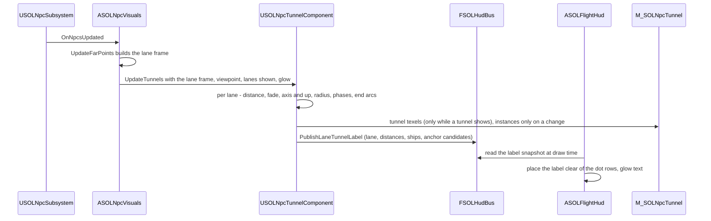

<!-- SOLTest / Copyright © 2026 Acid Rain Studios LLC -->

# SDD 49: Lane guidance tunnel near NPC lanes

**Issue:** [#49](https://github.com/DieSlower/SOLTest/issues/49). Plan:
[`Plans/49-lane-guidance-tunnel-plan.md`](../Plans/49-lane-guidance-tunnel-plan.md). Builds on SDD 38 (the NPC lane
lines; this ticket consumes its section 4.10 extension point), SDD 17 (the orbit-line ribbon technique, shader library
and shared occluders), SDD 37 (the HUD glow scale `g`), SDD 21 (the HUD event bus and the HUD glow-text list) and
SDD 34 (the overlay profiles). Mock-ups: [`Docs/ToDo/49-lane-tunnel-mockups/`](../ToDo/49-lane-tunnel-mockups/README.md)
(`tunnel8_rings_dots_sides.gif` is the chosen look).
**Persistence change: none.** `SOL::Settings::SAVE_VERSION` stays 13 and `KEY_BINDING_LAYOUT_VERSION` stays 10 (D3).
Status: **draft (2026-11-11).** Grill-me done 2026-11-11 (D1-D15, section 2); the derived design choices that the
user has not made are listed as **open questions Q1-Q11 (section 11)**, each with a recommended answer. The build does
not start until they are answered.

## 1. Problem

Since #38 every NPC lane is a pair of flowing dashed lines far away, and close up (inside 100 lane radii) the line has
faded out and the lane is only its ships as points. A pilot near or inside a lane then has nothing that shows where
the lane is, which way it runs, which side carries which direction, where it ends, or how busy it is. Issue #49 asks
for a HUD-style guidance tunnel around a nearby lane that the player can fly through, with the other ships moving in
it.

## 2. Decisions (user, grill-me 2026-11-11)

- **D1: Trigger and hand-over.** Within **100 -> 50 lane radii** of a lane the far dashed line of #38 hands over to
  the tunnel: the tunnel fades in (0 at 100 lane radii, full at 50) where the lane line's own close-up fade (gone
  inside 100 lane radii) has faded it out. It triggers for **every lane near the player, not only a targeted lane**.
  *Rationale:* the two fades meet at 100 lane radii, so a lane is never without a cue (dashes far, ship points between,
  tunnel near), and the #38 fade band is reused rather than re-tuned.
- **D2: Pure HUD-style display.** No gameplay effect: no collision, no speed limit, no flight assist, no AI change.
  *Rationale:* keeps the ticket a renderer and the flight model untouched.
- **D3: Settings.** The tunnel follows the per-profile **Lanes** overlay row (#38, governed by the master O like every
  row) and the **HUD glow** setting (#37). **No new setting, no schema change** (`SAVE_VERSION` 13 and
  `KEY_BINDING_LAYOUT_VERSION` 10 stay). *Rationale:* the tunnel is the close-up half of the same lane overlay.
- **D4: Direction cue = side-wall chevrons and coloured guide dots** (`tunnel8_rings_dots_sides.gif`): chevrons on the
  left and right tube walls at **3 and 9 o'clock**, plus **muted green (outbound) and muted red (inbound) guide dots**.
  **Keep right:** outbound / forward traffic on the **right** lane, inbound on the **left** (the same rule as #38 D2).
  The floor-strip chevron variant (`tunnel8_rings_symbols.gif`) was previewed and **not** chosen.
- **D5: Orientation.** Space has no up or down, so the tunnel's **12 o'clock is aligned to the average solar-system
  orbit plane**: its up is the plane's normal projected perpendicular to the lane axis; left and right are defined from
  it. The precise normal was left to this design: **the fixed J2000 ecliptic north pole** (section 4.3 justifies it).
- **D6: Rings and dots.** **Bright HUD cyan rings** (`SOL::SolidMenu::CYAN_COLOR`, sRGB #28D2F0, the kit cyan the user
  named) and **8 longitudinal rows of guide dots** along the tube, **outside** the rings. Rings, walls and dots
  **stream toward the player in proportion to the player's actual speed and direction**: a stationary player sees
  nothing move (no idle drift), and the flow **does not change direction per lane**.
- **D7: Ring visibility and spacing.** From inside, the rings ahead are visible **all the way to the lane's end node**,
  darker and more transparent with distance. Near the player they are **about 2 tunnel radii apart**; the spacing
  **grows smoothly with distance** (multi-scale like the far dashes, **no pops**), so the whole lane stays readable and
  cheap.
- **D8: Width from traffic, empty lanes kept.** The tunnel radius follows the lane's ship count on the #38 scale (100
  to 100,000 ships, `LaneTrafficWeight`), mapped to **1x .. 3x a base radius**. **An empty lane never vanishes:** it
  still gets a tunnel at the minimum width (the player may be inside it). The far line of an empty lane stays undrawn,
  as in #38.
- **D9: Overlap.** **All lanes within range get their own tunnel.** Cost and clutter near planets (where several lanes
  meet) are accepted and covered by the budget (D14), which applies to the all-lanes case at 1M NPCs.
- **D10: Ships.** No special drawing: lane ships look like normal NPC ships with the usual HUD treatment; they are not
  tinted green or red (issue comment of 2026-11-11). The tunnel only adds rings, dots, chevrons and its label.
- **D11: Readout = ONE floating wall label** (mock-up "Option B"): world-anchored text near the tunnel wall that
  **never overlaps the guide dots**, showing the **lane name** (e.g. "Earth - Mars"), the **distance to each end** and
  the **ships in the lane**. It must **not** show a left/right "your side" line.
- **D12: Lane ends.** An **end ring** marks each node. The tunnel draws over a planet **unless the planet is in front
  of the tunnel's path**: the #38 shared occluders (the orbit lines' 8 analytic spheres) hide the parts behind a
  planet.
- **D13: Smooth spacing dependency.** Smooth dash size changes for the far lane line are a separate #38 follow-up, not
  part of #49; the tunnel's multi-scale ring spacing **must use the same smooth scheme once it is chosen** (section 4.5
  proposes one; recorded as dependency Q9).
- **D14: Budget gate at 1920x1080**, all lanes in range, 1M NPCs present: **<= 0.15 ms GPU, <= 0.02 ms CPU**. 4K
  (3840x2160) and one XR-4 eye (3840x3744) are measured and **recorded only** (no VR work, no two-eye run). Review
  items 9 and 11 apply; the method follows #38 (section 4.13 of SDD 38).
- **D15: Not in #49:** the far-line dash-length follow-up (D13), any VR work, gameplay aids (D2).

## 3. What exists today (code survey, HEAD `24ca30f`)

| Piece | Where | Facts that matter here |
|---|---|---|
| Lane frame | `Npc/SOLNpcLaneMath.h` (`FSOLNpcLaneEntry`, `FSOLNpcLaneFrame`, `BuildLaneFrame`), `ASOLNpcVisuals::GetLaneFrame()` | Per lane: `A`, `B` (body centres, universe ecliptic metres, double), `RadiusM`, `ShipCount`, `TrafficWeight`, `bDrawn`. Built each frame, no allocation. **`bDrawn` folds "has ships" and "both bodies resolved" together**, so an empty lane cannot be told from an unresolved one (D8 needs that) |
| Lane math | `SOLNpcLane::` | `LaneLineFade` (100 / 400 radii, log-linear), `LaneTrafficWeight` (100 .. 100,000), `ClosestLaneParam` (ray), `LaneDistanceAtParamM`, `LaneLineProfile` and `LaneRibbonHalfExtentPx` (HUD glow profile scaled with the viewport height, D25 of SDD 38), `LaneOutboundSide` (keep-right sign) |
| Lane renderer | `ASOLNpcVisuals` (930-line `.cpp`), `M_SOLNpcLanes`, `Shaders/Private/SOLNpcLane.ush` (`SOLNL_*`), `Tools/Npc/create_npc_assets.py` | One `USOLOrbitLineComponent` ribbon, placed on the GPU from the 64x2 group texture; after motion blur, additive, depth test off, sort priority 1; `FSOLGlowScaleFeed mLaneGlowFeed`; `SetLaneVerificationOverride`; cvar `sol.NpcLanes`; reads `USOLSettingsSubsystem` (Lanes row, live HUD glow) |
| Orbit-line library | `Shaders/Private/SOLOrbitLine.ush` (`SOLOL_*`), `OrbitLines/SOLOrbitLineMath` | `SOLOL_PlaceLinePointCm` (far-depth compression on the true ray), `SOLOL_RibbonSideDirection`, `SOLOL_LineCoverage`, `SOLOL_IsPointOccludedBySphere` / `IsPointOccluded`, `SOLOL_IsHiddenBySceneDepth`, `SOLOL_EclipticToUnreal`; occluders and trust limit in `MPC_SOLOrbitLine`, written while orbit lines **or** lanes draw (SDD 38 D24) |
| Fixed-bounds ISM | `Npc/SOLNpcHullInstances` (`USOLNpcHullInstances`) | An ISM subclass with fixed bounds (no per-frame `CalcBoundsImpl`); the pattern the tunnel's slot instances reuse |
| Lane rails | `Npc/SOLNpcScaleMath.cpp` (`MakeSpawn`, `LaneParamAt`) | A lane ship's lateral offset is uniform over the lane disc and its direction (+1 / -1) is an independent hash; the triangle wave reverses it at each end. **Ships do not keep right today** (Q1) |
| Default lanes | `SOLNpcScale::DefaultLayout` | 8 lanes, radii 2e5 m (Earth-Moon), 2e6 (Mercury-Venus, Venus-Earth), 3e6 (Earth-Mars), 5e6, 8e6, 1e7, 1e7 m; lengths 3.8e8 m to about 4.5e12 m |
| HUD | `UI/SOLFlightHud` (`ProjectLocal(FSOLHudView, localCm)`), `UI/SOLHudTextList`, `UI/SOLHudFormat` | Glow text through the fixed-capacity text list in `SSOLHudShapeLayer`; distance formatting; the HUD hides while a menu shows and follows the HUD visibility setting |
| HUD event bus | `HudEvents/SOLHudBus.h` (`FSOLHudBus`, owned by `USOLHudEventSubsystem`) | Plain C++ bus between the pawn and the HUD (pilot snapshot, commands, map body overlay); `UI -> HudEvents` exists |
| Frames | `Docs/ARCHITECTURE.md` section 4 | Universe = right-handed J2000 ecliptic, **+Z = north ecliptic pole**; `EclipticToUnreal` negates Y |

Known debt not to re-report (grep of `Docs/TECH_DEBT.md`): `Npc` leaning on the orbit lines' actor-side code
(`USOLOrbitLineComponent`, `SetLanesDrawn`); the `Npc <-> Menu` folder cycle; the speed panel and Overlay Menu one-eye
cost; the duplicated view-size helper of the profile smokes (the tunnel smoke will reuse the lane smoke's copy, not
add a sixth); the NPC worst case with every Demo option at its maximum; `ASOLOrbitLineVisuals`' drift rebuilds.

## 4. Design

### 4.1 Overview

For every lane within 100 lane radii of the render viewpoint the CPU computes, in double, a small per-lane **tunnel
frame** (nearest lane point, axis, up from the ecliptic, tunnel radius, fade, ring grid phases, end-ring positions) and
uploads it as a few texels. A **fixed slot mesh** (one instance per lane in range) of ring ribbons, dot quads and
chevron quads is placed and shaded entirely on the GPU by a new material `M_SOLNpcTunnel` (HLSL in
`Shaders/Private/SOLNpcTunnel.ush`, reusing the orbit-line and lane libraries). The single wall label is chosen and
formatted on the CPU, published on the HUD event bus and drawn by the flight HUD as glow text. Per-frame CPU work is
O(lanes in range); nothing in the tunnel is per ship.

### 4.2 Trigger, hand-over and visibility (D1, D3, D8)

- **Distance to the lane** `d` = distance from the render viewpoint to the lane **segment** A-B (clamped; past an end
  it is the distance to that node). Computed in double on the CPU per lane (`LaneNearestParam`, section 6 case 6).
- **Tunnel fade** `TunnelFade(d, R)`: 0 at and beyond `NPC_TUNNEL_FADE_START_RADII` (100) x `R`, 1 at and inside
  `NPC_TUNNEL_FADE_FULL_RADII` (50) x `R`, linear in `log d` between; `R` is the **lane** radius (`LaneRadiusM`, as
  D1 states the band in lane radii). One scalar per lane per frame multiplies everything the lane's tunnel draws (rings,
  dots, chevrons, end rings).
- **The #38 line is not changed.** Its per-pixel close-up fade already removes it inside 100 lane radii of each lane
  point; the far parts of a lane (more than 100 lane radii from the camera) keep their dashes, so from inside a tunnel
  the distant section shows the tunnel rings with the dashed line pair down its middle. The far points' crossfade
  (`M_SOLNpcPoints`) is unchanged, so a lane is never empty at any distance (SDD 38 D9). Suppressing the far line
  inside a shown tunnel is the alternative (Q5).
- **Shown** = the lanes shown (`SOLNpcLane::AreLanesShown`: the Lanes row with the master O, `sol.NpcLanes`) **and**
  the new cvar `sol.NpcTunnel` (default 1, A/B profiling) **and** both lane bodies resolved. An **empty lane** (0 ships)
  is shown at the minimum radius (D8). To tell empty from unresolved, `FSOLNpcLaneEntry` gains
  `bool bResolved` (both bodies resolved, `LaneBodyA/B != INDEX_NONE` and inside the frame arrays), set by
  `BuildLaneFrame`; `bDrawn` keeps its meaning (`bResolved` and at least one ship), so #38 is unaffected.
- **Map:** hidden while the jump map is open (proposed, Q6): the map viewpoint is the map camera, and the tunnel is a
  flight aid. **Menus:** the tunnel geometry stays while a menu shows (as the lane lines do); the label is HUD text and
  hides with the HUD (Q6).
- A verification override (`SetTunnelVerificationOverride(bShown, bForceAllLanes)`) lets the smokes show or hide the
  tunnels without the player's settings, and force every lane's fade to 1 for the all-lanes budget case (D14).

### 4.3 Tunnel frame and orientation (D4, D5)

- **Axis** `a = (B - A) / |B - A|` (ecliptic, outbound direction A -> B; A and B as in `FSOLNpcLaneEntry`, the
  layout's order, the same outbound as #38).
- **Up (12 o'clock)** `u = normalize(N - (N . a) a)` with `N` = **the fixed J2000 ecliptic north pole, universe +Z**.
  *Justification (D5 "pick and justify"):* the universe frame **is** the J2000 ecliptic (ARCHITECTURE section 4), so
  `N` is a constant with no per-frame cost and no jitter; the orbit lines and the map are drawn in the same frame, so the
  tunnel's horizon agrees with what the player sees there; the mass-weighted mean orbit normal (the invariable plane)
  is only about 1.6 degrees from the ecliptic, dominated by Jupiter, a difference no player can see, and would add a
  computation and a definition to keep in sync for nothing. Fallback: if `|N . a| > cos(NPC_TUNNEL_UP_FALLBACK_DEG)`
  (1 degree; no default lane is within 80 degrees of that, their axes lie within a few degrees of the ecliptic), `N` is
  replaced by universe +X so `u` stays defined.
- **Right (3 o'clock, the outbound side)** `r = a x u` in the right-handed ecliptic frame (looking along `a` with `u`
  up, `r` is on the right; after `EclipticToUnreal` it is the Unreal right of a camera looking along `a`). Clock angles
  are measured **clockwise from 12 o'clock as seen looking from A toward B**: angle `t` maps to the wall direction
  `cos(t) u + sin(t) r`.
- **Keep right:** the outbound half of the tube is the `r` side (3 o'clock), the inbound half the `-r` side (9
  o'clock). Seen from B looking toward A the sides swap on screen, and each direction's traffic is still on the right of
  its own travel, as with the #38 line. Ships themselves are not moved (D10; see Q1).
- **Radius** `Rt = R x lerp(NPC_TUNNEL_RADIUS_MIN_SCALE, NPC_TUNNEL_RADIUS_MAX_SCALE, LaneTrafficWeight(n))`, scales 1
  and 3 (D8); the **base radius is the lane radius `R`** (proposed, Q3): the ships' lateral offsets lie inside `R`, so
  even the minimum tunnel contains all its ships, and a busy lane's tube is roomier around them.
- **Nearest point** `P = A + s_P (B - A)`, `s_P` the segment parameter nearest the viewpoint, and its lane arc
  `a_P = s_P x L` (`L = |B - A|`), all in double.
- **End rings** (D12) at arcs `a_A = R_bodyA + NPC_TUNNEL_END_MARGIN_RADII x Rt` and `a_B = L - R_bodyB - margin`
  (body radii from the registry; proposed, Q10): just outside each body's surface, so the end ring is not inside the
  planet, where the analytic occluder would always hide it. Rings, dots and chevrons exist only between the end rings.
  If the end arcs cross (a lane shorter than its bodies plus margins), the tunnel is not drawn.

### 4.4 Streaming (D6)

Rings, dots and chevrons are **anchored to the lane** in lane-arc units measured from node A (like the #38 dashes and
like the lane ships' rails), never animated by a clock. What the player sees move is therefore exactly the player's
motion relative to the lane: flying along the lane streams the rings toward the camera at the player's speed, flying
backwards streams them away, and a player at rest relative to the lane sees nothing move. The flow cannot change
direction per lane because it is not a per-lane animation. The only other motion is the lane's own (the bodies orbit,
the lane stretches and turns): at 1x warp under about 0.003 ring spacings per second for every default lane (checked
in the smoke), visible only under high time warp, where the bodies and the lane ships (whose rails run on sim time)
visibly move with it. A player-driven "odometer" phase that ignores the lane's motion is the alternative (Q8).

Precision: the shader never sees a large arc. The CPU sends each ring grid phase as `a_P mod S` for two periods (a fine
level and the coarsest level, section 4.5) as floats smaller than their period, and every ring position as an offset
from `P` (camera-relative), so rings near the camera are exact to far under a pixel on a 30 AU lane (contract case 9).

### 4.5 Multi-scale ring spacing (D7, D13)

- **Level by camera distance.** For a ring centre at camera distance `d` (true 3D distance, so the on-screen density is
  bounded from inside and from outside the tube), the continuous level is
  `l(d) = max(0, log2(rho x d / (S0)))`, with `S0 = NPC_TUNNEL_RING_BASE_SPACING_RADII` (2) x `Rt` and
  `rho = NPC_TUNNEL_RING_SPACING_PER_DISTANCE` (0.25, proposed). So rings are 2 tunnel radii apart within
  `D0 = S0 / rho` (8 tunnel radii) of the camera, and beyond it about `d / 4` apart: each ring is about 1.25 times
  farther than the one before it, a steady geometric tunnel to the end node. Level `k` spacing `S_k = S0 x 2^k`.
- **Nested power-of-two rings, no pops (proposed scheme).** The ring at grid index `n` (arc `n x S0`) has the **own
  level** `j(n)` = the number of trailing zero bits of `n` (capped at `NPC_TUNNEL_MAX_LEVEL`, 20, which covers 4.5e12 m
  lanes at the 2e5 m minimum radius), i.e. the coarsest level whose grid contains it. Its alpha is
  `RingLevelAlpha = clamp(j(n) + 1 - l(d), 0, 1)`: fully drawn while `l(d) <= j`, fading out linearly as `l` goes from
  `j` to `j + 1`. Every ring of a coarser level is also a ring of every finer one, so as the camera moves a ring only
  ever fades in or out continuously; nothing pops and no dimmer copy is drawn beside a ring (the #38 "shadow" issue
  cannot occur, since a ring is never drawn at two sizes).
- **Dependency (D13, Q9):** if the #38 dash-length follow-up chooses a different smooth scheme, the tunnel adopts it
  (the spacing functions and their mirror change together). The nested fade above is the proposal until then.
- **Depth fade (D7):** `TunnelDepthFade(d, Rt)` = 1 inside `NPC_TUNNEL_DEPTH_FADE_START_RADII` (8) x `Rt`, falling
  linearly in `log d` to `NPC_TUNNEL_DEPTH_FADE_FLOOR` (0.2) at `NPC_TUNNEL_DEPTH_FADE_END_RADII` (65,536) x `Rt` and
  staying at the floor beyond, so the rings stay visible to the end node, darker and more transparent with distance.
  The end rings never fall below `NPC_TUNNEL_END_RING_MIN_ALPHA` (0.5).
- **Near fade:** a ring whose axial offset from the camera's foot point is under `NPC_TUNNEL_NEAR_FADE_FULL_RADII`
  (1.5) tunnel radii fades out, to 0 at `NPC_TUNNEL_NEAR_FADE_START_RADII` (0.5) (smoothstep). This keeps the ring the
  player passes through from sweeping the whole screen edge-on, as in the mock-up (rings from half a radius ahead).
- **Dots and chevrons** use the same grid and fades: dots at `NPC_TUNNEL_DOTS_PER_GAP` (2) per ring gap of the level
  in use, chevrons one per ring gap (mid-gap), both with `RingLevelAlpha` of their own grid index. Both **fade out
  between 256 and 512 tunnel radii** (`NPC_TUNNEL_DETAIL_FADE_*`; proposed, Q11), where they are below a pixel or two;
  rings alone carry the lane to its end.

### 4.6 Look (D4, D6, D11, D12)

| Element | Geometry | Colour, size | Notes |
|---|---|---|---|
| Rings | Circle of radius `Rt` in the plane normal to `a`, drawn as a constant-pixel-width line ribbon | `CYAN_COLOR` #28D2F0, `NPC_TUNNEL_RING_WIDTH_PX` 1.5 px at 1080p, scaled by the viewport height | HUD glow profile with the live `g` (`LaneLineProfile` / `SOLNL_LineProfile` with the ring width), `LaneRibbonHalfExtentPx` for the ribbon edge |
| End rings | Same, at `a_A` and `a_B` | Cyan, `NPC_TUNNEL_END_RING_WIDTH_PX` 3 px, alpha floor 0.5 | One per node (D12) |
| Guide dots | 8 rows at clock angles `(g + 0.5) x 45` degrees (22.5, 67.5, ... ), radius `NPC_TUNNEL_DOT_RADIUS_SCALE` (1.1) x `Rt`, camera-facing round quads | Outbound rows (angles in (0, 180), the `r` half) **#5C8F6C** muted green, inbound rows **#9A5656** muted red (the mock-up's colours); `NPC_TUNNEL_DOT_SIZE_PX` 3 px at 1080p, scaled | "Outside the rings" (D6); a soft glow like the mock-up |
| Chevrons | Flat arrowheads on the wall at 3 o'clock (outbound, pointing toward B) and 9 o'clock (inbound, pointing toward A), radius 0.97 `Rt`, half width 0.17 `Rt`, half length 0.26 `Rt` (the mock-up's proportions, world-sized so they foreshorten) | Outbound **#84AB90**, inbound **#B38080** (the dot colours lightened 25%, as in the mock-up), alpha 0.75 | World-anchored like the rings (proposed, Q2; the mock-up let them flow in their traffic direction) |
| Label | HUD glow text (section 4.9) | HUD text colour and glow | One for the whole view |

All tunnel colours are stored as sRGB `FColor` constants and converted to linear once; the emissive scale
`NPC_TUNNEL_EMISSIVE` is tuned on the screenshots so the brightest ring core keeps its cyan after tone mapping (as SDD
38 D16). The "HUD and menu effects" and "Hologram menu effects" sliders do not affect the tunnel (as for the lanes).

### 4.7 Renderer (`USOLNpcTunnelComponent`, `M_SOLNpcTunnel`)

- **Where the code lives.** A new component `USOLNpcTunnelComponent` (`Npc/SOLNpcTunnelComponent.{h,cpp}`, a
  `USceneComponent`, never ticks) created in `ASOLNpcVisuals`' constructor and attached to its root. It owns the slot
  instances (a `USOLNpcHullInstances`-style fixed-bounds ISM, never culled), the tunnel MID, the tunnel data texture
  and its upload ring, and the label snapshot. `ASOLNpcVisuals::UpdateLanes` calls
  `Tunnel->UpdateTunnels(laneFrame, viewpointM, bodies, bLanesShown, glowScale)` once per redraw; this keeps the
  930-line `SOLNpcVisuals.cpp` from growing by more than a few lines. The pure math is in
  `Npc/SOLNpcTunnelMath.{h,cpp}` (namespace `SOLNpcTunnel`); the HLSL mirror in `Shaders/Private/SOLNpcTunnel.ush`
  (`SOLNT_*`) includes `SOLOrbitLine.ush` and `SOLNpcLane.ush` and reuses `SOLOL_PlaceLinePointCm`,
  `SOLOL_RibbonSideDirection`, `SOLOL_IsPointOccludedBySphere`, `SOLOL_IsHiddenBySceneDepth`, `SOLOL_EclipticToUnreal`,
  `SOLNL_HeightScale`, `SOLNL_LineProfile` and `SOLNL_RibbonHalfExtentPx`. The C++ is the reference and the test
  oracle; a change to one changes the other (both file headers say so).
- **World-space mesh, not screen space.** As in SDD 38 D7: world-space geometry gets planet occlusion and correct depth
  order for free, needs no CPU projection or clipping per frame, and renders per eye in a future VR stereo view. A HUD
  shape-batch tunnel would project and clip hundreds of rings on the CPU every frame.
- **Slot mesh, built once at `BeginPlay`** (the same for every lane; one ISM instance per lane in range, its lane index
  in the per-instance custom data). Slots: for each direction along the axis (ahead, behind), a level-0 band of
  `NPC_TUNNEL_RING_SLOTS_LEVEL0` ring slots and, for each level 1 .. `NPC_TUNNEL_MAX_LEVEL`,
  `NPC_TUNNEL_RING_SLOTS_PER_LEVEL` slots (proposed 9 and 8: a level band spans camera distances `[D0 2^k, D0 2^(k+1))`,
  whose axial length is at most `0.87 x D0 2^(k+1)`, at most 7 spacings, plus one at the boundary). Each slot carries
  its direction, level band and index; the vertex shader computes its grid index `n` from the band's first ring at or
  after the band's inner edge (using the lane's phases), so **every ring with a non-zero alpha between the end rings is
  covered exactly once** for any camera position, inside or outside the tube (contract case 11). A slot whose ring is
  outside its band or past an end ring returns the hidden offset in the vertex shader (no raster cost).
- **Level of detail by band.** A ring's on-screen radius is about `Rt / d x 960` px at 1080p, so far bands get fewer
  segments: `NPC_TUNNEL_RING_SEGMENTS_NEAR` 48 for bands 0-1, 24 for bands 2-3, 12 beyond. Dots and chevrons have
  slots only in bands 0-5 (they fade out by 512 tunnel radii). Estimated vertices per lane instance: rings about
  12,000, dots about 6,300, chevrons about 800, end rings about 200: **about 20,000 per lane, about 160,000 for all 8
  lanes** (the D14 worst case). The implementer pins the exact slot counts with the coverage test.
- **Instances change only on events.** The ISM's instance list is rewritten only when the set of lanes with a non-zero
  fade changes (a lane enters or leaves range, the lanes turn on or off), not per frame, so out-of-range lanes cost no
  vertex work at all.
- **Per-lane data texture** `NpcTunnelTex`, `NPC_GROUP_TEXTURE_WIDTH` (64) x 4 float texels, a 3-slot upload ring like
  the group texels, uploaded only on frames where at least one tunnel shows. Per lane column (proposed layout, the
  implementer keeps or reports a better packing; `WriteTunnelTexels` pins it): row 0 = `P` relative to the viewpoint
  (ecliptic m), `Rt`; row 1 = `a`, fade; row 2 = `u`, fine phase; row 3 = coarse phase, `a_A - a_P`, `a_B - a_P`,
  0. `r = a x u` is computed in the shader.
- **Vertex shader.** Ring slot: grid index and arc offset `x` from the phases, centre `P + x a`, sample `k` of the
  circle `centre + Rt (cos(2 pi k / N) u + sin(2 pi k / N) r)`, placed with `SOLOL_PlaceLinePointCm` (so it lands on
  its true pixel at any distance), expanded along `SOLOL_RibbonSideDirection` by the ribbon half extent; neighbouring
  samples give the tangent. The alpha (`RingLevelAlpha x TunnelDepthFade x TunnelNearFade x fade`) is computed per
  vertex; a vertex of a zero-alpha ring returns the hidden offset. Dot and chevron quads: their centre on the wall,
  expanded camera-facing (dots, pixel size) or in the wall plane (chevrons, world size).
- **Near-plane rule.** Rings close to the camera plane are already faded (near fade, section 4.5), but when the
  player looks sideways inside the tube some ring samples lie behind the camera. A segment with both ends behind the
  near plane is collapsed; a vertex just behind it is clamped to the plane along its segment (the SDD 38 V4b
  regression view is repeated for the tunnel, section 8).
- **Pixel shader.** HUD glow profile across the ribbon (`SOLNL_LineProfile`) or the dot / chevron shape with AA, times
  the colour, the interpolated alpha, the emissive scale and `(1 - occluded)`: the analytic sphere test against the
  shared `MPC_SOLOrbitLine` occluders plus the 1:1-zone scene-depth rule, as the lane lines. Additive, unlit,
  two-sided, depth test off, **after motion blur** like the lanes and orbit lines (issue #25),
  `NPC_TUNNEL_TRANSLUCENCY_SORT_PRIORITY` 2 (above the lanes within that pass; additive, so order does not change the
  result).
- **Occluders (D12).** The tunnel needs the shared occluders exactly when the lanes do (it is only shown while the
  lanes are shown), so `SetLanesDrawn` is reported as "lane lines **or** tunnels drawn" (an empty lane's tunnel can
  show with no lane line drawn). No new occluder writer.
- **Glow.** The component pushes `GlowScale` into its MID through `ASOLNpcVisuals`' existing `FSOLGlowScaleFeed`, only
  when the live HUD glow changes (the Settings slider previews at once).
- **Assets.** `M_SOLNpcTunnel` added to `Tools/Npc/create_npc_assets.py` (rebuilt with `-SOLRebuild`, editor closed),
  path `SOL::Paths::NPC_TUNNEL_MATERIAL`, parameter names in a new `SOL::NpcTunnelMaterialParams`; constants as vector
  parameters set once at `BeginPlay`, the texture per frame.

### 4.8 Per-frame data flow and cost scaling

- **CPU per frame:** O(lanes): for each of up to 64 lanes (8 in the default layout) one segment distance, one log, one
  basis, two `fmod` in double, 4 texels; one label selection; one bus publish of plain numbers (no strings). No
  allocation (arrays sized once), no tick, no UObject per frame. Budget with the HUD's label work: **<= 0.02 ms** at
  1080p (D14), measured with a new `STAT_SOL_NpcTunnel` and the HUD's label stat.
- **GPU:** vertex work scales with the lanes in range (about 20,000 vertices each, most of them early-out hidden);
  pixel work with the ring area: inside one tube about 0.3-0.5 Mpx of a cheap shader at 1080p (near rings are large,
  the series of far rings small), several tubes seen from outside less each. Expected well inside **0.15 ms** at 1080p
  with all 8 lanes forced in range (D14); 4K and one eye scale with the pixels and are recorded only.
- **Clutter near planets (D9):** at the default spawn (10,000 km above Earth) the Venus-Earth and Earth-Mars tunnels are
  fully shown and Earth-Moon partly, all three ending in end rings just outside Earth. Accepted by D9; the smoke's T5
  view records it.

### 4.9 Wall label (D11)

- **Which lane:** the lane with the highest tunnel fade, at least `NPC_TUNNEL_LABEL_MIN_FADE` (0.5); ties go to the
  smallest `d / R` (the lane the player is deepest in). One label for the whole view (proposed, Q4). None while no lane
  qualifies.
- **Content (three lines), no "your side" line:**
  - `Earth - Mars` (body A and body B names from the registry, layout order).
  - `Earth 0.42 AU   Mars 1.08 AU`: the straight-line distance from the ship to each end ring (proposed, Q4), with
    `SOLHudFormat`'s distance format.
  - `62,400 ships` (the lane's population count; `0 ships` for an empty lane).
  The bus carries numbers and body indices only; the HUD formats them and rebuilds the text only when a displayed
  (rounded) value changes, so no string is built per frame.
- **Where:** anchored on the wall at **12 o'clock** (the gap between the dot rows at 337.5 and 22.5 degrees), at
  `NPC_TUNNEL_LABEL_AHEAD_RADII` (4) tunnel radii ahead along the axis in the direction the camera looks (sign of the
  camera forward on `a`); candidates 12 o'clock, then 6 o'clock (the gap between 157.5 and 202.5 degrees).
- **Never over the dots:** the HUD projects the candidate anchor and the 8 dot rows (straight lines along the tube, so
  straight on screen, since the far-depth compression keeps every point on its true ray), and draws the label box only
  where it is clear of every projected row by `NPC_TUNNEL_LABEL_DOT_MARGIN_PX` (6 px, scaled) plus the dot radius
  (`LaneLabelClearOfDots`, pure, in `UI/SOLLaneTunnelLabel`); otherwise it tries the next candidate, else the label is
  hidden that frame. Hidden too when the anchor is behind the camera, off screen, or behind a planet (the same sphere
  test, CPU side). The label eases in and out over `NPC_TUNNEL_LABEL_FADE_S` (0.2 s) so a candidate switch does not
  flicker.
- The label follows the HUD: hidden while a menu shows or the HUD is hidden, sized by the HUD scale, glowing with the
  HUD glow.

### 4.10 Module edges (for `ARCHITECTURE.md`)

- `Npc -> HudEvents` (new, solid): `USOLNpcTunnelComponent` publishes the label snapshot on `FSOLHudBus`
  (`PublishLaneTunnelLabel`, plain struct `FSOLHudLaneTunnelLabel` in `HudEvents/`). `UI -> HudEvents` exists, so the
  HUD reads it **without** a `UI -> Npc` edge (the same decoupling the bus gives `Ship` and `UI`).
- `Npc -> OrbitLines` and `Npc -> UI` (existing): the shader library and `SOLHudShapeMath` glow profile, reused.
- `Npc -> Menu` (existing dashed): no new settings read; the Lanes row and the live HUD glow are already read by
  `ASOLNpcVisuals` and handed to the component.
- `Npc -> Universe` (existing): body radii and the viewpoint.
- New files: `Npc/SOLNpcTunnelMath.{h,cpp}`, `Npc/SOLNpcTunnelComponent.{h,cpp}`, `Npc/SOLNpcTunnelSmoke.{h,cpp}`,
  `UI/SOLLaneTunnelLabel.{h,cpp}`, `Shaders/Private/SOLNpcTunnel.ush`, `Content/SOL/Npc/M_SOLNpcTunnel.uasset`,
  `Tests/NpcTunnelMathTest.cpp`, `Tests/LaneTunnelLabelTest.cpp`. Extended: `FSOLNpcLaneEntry` (`bResolved`),
  `ASOLNpcVisuals` (component, call, override, occluder flag), `FSOLHudBus`, `ASOLFlightHud` (label draw),
  `SOLConstants.h`, `Tools/Npc/create_npc_assets.py`.
- Flags: `-SOLSmokeNpcTunnel`, `-SOLSmokeNpcTunnelProfile`; cvar `sol.NpcTunnel`.

### 4.11 What does not change

The #38 lane line, its fades, the far points' crossfade, the rails, tiers and NPC simulation, NPC combat, the Lanes
row, overlay profiles, every setting, the save schema and key layout, key bindings, the flight model, the orbit lines'
look, the map look (the tunnel is hidden there, Q6).

## 5. Player-facing text and docs

- **Info, overlay paragraph** (after the #38 lane sentence): "Close to a lane (within about 50-100 lane widths) its
  lines become a tunnel of cyan rings that you can fly through. Traffic keeps right: the green dots and chevrons on the
  right wall show ships leaving the inner body, the red ones on the left ships coming back. The rings stream past at
  your own speed, and a label on the wall names the lane, the distance to each end and how many ships use it. The
  tunnel follows the Lanes row and the HUD glow." (Final wording checked against the constants in 49c.)
- **Controls, `@OverlayMenu` row:** "NPC lanes" becomes "NPC lanes and tunnels".
- **Help glossary:** no new row; the existing "Overlay Menu" glossary entry's text gains "and their tunnels" (proposed,
  Q7).
- `Docs/GAME_MECHANICS.md`: a new "Lane tunnel" row in section 9 with every tunable of section 6 case 1, the trigger,
  orientation, keep right, spacing scheme, colours, label rule, `sol.NpcTunnel`; the Lanes overlay row notes the tunnel.
- `Docs/PLAYER_GUIDE.md` regenerated with `Tools\WritePlayerGuide.bat` if the Controls or glossary text changes.
- `Docs/ARCHITECTURE.md`: `Npc/` row (tunnel math, component, material, `.ush`, smoke), `UI/` row (label math), the
  `Npc -> HudEvents` edge and its sentence, `HudEvents/` row (the label snapshot), the frame-update note (the tunnel
  updates inside `ASOLNpcVisuals::Redraw`), flags and cvar.
- SDD 38: a note in section 4.10 that #49 consumed the extension point and that `FSOLNpcLaneEntry` gained `bResolved`.
- `Docs/Plans/STATUS.md` (#49 in progress, then done), `Docs/TECH_DEBT.md` (new debt only), the README gallery (2-3
  tunnel shots), `Docs/ToDo/49-lane-tunnel-mockups/` deleted at the end of 49c.

## 6. Contract for the test author

Pure functions and plain data only. Names are proposals the implementer keeps unless a reason is reported back.
Tolerance 1e-9 for doubles unless stated. Constants are referenced by name; where a case says "proposed value" the
test also asserts the constant's value, so a tuning change is a visible test edit. Frames: universe ecliptic metres,
right-handed, +Z north.

**New `Tests/NpcTunnelMathTest.cpp` (`SOLTest.NpcTunnelMath.*`), `Npc/SOLNpcTunnelMath.h`, namespace
`SOLNpcTunnel`:**

1. **Constants** (proposed values): `NPC_TUNNEL_FADE_START_RADII` 100 and `NPC_TUNNEL_FADE_FULL_RADII` 50 (start >
   full > 1, and start equals `NPC_LANE_FADE_NEAR_RADII`, so the hand-over meets the line's fade);
   `NPC_TUNNEL_RADIUS_MIN_SCALE` 1, `NPC_TUNNEL_RADIUS_MAX_SCALE` 3; `NPC_TUNNEL_RING_BASE_SPACING_RADII` 2;
   `NPC_TUNNEL_RING_SPACING_PER_DISTANCE` 0.25; `NPC_TUNNEL_MAX_LEVEL` 20; `NPC_TUNNEL_PHASE_FINE_LEVEL` 10 (between 0 and MAX); `NPC_TUNNEL_DEPTH_FADE_START_RADII` 8,
   `_END_RADII` 65,536, `_FLOOR` 0.2; `NPC_TUNNEL_NEAR_FADE_START_RADII` 0.5, `_FULL_RADII` 1.5;
   `NPC_TUNNEL_DETAIL_FADE_START_RADII` 256, `_END_RADII` 512; `NPC_TUNNEL_END_MARGIN_RADII` 1;
   `NPC_TUNNEL_END_RING_MIN_ALPHA` 0.5; `NPC_TUNNEL_DOT_ROWS` 8; `NPC_TUNNEL_DOTS_PER_GAP` 2;
   `NPC_TUNNEL_DOT_RADIUS_SCALE` 1.1; `NPC_TUNNEL_UP_FALLBACK_DEG` 1; `NPC_TUNNEL_LABEL_MIN_FADE` 0.5;
   `NPC_TUNNEL_LABEL_AHEAD_RADII` 4; ring colour `== SOL::SolidMenu::CYAN_COLOR` (#28D2F0); dot colours #5C8F6C and
   #9A5656, chevron colours #84AB90 and #B38080; outbound and inbound colours differ (green channel above red for the
   outbound pair, red above green for the inbound pair).
2. **`double TunnelFade(double distanceM, double laneRadiusM)`**: 0 at and beyond `START x R`; 1 at and inside
   `FULL x R` (also d = 0 and negative d); exactly 0.5 at `sqrt(START x FULL) x R`; linear in `log d` (3 interior
   points against the closed form); non-increasing in d; scale free (`fade(k d, k R)` for k = 1e3); NaN distance -> 0;
   NaN, 0, negative or infinite radius -> 0 (no tunnel).
3. **`double TunnelRadiusM(double laneRadiusM, int32 shipCount)`**: `R x lerp(MIN_SCALE, MAX_SCALE,
   SOLNpcLane::LaneTrafficWeight(n))`; count 0 and negative -> `R x MIN_SCALE` (**never 0**, D8); 100 -> `R`;
   1,000 -> `R x (1 + 2/3)`; 100,000 and 1,000,000 -> `3 R`; non-decreasing in the count; a bad radius -> 0.
4. **`FSOLNpcTunnelBasis TunnelBasis(const FVector3d& aM, const FVector3d& bM)`** (`Axis`, `Up`, `Right`, `bValid`):
   A -> B = +X: axis (1,0,0), up (0,0,1), right (0,-1,0) (and `EclipticToUnreal(right)` = (0,1,0), the Unreal right of
   a camera looking along +X); A -> B = (1,1,0)/sqrt2: up (0,0,1), right `axis x up`; an inclined axis (10 degrees above
   the ecliptic): up perpendicular to the axis, in the plane of axis and +Z, with positive z; the three vectors unit
   and mutually orthogonal (1e-12) and right-handed (`Axis x Up == Right`); an axis within 1 degree of +Z uses +X as the
   reference (still orthonormal, `bValid` true); A == B or non-finite -> `bValid` false and zero vectors; the basis is
   independent of the lane length and of a common translation of A and B.
5. **Keep right: `int32 DotRowSide(int32 row)`, `double DotRowAngleDeg(int32 row)`, `FVector3d WallDirection(const
   FSOLNpcTunnelBasis&, double clockDeg)`**: row g at `(g + 0.5) x 360 / NPC_TUNNEL_DOT_ROWS` degrees; rows 0-3 ->
   +1 (outbound, right half), rows 4-7 -> -1 (inbound); `WallDirection(b, 0) == Up`, `(b, 90) == Right`,
   `(b, 270) == -Right`; seen from a camera on the axis behind A looking toward B (Unreal frame, up = ecliptic north),
   a point on the 90-degree wall projects to the right half of the screen and a 270-degree point to the left; from a
   camera beyond B looking toward A the 90-degree (outbound) wall projects to the **left** (each direction keeps to the
   right of its own travel); out-of-range rows -> 0.
6. **`double LaneNearestParam(const FVector3d& aRelM, const FVector3d& bRelM)`** (viewpoint at the origin) and
   **`double LaneSegmentDistanceM(aRelM, bRelM)`**: the parameter in [0, 1] of the segment point nearest the origin
   and its distance; beside the middle -> 0.5; beyond B -> 1 and the distance to B; degenerate segment -> 0; non-finite
   -> 0 and +inf distance; 1 AU scale keeps 1e-9 relative accuracy.
7. **`double RingLevel(double distanceM, double tunnelRadiusM)`** = `max(0, log2(rho x d / (BASE x Rt)))`: 0 for
   `d <= BASE x Rt / rho` (8 `Rt`); 1 at 16 `Rt`; continuous and non-decreasing; bad inputs -> 0.
   **`double RingSpacingM(int32 level, double tunnelRadiusM)`** = `BASE x Rt x 2^level`, level clamped to [0, MAX].
8. **`int32 RingOwnLevel(int64 gridIndex)`** = trailing zero bits of `|n|`, capped at `NPC_TUNNEL_MAX_LEVEL` (0 ->
   MAX); 1 -> 0, 2 -> 1, 12 -> 2, -8 -> 3, 2^30 -> MAX. **`double RingLevelAlpha(int64 gridIndex, double distanceM,
   double tunnelRadiusM)`** = `clamp(own + 1 - RingLevel(d), 0, 1)`. **No pops:** for a camera moving in small steps
   along and across a lane (sweep of 2,000 positions), every ring's alpha changes by at most the change of
   `RingLevel` at its distance (plus 1e-9) per step (continuity), and a ring never goes from 0 to 1 in one step; a
   ring of own level `j` is fully drawn wherever `RingLevel <= j`. Spacing near the camera: inside 8 `Rt` the
   fully drawn rings are 2 `Rt` apart; beyond 8 `Rt` the gap between neighbouring fully drawn rings is at least 0.25
   and under 0.5 of their distance (`rho` and `2 rho`; at 100 `Rt` it is 32 `Rt`).
9. **`FSOLNpcTunnelPhases TunnelPhases(double arcM, double tunnelRadiusM)`** (fine and coarse floats): fine =
   `arc mod (BASE x Rt x 2^NPC_TUNNEL_PHASE_FINE_LEVEL)`, coarse = `arc mod (BASE x Rt x 2^MAX)`, each in [0, period);
   reconstructing the camera-relative offset of the grid ring nearest the camera, at every level, **in float arithmetic
   emulated by the test** (the shader's path, `ReconstructRingOffsetM`) is within `1e-3 x Rt` of the double result for
   arcs up to 4.5e12 m at `Rt` = 2e5 m and 3e7 m; negative or non-finite arc -> zeros.
10. **`double TunnelDepthFade(double distanceM, double tunnelRadiusM)`**, **`double TunnelNearFade(double
    axialOffsetM, double tunnelRadiusM)`**, **`double TunnelDetailFade(double distanceM, double tunnelRadiusM)`**:
    depth 1 inside 8 `Rt`, the floor at and past 65,536 `Rt`, log-linear between (2 interior points), non-increasing,
    never below the floor; near 0 for `|x| <= 0.5 Rt`, 1 for `|x| >= 1.5 Rt`, smoothstep between, symmetric in x;
    detail 1 inside 256 `Rt`, 0 at and past 512 `Rt`; all scale free; bad inputs -> 0 for near and detail, the floor
    for depth.
11. **Slot coverage: `bool RingSlot(int32 slot, const FSOLNpcTunnelSlotInput& in, FSOLNpcTunnelRing& out)`** (input:
    camera radial offset `|P|`, `Rt`, phases, end-ring arcs relative to `P`; output: grid index, axial offset, own level,
    alpha) and `int32 RingSlotCount()`: against a brute-force reference (every grid index between the end rings with a
    non-zero `RingLevelAlpha x TunnelNearFade`), for camera positions on the axis, at 0.5, 1, 10, 50 and 100 `Rt`
    radial offset, at both ends and the middle of the shortest (Earth-Moon at its perigee) and longest (Uranus-Neptune at
    30 AU) default lanes, at both radius scales: every visible ring is returned by **exactly one** slot with the same
    axial offset (1e-6 relative) and alpha; no slot returns a ring outside the end rings; `RingSlotCount()` equals
    `2 x (SLOTS_LEVEL0 + MAX x SLOTS_PER_LEVEL)`; the same holds for the dot and chevron slots (`DotSlot`,
    `ChevronSlot`) over their bands.
12. **`FVector2D TunnelEndArcsM(double laneLengthM, double bodyRadiusAM, double bodyRadiusBM, double tunnelRadiusM)`**:
    `(R_A + MARGIN x Rt, L - R_B - MARGIN x Rt)`; when the two cross -> (0, 0) and **`IsTunnelDrawable`** false;
    a zero body radius -> just the margin; non-finite -> not drawable.
13. **`FVector3d RingSamplePointM(const FSOLNpcTunnelBasis&, const FVector3d& centreM, double radiusM, int32 sample,
    int32 segments)`**: on the circle (distance from the centre = radius, 1e-9 relative), in the plane normal to the
    axis, sample 0 at 12 o'clock (along `Up`), sample `segments / 4` at 3 o'clock (along `Right`), clockwise as seen
    along the axis; `segments` <= 0 -> the centre.
14. **Label lane: `int32 SelectLabelLane(TConstArrayView<double> fades, TConstArrayView<double> distanceRadii)`**:
    the highest fade at least `LABEL_MIN_FADE`; ties (equal fades, e.g. several at 1) -> the smallest `d / R`; none
    -> `INDEX_NONE`; mismatched lengths -> the shorter; NaN entries ignored.
15. **`FVector2D LaneEndDistancesM(const FVector3d& shipM, const FSOLNpcLaneEntry&, const FSOLNpcTunnelBasis&,
    FVector2D endArcsM)`**: the straight-line distance from the ship to end ring A's and end ring B's centres
    (`A + a_A axis`, `A + a_B axis`); a ship on the axis between them -> the arc differences.
16. **Renderer feed:** `void WriteTunnelTexels(TConstArrayView<FSOLNpcTunnelLaneData> lanes, TArrayView<FVector4f>
    texels)` writes the documented 4-row layout per lane column and zeros (fade 0) for every other column, and leaves a
    buffer shorter than 4 rows alone; `bool CollectTunnelLanes(TConstArrayView<double> fades, TArray<int32>&
    inOutLanes)` returns true only when the set of lanes with a fade above 0 changed, keeps the array's allocation when
    the count does not grow, and lists lanes in index order; `bool AreTunnelsShown(bool bLanesShown, bool bCvarOn,
    bool bMapOpen)` is `bLanesShown && bCvarOn && !bMapOpen`.

**Extended `Tests/NpcLaneMathTest.cpp` (re-validate every case):**

17. Case 16 (`BuildLaneFrame`) gains `bResolved`: true when both bodies are resolved and inside the frame arrays,
    **whatever the ship count**; an empty lane has `bResolved` true and `bDrawn` false; an unresolved lane both false;
    every existing assertion unchanged.

**New `Tests/LaneTunnelLabelTest.cpp` (`SOLTest.LaneTunnelLabel.*`), `UI/SOLLaneTunnelLabel.h`:**

18. **`bool LaneLabelClearOfDots(const FBox2D& labelBox, TConstArrayView<FVector2D> rowStarts,
    TConstArrayView<FVector2D> rowEnds, double marginPx)`**: true when the box, grown by the margin, intersects none
    of the row segments; a row crossing the box, a row ending inside it, a row passing within the margin -> false; a
    degenerate row (a point) is tested as a point; an empty row list -> true.
19. **`FSOLLaneLabelPlacement PlaceLaneLabel(...)`** (inputs: the projected 12 and 6 o'clock anchors with their
    in-front flags, the projected dot rows, the label size, the viewport): picks the 12 o'clock candidate when clear and
    on screen, else 6 o'clock, else hidden; a candidate behind the camera or off screen is skipped; the returned box
    is always clear of every row (property check over 500 random views of a synthetic tube); the box is centred on the
    anchor horizontally.
20. **Text values (`FormatLaneLabelLines`, built on `SOLHudFormat`)**: line 1 is "A - B" with the registry names;
    line 2 has both distances in the HUD's distance format; line 3 the ship count with thousands separators and
    "ships" (0 -> "0 ships", 1 -> "1 ship"); **no line mentions a side** (no "left", "right" or "your").

**HUD bus (`Tests/HudBusTest.cpp` or the existing bus test, re-validated):**

21. `PublishLaneTunnelLabel` / `GetLaneTunnelLabel` round-trip every field; a cleared label (`bShown` false) reads as
    hidden; publishing twice in a frame keeps the last.

**Text (`SOLTest.InfoText.*`, `SOLTest.PlayerGuide.UpToDate`):**

22. The Info prose and the `@OverlayMenu` Controls row contain the tunnel wording of section 5 with every `{Token}`
    resolving (existing token check); the player guide is regenerated and up to date.

Not unit-testable (smoke and screenshots, section 8): the material, ring placement and LOD on screen, near-plane
behaviour, occlusion, colours after tone mapping, the label on screen.

## 7. Tests to re-validate

`NpcLaneMathTest.cpp` (case 16 extended, every other case unchanged), the HUD bus tests, `InfoText`, `PlayerGuide`,
`OverlayModelTest.cpp` (no change expected: no new row), every settings and migration test (no change: no schema
bump; a test edit there is a red flag to report).

## 8. Verification

1. **Tests:** the section 6 contract (TDD, written by a separate agent from this contract only, red for the right
   reason first), then the full suite (`Tools\RunTests.bat`).
2. **New smoke `-SOLSmokeNpcTunnel`** (1M NPCs, fixed seed, tunnel and lane verification overrides so the player's
   settings are neither read nor written, HUD glow as a pending value, never applied; the space dust off in memory as
   in the lane smoke). Views:
   - **T1** 75 lane radii beside the Earth-Mars lane's middle (tunnel half faded in, the far dashes beyond 100 radii);
   - **T2** on the Earth-Mars axis a quarter of the way from Earth, looking toward Mars (rings to the end ring, green
     dots and chevrons on the right, red on the left);
   - **T3** the same point looking toward Earth (sides swapped on screen: inbound traffic, now forward, on the right);
   - **T4** inside, looking 90 degrees off the axis, and **T4b** 1 tunnel radius off the axis looking 1.5 degrees off
     it (near-plane regression views, as SDD 38 V4b);
   - **T5** the default spawn 10,000 km above Earth (Venus-Earth, Earth-Mars and Earth-Moon tunnels meeting, end rings
     at Earth, Earth in front of part of a tunnel: occlusion and clutter);
   - **T6** the same population with Demo lane fraction 0 (every lane empty): minimum-radius tunnels, no far line;
   - **T7** flight: the ship at rest relative to the lane for 2 s (ring screen positions unchanged within 0.5 px), then
     flying along the axis at a fixed speed (ring phase advance equals speed x time within 1%), then reversed.
   Checks (logged PASS / FAIL): instance list = lanes with a fade above 0; every texel equals the pure frame; the fade
   equals `TunnelFade` of the logged distance (about 0.415 at 75 lane radii in T1); visibility follows the Lanes
   row, the master O, `sol.NpcTunnel` and the map (hidden when open); the pushed glow scale follows the live HUD glow
   and returns on revert; the label shows the expected lane, its three values match the pure functions and its box is
   clear of the projected dot rows; the label hides with the HUD and menus; `SetLanesDrawn` true with only an empty
   lane's tunnel shown (T6).
3. **Screenshots** of T1-T6 at 1280x720, 1920x1080 and 3840x2160 (4K proxy), HUD glow 0% / 100% / 200%, looked at:
   cyan rings never white, rings to the end node getting darker, no ring popping while the camera moves (a short
   capture sequence along the axis), dots outside the rings, chevrons at 3 and 9 o'clock pointing the right ways, keep
   right in T2 and T3, end rings outside the planet, planets in front hiding the tunnel, no near-plane smear in T4 and
   T4b, the label clear of the dots and with no side line. Tuning (spacing rho, widths, dot size, emissive, depth
   floor, label distance) on these shots, recorded in an as-built section; candidate shots deleted, 2-3 kept for the
   README gallery.
4. **Existing smokes:** `-SOLSmokeNpcLanes` (unchanged checks, 35 / 35), `-SOLSmokeOverlay` (the Lanes row also hides
   the tunnel), `-SOLSmokeHud` (label absent without NPCs), `-SOLSmokeHoloMenu`, `-SOLSmokeSolidMenu` (Controls text).
5. **PIE smoke check** via unreal-mcp when the editor is open (Demo 1M, fly into the Earth-Mars lane, Ctrl+O Lanes off
   / on, HUD glow slider); noted in the plan if it could not be run.
6. **Profiling** (`-SOLSmokeNpcTunnelProfile`, review items 9 and 11, the SDD 38 section 4.13 method): standalone
   `-game`, `-corelimit=16`, vsync off, 1M NPCs, orbit lines off, **all 8 lanes forced in range** (the override) in
   views T2 and T5, `sol.NpcTunnel` 0 and 1 in the same run, `stat dumpave` of `STAT_SOL_NpcRedraw`,
   `STAT_SOL_NpcTunnel` and the HUD label stat over 240 frames, three `ProfileGPU` frames per pass, three runs, medians,
   at 1920x1080 (**gated: <= 0.15 ms GPU for the tunnel draw plus its share of the after-motion-blur pass, <= 0.02 ms
   CPU**), 3840x2160 and 3840x3744 (recorded only; two eyes skipped). The 1M `-SOLNpcRamp` must still PASS every
   stage.

Temporary screenshots and captures are deleted once looked at; only README gallery shots are kept.

## 9. Performance

- **CPU per frame:** O(lanes), independent of the ship count (section 4.8). No allocation, no tick, no UObject churn,
  no per-frame strings (the HUD formats the label only on a value change). Instances rewritten only on enter / leave.
- **GPU:** about 20,000 vertices per lane in range (most early-out hidden); pixel cost is the ring ribbon area, with LOD
  by band. Expected well under 0.15 ms at 1080p with all 8 lanes forced in range.
- **1M scaling:** nothing in the tunnel is per ship on the CPU or the GPU.
- **VR (record only):** world-space geometry, per-eye cost is the ribbon area; recorded at 3840x3744, no VR work before
  procedural terrain.

## 10. Risks

- **Keep right versus the real ships (Q1):** the cue states a convention the NPC rails do not follow today; ships fly
  both ways on both halves of the tube. Lever: Q1.
- **Clutter near planets (D9):** three or more tunnels meet at Earth; levers: the fade band, the detail fade, ring
  brightness.
- **Vertex count:** about 160,000 vertices in the forced all-lanes case; levers: band LOD, fewer slots per band (rho),
  fewer ring segments.
- **Near-plane artefacts** when looking sideways inside the tube; covered by T4 / T4b.
- **Float precision** of ring positions on AU-long lanes; covered by case 9 and the camera-relative layout.
- **Additive cyan toward white** after tone mapping; tuned on the screenshots (as SDD 38 D16).
- **The smooth-spacing dependency (D13):** if the #38 follow-up picks another scheme, the ring spacing functions,
  their mirror and cases 7, 8 and 11 change together.
- **HLSL mirror drift:** `SOLNpcTunnel.ush` mirrors `SOLNpcTunnelMath`; both file headers say so.

## 11. Open questions (for the user; recommended answer first)

- **Q1: Ships and keep right.** The rails spread lane ships uniformly over the lane disc whatever their direction
  (`SOLNpcScale::MakeSpawn`), so in the tunnel ships fly both ways on both sides, against the keep-right cue.
  (a) **Recommended:** accept for #49 (pure display, D2), record a ToDo for keep-right rails; (b) change the rails in
  #49 so each ship's lateral offset sits in its own direction's half (a simulation and rail-shader change: the ship
  crosses the lane at every turnaround).
- **Q2: Chevron motion.** (a) **Recommended:** anchored to the lane like the rings (they move only with the player,
  "nothing moves" when stationary, D6); (b) flowing in their traffic direction as in the mock-up, on a real-time clock
  like the #38 dashes.
- **Q3: Base radius.** (a) **Recommended:** the lane radius (minimum tunnel contains all its ships; radius 1x-3x of
  it); (b) a fixed fraction or multiple of it.
- **Q4: Label scope and distances.** (a) **Recommended:** one label for the lane with the strongest tunnel, distances
  as straight lines from the ship to each end ring; (b) one label per shown tunnel; (c) distances along the lane, or
  to the body centres.
- **Q5: Far line inside a shown tunnel.** (a) **Recommended:** keep the #38 line unchanged (its far dashes run down
  the distant tunnel; the point crossfade stays exact); (b) fade the lane's whole line out with its tunnel fade (the
  far lane ships would then have to show as points again, changing `M_SOLNpcPoints`).
- **Q6: Map and hidden HUD.** (a) **Recommended:** tunnel hidden while the jump map is open; tunnel stays while a menu
  shows (like the lane lines) and the label hides with the HUD; (b) tunnel on the map too; (c) the whole tunnel hidden
  with the HUD.
- **Q7: Help glossary.** (a) **Recommended:** no new row, the "Overlay Menu" entry mentions the tunnels; (b) a new
  description-only "Lane tunnel" row; (c) a row with a screenshot crop.
- **Q8: Lane motion under time warp.** (a) **Recommended:** rings anchored to the lane (they move with it under warp,
  like the ships); (b) a player-driven phase that ignores the lane's own motion.
- **Q9: Smooth spacing scheme (dependency, D13).** (a) **Recommended:** build with the nested power-of-two ring fade of
  section 4.5 now and switch if the #38 follow-up chooses another; (b) wait for the follow-up before building 49b.
- **Q10: End ring position.** (a) **Recommended:** just outside each body (surface plus one tunnel radius), the tunnel
  running between the end rings; (b) at the body centre (then hidden inside the planet by the occluder).
- **Q11: Dots and chevrons far away.** (a) **Recommended:** they fade out between 256 and 512 tunnel radii (below a
  pixel or two there), rings alone reach the end node; (b) they also run to the end node.

## 12. Change log

- 2026-11-11: first draft from grill-me D1-D15; derived choices Q1-Q11 reported to the main session for the user.
