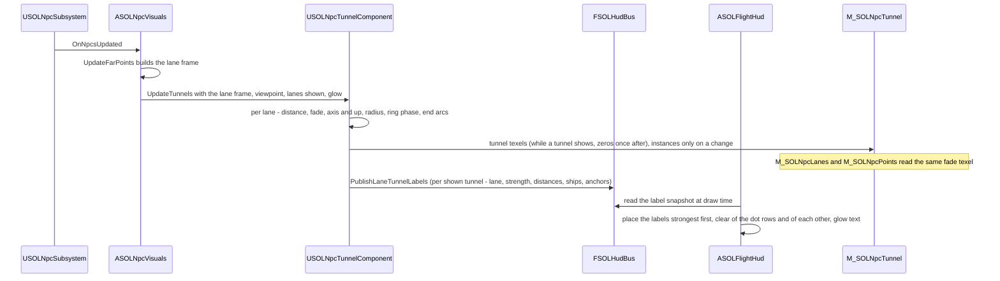

<!-- SOLTest / Copyright © 2026 Acid Rain Studios LLC -->

# SDD 49: Lane guidance tunnel near NPC lanes

**Issue:** [#49](https://github.com/DieSlower/SOLTest/issues/49). Plan:
[`Plans/49-lane-guidance-tunnel-plan.md`](../Plans/49-lane-guidance-tunnel-plan.md). Builds on SDD 38 (the NPC lane
lines; this ticket consumes its section 4.10 extension point), SDD 17 (the orbit-line ribbon technique, shader library
and shared occluders), SDD 37 (the HUD glow scale `g`), SDD 21 (the HUD event bus and the HUD glow-text list) and
SDD 34 (the overlay profiles). Mock-ups: the folder `Docs/ToDo/49-lane-tunnel-mockups/` was deleted when #49 closed;
it is kept in the tree of commit `c8cab1f` (`tunnel8_rings_dots_sides.gif` there is the chosen look, `tunnels8.py`
the script that drew it).
**Persistence change: none.** `SOL::Settings::SAVE_VERSION` stays 13 and `KEY_BINDING_LAYOUT_VERSION` stays 10 (D3).
Status: **done (2026-11-13), issue #49 closed.** Part 49a (2026-11-12): the pure tunnel math, the label layout and
text and the HUD bus snapshot (section 12); part 49b (2026-11-12): the renderer, the material and the HUD labels
(section 12b); part 49c (2026-11-13): tuning, CPU cuts, profiling, docs and the whole-ticket review fixes (section
12c). Grill-me done 2026-11-11 (D1-D15, section 2); the derived
questions Q1-Q11 were answered by the user the same day and are resolved decisions (section 11, numbering kept). The
keep-right rails and the rest of the traffic behaviour went to the new ticket
[#50](https://github.com/DieSlower/SOLTest/issues/50).

## 1. Problem

Since #38 every NPC lane is a pair of flowing dashed lines far away, and close up (inside 100 lane radii) the line has
faded out and the lane is only its ships as points. A pilot near or inside a lane then has nothing that shows where
the lane is, which way it runs, which side carries which direction, where it ends, or how busy it is. Issue #49 asks
for a HUD-style guidance tunnel around a nearby lane that the player can fly through, with the other ships moving in
it.

## 2. Decisions (user, grill-me 2026-11-11)

- **D1: Trigger and hand-over.** Within **100 -> 50 lane radii** of a lane the far dashed line of #38 hands over to
  the tunnel: the tunnel fades in (0 at 100 lane radii, full at 50) where the lane line's own close-up fade (gone
  inside 100 lane radii) has faded it out. It triggers for **every lane near the player, not only a targeted lane**.
  *Rationale:* the two fades meet at 100 lane radii, so a lane is never without a cue (dashes far, ship points between,
  tunnel near), and the #38 fade band is reused rather than re-tuned.
- **D2: Pure HUD-style display.** No gameplay effect: no collision, no speed limit, no flight assist, no AI change.
  *Rationale:* keeps the ticket a renderer and the flight model untouched.
- **D3: Settings.** The tunnel follows the per-profile **Lanes** overlay row (#38, governed by the master O like every
  row) and the **HUD glow** setting (#37). **No new setting, no schema change** (`SAVE_VERSION` 13 and
  `KEY_BINDING_LAYOUT_VERSION` 10 stay). *Rationale:* the tunnel is the close-up half of the same lane overlay.
- **D4: Direction cue = side-wall chevrons and coloured guide dots** (`tunnel8_rings_dots_sides.gif`): chevrons on the
  left and right tube walls at **3 and 9 o'clock**, plus **muted green (outbound) and muted red (inbound) guide dots**.
  **Keep right:** outbound / forward traffic on the **right** lane, inbound on the **left** (the same rule as #38 D2).
  The floor-strip chevron variant (`tunnel8_rings_symbols.gif`) was previewed and **not** chosen.
- **D5: Orientation.** Space has no up or down, so the tunnel's **12 o'clock is aligned to the average solar-system
  orbit plane**: its up is the plane's normal projected perpendicular to the lane axis; left and right are defined from
  it. The precise normal was left to this design: **the fixed J2000 ecliptic north pole** (section 4.3 justifies it).
- **D6: Rings and dots.** **Bright HUD cyan rings** (`SOL::SolidMenu::CYAN_COLOR`, sRGB #28D2F0, the kit cyan the user
  named) and **8 longitudinal rows of guide dots** along the tube, **outside** the rings. Rings, walls and dots
  **stream toward the player in proportion to the player's actual speed and direction**: a stationary player sees
  nothing move (no idle drift), and the flow **does not change direction per lane**.
- **D7: Ring visibility and spacing.** From inside, the rings ahead are visible **all the way to the lane's end node**,
  darker and more transparent with distance. Near the player they are **about 2 tunnel radii apart**; the spacing
  **grows smoothly with distance** (multi-scale like the far dashes, **no pops**), so the whole lane stays readable and
  cheap. *As built (49c):* the repeating rings also fade while their projected radius is below 10 ribbon half extents
  (no white vanishing point, section 12c), so the far rings thin out before the end node; the end ring itself is
  exempt (D12 amendment) and stays visible at its 0.5 floor.
- **D8: Width from traffic, empty lanes kept.** The tunnel radius follows the lane's ship count on the #38 scale (100
  to 100,000 ships, `LaneTrafficWeight`), mapped to **1x .. 3x a base radius**. **An empty lane never vanishes:** it
  still gets a tunnel at the minimum width (the player may be inside it). The far line of an empty lane stays undrawn,
  as in #38.
- **D9: Overlap.** **All lanes within range get their own tunnel.** Cost and clutter near planets (where several lanes
  meet) are accepted and covered by the budget (D14), which applies to the all-lanes case at 1M NPCs.
- **D10: Ships.** No special drawing: lane ships look like normal NPC ships with the usual HUD treatment; they are not
  tinted green or red (issue comment of 2026-11-11). The tunnel only adds rings, dots, chevrons and its label.
- **D11: Readout = floating wall labels** (mock-up "Option B"): world-anchored text near the tunnel wall that
  **never overlaps the guide dots**, showing the **lane name** (e.g. "Earth - Mars"), the **distance to each end** and
  the **ships in the lane**. It must **not** show a left/right "your side" line. *Amended by Q4:* **one label per shown
  tunnel**, the weaker tunnels' labels dimmer (section 4.9).
- **D12: Lane ends.** An **end ring** marks each node. The tunnel draws over a planet **unless the planet is in front
  of the tunnel's path**: the #38 shared occluders (the orbit lines' 8 analytic spheres) hide the parts behind a
  planet. *Amended (user, 2026-11-13, whole-ticket review):* the end rings are **exempt from the screen-size fade**
  (section 12c) and keep the designed alpha floor `NPC_TUNNEL_END_RING_MIN_ALPHA` (0.5), so every lane end stays
  marked however small it is on screen; only the repeating rings and the dot rows take that fade.
- **D13: Smooth spacing dependency.** Smooth dash size changes for the far lane line are a separate #38 follow-up, not
  part of #49; the tunnel's multi-scale ring spacing **must use the same smooth scheme once it is chosen**. *Resolved
  (Q9):* the follow-up chose the continuous "accordion" scale (SDD 38 D15 amendment D, `b5bae2c`); section 4.5 applies
  the same principle to the rings.
- **D14: Budget gate at 1920x1080**, all lanes in range, 1M NPCs present: **<= 0.15 ms GPU, <= 0.02 ms CPU**. 4K
  (3840x2160) and one XR-4 eye (3840x3744) are measured and **recorded only** (no VR work, no two-eye run). Review
  items 9 and 11 apply; the method follows #38 (section 4.13 of SDD 38).
- **D15: Not in #49:** the far-line dash-length follow-up (D13), any VR work, gameplay aids (D2), and every change to
  how the lane ships move (keep-right rails, speed by radial position, traffic just outside the tunnel, merging): ticket
  [#50](https://github.com/DieSlower/SOLTest/issues/50) (Q1).
- **D17 (user, 2026-11-12, after the 49a review): the near fade depends on the distance from the axis.** The near
  fade (section 4.5) acts fully while the camera is within `NPC_TUNNEL_NEAR_FADE_RADIAL_FULL_RADII` (1.5) tunnel radii
  of the axis and not at all from `NPC_TUNNEL_NEAR_FADE_RADIAL_NONE_RADII` (3) (smoothstep between), so seen from
  outside the tube the ring nearest the foot point stays instead of blinking out as the foot point passes it.
- **D18 (user, 2026-11-12, after the 49b smoke): labels that fit from inside a tube.** The label anchor moves to
  2.5 tunnel radii ahead; the labels avoid the HUD panels (key-hint line, cards and panels, radar); when the three-line
  box still fits at neither candidate, a compact one-line label "A - B  <nearest end distance>" is tried at the same
  candidates, dimmed by the same side-tunnel rule (section 4.9).
- **D19 (user, 2026-11-12, after the 49b review): two smoke views draw no label, by design.** T4 (camera on the tunnel
  axis looking straight at the 12 o'clock wall: both anchors lie along the axis, off screen) and T5 (start above
  Earth: the label anchors of the tunnels ending at Earth lie past the nearer end ring, behind Earth, so occluded). The
  smoke asserts 0 labels drawn at T4 and T5. Options considered and deferred: clamping the anchor short of the nearer
  end ring (a temporary clamp still drew no label at T5), a label pinned to the screen edge.
- **D20 (user, 2026-11-12/13, after the first 49c profile): the CPU budget stands; optimise first.** D14's
  <= 0.02 ms CPU (tunnel update + HUD labels, 1080p, 1M NPCs, all lanes in range) is kept. The overrun found in the
  first profile (0.039 ms in T2, 0.048 ms in T5) is profiled and cut (early-outs, no label work where no label can
  draw, caching, rate limits where invisible); if it stays above after real effort, the floor reached and what remains
  are reported to the user, not re-scoped silently. Result: section 12c. **Measurement method (user, 2026-11-13):**
  the budget is judged against the tunnels-off baseline of the same run (`sol.NpcTunnel 0`). Measured after the cuts
  (the two stat scopes, tunnel update + HUD labels): 0.022-0.026 ms on, 0.006 ms off; **on vs off: 0.016-0.022 ms
  across runs, at the budget (0.020)** (the 1080p medians give 0.016-0.020, the one-eye T2-all row 0.022). The
  difference is not the whole cost the tunnels add: it does not count the Slate paint of the label text, the
  render-thread texture update or the per-frame MID parameter update, and the off baseline still runs update code
  inside both scopes (the 0.006 ms off figure is not fully explained). This is how the budget is measured, not a
  re-scope; the absolute numbers stay recorded (section 12c, `TECH_DEBT.md`).
- **D21 (user, 2026-11-12/13): the extra points cost inside a tunnel is accepted.** Inside a tunnel the Q5 crossfade
  brings the lane's ships (about 88k on Earth - Mars) back as points, about +0.25 ms GPU on the points draw against
  `sol.NpcTunnel 0` (where the lane line stands in for them). It is outside D14's tunnel budget and recorded in
  `TECH_DEBT.md` and section 12c.
- **D22 (user, 2026-11-12/13): far chevrons fade like the mock-up.** The chevrons fade out by their camera-to-axis
  distance between `NPC_TUNNEL_CHEVRON_FADE_START_RADII` (13) and `NPC_TUNNEL_CHEVRON_FADE_END_RADII` (30) tunnel radii
  (a falling smoothstep, `TunnelChevronFarFade`, mirrored in the shader) instead of only the 256-512 tunnel radii detail
  fade, which the dots keep (the mock-up's fog has them gone by about 13 tunnel radii).
- **D16 (user, 2026-11-11): traffic outside the tunnel.** Some ships may travel just **outside** the tunnel, along it
  (#50). The display needs nothing special for them: it only draws rings, dots, chevrons, end rings and labels, and the
  ships keep their normal look and HUD markings wherever they are.

## 3. What exists today (code survey, HEAD `24ca30f`)

| Piece | Where | Facts that matter here |
|---|---|---|
| Lane frame | `Npc/SOLNpcLaneMath.h` (`FSOLNpcLaneEntry`, `FSOLNpcLaneFrame`, `BuildLaneFrame`), `ASOLNpcVisuals::GetLaneFrame()` | Per lane: `A`, `B` (body centres, universe ecliptic metres, double), `RadiusM`, `ShipCount`, `TrafficWeight`, `bDrawn`. Built each frame, no allocation. **`bDrawn` folds "has ships" and "both bodies resolved" together**, so an empty lane cannot be told from an unresolved one (D8 needs that) |
| Lane math | `SOLNpcLane::` | `LaneLineFade` (100 / 400 radii, log-linear), `LaneTrafficWeight` (100 .. 100,000), `ClosestLaneParam` (ray), `LaneDistanceAtParamM`, `LaneLineProfile` and `LaneRibbonHalfExtentPx` (HUD glow profile scaled with the viewport height, D25 of SDD 38), `LaneOutboundSide` (keep-right sign) |
| Lane renderer | `ASOLNpcVisuals` (930-line `.cpp`), `M_SOLNpcLanes`, `Shaders/Private/SOLNpcLane.ush` (`SOLNL_*`), `Tools/Npc/create_npc_assets.py` | One `USOLOrbitLineComponent` ribbon, placed on the GPU from the 64x2 group texture; after motion blur, additive, depth test off, sort priority 1; `FSOLGlowScaleFeed mLaneGlowFeed`; `SetLaneVerificationOverride`; cvar `sol.NpcLanes`; reads `USOLSettingsSubsystem` (Lanes row, live HUD glow) |
| Orbit-line library | `Shaders/Private/SOLOrbitLine.ush` (`SOLOL_*`), `OrbitLines/SOLOrbitLineMath` | `SOLOL_PlaceLinePointCm` (far-depth compression on the true ray), `SOLOL_RibbonSideDirection`, `SOLOL_LineCoverage`, `SOLOL_IsPointOccludedBySphere` / `IsPointOccluded`, `SOLOL_IsHiddenBySceneDepth`, `SOLOL_EclipticToUnreal`; occluders and trust limit in `MPC_SOLOrbitLine`, written while orbit lines **or** lanes draw (SDD 38 D24) |
| Fixed-bounds ISM | `Npc/SOLNpcHullInstances` (`USOLNpcHullInstances`) | An ISM subclass with fixed bounds (no per-frame `CalcBoundsImpl`); the pattern the tunnel's slot instances reuse |
| Lane rails | `Npc/SOLNpcScaleMath.cpp` (`MakeSpawn`, `LaneParamAt`) | A lane ship's lateral offset is uniform over the lane disc and its direction (+1 / -1) is an independent hash; the triangle wave reverses it at each end. **Ships do not keep right today** (accepted for #49, Q1; fixed by #50) |
| Lane ship points | `M_SOLNpcPoints` vertex node (`Tools/Npc/create_npc_assets.py`), `SOLNpcLane::LaneShipPointAlpha`, `PointLaneParams` (`NpcParams4`) | In rail mode a lane ship's alpha is `1 - SOLNL_LineFade(d_ship, R)` while `NpcParams4.x` = 1, so it and the line sum to 1 at every lane point (SDD 38 D9); the CPU-position mode and Lanes off draw every point as before. Q5 changes this crossfade (section 4.2) |
| Default lanes | `SOLNpcScale::DefaultLayout` | 8 lanes, radii 2e5 m (Earth-Moon), 2e6 (Mercury-Venus, Venus-Earth), 3e6 (Earth-Mars), 5e6, 8e6, 1e7, 1e7 m; lengths 3.8e8 m to about 4.5e12 m |
| HUD | `UI/SOLFlightHud` (`ProjectLocal(FSOLHudView, localCm)`), `UI/SOLHudTextList`, `UI/SOLHudFormat` | Glow text through the fixed-capacity text list in `SSOLHudShapeLayer`; distance formatting; the HUD hides while a menu shows and follows the HUD visibility setting |
| HUD event bus | `HudEvents/SOLHudBus.h` (`FSOLHudBus`, owned by `USOLHudEventSubsystem`) | Plain C++ bus between the pawn and the HUD (pilot snapshot, commands, map body overlay); `UI -> HudEvents` exists |
| Frames | `Docs/ARCHITECTURE.md` section 4 | Universe = right-handed J2000 ecliptic, **+Z = north ecliptic pole**; `EclipticToUnreal` negates Y |

Known debt not to re-report (grep of `Docs/TECH_DEBT.md`): `Npc` leaning on the orbit lines' actor-side code
(`USOLOrbitLineComponent`, `SetLanesDrawn`); the `Npc <-> Menu` folder cycle; the speed panel and Overlay Menu one-eye
cost; the duplicated view-size helper of the profile smokes (planned: the tunnel smoke reuses the lane smoke's copy;
as built it added a sixth, since the lane copy is file-local, and `TECH_DEBT.md` now lists six); the NPC worst case with every Demo option at its maximum; `ASOLOrbitLineVisuals`' drift rebuilds.

## 4. Design

### 4.1 Overview

For every lane within 100 lane radii of the render viewpoint the CPU computes, in double, a small per-lane **tunnel
frame** (nearest lane point, axis, up from the ecliptic, tunnel radius, fade, the ring phase, end-ring positions) and
uploads it as a few texels. A **fixed slot mesh** (one instance per lane in range) of ring ribbons, dot quads and
chevron quads is placed and shaded entirely on the GPU by a new material `M_SOLNpcTunnel` (HLSL in
`Shaders/Private/SOLNpcTunnel.ush`, reusing the orbit-line and lane libraries). The same texture's per-lane fade is
also read by the #38 lane and point materials, which fade the lane's line out with its tunnel and show its ships as
points again (Q5). The wall labels (one per shown tunnel, Q4) are chosen on the CPU, published on the HUD event bus
and drawn by the flight HUD as glow text. Per-frame CPU work is O(lanes in range); nothing in the tunnel is per ship.

### 4.2 Trigger, hand-over and visibility (D1, D3, D8)

- **Distance to the lane** `d` = distance from the render viewpoint to the lane **segment** A-B (clamped; past an end
  it is the distance to that node). Computed in double on the CPU per lane (`LaneNearestParam`, section 6 case 6).
- **Tunnel fade** `TunnelFade(d, R)`: 0 at and beyond `NPC_TUNNEL_FADE_START_RADII` (100) x `R`, 1 at and inside
  `NPC_TUNNEL_FADE_FULL_RADII` (50) x `R`, linear in `log d` between; `R` is the **lane** radius (`LaneRadiusM`, as
  D1 states the band in lane radii). One scalar per lane per frame multiplies everything the lane's tunnel draws (rings,
  dots, chevrons, end rings).
- **The lane's whole #38 line fades out with its tunnel (Q5).** Without a tunnel the line's per-pixel close-up fade
  removes it only inside 100 lane radii of each lane point, so from inside a tunnel the distant section would keep its
  dashes down the tube. Instead, with `F` the lane's tunnel fade (above) and `d` the camera distance of the lane point
  (line pixel) or of the ship (point), both clamped to [0, 1], NaN as 0:
  - **line alpha** = `LaneLineFade(d, R) x (1 - F)` (new `SOLNpcLane::LaneLineFadeWithTunnel(d, R, F)`);
  - **lane-ship point alpha** = `1 - LaneLineFade(d, R) x (1 - F)` while the lanes are shown, else 1
    (`SOLNpcLane::LaneShipPointAlpha` gains the argument `tunnelFade`; `F` = 0 gives exactly today's values).
  The two still **sum to 1 at every lane point** (SDD 38 D9 holds: a lane is never empty at any distance). As the
  player closes from 100 to 50 lane radii the far dashes fade together with the tunnel coming in, and the far ships,
  which the line stood for, come back as points; with the tunnel full (`F` = 1) the line is gone and every lane ship
  draws as a point exactly as with Lanes off. **Lanes off and the exact points stay consistent:** with the lanes not
  shown no tunnel shows (`F` = 0 everywhere) and `NpcParams4.x` = 0 draws every point as before; ships in the
  CPU-position mode (the exact tier) were never crossfaded and are not touched; `sol.NpcTunnel 0`, the jump map (Q6)
  and the hidden verification override all write `F` = 0, so the #38 behaviour returns exactly. An empty lane has no
  line and no lane ships, so its `F` changes nothing there.
- **Where `F` reaches the shaders.** `F` is row 1 `.w` of the tunnel texture `NpcTunnelTex` (section 4.7), indexed by
  the lane's group column like the group texture. `M_SOLNpcLanes` (`SOLNL_Pixel`) and `M_SOLNpcPoints` (the lane
  branch of the rail vertex node) gain the texture parameter `NpcTunnelTex` (name in `SOL::NpcLaneMaterialParams`,
  bound once at `BeginPlay` to the component's texture) and multiply `SOLNL_LineFade` by `1 - F`. The texture is
  written with fade 0 for every column on the frame the last tunnel goes away (and holds zeros before the first one),
  so a stale fade can never hide a line. Both materials are **rebuilt** by `Tools/Npc/create_npc_assets.py`
  (`-SOLRebuild`, editor closed) in 49b, together with `M_SOLNpcTunnel`; the vertex node's lane branch stays the one
  `SOLNL_LineFade` call times one texel load. Cost: one extra texel load per lane-ship vertex in rail mode and per
  lane pixel (budget re-checked in the profile run, section 8 item 6).
- **Ship markings (Q5):** lane ships keep their **normal HUD markings** (symbols, brackets, the radar) inside and near
  tunnels; nothing in the HUD's ship marking changes.
- **SDD 38 amendment note** (written in 49b with the material change): SDD 38 D9 / D10 and section 4.8 gain a note that
  since #49 the line and point crossfade also carries the per-lane tunnel fade, `LaneLineFade x (1 - F)`, sum still 1.
- **Shown** = the lanes shown (`SOLNpcLane::AreLanesShown`: the Lanes row with the master O, `sol.NpcLanes`) **and**
  the new cvar `sol.NpcTunnel` (default 1, A/B profiling) **and** both lane bodies resolved. An **empty lane** (0 ships)
  is shown at the minimum radius (D8). To tell empty from unresolved, `FSOLNpcLaneEntry` gains
  `bool bResolved` (both bodies resolved, `LaneBodyA/B != INDEX_NONE` and inside the frame arrays), set by
  `BuildLaneFrame`; `bDrawn` keeps its meaning (`bResolved` and at least one ship), so #38 is unaffected.
- **Map (Q6):** the tunnels are hidden while the jump map is open (the map viewpoint is the map camera, and the
  tunnel is a flight aid); their fades read 0 there, so the lanes' #38 lines show on the map as before (SDD 38 D18).
  **Menus (Q6):** the tunnel geometry stays while a menu shows (as the lane lines do); the wall labels are HUD text and
  hide with the HUD.
- A verification override (`SetTunnelVerificationOverride(bShown, bForceAllLanes)`) lets the smokes show or hide the
  tunnels without the player's settings, and force every lane's fade to 1 for the all-lanes budget case (D14).

### 4.3 Tunnel frame and orientation (D4, D5)

- **Axis** `a = (B - A) / |B - A|` (ecliptic, outbound direction A -> B; A and B as in `FSOLNpcLaneEntry`, the
  layout's order, the same outbound as #38).
- **Up (12 o'clock)** `u = normalize(N - (N . a) a)` with `N` = **the fixed J2000 ecliptic north pole, universe +Z**.
  *Justification (D5 "pick and justify"):* the universe frame **is** the J2000 ecliptic (ARCHITECTURE section 4), so
  `N` is a constant with no per-frame cost and no jitter; the orbit lines and the map are drawn in the same frame, so the
  tunnel's horizon agrees with what the player sees there; the mass-weighted mean orbit normal (the invariable plane)
  is only about 1.6 degrees from the ecliptic, dominated by Jupiter, a difference no player can see, and would add a
  computation and a definition to keep in sync for nothing. Fallback: within `NPC_TUNNEL_UP_FALLBACK_DEG` (1 degree)
  of the pole `u` is universe +X projected off the axis, so it stays defined; between 1 and `NPC_TUNNEL_UP_BLEND_DEG`
  (2 degrees) it turns smoothly about the axis from that up to the north up (the signed angle between them times a
  descending smoothstep of the pole angle), so the basis is continuous along the pole angle. Like any up field on a
  sphere it keeps a seam (at the azimuth where the two ups are opposite inside the blend band); no default lane is
  within 80 degrees of the pole, their axes lie within a few degrees of the ecliptic.
- **Right (3 o'clock, the outbound side)** `r = a x u` in the right-handed ecliptic frame (looking along `a` with `u`
  up, `r` is on the right; after `EclipticToUnreal` it is the Unreal right of a camera looking along `a`). Clock angles
  are measured **clockwise from 12 o'clock as seen looking from A toward B**: angle `t` maps to the wall direction
  `cos(t) u + sin(t) r`.
- **Keep right:** the outbound half of the tube is the `r` side (3 o'clock), the inbound half the `-r` side (9
  o'clock). Seen from B looking toward A the sides swap on screen, and each direction's traffic is still on the right of
  its own travel, as with the #38 line. Ships themselves are not moved (D10, Q1: accepted; keep-right rails are #50).
- **Radius** `Rt = R x lerp(NPC_TUNNEL_RADIUS_MIN_SCALE, NPC_TUNNEL_RADIUS_MAX_SCALE, LaneTrafficWeight(n))`, scales 1
  and 3 (D8); the **base radius is the lane radius `R`** (Q3): the ships' lateral offsets lie inside `R`, so even the
  minimum tunnel contains all its ships, and a busy lane's tube is roomier around them. An empty lane gets `R`.
- **Nearest point** `P = A + s_P (B - A)`, `s_P` the segment parameter nearest the viewpoint, and its lane arc
  `a_P = s_P x L` (`L = |B - A|`), all in double; it gives the trigger distance and fade (section 4.2).
- **Foot point** `F` on the axis **line** (the same projection, not clamped to the segment), its arc `a_F` (may lie
  below 0 or above `L` past an end) and the camera's distance `h` from the line: the origin of the ring layout
  (sections 4.4, 4.5). Inside the segment `F = P`.
- **End rings** (D12) at arcs `a_A = R_bodyA + NPC_TUNNEL_END_MARGIN_RADII x Rt` and `a_B = L - R_bodyB - margin`
  (body radii from the registry; Q10): just outside each body's surface (surface plus one tunnel radius), so the end
  ring is not inside the planet, where the analytic occluder would always hide it. Rings, dots and chevrons exist only
  between the end rings; the tunnel draws over the planet unless the planet is in front of its path (the shared
  occluders, D12).
  If the end arcs cross (a lane shorter than its bodies plus margins), the tunnel is not drawn.

### 4.4 Streaming (D6, Q2, Q8)

Rings, dots and chevrons are **anchored to the lane** (Q2: the chevrons too, like the rings) and are never animated by
a clock. The anchor is the per-lane **ring phase** `Phi` in [0, 1) (section 4.5), held by the component in double and
advanced each frame by the change of the camera's **foot arc** `a_F` (the arc from node A of the camera's foot point on
the lane's axis line, unclamped, in double) divided by the ring spacing at the foot point (`AdvanceRingPhase`). The
rings near the player therefore move exactly with the player's motion relative to the lane: flying along the lane
streams them toward the camera at the player's speed, flying backwards streams them away, and a player at rest
relative to the lane sees nothing move. The flow cannot change direction per lane because it is not a per-lane
animation. **Under time warp (Q8)** the lane's own motion (the bodies orbit, the lane stretches and turns) changes
`a_F` and the foot point too, so the rings move with the lane like the lane ships do; at 1x warp this is under about
0.003 ring spacings per second for every default lane (checked in the smoke). When a lane enters range (its fade leaves
0) its phase starts at `InitialRingPhase(a_F, spacing) = frac(a_F / spacing)`, so the start is deterministic; a jump
across the solar system just advances the phase by a large wrapped amount.

Precision: the shader never sees a large arc. The CPU sends the phase (a float in [0, 1)), the foot point relative to
the viewpoint and the end-ring arcs relative to `a_F`; every ring position is an offset from the foot point
(camera-relative) computed from warp values smaller than the slot count, so rings near the camera are exact to far
under a pixel on a 30 AU lane (contract case 9).

### 4.5 Continuous "accordion" ring spacing (D7, D13, Q9)

The #38 follow-up chose one continuous dash scale per lane, the accordion (SDD 38 D15 amendment D: a dash period stays
about 24 px on screen, nothing pops, no dimmer copy, the dashes slide while zooming; `LaneDashLevel`,
`LaneDashLaneFootprint`, `LaneScreenParam`). The rings use the same principle (Q9): **one continuous spacing function**,
evenly spaced near the player and growing smoothly with distance, no levels, no pops.

- **Spacing.** With `x` the signed axial offset from the camera's foot point on the axis line, `h` the camera's
  distance from the axis line, `S0 = NPC_TUNNEL_RING_BASE_SPACING_RADII` (2) x `Rt` and
  `rho = NPC_TUNNEL_RING_SPACING_PER_DISTANCE` (0.25), the local ring spacing is
  `sigma(x, h) = max(S0, rho x sqrt(x^2 + h^2))` (`RingSpacingM`): 2 tunnel radii apart within `D0 = S0 / rho`
  (8 tunnel radii) of the camera, beyond it about a quarter of the ring's own distance (neighbouring rings about
  `e^rho` = 1.28 times farther each), a steady geometric tunnel to the end node. Using the true distance bounds the
  on-screen density from inside and from outside the tube (seen from 50 tunnel radii away the rings at the foot point
  are 12.5 tunnel radii apart).
- **Warp.** The ring coordinate is `w = W(x, h)`, the integral of `1 / sigma` from the foot point (`RingWarp`, odd in
  `x`, strictly increasing). With `x0 = sqrt(max(0, D0^2 - h^2))`: `W = x / S0` for `|x| <= x0`, and beyond it
  `W = sign(x) (x0 / S0 + ln((u + sqrt(u^2 + h^2)) / (x0 + sqrt(x0^2 + h^2))) / rho)` with `u = |x|` (the `asinh`
  form, well defined at `h` = 0 and at `x0` = 0). Its closed-form inverse `RingWarpInverse(w, h)`: `x = w S0` inside,
  else `v = (x0 + sqrt(x0^2 + h^2)) e^(rho (|w| - x0 / S0))` and `u = (v^2 - h^2) / (2 v)`.
- **Rings** sit at every `x` with `W(x, h) + Phi` a whole number (`Phi` the lane's phase, section 4.4). Ring slot `k`
  (0 .. `NPC_TUNNEL_RING_SLOTS_PER_SIDE` - 1, 64 per side) is the ring at `w = k + 1 - Phi` ahead (along `+a`) and
  `w = -(k + Phi)` behind, so **slot and ring are one to one**: every ring with `|w| < 64` is drawn by exactly one
  slot, with no level bands to cover. On the axis (`h` = 0) a lane needs `W(L, 0) = 4 + 4 ln(L / (8 Rt))` rings per
  side: about 48 for a 4.5e12 m lane of radius 1e7 m, and still under 64 (about 63.4) for a 4.5e12 m lane at the
  2e5 m minimum radius, so no ring between the end rings is lost on any default lane (contract case 11 checks each).
- **No pops.** Every ring's position is a continuous function of `Phi`, `h` and `Rt` (when `Phi` wraps, the slot
  labels shift by one and the set of rings is the same). Rings only enter or leave at alpha 0: the **cap fade**
  `clamp(64 - |w|, 0, 1)` fades a ring in or out at the far end of the slot range, and the **end fade**
  `TunnelEndFade(dEnd, sigma) = clamp(dEnd / (NPC_TUNNEL_END_FADE_SPACINGS x sigma), 0, 1)` (0.5 spacings) fades a ring
  to 0 as it reaches an end ring (`dEnd` its axial distance to the nearer end ring, inside the tunnel). The tunnel
  radius steps only when the lane's ship count changes, by a fraction of a ring spacing (accepted).
- **Accepted trade-off (the accordion's slide, as in #38).** Rings within `x0` (8 tunnel radii inside the tube) are
  fixed to the lane: they move exactly with the player and the lane (D6, Q2, Q8). Farther rings **slide along the lane**
  when the player moves along it (an outer ring moves `sigma(x, h) / sigma(0, h)` times as fast, the far tunnel
  "breathing" in toward the player) and spread or gather around the foot point when the player moves toward or away
  from the axis; the foot point is the pivot and stays put, as the lane's middle on screen does for the #38 dashes.
  Their on-screen spacing stays constant, which is the point of the scheme.
- **Why the nested power-of-two fade (the first draft) is dropped.** It kept every ring fixed to the lane, but it did
  so by fading half of the rings out at every octave of distance, so the far tunnel showed rings continually dimming
  and brightening as the player flew, the multi-level look the user moved away from in #38 (amendments C and D); it
  needed a level per ring (trailing zero bits of the grid index), two float phases for precision and a banded slot
  layout with an "exactly once" proof per band, and about twice the ring vertices (12,000 against about 5,000 per
  lane, section 4.7). The accordion draws every ring with no level fade, needs one phase and one slot per ring, and
  matches the lane line's behaviour, so the player sees one rule for both.
- **Depth fade (D7):** `TunnelDepthFade(d, Rt)` = 1 inside `NPC_TUNNEL_DEPTH_FADE_START_RADII` (8) x `Rt`, falling
  linearly in `log d` to `NPC_TUNNEL_DEPTH_FADE_FLOOR` (0.2) at `NPC_TUNNEL_DEPTH_FADE_END_RADII` (65,536) x `Rt` and
  staying at the floor beyond, so the rings stay visible to the end node, darker and more transparent with distance.
  The end rings never fall below `NPC_TUNNEL_END_RING_MIN_ALPHA` (0.5) by distance: they take no screen-size fade
  (D12 amendment), and only the near fade can dim one further, beside the camera.
- **Near fade:** a ring whose axial offset from the camera's foot point is under `NPC_TUNNEL_NEAR_FADE_FULL_RADII`
  (1.5) tunnel radii fades out, to 0 at `NPC_TUNNEL_NEAR_FADE_START_RADII` (0.5) (smoothstep). This keeps the ring the
  player passes through from sweeping the whole screen edge-on, as in the mock-up (rings from half a radius ahead).
  **Weighted by the distance from the axis (D17):** the slots use `TunnelNearFadeAt(x, h) = 1 - weight(h) x (1 -
  near(x))` with `weight` 1 within 1.5 tunnel radii of the axis and 0 from 3 (smoothstep,
  `TunnelNearFadeRadialWeight`), so from outside the tube the nearest ring is not removed.
- **Dots and chevrons** use the same warp and phase, so they are anchored and slide exactly like the rings: dots at
  `NPC_TUNNEL_DOTS_PER_GAP` (2) per ring gap (at `w` + 0.25 and + 0.75 of the gap), chevrons one per ring gap
  (mid-gap, `w` + 0.5), each with the cap, end and near fades of its own `w` (the detail cap is
  `DetailCapFade(w) = clamp(NPC_TUNNEL_DETAIL_SLOTS_PER_SIDE - 1 - |w|, 0, 1)`, 0 one gap before the far end of the gap
  slots, so an element entering there starts at alpha 0; it is 1 wherever the detail fade is above 0). Both **fade out between 256 and 512
  tunnel radii** of true distance (`NPC_TUNNEL_DETAIL_FADE_*`, Q11), where they are below a pixel or two; rings alone
  carry the lane to its end ring. `NPC_TUNNEL_DETAIL_SLOTS_PER_SIDE` (24) gaps per side cover 512 tunnel radii
  (`W(512 Rt, 0)` is about 20.6).

### 4.6 Look (D4, D6, D11, D12)

| Element | Geometry | Colour, size | Notes |
|---|---|---|---|
| Rings | Circle of radius `Rt` in the plane normal to `a`, drawn as a constant-pixel-width line ribbon | `CYAN_COLOR` #28D2F0, `NPC_TUNNEL_RING_WIDTH_PX` 1.5 px at 1080p, scaled by the viewport height | HUD glow profile with the live `g` (`LaneLineProfile` / `SOLNL_LineProfile` with the ring width), `LaneRibbonHalfExtentPx` for the ribbon edge |
| End rings | Same, at `a_A` and `a_B` | Cyan, `NPC_TUNNEL_END_RING_WIDTH_PX` 3 px, alpha floor 0.5, no screen-size fade (D12 amendment) | One per node (D12) |
| Guide dots | 8 rows at clock angles `(g + 0.5) x 45` degrees (22.5, 67.5, ... ), radius `NPC_TUNNEL_DOT_RADIUS_SCALE` (1.1) x `Rt`, camera-facing round quads | Outbound rows (angles in (0, 180), the `r` half) **#5C8F6C** muted green, inbound rows **#9A5656** muted red (the mock-up's colours); world-sized near (`NPC_TUNNEL_DOT_WORLD_DIAMETER_RADII` 0.034 `Rt`, the mock-up's), never below the floor `NPC_TUNNEL_DOT_SIZE_PX` 3 px at 1080p (scaled); faded below 0.5-1 `Rt` of their own distance and while the row is small on screen (12c) | "Outside the rings" (D6); a soft glow like the mock-up |
| Chevrons | Filled, notched darts (the mock-up's arrowheads: tip, two wings, rear notch at 0.3 half lengths) on the wall at 3 o'clock (outbound, pointing toward B) and 9 o'clock (inbound, pointing toward A), radius 0.97 `Rt`, half width 0.17 `Rt`, half length 0.26 `Rt` (the mock-up's proportions, world-sized so they foreshorten) | Outbound **#84AB90**, inbound **#B38080** (the dot colours lightened 25%, as in the mock-up), linear alpha `NPC_TUNNEL_CHEVRON_ALPHA` 0.3; gone between 13 and 30 `Rt` (D22) | Fixed to the lane like the rings (Q2): they move only with the player's own motion, not on a clock (the mock-up let them flow) |
| Labels | HUD glow text (section 4.9) | HUD text colour and glow, alpha by tunnel strength | One per shown tunnel (Q4), the strongest brightest |

All tunnel colours are stored as sRGB `FColor` constants and converted to linear once; the emissive scale
`NPC_TUNNEL_EMISSIVE` is tuned on the screenshots so the brightest ring core keeps its cyan after tone mapping (as SDD
38 D16). The "HUD and menu effects" and "Hologram menu effects" sliders do not affect the tunnel (as for the lanes).

### 4.7 Renderer (`USOLNpcTunnelComponent`, `M_SOLNpcTunnel`)

- **Where the code lives.** A new component `USOLNpcTunnelComponent` (`Npc/SOLNpcTunnelComponent.{h,cpp}`, a
  `USceneComponent`, never ticks) created in `ASOLNpcVisuals`' constructor and attached to its root. It owns the slot
  instances (a `USOLNpcHullInstances`-style fixed-bounds ISM, never culled), the tunnel MID, the tunnel data texture
  and its upload ring, the per-lane ring phases and last foot arcs (fixed arrays of `NPC_GROUP_TEXTURE_WIDTH`), and the
  label snapshot. `ASOLNpcVisuals::UpdateLanes` calls
  `Tunnel->UpdateTunnels(laneFrame, viewpointM, bodies, bLanesShown, glowScale)` once per redraw; this keeps the
  930-line `SOLNpcVisuals.cpp` from growing by more than a few lines. The pure math is in
  `Npc/SOLNpcTunnelMath.{h,cpp}` (namespace `SOLNpcTunnel`); the HLSL mirror in `Shaders/Private/SOLNpcTunnel.ush`
  (`SOLNT_*`) includes `SOLOrbitLine.ush` and `SOLNpcLane.ush` and reuses `SOLOL_PlaceLinePointCm`,
  `SOLOL_RibbonSideDirection`, `SOLOL_IsPointOccludedBySphere`, `SOLOL_IsHiddenBySceneDepth`, `SOLOL_EclipticToUnreal`,
  `SOLNL_HeightScale`, `SOLNL_LineProfile` and `SOLNL_RibbonHalfExtentPx`. The C++ is the reference and the test
  oracle; a change to one changes the other (both file headers say so).
- **World-space mesh, not screen space.** As in SDD 38 D7: world-space geometry gets planet occlusion and correct depth
  order for free, needs no CPU projection or clipping per frame, and renders per eye in a future VR stereo view. A HUD
  shape-batch tunnel would project and clip hundreds of rings on the CPU every frame.
- **Slot mesh, built once at `BeginPlay`** (the same for every lane; one ISM instance per lane in range, its lane index
  in the per-instance custom data). Slots (section 4.5): for each side along the axis (ahead, behind)
  `NPC_TUNNEL_RING_SLOTS_PER_SIDE` (64) ring slots, slot `k` being the ring at `w = k + 1 - Phi` ahead or
  `w = -(k + Phi)` behind; `NPC_TUNNEL_DETAIL_SLOTS_PER_SIDE` (24) gap slots per side for the dots and chevrons; and two
  end-ring slots. Slot and ring are one to one, so **every ring with a non-zero alpha between the end rings is drawn
  exactly once** for any camera position, inside or outside the tube (contract case 11). A slot whose ring is past an
  end ring or at alpha 0 returns the hidden offset in the vertex shader (no raster cost).
- **Level of detail by slot.** A ring's on-screen radius is about `Rt / d x 960` px at 1080p, and the slot index grows
  with distance (geometrically past `x0`), so far slots get fewer segments: `NPC_TUNNEL_RING_SEGMENTS_NEAREST` 96 for
  slots 0-1 and the end rings (49c: they fill the view), `NPC_TUNNEL_RING_SEGMENTS_NEAR` 48 for slots 2-7, 24 for
  slots 8-23, 12 beyond (seen from outside the tube slot 0 is already far, so this only errs toward more segments).
  As built (`TunnelSlotMeshVertexCount`, pinned by the slot-mesh test): **9,476 vertices per lane, 75,808 for all 8
  lanes** (the D14 worst case; the first estimate was about 9,000 and 72,000). **Fixed budget: at most 80,000 vertices
  for 8 lanes**; the test checks this limit and it is not raised to follow the code.
- **Instances change only on events.** The ISM's instance list is rewritten only when the set of lanes with a non-zero
  fade changes (a lane enters or leaves range, the lanes turn on or off), not per frame, so out-of-range lanes cost no
  vertex work at all.
- **Per-lane data texture** `NpcTunnelTex`, `NPC_GROUP_TEXTURE_WIDTH` (64) x 4 float texels, a 3-slot upload ring like
  the group texels, uploaded on frames where at least one tunnel shows and once more (all zeros) on the frame the
  last one goes away (section 4.2). Per lane column (the implementer keeps or reports a better packing;
  `WriteTunnelTexels` pins it): row 0 = the foot point `F` on the axis line relative to the viewpoint (ecliptic m; its
  length is `h`), `Rt`; row 1 = `a`, **fade** (also read by `M_SOLNpcLanes` and `M_SOLNpcPoints`, Q5); row 2 = `u`,
  ring phase `Phi`; row 3 = `a_A - a_F`, `a_B - a_F`, 0, 0. `r = a x u` is computed in the shader. Columns of lanes
  without a tunnel are zero (fade 0).
- **Vertex shader.** Ring slot: `w` from the slot index and `Phi`, axial offset `x = RingWarpInverse(w, h)`, centre
  `F + x a`, sample `k` of the circle `centre + Rt (cos(2 pi k / N) u + sin(2 pi k / N) r)`, placed with
  `SOLOL_PlaceLinePointCm` (so it lands on its true pixel at any distance), expanded along `SOLOL_RibbonSideDirection`
  by the ribbon half extent; neighbouring samples give the tangent. The alpha (`cap fade x TunnelEndFade x
  TunnelDepthFade x TunnelNearFade x fade`) is computed per vertex; a vertex of a zero-alpha ring returns the hidden
  offset. Dot and chevron quads: their centre on the wall at their gap's `w`, expanded camera-facing (dots, pixel
  size) or in the wall plane (chevrons, world size), with `TunnelDetailFade` as well. *As built (49c):* the C++
  `RingSlot`, `DotSlot` and `ChevronSlot` give the slot alpha (cap, end, depth, near, detail and, for chevrons, the far
  fade); they are **not the full rendered alpha**: the shader alone adds the ring and dot-row screen-size fade
  (`TunnelRingScreenFade` / `TunnelScreenSizeFade`, of which C++ has the pure functions and tests), the dots' and
  chevrons' near fade by their own distance (`TunnelDetailNearFade`), the world dot size and `NPC_TUNNEL_CHEVRON_ALPHA`.
- **Near-plane rule.** Rings close to the camera plane are already faded (near fade, section 4.5), but when the
  player looks sideways inside the tube some ring samples lie behind the camera. A segment with both ends behind the
  near plane is collapsed; a vertex just behind it is clamped to the plane along its segment (the SDD 38 V4b
  regression view is repeated for the tunnel, section 8). *As built: the clamp was replaced by hardware clipping, see
  12b.*
- **Pixel shader.** HUD glow profile across the ribbon (`SOLNL_LineProfile`) or the dot / chevron shape with AA, times
  the colour, the interpolated alpha, the emissive scale and `(1 - occluded)`: the analytic sphere test against the
  shared `MPC_SOLOrbitLine` occluders plus the 1:1-zone scene-depth rule, as the lane lines. Additive, unlit,
  two-sided, depth test off, **after motion blur** like the lanes and orbit lines (issue #25),
  `NPC_TUNNEL_TRANSLUCENCY_SORT_PRIORITY` 2 (above the lanes within that pass; additive, so order does not change the
  result).
- **Occluders (D12).** The tunnel needs the shared occluders exactly when the lanes do (it is only shown while the
  lanes are shown), so `SetLanesDrawn` is reported as "lane lines **or** tunnels drawn" (an empty lane's tunnel can
  show with no lane line drawn). No new occluder writer.
- **Glow.** The component pushes `GlowScale` into its MID through `ASOLNpcVisuals`' existing `FSOLGlowScaleFeed`, only
  when the live HUD glow changes (the Settings slider previews at once).
- **Assets.** `M_SOLNpcTunnel` added to `Tools/Npc/create_npc_assets.py` (rebuilt with `-SOLRebuild`, editor closed),
  path `SOL::Paths::NPC_TUNNEL_MATERIAL`, parameter names in a new `SOL::NpcTunnelMaterialParams`; constants as vector
  parameters set once at `BeginPlay`, the texture per frame. The same script run rebuilds `M_SOLNpcLanes` and
  `M_SOLNpcPoints` with their new `NpcTunnelTex` texture parameter (Q5, section 4.2).

### 4.8 Per-frame data flow and cost scaling

- **CPU per frame:** O(lanes): for each of up to 64 lanes (8 in the default layout) one segment distance, one log, one
  basis, one phase advance (`fmod` in double), 4 texels; one label selection (at most `NPC_TUNNEL_LABEL_MAX_COUNT`);
  one bus publish of plain numbers (no strings). No
  allocation (arrays sized once), no tick, no UObject per frame. Budget with the HUD's label work: **<= 0.02 ms** at
  1080p (D14), measured with a new `STAT_SOL_NpcTunnel` and the HUD's label stat `STAT_SOL_HudLaneLabels` (stat group
  `SOLHud`, declared in `UI/SOLFlightHud.cpp`).
- **GPU:** vertex work scales with the lanes in range (about 9,000 vertices each, most of them early-out hidden), plus
  one texel load per lane-ship point vertex and per lane-line pixel for the Q5 fade;
  pixel work with the ring area: inside one tube about 0.3-0.5 Mpx of a cheap shader at 1080p (near rings are large,
  the series of far rings small), several tubes seen from outside less each. Expected well inside **0.15 ms** at 1080p
  with all 8 lanes forced in range (D14); 4K and one eye scale with the pixels and are recorded only.
- **Clutter near planets (D9):** at the default spawn (10,000 km above Earth) the Venus-Earth and Earth-Mars tunnels are
  fully shown and Earth-Moon partly, all three ending in end rings just outside Earth. Accepted by D9; the smoke's T5
  view records it.

### 4.9 Wall labels (D11, Q4)

- **Which lanes (Q4): one label per shown tunnel.** Every lane whose tunnel fade `F` is above 0 is a candidate. The
  candidates are ordered by **strength = `F`** (the same value as the tunnel fade), highest first; ties (several at
  1) go to the smallest `d / R` (the lane the player is deepest in), then the lower lane index. The first is the
  **strongest** tunnel. At most `NPC_TUNNEL_LABEL_MAX_COUNT` (4) labels are placed (the default layout meets at most
  three tunnels at a time, at Earth; the cap bounds the HUD work and the clutter); `SelectLabelLanes`.
- **Dimming (Q4):** a label's target alpha is `LaneLabelAlpha(F, bStrongest)` = `F` for the strongest tunnel's label and
  `F x NPC_TUNNEL_LABEL_SIDE_ALPHA` (0.55) for every other, so a side or weaker tunnel's label is always dimmer than
  the strongest one's, even when both tunnels are fully shown, and each label fades in and out with its own tunnel. A
  label below `NPC_TUNNEL_LABEL_MIN_ALPHA` (0.05) is not placed. The tunnel component computes the target alpha and
  publishes it in the label (`FSOLHudLaneTunnelLabel::Alpha`, only labels with `IsLabelPlaced`), so the HUD needs no
  NPC code. The displayed alpha of each lane's label eases toward
  its target over `NPC_TUNNEL_LABEL_FADE_S` (0.2 s), so a change of the strongest lane, or a candidate switch, does not
  flicker.
- **Content (three lines), no "your side" line:**
  - `Earth - Mars` (body A and body B names from the registry, layout order).
  - `Earth 0.42 AU   Mars 1.08 AU`: the straight-line distance from the ship to each end ring (Q4), with
    `SOLHudFormat`'s distance format.
  - `62,400 ships` (the lane's population count; `0 ships` for an empty lane).
  The bus carries numbers and body indices only; the HUD formats them and rebuilds a label's text only when its key
  changes (`MakeLaneLabelKey`: the lane, the ship count and each distance's `LaneLabelDistanceKey`, the number exactly as
  `SOLHudFormat` prints it with its unit, so two distances share a key exactly when they read the same), so no string
  is built per frame. The fixed words and separators ("ship",
  "ships", " - ", the spacing, the thousands separator) are `SOLMenuText::LANE_LABEL_*`.
- **Where:** each label is anchored on its own tunnel's wall at **12 o'clock** (the gap between the dot rows at 337.5
  and 22.5 degrees), at `NPC_TUNNEL_LABEL_AHEAD_RADII` (2.5; was 4, D18) tunnel radii ahead of the foot point along the axis in the
  direction the camera looks (sign of the camera forward on `a`); candidates 12 o'clock, then 6 o'clock (the gap
  between 157.5 and 202.5 degrees). The box is centred on its anchor horizontally and sits **outward from the tube**:
  its bottom edge on a 12 o'clock anchor, its top edge on a 6 o'clock one (review amendment, 2026-11-12).
- **Placement rules (no collisions, never over dots).** The HUD projects every shown tunnel's 8 dot rows (straight
  lines along the tube, so straight on screen, since the far-depth compression keeps every point on its true ray;
  clipped to the near plane and to the 512 tunnel radii where the dots end). It then places the labels **greedily,
  strongest first**: a label takes the first of its candidates whose box is on screen, whose anchor is in front of the
  camera and not behind a planet (the same sphere test, CPU side), that is clear of **every** projected dot row of
  **every** shown tunnel by `NPC_TUNNEL_LABEL_DOT_MARGIN_PX` (6 px, scaled) plus the dot radius
  (`LaneLabelClearOfDots`; *as built, 49c review:* each row is also clipped to the viewport and keeps the projected
  radius of its nearest on-screen dot, `LaneLabelDotRadiusPx`, since near dots are world-sized: about 12 px across at
  2.5 tunnel radii and 16-33 px at 1-2; the bus carries each row's world dot diameter), that does not overlap any **HUD panel** grown by `NPC_TUNNEL_LABEL_GAP_PX` (D18: every
  holo panel and card, the key-hint line and the radar with its stems and range label, recorded by the HUD as it
  draws them; the labels draw before the panels, so they avoid the previous frame's set, at most
  `NPC_TUNNEL_LABEL_MAX_AVOID_BOXES` 32), and that does not overlap any label already placed, grown by
  `NPC_TUNNEL_LABEL_GAP_PX` (6 px, scaled). **Compact fallback (D18):** when neither candidate fits the full
  three-line box, the label tries the same two candidates with a one-line box, "A - B  <nearest end distance>"
  (`FormatLaneLabelCompactLine`, the nearer of the two end-ring distances, `SOLMenuText::LANE_LABEL_COMPACT_SEPARATOR`;
  its own text key `MakeLaneLabelCompactKey`), at the same alpha (a side tunnel's compact label is dimmed by the same
  `NPC_TUNNEL_LABEL_SIDE_ALPHA` rule). A label with no such candidate is hidden that frame (it eases out). So the strongest label always has
  first choice, labels never cross each other or the guide dots, and a crowded view drops the weakest labels first.
  `PlaceLaneLabels`, pure, in `UI/SOLLaneTunnelLabel`; at most 4 labels against at most 64 row segments (8 lanes x 8
  rows), in fixed arrays.
- The labels follow the HUD: hidden while a menu shows or the HUD is hidden (Q6), sized by the HUD scale, glowing
  with the HUD glow.
- **Text cost (49b review).** The HUD caches per lane the two body names (refetched only when `BodyA` / `BodyB`
  change), line 1 and its width (rebuilt when the names change), line 3 and its width (when the ship count changes)
  and line 2 and its width (only when its quantised distance key changes). The compact line is built and measured only
  when the full form found no usable spot, or the label's previous form was compact.
- **Hysteresis (49b review).** Each label keeps last frame's candidate (12 or 6 o'clock) and form (full or compact)
  while that spot is still usable: `FSOLLaneLabelInput` has the new fields `PreviousCandidate` and `bPreviousCompact`,
  which `PlaceLaneLabels` tries first, else the normal order full@12, full@6, compact@12, compact@6.
- **Avoid boxes (49b review).** A HUD panel's box is recorded only when it is visible (`DrawCard`: it looks visible,
  `AddHoloPanel`: its colour alpha is above 0). The boxes are last frame's (one frame stale, tech debt).
- **Hiding.** The labels hide (drawn count 0, alphas back to 0 so they ease back in) on every frame the flight HUD
  does not draw: menu, warp, HUD hidden. `RowCount` is clamped to `NPC_TUNNEL_LABEL_MAX_ROWS` by the bus and by the HUD
  loop.

### 4.10 Module edges (for `ARCHITECTURE.md`)

- `Npc -> HudEvents` (new, solid): `USOLNpcTunnelComponent` publishes the label snapshot on `FSOLHudBus`
  (`PublishLaneTunnelLabels(labels, frameNumber)`, `ClearLaneTunnelLabels`; plain struct `FSOLHudLaneTunnelLabels` in
  `HudEvents/`: a count and a fixed array of `NPC_TUNNEL_LABEL_MAX_COUNT` entries `FSOLHudLaneTunnelLabel`, each with
  its target alpha; the frame number lets the HUD drop a stale snapshot). The data the HUD needs to project the dot
  rows is settled in 49b (it is not in the 49a snapshot). `UI -> HudEvents` exists, so the HUD reads it **without** a
  `UI -> Npc` edge (the same decoupling the bus gives `Ship` and `UI`): the label alpha is computed on the Npc side and
  published, and `UI/SOLLaneTunnelLabel` uses only `SOLHudFormat` and `SOLMenuText`.
- `Npc -> OrbitLines` and `Npc -> UI` (existing): the shader library and `SOLHudShapeMath` glow profile, reused.
- `Npc -> Menu` (existing dashed): no new settings read; the Lanes row and the live HUD glow are already read by
  `ASOLNpcVisuals` and handed to the component.
- `Npc -> Universe` (existing): body radii and the viewpoint.
- New files: `Npc/SOLNpcTunnelMath.{h,cpp}`, `Npc/SOLNpcTunnelComponent.{h,cpp}`, `Npc/SOLNpcTunnelSmoke.{h,cpp}`,
  `UI/SOLLaneTunnelLabel.{h,cpp}`, `Shaders/Private/SOLNpcTunnel.ush`, `Content/SOL/Npc/M_SOLNpcTunnel.uasset`,
  `Tests/NpcTunnelMathTest.cpp`, `Tests/LaneTunnelLabelTest.cpp`. Extended: `FSOLNpcLaneEntry` (`bResolved`),
  `SOLNpcLane::LaneShipPointAlpha` (tunnel fade argument) and the new `LaneLineFadeWithTunnel` (Q5), `ASOLNpcVisuals`
  (component, call, override, occluder flag, binding `NpcTunnelTex` on the lane and point MIDs), `FSOLHudBus`,
  `ASOLFlightHud` (label draw), `SOLConstants.h`, `Tools/Npc/create_npc_assets.py` (`M_SOLNpcTunnel`, and the
  `NpcTunnelTex` parameter of `M_SOLNpcLanes` and `M_SOLNpcPoints`), `Shaders/Private/SOLNpcLane.ush` (the line fade
  times `1 - F`).
- Flags: `-SOLSmokeNpcTunnel`, `-SOLSmokeNpcTunnelProfile`; cvar `sol.NpcTunnel`.

### 4.11 What does not change

The #38 lane line's look, dashes and its own close-up fade (only multiplied by `1 - F`, Q5), the crossfade's sum
of 1, the CPU-position (exact) points, the rails, tiers and NPC simulation (keep-right rails and traffic flow are #50),
NPC combat, the ships' HUD markings, the Lanes row, overlay profiles, every setting, the save schema and key layout,
key bindings, the flight model, the orbit lines' look, the map look (the tunnel is hidden there and every `F` is 0, so
the map shows the #38 lines exactly as before, Q6).

## 5. Player-facing text and docs

- **Info, overlay paragraph** (after the #38 lane sentence): "Close to a lane (the tunnel fades in between 100 and 50 lane radii away) its
  dashed lines fade out and become a tunnel of cyan rings that you can fly through, and its ships show as points again.
  The lane's rule is keep right: the green dots and chevrons on the right wall mark the way out from the inner body,
  the red ones on the left the way back. The rings near you stay fixed to the lane and the far ones also slide when you move toward or away from its axis,
  and everything moves with the lane under time warp. A label on each tunnel's
  wall names the lane, the distance to each end and how many ships use it (the nearest tunnel's label is the
  brightest). Tunnels follow the Lanes row and the HUD glow and are not shown on the map." (Final wording checked
  against the constants in 49c; it states keep right as the lane's rule, not as what every ship does, which stays true
  until #50 moves the ships.)
- **Controls, `@OverlayMenu` row:** "NPC lanes" becomes "NPC lanes and tunnels".
- **Help glossary (Q7):** no new row; the existing "Overlay Menu" glossary entry's text gains "and their tunnels" (the
  Info and Controls text above mention the tunnels too).
- `Docs/GAME_MECHANICS.md`: a new "Lane tunnel" row in section 9 with every tunable of section 6 case 1, the trigger,
  orientation, keep right, spacing scheme, colours, label rule, `sol.NpcTunnel`; the Lanes overlay row notes the tunnel.
- `Docs/PLAYER_GUIDE.md` regenerated with `Tools\WritePlayerGuide.bat` if the Controls or glossary text changes.
- `Docs/ARCHITECTURE.md`: `Npc/` row (tunnel math, component, material, `.ush`, smoke), `UI/` row (label math), the
  `Npc -> HudEvents` edge and its sentence, `HudEvents/` row (the label snapshot), the frame-update note (the tunnel
  updates inside `ASOLNpcVisuals::Redraw`), flags and cvar.
- SDD 38: a note in section 4.10 that #49 consumed the extension point and that `FSOLNpcLaneEntry` gained `bResolved`
  (49a), and the Q5 amendment note on D9 / D10 and section 4.8 (49b, with the material change; section 4.2).
- `Docs/Plans/STATUS.md` (#49 in progress, then done), `Docs/TECH_DEBT.md` (new debt only), the README gallery (2-3
  tunnel shots), `Docs/ToDo/49-lane-tunnel-mockups/` deleted at the end of 49c.

## 6. Contract for the test author

Pure functions and plain data only. Names are proposals the implementer keeps unless a reason is reported back.
Tolerance 1e-9 for doubles unless stated. Constants are referenced by name; where a case says "proposed value" the
test also asserts the constant's value, so a tuning change is a visible test edit. Frames: universe ecliptic metres,
right-handed, +Z north.

**New `Tests/NpcTunnelMathTest.cpp` (`SOLTest.NpcTunnelMath.*`), `Npc/SOLNpcTunnelMath.h`, namespace
`SOLNpcTunnel`:**

1. **Constants** (proposed values): `NPC_TUNNEL_FADE_START_RADII` 100 and `NPC_TUNNEL_FADE_FULL_RADII` 50 (start >
   full > 1, and start equals `NPC_LANE_FADE_NEAR_RADII`, so the hand-over meets the line's fade);
   `NPC_TUNNEL_RADIUS_MIN_SCALE` 1, `NPC_TUNNEL_RADIUS_MAX_SCALE` 3; `NPC_TUNNEL_RING_BASE_SPACING_RADII` 2;
   `NPC_TUNNEL_RING_SPACING_PER_DISTANCE` 0.25; `NPC_TUNNEL_RING_SLOTS_PER_SIDE` 64;
   `NPC_TUNNEL_DETAIL_SLOTS_PER_SIDE` 24; `NPC_TUNNEL_END_FADE_SPACINGS` 0.5; `NPC_TUNNEL_DEPTH_FADE_START_RADII` 8,
   `_END_RADII` 65,536, `_FLOOR` 0.2; `NPC_TUNNEL_NEAR_FADE_START_RADII` 0.5, `_FULL_RADII` 1.5;
   `NPC_TUNNEL_DETAIL_FADE_START_RADII` 256, `_END_RADII` 512; `NPC_TUNNEL_END_MARGIN_RADII` 1;
   `NPC_TUNNEL_END_RING_MIN_ALPHA` 0.5; `NPC_TUNNEL_DOT_ROWS` 8; `NPC_TUNNEL_DOTS_PER_GAP` 2;
   `NPC_TUNNEL_DOT_RADIUS_SCALE` 1.1; `NPC_TUNNEL_UP_FALLBACK_DEG` 1; `NPC_TUNNEL_LABEL_MAX_COUNT` 4;
   `NPC_TUNNEL_LABEL_SIDE_ALPHA` 0.55 (in (0, 1)); `NPC_TUNNEL_LABEL_MIN_ALPHA` 0.05; `NPC_TUNNEL_LABEL_GAP_PX` 6;
   `NPC_TUNNEL_LABEL_AHEAD_RADII` 2.5 (D18); ring colour `== SOL::SolidMenu::CYAN_COLOR` (#28D2F0); dot colours #5C8F6C and
   #9A5656, chevron colours #84AB90 and #B38080; outbound and inbound colours differ (green channel above red for the
   outbound pair, red above green for the inbound pair).
2. **`double TunnelFade(double distanceM, double laneRadiusM)`**: 0 at and beyond `START x R`; 1 at and inside
   `FULL x R` (also d = 0 and negative d); exactly 0.5 at `sqrt(START x FULL) x R`; linear in `log d` (3 interior
   points against the closed form); non-increasing in d; scale free (`fade(k d, k R)` for k = 1e3); NaN distance -> 0;
   NaN, 0, negative or infinite radius -> 0 (no tunnel).
3. **`double TunnelRadiusM(double laneRadiusM, int32 shipCount)`**: `R x lerp(MIN_SCALE, MAX_SCALE,
   SOLNpcLane::LaneTrafficWeight(n))`; count 0 and negative -> `R x MIN_SCALE` (**never 0**, D8); 100 -> `R`;
   1,000 -> `R x (1 + 2/3)`; 100,000 and 1,000,000 -> `3 R`; non-decreasing in the count; a bad radius -> 0.
4. **`FSOLNpcTunnelBasis TunnelBasis(const FVector3d& aM, const FVector3d& bM)`** (`Axis`, `Up`, `Right`, `bValid`):
   A -> B = +X: axis (1,0,0), up (0,0,1), right (0,-1,0) (and `EclipticToUnreal(right)` = (0,1,0), the Unreal right of
   a camera looking along +X); A -> B = (1,1,0)/sqrt2: up (0,0,1), right `axis x up`; an inclined axis (10 degrees above
   the ecliptic): up perpendicular to the axis, in the plane of axis and +Z, with positive z; the three vectors unit
   and mutually orthogonal (1e-12) and right-handed (`Axis x Up == Right`); an axis within 1 degree of +Z uses +X as the
   reference (still orthonormal, `bValid` true); from 2 degrees north again, and at 1.5 degrees up is the bisector of
   the two (the blend is continuous along the pole angle, sweep 0.8 to 2.2 degrees); A == B or non-finite -> `bValid`
   false and zero vectors; the basis is independent of the lane length and of a common translation of A and B.
5. **Keep right: `int32 DotRowSide(int32 row)`, `double DotRowAngleDeg(int32 row)`, `FVector3d WallDirection(const
   FSOLNpcTunnelBasis&, double clockDeg)`**: row g at `(g + 0.5) x 360 / NPC_TUNNEL_DOT_ROWS` degrees; rows 0-3 ->
   +1 (outbound, right half), rows 4-7 -> -1 (inbound); `WallDirection(b, 0) == Up`, `(b, 90) == Right`,
   `(b, 270) == -Right`; seen from a camera on the axis behind A looking toward B (Unreal frame, up = ecliptic north),
   a point on the 90-degree wall projects to the right half of the screen and a 270-degree point to the left; from a
   camera beyond B looking toward A the 90-degree (outbound) wall projects to the **left** (each direction keeps to the
   right of its own travel); out-of-range rows -> 0.
6. **`double LaneNearestParam(const FVector3d& aRelM, const FVector3d& bRelM)`** (viewpoint at the origin) and
   **`double LaneSegmentDistanceM(aRelM, bRelM)`**: the parameter in [0, 1] of the segment point nearest the origin
   and its distance; beside the middle -> 0.5; beyond B -> 1 and the distance to B; degenerate segment -> 0; non-finite
   -> 0 and +inf distance; 1 AU scale keeps 1e-9 relative accuracy.
7. **`double RingSpacingM(double axialM, double radialM, double tunnelRadiusM)`** = `max(BASE x Rt, rho x
   sqrt(x^2 + h^2))` (section 4.5): `2 Rt` on the axis within 8 `Rt`; `rho x d` beyond (at 100 `Rt` on the axis
   25 `Rt`); `rho h` at the foot point when `h > 8 Rt` (12.5 `Rt` at `h` = 50 `Rt`); continuous, even in `x`,
   non-decreasing in `|x|` and in `h`; scale free; bad inputs (NaN, non-positive or infinite radius) -> 0.
8. **`double RingWarp(double axialM, double radialM, double tunnelRadiusM)`** and **`double RingWarpInverse(double
   w, double radialM, double tunnelRadiusM)`** (the accordion, Q9): `RingWarp` is odd in `x`, strictly increasing,
   `x / (2 Rt)` for `|x| <= x0` (`x0 = sqrt(max(0, 64 Rt^2 - h^2))`), and its derivative equals `1 / RingSpacingM`
   (central differences at 40 points, `h` in {0, 0.5, 7.9, 8, 50, 100} `Rt`, 1e-6 relative); continuous at `x0`
   and as `h` crosses 8 `Rt`; the closed form at `h` = 0 is `4 + 4 ln(|x| / (8 Rt))` past 8 `Rt`; the inverse
   round-trips both ways (1e-9 relative, `|w|` up to 64, `x` up to 4.5e12 m); bad inputs -> 0.
   **No pops (sweep):** for a camera moving in 2,000 small steps along a lane, across it (h from 0 to 100 `Rt`) and
   with the phase advanced and wrapped, the set of visible rings (axial offsets with their alphas, slots 0-63 per side,
   section 4.5 fades) changes continuously: every ring of a step matches a ring of the previous step within the
   step's bound, and any ring without a match has alpha below 1e-3 (it entered or left at the cap or an end ring).
   **Lane-fixed near rings:** within `x0` a ring's lane arc (`a_F + x`) is unchanged when the camera moves along the
   lane and the phase is advanced by `AdvanceRingPhase` (1e-6 `Rt`). **Spacing:** inside 8 `Rt` the rings on the axis
   are 2 `Rt` apart; with both rings past 8 `Rt` on the axis, the ratio of neighbouring ring distances is `e^0.25`
   (about 1.284, 1e-9 relative).
9. **`double AdvanceRingPhase(double phase, double deltaArcM, double radialM, double tunnelRadiusM)`** =
   `frac(phase + deltaArc / RingSpacingM(0, h, Rt))` in [0, 1), in double (a negative delta wraps up); a NaN or
   infinite delta or a bad radius keeps the phase; a delta of 4.5e12 m keeps the result in [0, 1).
   **`double InitialRingPhase(double footArcM, double radialM, double tunnelRadiusM)`** = `frac(footArc /
   RingSpacingM(0, h, Rt))` (NaN -> 0). **Float path:** rebuilding a ring's camera-relative axial offset from the
   phase and the slot index **in float arithmetic emulated by the test** (the shader's path, `RingSlotOffsetM`) is
   within `1e-3 x Rt` of the double result for foot arcs up to 4.5e12 m at `Rt` = 2e5 m and 3e7 m.
10. **`double TunnelDepthFade(double distanceM, double tunnelRadiusM)`**, **`double TunnelNearFade(double
    axialOffsetM, double tunnelRadiusM)`**, **`double TunnelDetailFade(double distanceM, double tunnelRadiusM)`**:
    depth 1 inside 8 `Rt`, the floor at and past 65,536 `Rt`, log-linear between (2 interior points), non-increasing,
    never below the floor; near 0 for `|x| <= 0.5 Rt`, 1 for `|x| >= 1.5 Rt`, smoothstep between, symmetric in x;
    detail 1 inside 256 `Rt`, 0 at and past 512 `Rt`; all scale free; bad inputs -> 0 for near and detail, the floor
    for depth. **`double TunnelEndFade(double distanceToEndM, double spacingM)`** = `clamp(dEnd / (0.5 x spacing), 0,
    1)`: 0 at the end ring and outside the tunnel (negative), 1 from half a spacing inside; bad inputs -> 0.
    **`double RingCapFade(double w)`** = `clamp(64 - |w|, 0, 1)`; **`double DetailCapFade(double w)`** =
    `clamp(23 - |w|, 0, 1)`. **D17:** **`TunnelNearFadeRadialWeight(h, Rt)`** 1 within 1.5 `Rt`, 0 from 3 `Rt`,
    smoothstep, non-increasing and continuous; **`TunnelNearFadeAt(x, h, Rt)`** = `1 - weight x (1 - near)`; the ring
    at the foot point is hidden for `h` <= 1.5 `Rt` and present with only its depth fade at 25-100 `Rt`, its alpha
    continuous across the band. The slot alphas (cases 8 and 11) use `TunnelNearFadeAt`.
11. **Slot coverage: `bool RingSlot(int32 slot, const FSOLNpcTunnelSlotInput& in, FSOLNpcTunnelRing& out)`** (input:
    `h`, `Rt`, the phase, end-ring arcs relative to the foot arc; output: `w`, axial offset, alpha) and
    `int32 RingSlotCount()`: against a brute-force reference (every whole `n` with `W^-1(n - Phi)` between the end rings
    and a non-zero alpha), for camera positions on the axis, at 0.5, 1, 10, 50 and 100 `Rt` radial offset, at both ends
    and the middle of the shortest (Earth-Moon at its perigee) and longest (Uranus-Neptune at 30 AU) default lanes, at
    both radius scales and at phases 0, 0.3 and 0.999: every visible ring is returned by **exactly one** slot with the
    same axial offset (1e-6 relative) and alpha; no slot returns a ring outside the end rings; `RingSlotCount()` equals
    `2 x NPC_TUNNEL_RING_SLOTS_PER_SIDE`; for every default lane at the minimum radius and `h` = 0, `RingWarp` of its
    whole length is below `NPC_TUNNEL_RING_SLOTS_PER_SIDE` - 1 (no ring between the end rings lost to the cap); the
    same holds for the dot and chevron slots (`DotSlot`, `ChevronSlot`, `2 x NPC_TUNNEL_DETAIL_SLOTS_PER_SIDE` gaps)
    out to 512 `Rt`.
12. **`FVector2D TunnelEndArcsM(double laneLengthM, double bodyRadiusAM, double bodyRadiusBM, double tunnelRadiusM)`**:
    `(R_A + MARGIN x Rt, L - R_B - MARGIN x Rt)`; when the two cross -> (0, 0) and **`IsTunnelDrawable`** false;
    a zero body radius -> just the margin; non-finite -> not drawable.
13. **`FVector3d RingSamplePointM(const FSOLNpcTunnelBasis&, const FVector3d& centreM, double radiusM, int32 sample,
    int32 segments)`**: on the circle (distance from the centre = radius, 1e-9 relative), in the plane normal to the
    axis, sample 0 at 12 o'clock (along `Up`), sample `segments / 4` at 3 o'clock (along `Right`), clockwise as seen
    along the axis; `segments` <= 0 -> the centre.
14. **Label lanes (Q4): `int32 SelectLabelLanes(TConstArrayView<double> fades, TConstArrayView<double>
    distanceRadii, TArrayView<int32> outLanes)`**: writes the lanes with a fade above 0, strongest first (highest
    fade; ties, e.g. several at 1, -> the smallest `d / R`, then the lower index), at most
    `min(NPC_TUNNEL_LABEL_MAX_COUNT, outLanes.Num())`, and returns the count; no lane above 0 -> 0; mismatched lengths
    -> the shorter; NaN entries ignored; a fifth shown tunnel is dropped (the weakest). **`double LaneLabelAlpha(double
    fade, bool bStrongest)`** = `fade` for the strongest, `fade x NPC_TUNNEL_LABEL_SIDE_ALPHA` otherwise (fade clamped
    to [0, 1], NaN -> 0); for every fade in (0, 1] a side label is strictly dimmer than the strongest label at the same
    or a higher fade; **`bool IsLabelPlaced(double alpha)`** is `alpha >= NPC_TUNNEL_LABEL_MIN_ALPHA`.
15. **`FVector2D LaneEndDistancesM(const FVector3d& shipM, const FSOLNpcLaneEntry&, const FSOLNpcTunnelBasis&,
    FVector2D endArcsM)`**: the straight-line distance from the ship to end ring A's and end ring B's centres
    (`A + a_A axis`, `A + a_B axis`); a ship on the axis between them -> the arc differences.
16. **Renderer feed:** `void WriteTunnelTexels(TConstArrayView<FSOLNpcTunnelLaneData> lanes, TArrayView<FVector4f>
    texels)` writes the documented 4-row layout per lane column (the fade in row 1 `.w`, the phase in row 2 `.w`) and
    zeros (fade 0) for every other column, writes all zeros for an empty lane list (the frame the last tunnel goes
    away, Q5), and leaves a buffer shorter than 4 rows alone; `bool CollectTunnelLanes(TConstArrayView<double> fades, TArray<int32>&
    inOutLanes)` returns true only when the set of lanes with a fade above 0 changed, keeps the array's allocation when
    the count does not grow, and lists lanes in index order; `bool AreTunnelsShown(bool bLanesShown, bool bCvarOn,
    bool bMapOpen)` is `bLanesShown && bCvarOn && !bMapOpen`.

**Extended `Tests/NpcLaneMathTest.cpp` (re-validate every case):**

17. Case 16 (`BuildLaneFrame`) gains `bResolved`: true when both bodies are resolved and inside the frame arrays,
    **whatever the ship count**; an empty lane has `bResolved` true and `bDrawn` false; an unresolved lane both false;
    every existing assertion unchanged.
17b. **The Q5 crossfade (section 4.2):** `double LaneLineFadeWithTunnel(double distanceM, double laneRadiusM, double
    tunnelFade)` = `LaneLineFade(d, R) x (1 - clamp(F, 0, 1))` and `LaneShipPointAlpha(d, R, bLanesShown, tunnelFade)`
    = `1 - LaneLineFadeWithTunnel(d, R, F)` while shown, else 1. Cases: `F` = 0 gives exactly today's values at every
    distance of the existing case (the existing `LaneShipPointAlpha` assertions are kept, called with `F` = 0);
    `F` = 1 -> line 0 and point 1 at every distance (1 km, 100 R, 400 R, 1 AU, +inf); `F` = 0.5 at 400 R and beyond ->
    line 0.5, point 0.5; **the two sum to 1** for a grid of distances x `F` in {0, 0.25, 0.5, 0.75, 1} x 2 radii;
    the line alpha is non-increasing and the point alpha non-decreasing in `F`; `F` below 0 or above 1 is clamped; NaN
    `F` -> 0 (the line stays, a lane is never empty); lanes not shown -> point 1 whatever `F`; the bad-radius cases of
    `LaneLineFade` keep their results at `F` = 0. `PointLaneParams` is unchanged (case 27 re-validated).

**Extended `Tests/NpcLaneVisualsTest.cpp` (re-validate every case):**

17c. `SOL::NpcLaneMaterialParams` gains the tunnel texture parameter name (`"NpcTunnelTex"`), and both
    `M_SOLNpcLanes` and `M_SOLNpcPoints` expose a texture parameter of that name after the rebuild (the existing
    parameter checks unchanged); `M_SOLNpcTunnel` loads from `SOL::Paths::NPC_TUNNEL_MATERIAL` with every name in
    `SOL::NpcTunnelMaterialParams` (49b).

**New `Tests/LaneTunnelLabelTest.cpp` (`SOLTest.LaneTunnelLabel.*`), `UI/SOLLaneTunnelLabel.h`:**

18. **`bool LaneLabelClearOfDots(const FBox2D& labelBox, TConstArrayView<FVector2D> rowStarts,
    TConstArrayView<FVector2D> rowEnds, double marginPx)`**: true when the box, grown by the margin, intersects none
    of the row segments; a row crossing the box, a row ending inside it, a row passing within the margin -> false; a
    degenerate row (a point) is tested as a point; an empty row list -> true.
19. **`int32 PlaceLaneLabels(...)`** (Q4; inputs: per label, strongest first, the projected 12 and 6 o'clock anchors
    with their in-front and not-occluded flags and the label size; the projected dot rows of **every** shown tunnel;
    the viewport; the margins; output: one `FSOLLaneLabelPlacement` per label, placed or hidden, and the placed count):
    each label picks its 12 o'clock candidate when it is on screen, clear of every row and not overlapping an earlier
    placed label grown by `NPC_TUNNEL_LABEL_GAP_PX`, else 6 o'clock, else hidden; the box is centred on its anchor
    horizontally and outward from it (above 12 o'clock, below 6 o'clock); a non-finite or negative label size or a
    non-finite or non-positive viewport places nothing; a candidate behind the camera, behind
    a planet or off screen is skipped; the labels are placed in the given order, so the first (strongest) label is
    never displaced by a later one; properties over 500 random views of 1-4 synthetic tubes: every placed box is clear
    of every row, no two placed boxes (grown by the gap) overlap, at most `NPC_TUNNEL_LABEL_MAX_COUNT` are placed,
    removing a later label never changes an earlier one's placement; each box is centred on its anchor horizontally.
    *Amended (D18):* `PlaceLaneLabels` also takes the HUD panel boxes (`avoidBoxes`; a candidate overlapping one grown
    by the gap is skipped, touching allowed, invalid boxes ignored) and tries, after the full form at 12 then 6
    o'clock, the compact form (`CompactSizePx`, only when finite with both sides > 0) at 12 then 6 o'clock;
    `FSOLLaneLabelPlacement::bCompact` reports the form, the box has that form's size.
20. **Text values (`FormatLaneLabelLines`, built on `SOLHudFormat`)**: line 1 is "A - B" with the registry names;
    line 2 has both distances in the HUD's distance format; line 3 the ship count with thousands separators and
    "ships" (0 -> "0 ships", 1 -> "1 ship"); **no line mentions a side** (no "left", "right" or "your").
20b. **Compact form (D18):** `FormatLaneLabelCompactLine` writes "A - B", `LANE_LABEL_COMPACT_SEPARATOR` and
    `LaneLabelNearestDistanceM(a, b)` in the HUD's distance format; the nearest distance is the smaller one, a NaN one
    ignored unless both are NaN; `MakeLaneLabelCompactKey` (lane, the nearest distance's `LaneLabelDistanceKey`,
    `bCompact` set) changes exactly when the compact text would and never equals a full key.
20c. **Hysteresis (49b review, `SOLTest.LaneTunnelLabel.Hysteresis`):** a label whose `PreviousCandidate` and
    `bPreviousCompact` spot is still usable keeps it even when an earlier candidate in the normal order is also free;
    when the previous spot is no longer usable the normal order full@12, full@6, compact@12, compact@6 applies.

**HUD bus (`Tests/HudBusTest.cpp` or the existing bus test, re-validated):**

21. `PublishLaneTunnelLabels(labels, frame)` / `GetLaneTunnelLabels` / `GetLaneTunnelLabelsFrame` round-trip every
    field of every entry (lane, strength, strongest flag, alpha, distances, ship count, anchors, `BodyA`, `BodyB`), the
    count and the frame; `RowCount` is clamped to `NPC_TUNNEL_LABEL_MAX_ROWS` and `RowStartM` / `RowEndM` round-trip
    (`HudEventBusTest`); a count above `NPC_TUNNEL_LABEL_MAX_COUNT` is clamped; a cleared snapshot (count 0) reads as no labels;
    `ClearLaneTunnelLabels` resets the labels and the frame to 0; publishing twice in a frame keeps the last.

**Text (`SOLTest.InfoText.*`, `SOLTest.PlayerGuide.UpToDate`):**

22. The Info prose and the `@OverlayMenu` Controls row contain the tunnel wording of section 5 with every `{Token}`
    resolving (existing token check); the player guide is regenerated and up to date.

Not unit-testable (smoke and screenshots, section 8): the material, ring placement and LOD on screen, near-plane
behaviour, occlusion, colours after tone mapping, the labels on screen, the Q5 line and point crossfade on screen.

## 7. Tests to re-validate

`NpcLaneMathTest.cpp` (case 16 extended, the `LaneShipPointAlpha` case extended with the tunnel fade, case 17b,
every other case unchanged), `NpcLaneVisualsTest.cpp` (case 17c: material parameter names), the HUD bus tests,
`InfoText`, `PlayerGuide`, the Help glossary tests (the Overlay Menu entry's text, Q7),
`OverlayModelTest.cpp` (no change expected: no new row), every settings and migration test (no change: no schema
bump; a test edit there is a red flag to report).

## 8. Verification

1. **Tests:** the section 6 contract (TDD, written by a separate agent from this contract only, red for the right
   reason first), then the full suite (`Tools\RunTests.bat`).
2. **New smoke `-SOLSmokeNpcTunnel`** (1M NPCs, fixed seed, tunnel and lane verification overrides so the player's
   settings are neither read nor written, HUD glow as a pending value, never applied; the space dust off in memory as
   in the lane smoke). Views:
   - **T1** 75 lane radii beside the Earth-Mars lane's middle (tunnel half faded in, the far dashes at `1 - F` of
     their #38 alpha and the far lane ships back as points at the complementary alpha, Q5);
   - **T2** on the Earth-Mars axis a quarter of the way from Earth, looking toward Mars (rings toward Mars, thinning
     into the vanishing point by the screen-size fade, the end ring marked at its floor; green dots and chevrons on the
     right, red on the left);
   - **T3** the same point looking toward Earth (sides swapped on screen: inbound traffic, now forward, on the right);
   - **T4** inside, looking 90 degrees off the axis, and **T4b** 1 tunnel radius off the axis looking 1.5 degrees off
     it (near-plane regression views, as SDD 38 V4b);
   - **T5** the default spawn 10,000 km above Earth (Venus-Earth, Earth-Mars and Earth-Moon tunnels meeting, end rings
     at Earth, Earth in front of part of a tunnel: occlusion and clutter; as built it faces the Moon), and **T5b** the
     same point facing Earth (49c review): the tunnels meeting at Earth with their end rings just outside it, checked by
     `T5b-earth-end-rings` (each end ring at Earth is `NPC_TUNNEL_END_MARGIN_RADII` tunnel radii outside the surface)
     and `T5b-earth-occlusion` (Earth among the shared occluder spheres the shader reads, written during the view,
     and the C++ sphere test hiding some tunnel samples behind Earth while others stay in front);
   - **T6** the same population with Demo lane fraction 0 (every lane empty): minimum-radius tunnels, no far line;
   - **T7** flight: the ship at rest relative to the lane for 2 s (ring screen positions unchanged within 0.5 px), then
     flying along the axis at a fixed speed (the rings within 8 tunnel radii advance by speed x time within 1%, the
     phase by `AdvanceRingPhase`), then reversed; then a slow move toward the axis from 50 to 1 tunnel radii (no ring
     jumps more than its own slide between frames, the accordion pivot at the foot point).
   Checks (logged PASS / FAIL): instance list = lanes with a fade above 0; every texel equals the pure frame; the fade
   equals `TunnelFade` of the logged distance (about 0.415 at 75 lane radii in T1); visibility follows the Lanes
   row, the master O, `sol.NpcTunnel` and the map (hidden when open); the pushed glow scale follows the live HUD glow
   and returns on revert; one label per shown tunnel (at most 4), the strongest first and brightest, every other
   label's alpha `F x 0.55`, their values match the pure functions, every box clear of every projected dot row and of
   the other boxes (T5 has three); T4 and T5 assert 0 labels drawn (D19); the snapshot check needs the exact expected
   count (the shown lanes whose label alpha is placed, strongest first, capped); published end distances and anchors
   are compared with the pure functions; the a-population check asserts the built slot mesh's vertex count equals
   `SOLNpcTunnel::TunnelSlotMeshVertexCount()`; the chevron-side check (`CheckSides`) and the Q5 crossfade sum are
   C++-side checks (they prove the C++ mirror and the formulas, not the shader output, which the screenshots cover);
   the labels hide with the HUD and menus; `SetLanesDrawn` true with only an empty
   lane's tunnel shown (T6). **Q5 crossfade:** the fade texel read back for each lane equals its `TunnelFade`; with the
   tunnel at `F` the lane material's line alpha and the point material's lane-ship alpha at sampled lane points equal
   `LaneLineFadeWithTunnel` and `LaneShipPointAlpha` (sum 1); with the map open, `sol.NpcTunnel 0` or the Lanes row
   off, every fade texel is 0 and the #38 values return exactly.
3. **Screenshots** of T1-T6 at 1280x720, 1920x1080 and 3840x2160 (4K proxy), HUD glow 0% / 100% / 200%, looked at:
   cyan rings never white, rings getting darker with distance and thinning into the vanishing point, the end rings
   marked, no ring popping while the camera moves (a short
   capture sequence along the axis), dots outside the rings, chevrons at 3 and 9 o'clock pointing the right ways, keep
   right in T2 and T3, end rings outside the planet, planets in front hiding the tunnel, no near-plane smear in T4 and
   T4b, the labels clear of the dots and of each other, the side labels dimmer, no side line, the far dashes gone
   inside a full tunnel and the lane ships shown as points there. Tuning (spacing rho, widths, dot size, emissive, depth
   floor, label distance) on these shots, recorded in an as-built section; candidate shots deleted, 2-3 kept for the
   README gallery.
4. **Existing smokes:** `-SOLSmokeNpcLanes` (unchanged checks, 35 / 35; it hides the tunnels through their
   verification override so every fade texel is 0 and its close-up views measure the #38 crossfade as before),
   `-SOLSmokeOverlay` (the Lanes row also hides
   the tunnel), `-SOLSmokeHud` (label absent without NPCs), `-SOLSmokeHoloMenu`, `-SOLSmokeSolidMenu` (Controls text).
5. **PIE smoke check** via unreal-mcp when the editor is open (Demo 1M, fly into the Earth-Mars lane, Ctrl+O Lanes off
   / on, HUD glow slider); noted in the plan if it could not be run.
6. **Profiling** (`-SOLSmokeNpcTunnelProfile`, review items 9 and 11, the SDD 38 section 4.13 method): standalone
   `-game`, `-corelimit=16`, vsync off, 1M NPCs, orbit lines off, **all 8 lanes forced in range** (the override) in
   views T2 and T5, `sol.NpcTunnel` 0 and 1 in the same run, `stat dumpave` of `STAT_SOL_NpcRedraw`,
   `STAT_SOL_NpcTunnel` and the HUD label stat over 240 frames, three `ProfileGPU` frames per pass, three runs, medians,
   at 1920x1080 (**gated: <= 0.15 ms GPU for the tunnel draw plus its share of the after-motion-blur pass, <= 0.02 ms
   CPU**), 3840x2160 and 3840x3744 (recorded only; two eyes skipped). The 1M `-SOLNpcRamp` must still PASS every
   stage.

Temporary screenshots and captures are deleted once looked at; only README gallery shots are kept.

## 9. Performance

- **CPU per frame:** O(lanes), independent of the ship count (section 4.8). No allocation, no tick, no UObject churn,
  no per-frame strings (the HUD formats a label only on a value change). Instances rewritten only on enter / leave.
- **GPU:** 9,476 vertices per lane in range as built (most early-out hidden; section 12c); pixel cost is the ring
  ribbon area, with LOD by slot. Measured 0.039 ms at 1080p with all 8 lanes forced in range (section 12c).
- **1M scaling:** nothing in the tunnel is per ship on the CPU. On the GPU the only per-ship cost is the Q5 fade: one
  texel load per lane-ship point vertex in rail mode (measured in the profile run against `sol.NpcTunnel 0`). Inside
  a full tunnel the lane's far ships draw as points again, which is the Lanes-off point cost, already within the #38
  budgets.
- **VR (record only):** world-space geometry, per-eye cost is the ribbon area; recorded at 3840x3744 (section 12c), no
  VR work before procedural terrain.

## 10. Risks

- **Keep right versus the real ships (Q1, accepted):** the cue states a convention the NPC rails do not follow today;
  ships fly both ways on both halves of the tube until #50 adds keep-right rails. The player text states keep right as
  the lane's rule (section 5), so it stays true meanwhile.
- **The accordion slide (Q9, accepted):** rings beyond 8 tunnel radii slide along the lane as the player moves; if it
  reads as wrong on the screenshots, the lever is a larger constant-spacing zone (`D0`, through rho) so more of the
  visible rings are lane-fixed.
- **Q5 crossfade drift:** the line fade now lives in three places (C++, `SOLNpcLane.ush` for the line, the points
  material's vertex node); case 17b and the smoke's sampled-alpha check cover the sum of 1.
- **Clutter near planets (D9):** three or more tunnels meet at Earth; levers: the fade band, the detail fade, ring
  brightness.
- **Vertex count:** 75,808 vertices in the forced all-lanes case as built (9,476 per lane; fixed budget 80,000,
  section 4.7); levers: slot LOD, fewer slots (a larger rho), fewer ring segments.
- **Near-plane artefacts** when looking sideways inside the tube; covered by T4 / T4b.
- **Float precision** of ring positions on AU-long lanes; covered by case 9 and the camera-relative layout.
- **Additive cyan toward white** after tone mapping; tuned on the screenshots (as SDD 38 D16).
- **HLSL mirror drift:** `SOLNpcTunnel.ush` mirrors `SOLNpcTunnelMath`; both file headers say so.

## 11. Resolved questions (user, 2026-11-11; numbering kept)

The derived choices of the first draft, each now a decision. The user's answer is in bold; the rationale and where
the design applies it follow.

- **Q1: Ships and keep right. Accepted for #49; keep-right rails go to the new traffic ticket
  [#50](https://github.com/DieSlower/SOLTest/issues/50).** The tunnel is pure display (D2), so the ships keep their
  current random placement over the lane disc (`SOLNpcScale::MakeSpawn`, direction independent of the offset).
  *Rationale:* keep-right rails are a simulation and rail-shader change (the ship would cross the lane at every
  turnaround) that belongs with the rest of the traffic behaviour in #50 (speed by radial position, traffic just
  outside the tunnel, merging). The player text states keep right as the lane's rule (section 5). Applied: 4.3, 10.
- **Q2: Chevron motion. Fixed to the lane like the rings**; they move only with the player's own speed (no clock).
  *Rationale:* one motion rule for every tunnel element, "nothing moves" when stationary (D6). Applied: 4.4, 4.5, 4.6.
- **Q3: Base radius. The lane radius**: tunnel radius 1x-3x of it by ship count; an empty lane gets the minimum width
  and never vanishes (D8). *Rationale:* the ships' lateral offsets lie inside `R`, so even the minimum tube contains
  them. Applied: 4.3, case 3.
- **Q4: Labels. One label per shown tunnel**, the side or weaker tunnels' labels **dimmer** than the strongest
  tunnel's. Content: lane name, the straight-line distance from the ship to each end ring, ships in the lane, no side
  line. Decided here (sensible defaults, recorded for the tests): strength = the tunnel fade `F`; the strongest label's
  alpha is `F`, every other `F x 0.55` (`NPC_TUNNEL_LABEL_SIDE_ALPHA`), so a side label is always dimmer even when both
  tunnels are full; at most 4 labels (`NPC_TUNNEL_LABEL_MAX_COUNT`, the weakest dropped first); none placed below
  alpha 0.05; greedy placement strongest first at 12 then 6 o'clock, each box clear of every shown tunnel's dot rows
  and 6 px (scaled) from every placed label, else hidden that frame; 0.2 s ease per label. *Rationale:* the strongest
  tunnel is the one the player is in or nearest; ordering the placement by it means it is never displaced, and the
  greedy rule with fixed caps keeps the HUD work bounded. Applied: 4.9, cases 14, 19, 21.
- **Q5: Far line inside a shown tunnel. Fade the lane's whole #38 line out together with the tunnel fade; the lane
  ships then show as points again; ships keep their normal HUD markings inside and near tunnels.** Consequences
  (section 4.2): line alpha `LaneLineFade(d, R) x (1 - F)` and lane-ship point alpha `1 - LaneLineFade(d, R) x
  (1 - F)`, summing to 1 at every lane point; `F` reaches `M_SOLNpcLanes` and `M_SOLNpcPoints` as row 1 `.w` of
  `NpcTunnelTex` (new texture parameter on both); both materials are rebuilt with `M_SOLNpcTunnel` in 49b; Lanes off,
  the exact (CPU-position) points, the map, `sol.NpcTunnel 0` and the hidden override all give `F` = 0 and the #38
  behaviour exactly; tests: case 17b (crossfade), 17c (material parameters), the extended `LaneShipPointAlpha` case,
  case 16 (zeros when the last tunnel goes), the smoke's sampled-alpha check, the lane smoke run with the tunnels
  hidden; SDD 38 gets an amendment note on D9 / D10 and section 4.8 in 49b. *Rationale:* inside a tunnel the far
  dashes would double the cue and clutter the view down the tube; the points keep the lane's ships visible.
- **Q6: Map, menus and the hidden HUD. The tunnel is hidden while the jump map is open; it stays while a menu shows
  (like the lane lines); the wall labels hide with the HUD.** Applied: 4.2, 4.9, case 16 (`AreTunnelsShown`).
- **Q7: Help glossary. No new row**; the existing Overlay Menu entry, the Info text and the Controls text mention lane
  tunnels. Applied: section 5, case 22.
- **Q8: Lane motion under time warp. Rings anchored to the lane**: they move with it under time warp like the ships.
  Applied: 4.4 (the phase advances by the foot arc change, which includes the lane's own motion).
- **Q9: Smooth spacing scheme. Resolved by the #38 dash follow-up**, which chose the continuous accordion scale
  (`b5bae2c`, SDD 38 D15 amendment D). The rings use the same continuous-scale principle: evenly spaced near the
  player, spacing growing smoothly with distance, no pops. The nested power-of-two fade is dropped (section 4.5 gives
  the reasons and the accepted slide). Applied: 4.4, 4.5, 4.7, cases 7-11.
- **Q10: End ring position. Just outside each body** (surface plus one tunnel radius); the tunnel runs between the end
  rings and draws over the planet unless the planet is in front of the tunnel's path (shared occluders). Applied: 4.3,
  case 12.
- **Q11: Dots and chevrons far away. They fade out between 256 and 512 tunnel radii**; rings alone reach the end ring.
  Applied: 4.5, case 10.
- **Also stated by the user (D16):** some ships may travel just outside the tunnel, along it (#50); the display needs
  nothing special for them.

No question is open. Interpretation recorded for Q9: "even near the player" is read as "evenly spaced near the
player" (D7's 2 tunnel radii), with the smooth growth beyond.

## 12. As built (part 49a, 2026-11-12)

- **Files:** `Npc/SOLNpcTunnelMath.{h,cpp}`, `UI/SOLLaneTunnelLabel.{h,cpp}`, the label snapshot in
  `HudEvents/SOLHudBus.{h,cpp}`, `FSOLNpcLaneEntry::bResolved`, `SOLNpcLane::LaneLineFadeWithTunnel` and the 4-argument
  `LaneShipPointAlpha` (no production caller yet; the renderer is 49b), the `NPC_TUNNEL_*` constants (the ring colour
  is `SolidMenu::CYAN_COLOR`, now `constexpr`), `SOLMenuText::LANE_LABEL_*`. No persistence change.
- **Choices where the contract left room:** the detail fade (256-512 tunnel radii) is linear in `log d`, like the other
  fades; `PlaceLaneLabels` places at most the first `NPC_TUNNEL_LABEL_MAX_COUNT` labels by index (the bus carries at
  most that many anyway); `SelectLabelLanes` picks by repeated selection (no allocation); `RingSlotOffsetM` uses
  `exp(2t) - 1` in float as the shader will (the double reference uses `expm1`).
- **Review amendments (2026-11-12):** the near fade weighted by the distance from the axis (D17); the label box
  outward from its anchor (section 4.9); the label's target alpha and the publish frame on the bus, plus
  `ClearLaneTunnelLabels` (section 4.10); the detail cap one gap early (section 4.5); the pole fallback blended between
  1 and 2 degrees (section 4.3); the label words in `SOLMenuText`; slot and phase functions wrap the phase into
  [0, 1) and read a non-finite phase as 0. The bus does not carry the dot-row frames; 49b settles what the HUD needs.
- **Deferred to 49b** (plan): pure functions and tests for the end-ring alpha, the unclamped foot arc and foot point,
  the label anchors 4 tunnel radii ahead with hysteresis on the sign flip of the camera forward; a quantised key before
  a label's text is reformatted (section 4.9's "rounded values" made exact); `Reserve` in the component.
- **Test tolerances settled with the main session** (the contract's intent kept): the float path (case 9) is held to
  `1e-3 Rt` for rings within 64 tunnel radii of the foot point and to `1e-5` of the distance beyond (a fraction of a
  pixel there); the across-the-lane no-pop sweep keeps the end rings out of reach (rings enter and leave there only by
  the near fade), while the along-the-lane sweeps (12,000 steps) must see an element cross an end ring; the basis'
  length-independence check (case 4) uses `1e-8`, because a 1 km lane built 5e10 m from the origin already carries
  about 2e-9 of direction error in its rounded inputs.
- **Tests:** `NpcTunnelMath` 24, `LaneTunnelLabel` 4, `NpcLaneMath` 29 (cases 17, 17b), `HudEventBus` 6 (case 21).

## 12b. As built (part 49b, 2026-11-12, review done, fixes applied)

- **Files:** `Npc/SOLNpcTunnelComponent.{h,cpp}`, `Npc/SOLNpcTunnelSmoke.{h,cpp}`, `Shaders/Private/SOLNpcTunnel.ush`,
  `Content/SOL/Npc/M_SOLNpcTunnel.uasset` (built by `Tools/Npc/create_npc_assets.py`, which also rebuilt
  `M_SOLNpcLanes` and `M_SOLNpcPoints` with `NpcTunnelTex`); the 49b pure functions in `SOLNpcTunnelMath` (`LaneFoot`,
  `EndRingAlpha` / `EndRingSlot`, `LabelAheadSign` with the dead band `NPC_TUNNEL_LABEL_FLIP_HYSTERESIS` 0.2,
  `LaneLabelAnchorRelM`, `TunnelDotRowSegmentRelM`, `BuildTunnelLaneData`, `StepRingPhase`, the visibility and upload
  rules, `RingSegmentsForSlot`, `TunnelSlotMeshVertexCount` 8,900, `ReadTunnelFadeTexel`) and in `SOLLaneTunnelLabel`
  (`LaneLabelDistanceKey`, `MakeLaneLabelKey`, `EaseLaneLabelAlpha`; new `SOLHudFormat::DistanceUnitM`); the HUD label
  drawing in `UI/SOLFlightHud`. No persistence change.
- **Choices accepted by the main session (2026-11-12):** the jump-map state is read from the player pawn
  (`ASOLShipPawn::IsMapOpen`, the existing `Npc -> Ship` edge; no `Npc -> Map` edge); the label distances use the
  viewpoint as the ship's position (in flight the viewpoint is the ship); the bus label carries `BodyA` / `BodyB`
  (registry indices, the HUD looks up the names) and the snapshot carries every shown tunnel's dot rows
  (`RowCount`, `RowStartM` / `RowEndM`, viewpoint-relative ecliptic metres, cap `NPC_TUNNEL_LABEL_MAX_ROWS` 64); the
  near-plane rule of section 4.7 is left to the GPU's clipping (vertices keep their true positions behind the camera,
  the ribbon width uses `|depth|`); T4 and T4b show no smear, so the clamp was not added.
- **Material layout** (`SOL::NpcTunnelMaterialParams`, documented in `SOLNpcTunnel.ush`): `NpcTunnelFrame`, `GlowScale`,
  `NpcTunnelStyle0` / `Style1` / `Shape` / `Layout0-3` / `Glow0-1` and five colours, set once except the frame, the
  texture and the glow. Slot mesh UVs: UV0 = (kind, slot), UV1 = (sample, side) or quad corner, UV2 = (segments, 0) or
  (row or wall, dot).
- **HUD:** the labels are drawn as glow text after the overlay icons (hidden with the HUD, menus and the map); the dot
  rows and anchors are projected from their true camera-relative positions (the far-depth placement keeps every point
  on its true ray); the anchor's planet test runs against every registry body on the CPU; the glow-text capacity
  `Hologram::HUD_MAX_TEXTS` rose from 64 to 80 for the 12 label lines.
- **Glow feed:** `ASOLNpcVisuals`' feed now runs while lane lines **or** tunnels draw and pushes to both materials.
- **D18 (user, 2026-11-12, found by the smoke):** with the label 4 tunnel radii ahead the box (about 190 px wide at
  1280x720) was wider than the gap between the dot rows where it sits, so from inside a tube it was never placed
  (T2-T6 published one label and drew none). The user chose: the anchor at 2.5 tunnel radii; the labels avoid the
  HUD panels (key-hint line, cards, panels, radar); a compact one-line fallback ("A - B  <nearest end distance>",
  dimmed by the same side-tunnel rule) when the three-line box still does not fit (section 4.9). The HUD records the
  panel boxes in `AddHoloPanel`, `DrawCard`, after the info block (the key-hint line) and in `DrawRadar`
  (`AddHudAvoidBox`, fixed arrays, previous frame's set used). The smoke now requires T2-T6 (and T4b) to draw a
  label and checks every drawn box against the avoided panels. Result: T2, T3 and T6 draw the full label (6 o'clock,
  below the ship), T4b the compact one; T4 (looking straight at the wall: both anchors off screen) and T5 (anchors
  past the nearer end ring, behind Earth) draw none, accepted by the user as D19.
- **Review fixes (2026-11-12, D19):** (1) the near-plane clamp is replaced by hardware clipping (above); (2) label text
  cached per lane (section 4.9); (3) label hysteresis, `PreviousCandidate` / `bPreviousCompact` (section 4.9); (4) HUD
  avoid boxes recorded only for visible panels; (5) labels hide on every frame the flight HUD does not draw, with
  alphas reset; (8) `RowCount` clamped by the bus and the HUD loop; (9) `STAT_SOL_HudLaneLabels` beside
  `STAT_SOL_NpcTunnel`; (10) smoke: exact expected label count, T4 and T5 assert 0 labels, new check `labels-hud-hidden`
  (flight HUD hidden through the HUD-visible setting draws 0 labels, the pause-menu check stays); (11) smoke: end
  distances and anchors compared with the pure functions, slot mesh vertex count checked against
  `TunnelSlotMeshVertexCount()`; (12) Info text and `GAME_MECHANICS.md` ring wording corrected; (13) tests: label
  hysteresis and bus cases (section 6). Deferred to 49c: chevron fill and far-ring tuning (plan).
- **Smoke count (re-run after the review fixes):** `-SOLSmokeNpcTunnel` has 35 checks, expected 35 / 35 at 1280x720 and 1920x1080.
- **Regression smokes (2026-11-12, before the review fixes):** `-SOLSmokeNpcTunnel` 34 / 34 at 1920x1080 too, `-SOLSmokeNpcLanes` 35 / 35 at 1920x1080, `-SOLSmokeOverlay` 50 / 50, `-SOLSmokeHud` 45 / 45, `-SOLSmokeHoloMenu` 86 / 86, `-SOLSmokeSolidMenu` 296 / 296, `-SOLNpcRamp` to 1M PASS (1M: mean 6.52 ms, p95 7.15 ms, NPC mean 1.47 ms at 1280x720); `GameUserSettings.ini` unchanged after the runs. The 49c profile capture is still to come.
- **Verification (1280x720, before the review fixes):** `-SOLSmokeNpcTunnel` 34 / 34 (keep right and the chevron directions confirmed in T2 and
  T3, also on the screenshots); dots render but are faint at 3 px (49c tuning); the far ring series is white at the
  vanishing point (49c emissive tuning).

## 12c. As built (part 49c, 2026-11-13, whole-ticket review done, fixes applied)

- **Chevrons (step 10-0):** the mock-up's filled, notched dart (`ChevronDartDistance`, notch
  `NPC_TUNNEL_CHEVRON_NOTCH_FRACTION` 0.3), linear alpha `NPC_TUNNEL_CHEVRON_ALPHA` 0.3 (reads like the mock-up's sRGB
  0.75 times its fog over black); far fade 13-30 tunnel radii (D22).
- **Review items 6 and 7 (steps 10a, 10b):** dots and chevrons fade by their own distance below 0.5-1 tunnel radii
  (`TunnelDetailNearFade`); near dots are world-sized (`NPC_TUNNEL_DOT_WORLD_DIAMETER_RADII` 0.034, 3 px floor); a ring
  or dot row (since the whole-ticket review, not an end ring) fades while its projected radius is below
  `NPC_TUNNEL_SCREEN_FADE_HALF_EXTENTS` (10) ribbon half extents
  (`TunnelScreenSizeFade`; 1 left a white core at the vanishing point, 6 still a large one, 10 leaves a soft glow no
  larger than the body glow there with the tunnels off); ring slots 0-1 and the end rings use 96 segments
  (`NPC_TUNNEL_RING_SEGMENTS_NEAREST`), so the slot mesh has 9,476 vertices (75,808 for 8 lanes; the earlier 72,000
  estimate is superseded). New material vectors `NpcTunnelStyle2` (notch, detail near fade start / full, dot world
  diameter) and `NpcTunnelStyle3` (screen fade half extents, chevron fade start / end).
- **CPU (D20):** where the time went (finer temporary stats, T2 all lanes forced): the HUD label pass built both label
  distance keys (two number formats per label) every frame and reformatted a busy lane's ship count every frame; the
  placement ran its passes and the occlusion loop over every body even when no anchor was on screen and unoccluded
  (T4, T5); the tunnel published dot rows with a cosine and sine per row and when no label was placed. Cuts: the
  distance keys and the ship count are checked at most every `NPC_TUNNEL_LABEL_TEXT_REFRESH_S` (0.1 s; names and lane
  changes stay immediate); a label's text is updated only when one of its anchors is usable; the occlusion test runs
  only for anchors on the viewport; the placement passes are skipped when no anchor is usable; out-of-range lanes (fade
  0, not forced) build no tunnel frame; rows only while a label is placed and only for tunnels at or above the label
  alpha cut, all rows of a tunnel in one call from a table of row directions (`TunnelDotRowSegmentsRelM`).
  Medians of three 1920x1080 runs (`stat dumpave`, 240 frames, ms):

  | Pass | Tunnel update before / after | HUD labels before / after | Sum before / after | Off state (`sol.NpcTunnel 0`) |
  |---|---|---|---|---|
  | T2-all (8 lanes) | 0.018 / 0.017 | 0.021 / 0.009 | 0.039 / 0.026 | 0.004 + 0.002 = 0.006 |
  | T2-own (1 lane) | 0.015 / 0.016 | 0.015 / 0.008 | 0.030 / 0.024 | 0.006 |
  | T5-all (8 lanes, no label) | 0.018 / 0.018 | 0.030 / 0.004 | 0.048 / 0.022 | 0.006 |

  The absolute sum is still above 0.02 ms (floor reached 0.022-0.026 ms); on vs off it is 0.016-0.022 ms across runs,
  at the budget (0.020). What remains is mostly the tunnel update (about 1 us per lane for the frame build, the label
  publication with its rows, the texture upload's render command about 0.003 ms). **Not counted** by the two scopes:
  the Slate paint of the label text, the render-thread texture update and the per-frame MID parameter update. The off
  baseline still runs update code inside both scopes, and its 0.006 ms is not fully explained (stat scope overhead and
  cold caches after the 1M-ship pass are guesses, not measured). Reported to the user as D20 asks.
- **GPU (1920x1080, same runs, medians of 9 ProfileGPU frames):** tunnel draw 0.039 ms (T2-all), 0.034 ms (T2-own, 1
  lane), 0.021 ms (T5-all); its share of the after-motion-blur translucency pass 0.082 / 0.077 / 0.062 ms against
  0.041 / 0.042 / 0.038 off; the shared composite 0.038 ms either way. Within D14's 0.15 ms. The points draw grows by
  about 0.25-0.4 ms inside the Earth - Mars tunnel (D21, accepted).
- **D20 verdict (user, 2026-11-13):** the CPU budget is judged against the tunnels-off baseline of the same run: on
  vs off, 0.016-0.022 ms across runs (0.022-0.026 ms on, 0.006 ms off at 1920x1080; the one-eye T2-all row below
  gives 0.022), at the budget (0.020), with the uncounted work listed above. The absolute figures stay as recorded.
  The decision is not reopened.
- **4K proxy and one XR-4 eye (recorded only, not gated; no VR work, two eyes skipped).** Same flag and method,
  `-ResX` / `-ResY` set past the 2560x1440 desktop with `r.SetRes` (screenshots confirmed at the full size), three runs
  each, medians of 9 ProfileGPU frames and of the three `stat dumpave` runs, ms:

  | Resolution | Pass | Tunnel draw | After-motion-blur pass on / off | Composite | Points on / off | Tunnel update + labels on / off |
  |---|---|---|---|---|---|---|
  | 3840x2160 | T2-all | 0.091 | 0.140 / 0.048 | 0.088 | 0.784 / 0.453 | 0.018 + 0.009 = 0.027 / 0.007 |
  | 3840x2160 | T2-own | 0.082 | 0.135 / 0.049 | 0.090 | 0.718 / 0.458 | 0.015 + 0.008 = 0.023 / 0.007 |
  | 3840x2160 | T5-all | 0.049 | 0.099 / 0.052 | 0.088 | 0.279 / 0.274 | 0.018 + 0.005 = 0.023 / 0.007 |
  | 3840x3744 | T2-all | 0.209 | 0.263 / 0.056 | 0.149 | 1.218 / 0.814 | 0.019 + 0.009 = 0.028 / 0.006 |
  | 3840x3744 | T2-own | 0.199 | 0.277 / 0.059 | 0.151 | 1.313 / 0.817 | 0.016 + 0.009 = 0.025 / 0.006 |
  | 3840x3744 | T5-all | 0.138 | 0.196 / 0.062 | 0.147 | 0.275 / 0.278 | 0.019 + 0.004 = 0.023 / 0.006 |

  The tunnel draw scales with the ring ribbon pixels (about 2.3x from 1080p to 4K, 5.4x at one eye; T5 grows more at
  one eye because the taller view shows more of the Earth tunnels); the after-motion-blur pass grows by about the draw
  itself, and the composite is shared and the same with the tunnels off. The CPU does not depend on the resolution.
  At one eye the tunnel adds about 0.21 ms GPU and the D21 points about 0.40-0.50 ms more inside the Earth - Mars
  tunnel: about 0.7 ms together, below the provisional 1.2 ms one-eye ceiling of `VR_PERFORMANCE_TARGETS.md` (a
  menu / HUD figure; the tunnel is world geometry, recorded against it for scale).
- **GPU scaling past 8 lanes (review item 7):** only 8 lanes exist; 1 lane (T2-own) 0.034 ms against 8 lanes 0.039 ms
  at 1080p (0.082 / 0.091 ms at 4K), so the draw is dominated by the near rings' pixels, not the lane count: about
  0.001 ms per extra far lane. #50 re-measures with more lanes.
- **1M ramp (`-SOLNpcRamp`, 1280x720, 2026-11-13):** every stage PASS; 1M mean 6.98 ms, p95 8.20 ms, p99 10.94 ms,
  NPC mean 1.54 ms (49b's run: mean 6.52, p95 7.15 ms, NPC mean 1.47 ms; single runs; the 500k stage of this run
  also shows a hitchy p95 of 13.0 ms). **Attributed (whole-ticket review, three more runs after the fixes below):**
  tunnels on, 1M mean 6.47 / 6.59 ms, p95 7.06 / 7.31 ms, NPC mean 1.43 / 1.45 ms; with `-ExecCmds="sol.NpcTunnel 0"`
  mean 6.51 ms, p95 7.46 ms, NPC mean 1.44 ms. Every stage PASS in all three. The tunnels make no measurable
  difference to the ramp, and the 8.20 ms p95 above was run-to-run noise (that run's hitchy 500k stage points the same
  way), not a 49c regression.
- **Whole-ticket review fixes (2026-11-13).**
  - *End rings exempt from the screen-size fade (user decision A):* `TunnelRingScreenFade(bEndRing, Rt, pxPerM,
    halfExtentPx)` is 1 for an end ring, so every lane end stays marked at its 0.5 floor however small on screen;
    the shader mirrors it (`SOLNT_RingScreenFade`); repeating rings and dot rows keep the fade (D7, D12 amendments).
  - *Ring screen fade measured at the ring centre (review item 9):* the ring's projected radius is now `Rt` x the
    pixels per true metre at its centre (as the dot rows), not the distance of each sample from the centre in the
    far-depth-compressed render space, which faded an oblique far ring unevenly round its circumference.
  - *Chevron fade kept as built (user decision B, D22):* flat to 13 tunnel radii, gone at 30. Recorded from the
    review: at mid distance the game's chevrons are about 1.5-5x brighter than the mock-up's continuous
    `(1 - z / 13)^1.1` fog, which dims them from the first metre; the user kept the built curve.
  - *Label clearance from world-sized dots (review item 5, D11):* each dot row is clipped to the viewport (grown by
    the 6 px margin) and keeps the projected radius of its nearest on-screen dot (`LaneLabelDotRadiusPx`, half of
    max(3 px floor, 0.034 `Rt` x focal / depth)); the label box keeps clear of each row by the margin plus that
    radius (`LaneLabelClearOfDots` / `PlaceLaneLabels` per-row extra margins; the bus snapshot carries each row's
    world dot diameter, `RowDotDiameterM`). The largest radius seen in the smoke is 16.2 px (T2 and T3 at 1080p);
    every label the smoke expects still places, and the HUD label stat is unchanged (0.009 ms in T2-all).
  - *T5b (review item 2):* the smoke's new view 40,000 km from Earth on its far side from Mars, 15 degrees off the
    Earth-Mars axis, facing Earth. Logged: the Venus-Earth and Earth-Mars tunnels end at Earth, each end ring exactly
    1.00 tunnel radius outside the surface (5,767 km and 8,892 km); Earth is among the shared occluder spheres the
    shader reads, written every frame of the view (lane-only writes); of the tunnel samples within 8 tunnel radii of
    those end rings 236 are behind Earth and 852 in front (C++ sphere test). The screenshot shows the Earth-Mars rings
    cut off at Earth's limb and coming out from behind it toward the vanishing point (now the README image). The
    earlier T5 image's white blob at the Moon is the same with `sol.NpcTunnel 0` (profile shots T5-all on / off): it
    is the Moon's body glow with the Earth-Moon lane's ships there, not the tunnel's vanishing point.
  - *HUD glow check (review item 8):* T2 at 1920x1080 with HUD glow 0% and 200% (the vanishing-point fade was tuned
    at 100%): at 0% the rings stay cyan and crisp to the centre; at 200% the core is brighter, its white mostly the
    HUD reticle's own 200% glow, the innermost rings still cyan. Judged acceptable, no change (the ribbon half
    extent, and so the 10-half-extent fade, grows with the glow). Shots deleted.
  - *CPU after the fixes (one 1920x1080 profile run, ms):* tunnel update + labels on / off: T2-all 0.016 + 0.009 =
    0.025 / 0.006, T2-own 0.014 + 0.008 = 0.022 / 0.006, T5-all 0.016 + 0.005 = 0.021 / 0.006, so on vs off
    0.015-0.019 ms, inside the recorded 0.016-0.022 ms range; GPU tunnel draw 0.034 / 0.031 / 0.019 ms.
  - *Tests (review item 11):* the slot-mesh test checks the fixed 80,000-vertex budget (section 4.7); the chevron
    near-fade test asserts the real value beside a camera on the axis (about 0.99, at least 0.985) instead of a 0.05
    slack; the batch dot-row test asserts each row's geometry (end ring A to end ring B at its clock angle); new
    cases for `TunnelRingScreenFade` and `SOLTest.LaneTunnelLabel.DotRadiusMargin`.
  - *Shader-only alpha (review item 13):* `DotSlot` and `ChevronSlot` are the slot alpha, not the full rendered
    alpha (section 4.7); their header comments say so.

## 13. Change log

- 2026-11-13: 49c in progress: D20-D22 (user), section 12c (chevron dart, review items 6-7, screen fade 10 half
  extents, chevron far fade 13-30 tunnel radii, CPU cuts and the profile before / after).
- 2026-11-13: D20 measurement method (user: against the tunnels-off baseline); 4K and one-eye records, GPU scaling,
  the 1M ramp; section 9 updated (9,476 vertices); 49c ready for the whole-ticket review.
- 2026-11-13: whole-ticket review fixes (section 12c): end rings exempt from the screen-size fade (user, D12 / D7
  amendments), ring screen fade at the ring centre, label clearance from world-sized dots, smoke view T5b, the ramp
  attributed, the D20 wording made exact, stale text amended in place (status, 4.6, 4.7 with the fixed 80,000-vertex
  budget, 8, 10); the mock-up folder deleted (kept in the tree of `c8cab1f`); #49 done.

- 2026-11-11: first draft from grill-me D1-D15; derived choices Q1-Q11 reported to the main session for the user.
- 2026-11-11: the user's answers to Q1-Q11 recorded as resolved decisions (section 11): labels per shown tunnel with
  dimmed side labels (Q4), the lane line faded out with its tunnel and the ships back as points (Q5, the crossfade
  change to `M_SOLNpcLanes` and `M_SOLNpcPoints`), the continuous accordion ring spacing replacing the nested
  power-of-two fade (Q9, after SDD 38 D15 amendment D), D16 (traffic outside the tunnel); keep-right rails and the
  traffic flow moved to the new ticket #50.
- 2026-11-12: 49b review fixes, D19.
- 2026-11-12: part 49b built; D18 (the user's answer to the label fit found by the smoke): anchor at 2.5 tunnel radii,
  HUD panels avoided, compact one-line fallback (sections 4.9, 6 cases 19-20b, 12b).
- 2026-11-12: part 49a built; the 49a review amendments recorded (D17, the label box outward, the bus alpha and frame,
  the detail cap, the pole blend, the label words in `SOLMenuText`, phase wrapping) and the as-built section 12 added.
