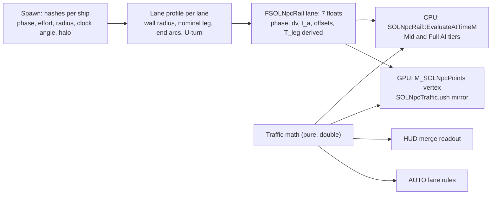
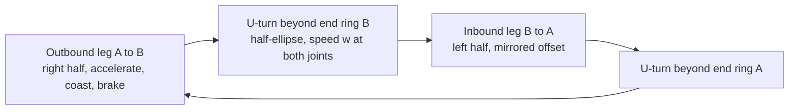

<!-- SOLTest / Copyright © 2026 Acid Rain Studios LLC -->

# SDD 50: Lane traffic flow

**Issue:** [#50](https://github.com/DieSlower/SOLTest/issues/50). Plan:
[`Plans/50-lane-traffic-flow-plan.md`](../Plans/50-lane-traffic-flow-plan.md). Builds on SDD 11 (the NPC rails, tiers
and the GPU far points), SDD 38 (the lane lines and their crossfade), SDD 49 (the guidance tunnel, its basis, end rings,
radius and labels), SDD 18 / 20 / 32 (the autopilot, route fly-through and Chase Down guidance) and SDD 21 (the HUD
event bus).
**Persistence change: none planned.** `SOL::Settings::SAVE_VERSION` stays 13 and `KEY_BINDING_LAYOUT_VERSION` stays 10
(D11). No setting, no key binding, no `UPROPERTY` of a save class changes. If the work shows that one is needed, stop
and report (section 12).
Status: **draft (2026-11-13), grill-me done (D1-D12), questions Q1-Q8 answered by the user (2026-11-13, D13-D20),
amended for the hull flip before braking (D21, section 14), Q9 answered by the user (2026-11-17, D22); 50a-50d
built and committed; 50e profiling recorded (section 15); Q11 answered by the user (2026-11-17: the flip swings toward
each ship's own top, the U-turn attitude kept) and the tunnel guide thinning decided (D23), both built (section 16);
the rendered hull's roll decided by the user (2026-11-18, D24 and D25) and built (section 16).**

## 1. Problem

Since #11 every lane ship rides a triangle wave between the two body **centres** at a random constant speed (20-150
km/s), with its lateral offset uniform over the lane disc and its direction an independent coin flip
(`SOLNpcScale::MakeSpawn`, `SOLNpcScale::LaneParamAt`). So the ships ignore the keep-right rule that the #38 lines and the
#49 tunnel display, reverse instantly at each end, fly straight through both planets, and move at the same speed
whether they are on the axis or at the wall. Issue #50 asks for real lane traffic: keep right, fast in the middle and
slow at the wall, some traffic just outside the tunnel, a way for the player to merge in, and AUTO flight that obeys
the lane.

## 2. Decisions (user, grill-me 2026-11-13)

- **D1: Keep right, U-turn outside the tunnel.** A ship's side follows its **current** direction: outbound (A -> B)
  ships on the right of the axis, inbound on the left, the convention of the #38 lines and the #49 chevrons and guide
  dots (12 o'clock = ecliptic north, SDD 49 section 4.3). At a lane end a ship leaves through the end ring, makes a
  **U-turn outside the tunnel** (a half-circle of about 2 tunnel radii beyond the end ring, at reduced speed) and
  re-enters on the opposite side, so it swaps sides there. *Reasoning (user):* the rule the display shows must be what
  the traffic does; turning outside the tube keeps the tube's two directions clean. **Future, record only:** with the
  market / trade system ships get destinations (planet, station, asteroid), leave the tunnel and go there; the data is
  designed so a destination can later replace the U-turn (section 4.11).
- **D2: Speed by radial position.** A smooth profile, fastest at the axis, falling smoothly to the comfortable wall
  speed at the tunnel wall. The per-ship random speed is replaced by the burn profile of D4. *Reasoning:* the issue's
  first idea, and the basis of merging (match the slow outer traffic, then move inward).
- **D3: Wall ("comfortable") speed = 20 km/s relative to the nearest body**, a global tunable. Outside traffic and the
  merge band move at it; the lane's end bodies' velocities matter (a ship matches the body's speed at each end).
  *Reasoning:* a speed a pilot can match and dock from, and one number for the whole system.
- **D4: Along-lane flip-and-burn.** A ship accelerates over the first half of the lane, flips at the midpoint and
  brakes over the second half, arriving at the end body at the body-matched wall speed. Per-ship effort is hashed in
  **50-100 %** of the peak acceleration; the design peak is **1.5 G + 10 % = 1.65 G (16.18 m/s^2)**; the unbraked
  peak is `v = sqrt(w^2 + a L)` at mid-lane (lane length `L`, `w` = 20 km/s); the peak is **capped at 300 km/s**, so
  long lanes run accelerate / coast / brake. *User note, recorded:* 1.65 G is above the human sustained limit (Pilot G,
  `GAME_MECHANICS.md` section 2: sustained 1.5 G, drain above); the user wants a future concept of **AI NPC pilots
  versus human NPC pilots** (AI may exceed human limits, humans obey the G limit). The design keeps that representable
  (an effort cap per pilot kind, section 4.12); for now every ship uses 1.65 G with its 50-100 % effort.
- **D5: Radial x along combination.** At the wall the wall speed everywhere along the lane; at the axis the along-lane
  profile; a smooth monotone blend between, shape chosen by this design (section 4.3, shown with its formula).
- **D6: Outside traffic (halo).** About **25 %** of lane ships travel outside the tunnel wall, out to 2x the radius,
  keeping right, following the same along-lane burn profile at the slower wall-speed factor (they speed up a little
  mid-lane; the factor is this design's, section 4.3). **Halo ships do not widen the tunnel:** the #49 width counts the
  ships inside the wall only. They still draw as points. Spawn: uniform over the disc inside the wall for 75 %, uniform
  over the annulus wall .. 2x for 25 % (a parameterised constant). The #49 label's ship count includes them (D15).
- **D7: Time warp.** Traffic speeds scale with warp as today (lane time = sim time). The player's HUD readout shows the
  real-time (unscaled, sim-second) speed and a note while warp is active.
- **D8: Player merge in manual flight.** No gameplay rule: purely visual and emergent, plus a HUD readout shown near
  the tunnel label from the outer halo (2x radius) inward: the **traffic speed here** (relative to the nearest body),
  the mean profile speed at the player's position (radial and along-lane) for the lane direction closest to the
  player's heading (defined precisely in section 4.8), and the player's difference to it with the text **TOO FAST /
  TOO SLOW / MATCHED** and a colour: **green within 5 %, amber to 20 %, red beyond**. Hidden outside 2x radius. No new
  setting unless unavoidable (none is); follows the HUD glow and the Lanes row like #49. No sound cue.
- **D9: AUTO follows the lane.** When the ship is on AUTO (autopilot, route waypoint or chase) and its path enters a
  lane tunnel it follows the traffic rules: it slows to the local traffic speed at the entry radius, enters on the
  correct (right-hand for its direction) side, holds the local traffic speed while inside and leaves normally. Outside
  lanes nothing changes. The flight model changes are minimal and listed (section 4.9); no save-schema change.
- **D10: Realism versus performance, delegated to this design.** The rail stays **closed form per ship with no per-ship
  state**: position along the lane and track radius are an analytic function of time and the ship's hashed spawn
  values; the radial speed factor is constant per ship (its lateral radius is fixed), so it enters as a per-ship
  factor; the C++ (`SOLNpcRail`) and the shader evaluate the same formula, and the near tiers (Mid and Full AI) read
  the same closed form, so there is no seam at a tier change. This design recommends the piecewise form (leg, U-turn,
  leg, U-turn), the cycle period and the per-ship phase (section 4.4), checks the 1M budget and float precision
  (sections 4.6, 9) and proposes profiling gates (section 8 item 6).
- **D11: No save-schema or key-layout change planned** (`SAVE_VERSION` 13, `KEY_BINDING_LAYOUT_VERSION` 10). A change
  found necessary goes to the open questions, never assumed approved.
- **D12: Out of scope:** VR work; destinations and the market; **security patrols** (record as future: the user's
  intent is that trade lanes carry safe traffic patrolled by security forces, and flying outside the lanes is the
  dangerous option); the thruster flame, ticket **#51** (a consumer of this ticket's burn profile: each ship's thrust
  state is derivable from the closed form, section 4.12).
- **D13: Wall radius = the drawn tunnel radius, frozen at spawn** (user, Q1, 2026-11-13). The wall is the #49 tunnel
  radius computed from the in-wall ship count and frozen for the population; the halo of D6 reaches 2x that radius.
- **D14: End rings move out to 3 tunnel radii above the surface** (user, Q2): `NPC_TUNNEL_END_MARGIN_RADII` 1 -> 3, so
  the 2-radius U-turn (D1) has its apex one wall radius above the planet. This **amends SDD 49 D12** (a one-line
  amendment note is added there).
- **D15: The label's ship count includes the halo** (user, Q3): every ship using the lane; only the tunnel width uses
  the in-wall count.
- **D16: Nominal lane length = the lane's maximum length** (user, Q4), with exact (metric) distances near the end rings
  (section 4.5): the 300 km/s cap and the 1.65 G bound hold at every geometry and the ends stay exact.
- **D17: Engine-first hull flip** (user, Q5): hulls face their thrust, flipping over about 60 s (`NPC_LANE_FLIP_S`)
  while braking; this is also what #51's flame needs. *Refined by D21: the flip finishes before braking starts.*
- **D18: Readout fallback** (user, Q6): when no tunnel label is placed, the merge readout falls back to a fixed line
  under the speed readout. *Confirmed by the user on 2026-11-16 (50c, final):* whenever the readout lane's label is
  placed (the compact one-line form too), the readout is its last line, and that label's box grows by the line and may
  overlap the guide-dot rows (it still stays on screen and never pushes another label or a HUD panel away). When the
  grown label does not fit at its anchor it slides sideways, still covering its own centred box, as close to centred
  as possible. *Q10 answered by the user on 2026-11-17 (A):* if it fits nowhere even slid, the readout uses the fixed
  fallback line. The fallback line is only for when no label of the readout's lane is placed, or when the grown label
  fits nowhere.
- **D19: AUTO obeys lane traffic rules by default, with an override** (user, Q7, changed from the recommendation): the
  autopilot follows the lane profile (accepting the slower trip, Earth - Mars about 16 days at 1x as built, see the trip time note in 4.9, instead of about 2.9).
  **But** it can fly around lanes, or ignore the safe space, when the player tells it to. How the player tells it is
  **D22** (Q9, answered 2026-11-17): the "War power move" entry of the round command menu. Not saved (D11).
- **D22: The lane-rule override is the "War power move" entry of the round (radial) command menu** (user, Q9,
  2026-11-17). When the player tells the ship to move (the Move To entry), the menu has an extra option; its final
  label is the implementer's choice, short, in `SOLMenuText` (working name "War power move"). Chosen, it (1) makes that
  single autopilot move ignore the lane rules: the plain straight direct path, no slowing to local traffic speed at the
  lane entry, no lane entered and no side kept, no steering around the halo, and the path may cross the halo and the
  wall (the dangerous option), and (2) flies at maximum thrust, 100 % effort (no comfort cap, no slowing for
  traffic). "Around" therefore means a straight line that ignores lane space, not steering around the halo. It is **per
  command only**: each normal AUTO move, route and chase obeys the lane rules by default (D19), nothing is sticky,
  nothing is saved, no schema change (`SAVE_VERSION` 13 and `KEY_BINDING_LAYOUT_VERSION` 10 stay, D11). No saved
  setting. A console flag may exist as a debug aid only, if cheap (optional, not a player feature).
  *Amended 2026-11-17 (50d review-fix round 2, user decisions):* the move is a **pulsed** burn, not burst then hold:
  pulses at `WAR_POWER_PULSE_G` 6.80 G until the meter reaches 0.4, then recovery at the sustained 1.5 G up to 0.6, hard
  floor 0.3, boost always on (section 4.9.1). Move To and War Power Move never block each other or themselves (the
  "Already flying there" block rule is removed): a new order replaces the running one, and Move To on the body
  already flown to is enabled. A lane AUTO order that stops inside a lane ends in the new mode `Left` (section 4.9).
- **D20: AUTO paths count as using a lane only when they run inside the halo for 20 or more wall radii along the
  lane** (user, Q8): a path that only crosses a lane is left unchanged.
- **D21: The hull flip finishes before braking starts** (user, 2026-11-13, refines D17). Every leg that burns has a
  mandatory zero-thrust window of `T_f` = `NPC_LANE_FLIP_S` (60 s) between the end of the burn and the start of the
  brake, in which the hull turns over (engine first). The window is centred on the leg's midpoint in time: on a lane
  with no other coast the window is exactly the flip (the ship coasts at its peak speed for 60 s); on a lane with a
  longer coast the flip sits in the middle of the coast. The leg profile, the thrust state (a new `Flip` state) and
  the hull facing are redefined in sections 4.3, 4.4 and 4.12; summary and test impact in section 14.
  *Amended by the user's Q11 answer (2026-11-17, section 16):* (a) the nose turns over toward **the ship's own top**
  `T`, a fixed roll about the travel direction per ship (a hash of its NPC index, nothing stored), not the lane's `Up`,
  so the ships of a lane flip in different planes; (b) through the U-turn the hull keeps holding its brake attitude
  (as built).
  *Amended again by D24 (user, 2026-11-18, section 16):* `T` is the ship's top about the **outbound** axis, `T_out`,
  and both flips of a cycle turn in the same plane: the outbound flip swings the nose toward `side x T_out`, the
  inbound one toward `-side x T_out` (the top the outbound flip left), `side` = +1 or -1 fixed per ship.
- **D24: The drawn hull carries a full attitude** (user, 2026-11-18, answers the section 12 open question on the
  rendered hull's roll). The hull is drawn from a forward and a body top (`LaneHullBasis`, `HullRotation`), not from
  its heading alone. Both flips of a cycle turn in the same plane, the attitude is held through the brake and the
  U-turn with no extra roll, and the flip side (top-over or bottom-over, `LaneFlipSide`) is fixed per NPC-index key.
- **D25: The flip window grows with ship length** (user, 2026-11-18) so the rotational acceleration at the ship's ends
  stays under the ship's limit: at most 1 G, lower for bigger ships, at least 0.63 G at 2 km (`LaneFlipDurationS`,
  `LaneFlipEndAccelLimitMps2`). Every hull is still the 30 m placeholder, whose window is exactly `NPC_LANE_FLIP_S`,
  so the lane math, rails and shader mirror keep the one 60 s window (open item in section 16).
- **D23: Tunnel guide thinning** (user, 2026-11-17, built in 50e; SDD 49 sections 4.5 and 4.7 amended). The tunnel
  keeps only every 6th ring of the #49 lattice (`NPC_TUNNEL_RING_KEEP_EVERY` 6), near and far, at every speed: both
  spacing terms scale by 6 (`NPC_TUNNEL_RING_BASE_SPACING_RADII` 12, `NPC_TUNNEL_RING_SPACING_PER_DISTANCE` 1.5), so
  the constant zone stays 8 tunnel radii and the kept rings are a subset of the old ones. Guide dots and wall chevrons
  sit at every kept ring and halfway to the next (`NPC_TUNNEL_DOTS_PER_GAP` 2, `NPC_TUNNEL_CHEVRONS_PER_GAP` 2), never
  at a removed ring; the end rings are unchanged.

## 3. What exists today (code survey, HEAD `f336e10`)

| Piece | Where | Facts that matter here |
|---|---|---|
| Lane spawn | `Npc/SOLNpcScaleMath.cpp` `MakeSpawn` (lane branch), `FSpawn`, `FLayout` | Hash streams: group, faction, start param, direction (+1 / -1), speed uniform in `LaneMinSpeedMps` .. `LaneMaxSpeedMps` (2e4 .. 1.5e5, `DefaultLayout`), lateral offset uniform over the lane disc `R sqrt(h)` at a uniform angle |
| Lane motion | `SOLNpcScale::TriangleWave01`, `LaneParamAt`, `LanePositionM`, `LaneBasis` | Param in [0, 1] from body centre A to body centre B (ships pass through both bodies), rate per **nominal** length, position `A + s (B - A)` on the **current** lane, lateral basis `U = Z x a`, `V = a x U` (reference +X when `|a.z| >= 0.9`): for an ecliptic lane `U` = the tunnel's `-Right`, `V` = its `Up` |
| Rail | `Npc/SOLNpcRail.{h,cpp}` `FSOLNpcRail` (32 bytes: kind, faction, group, `P[7]`) | Lane uses P0 start param, P1 signed rate, P2-P3 lateral offset; **P4-P6 free**. `FromSpawn(spawn, groupBase, laneLengthM, bodyGM)`, `EvaluateAtTimeM`, `VelocityMps` (central difference, 0.5 s), `AdvancedToEpoch` (wraps the period-2 param), `GroupDistanceM` (lane capsule of radius `R`) |
| Epoch | `ASOLNpcVisuals::FillRailTexels`, `NPC_GPU_RAIL_EPOCH_S` 1e4, min interval 2 s | The GPU copy is re-based so the shader's float time stays small; the lane histogram (`AccumulateLaneShips`) is counted there |
| GPU far points | `Tools/Npc/create_npc_assets.py` `VERTEX_HLSL` (kind 1 branch), `M_SOLNpcPoints` | Float: triangle wave, normalize, cross, `pA + axis s + u x + v y`; three vertices per point (the full rail evaluation runs per vertex); the Q5 crossfade reads `NpcTunnelTex`; group texture `NpcGroupTex` 64 x 2 (row 0 `A` rel + `R`, row 1 `B` rel + drawn flag) |
| Spawn | `USOLNpcSubsystem::Spawn` | Nominal lane length = body distance at the spawn epoch; rails built in parallel; per-lane speed bound `NPC_WAKE_SPEED_MARGIN` (1.25) x `LaneShipSpeedBoundMps(150 km/s, nominal, current, R, endpoint speed)` recomputed per frame |
| Tiers | `SOLNpcTierProcessor`, `SOLNpcFullAiProcessor`, `SOLNpcMidProcessor` | Every tier positions a ship as `SOLNpcRail::EvaluateM(rail, frame) + deviation`; heading `SOLNpcAi::HullForward(VelocityMps + deviation velocity, ...)` |
| Pilot kinds | `Flight/SOLNewtonianFlight.h` `ESOLPilotKind`, `EffectiveGCapG`, `HUMAN_MAX_G`; `SOLNpcAi` classes carry a `PilotKind` | Already used for NPC combat G caps; not used by lane traffic (D4: 1.65 G for all, for now) |
| Tunnel | `Npc/SOLNpcTunnelMath` (`TunnelBasis`, `TunnelRadiusM(R, shipCount)`, end arcs `R_body + NPC_TUNNEL_END_MARGIN_RADII x Rt`), `USOLNpcTunnelComponent` | Radius from the lane's **whole** ship count (`FSOLNpcLaneEntry::ShipCount`); label line 3 = that count |
| AUTO | `SOLFlight::AutopilotStep`, `SOLFlight::ChaseStep`, `USOLShipFlightProcessor` | Rendezvous guidance (`ComputeRendezvousGuidance`) toward a target with velocity and acceleration inputs, route fly-through (`PassSpeedMps`, `CaptureRadiusM`), then `FlyGuidance`; three AUTO kinds: body, route waypoint, chase |
| HUD | `UI/SOLFlightHud`, `UI/SOLLaneTunnelLabel`, `HudEvents/SOLHudBus` | Tunnel labels published by Npc on the bus; HUD formats and places them |

Known debt not to re-report (grep of `Docs/TECH_DEBT.md`): the NPC worst case with every Demo option at its maximum;
the Q5 extra points cost inside a tunnel (SDD 49 D21); the tunnel CPU cost at its budget (SDD 49 D20); the labels
avoiding last frame's HUD boxes and no UMG widgets; `Npc` leaning on the orbit lines' actor code; the `Npc <-> Menu`
cycle; the duplicated view-size helper of the profile smokes.

## 4. Design

### 4.1 Overview

A new pure math unit (`Traffic/SOLLaneTrafficMath`, section 4.10) defines the lane traffic as closed-form functions:
the radial factor, the per-ship leg profile, the metric end zones, the cycle (leg, U-turn, leg, U-turn) and the mean
speed field. At spawn each lane gets a frozen **lane profile** (wall radius, nominal leg, end arcs, U-turn depth) and
each ship a rail that holds its phase and its precomputed leg constants. The CPU tiers, the GPU far points (a new
`Shaders/Private/SOLNpcTraffic.ush` mirror), the HUD readout and the AUTO lane rules all call the same functions. No
per-ship state is added and no per-frame per-ship CPU work exists outside the tiers that already evaluate rails.

### 4.2 Lane geometry: wall, halo, end rings, U-turn

Per lane (frozen at spawn unless stated):

- `R`: the lane radius of the layout (`FLaneDef::RadiusM`), unchanged meaning for #38 (line fade) and #49.
- **Wall radius `Rw`** = `SOLNpcTunnel::TunnelRadiusM(R, inWallCount)`, the #49 tunnel radius computed from the
  **in-wall** ship count (D6), frozen for the population and stored in `FSOLNpcGroupTable::LaneWallRadiusM`. The tunnel
  draws at exactly this radius (it no longer recomputes it from the whole count), so the drawn wall and the ships'
  inside / outside split agree. *(D13: wall = tunnel radius.)*
- **Halo outer radius** `H x Rw`, `H` = `NPC_LANE_HALO_OUTER_WALL_RADII` (2). The lane's culling capsule
  (`GroupDistanceM`) uses `H x Rw` instead of `R`.
- **Nominal length `L0`** and **nominal leg `l0`** = `L0 - R_A - R_B - 2 m Rw` between the two end rings (`R_A`, `R_B`
  body radii from the registry, `m` = `NPC_TUNNEL_END_MARGIN_RADII`). Nominal is the lane's maximum length (D16,
  section 4.5).
- **End ring arcs** (SDD 49 section 4.3, now with `Rw`): `e_A = R_A + m Rw` from A; the arrival ring at `R_B + m Rw`
  before B.
- **U-turn depth** `D_U` = `NPC_LANE_UTURN_DEPTH_WALL_RADII` (2) x `Rw` beyond the end ring (D1). **Conflict found and resolved (D14):**
  with #49's margin `m` = 1 the apex of a 2-radius turn lies `1 Rw` *inside* the body's surface radius along the axis,
  so near-axis ships would fly through the planet (Earth - Mars: end ring 6.4e6 + 8.6e6 m from Earth's centre, apex at
  6.4e6 - 8.6e6 < 0, past the centre). The user moved the end rings out to `m` = 3
  (apex one wall radius above the surface).
- **Drivable:** a lane whose nominal leg is not above `2 Z` (section 4.5) is not drivable; since `Z = min(0.05 l0,
  l0 / 2)` that means a nominal leg `<= 0` (the end rings meet or cross; a leg within the rounding of the end-ring
  subtraction counts as 0). Its ships stay on the lane's midpoint disc at rest. No default lane is close (asserted by
  a test).

### 4.3 Speed profile (D2-D6)

Constants: `w` = `NPC_LANE_WALL_SPEED_MPS` (2.0e4), `a` = `NPC_LANE_PEAK_ACCEL_G` (1.65) x `STANDARD_GRAVITY` = 16.18
m/s^2, `c` = `NPC_LANE_SPEED_CAP_MPS` (3.0e5), effort `eps` in [`NPC_LANE_EFFORT_MIN` 0.5, `NPC_LANE_EFFORT_MAX` 1.0],
the reference (mean) effort `eps_ref` = `NPC_LANE_EFFORT_MEAN` (0.75).

**Radial factor** `kappa = K(rho)` of a ship at `rho` wall radii from the axis (constant per ship):

- inside the wall (`rho` <= 1): `K = 1 - rho^2` (the laminar "pipe flow" parabola: 1 on the axis with zero slope, so
  smooth there; 0 at the wall; strictly decreasing);
- halo (`1 < rho <= H`): `K = kappa_h x smoothstep(1, 1 + r_h, rho)`, `kappa_h` = `NPC_LANE_HALO_KAPPA` (0.01), `r_h` =
  `NPC_LANE_HALO_RAMP_WALL_RADII` (0.25). Zero at the wall (continuous with the inside, D5: wall speed at the wall),
  rising to `kappa_h` a quarter radius out. A halo ship moves like a ship at `sqrt(1 - kappa_h)` = 0.995 wall radii
  inside the wall: at the wall speed near the ends and a little faster mid-lane (D6).

**Blend (D5), in squared speed.** A ship with factor `kappa` and effort `eps` uses the acceleration `alpha = kappa eps
a` and the cap `c_k` with `c_k^2 = w^2 + kappa (c^2 - w^2)`. Its speed at leg coordinate `u` (metres from the departure
end ring along a nominal leg `l0`) is

    v(u)^2 = min(w^2 + 2 alpha min(u, l0 - u),  c_k^2)
           = w^2 + kappa x [ min(w^2 + 2 eps a min(u, l0 - u), c^2) - w^2 ]

so `v^2 - w^2` is exactly `kappa` times the axis ship's `v^2 - w^2` at every point (accelerating, coasting and braking
phases start at the same `u` for every `kappa`). It equals the wall speed at the wall (`kappa` = 0) and at both end
rings, the axis profile at the axis, and is smooth and strictly monotone in `rho` in between. Peak (mid-lane or the cap)
`v_p = min(sqrt(w^2 + alpha l0), c_k)`: D4's `sqrt(w^2 + a L)` with the leg for `L`. *(Pre-D21; superseded by the
paragraph below. The speed law `v(u)^2 = min(w^2 + 2 alpha min(u, l0 - u), v_p^2)` stays, only `v_p` changes.)*

**Peak with the flip window (D21).** A leg that burns keeps a zero-thrust window of `T_f` = `NPC_LANE_FLIP_S` (60 s)
between the burn and the brake, so its coast is `t_c >= T_f`. With `l0 = 2 d_a + v_p t_c`, `d_a = (v_p^2 - w^2) / (2
alpha)` and the shortest coast `t_c = T_f`, the uncapped peak solves `v^2 + alpha T_f v - (w^2 + alpha l0) = 0`:

    v_f = sqrt((alpha T_f / 2)^2 + w^2 + alpha l0) - alpha T_f / 2
    v_p = max(w, min(v_f, c_k))

computed without cancellation as `dv = v_p - w = max(0, min(dv_f, dv_c))`, with

    dv_f = 2 alpha (l0 - w T_f) / ( (2 w + alpha T_f) + sqrt((2 w + alpha T_f)^2 + 4 alpha (l0 - w T_f)) )
    dv_c = kappa (c^2 - w^2) / (c_k + w)

(`dv_f` is the positive root of `dv^2 + (2 w + alpha T_f) dv - alpha (l0 - w T_f) = 0`). Then `t_a = dv / alpha` (0
when `alpha` = 0), `d_a = t_a (w + dv / 2)`, `t_c = (l0 - 2 d_a) / v_p`, `T_leg = 2 t_a + t_c`, as before.

- **Reduces to the old profile at `T_f = 0`:** `v_f = sqrt(w^2 + alpha l0)` and `dv_f = alpha l0 / (w + sqrt(w^2 +
  alpha l0))`, the pre-D21 formulas.
- **Capped legs** (`l0 >= (c_k^2 - w^2) / alpha + c_k T_f`; axis ship at full effort: 5.555e9 m, was 5.537e9):
  `v_p = c_k`, `t_c = (l0 - 2 d_a) / c_k > T_f`; peak, `t_a`, coast and leg time are **unchanged** from pre-D21, and
  the flip sits in the middle of the coast.
- **Uncapped legs:** `t_c = T_f` exactly (the window is the whole coast); the peak is a little lower and the leg time
  about the same (the 60 s coast replaces the last few km/s of burn).
- **Short legs** (`l0 <= w T_f` = 1,200 km; no default lane, the shortest default leg is Earth - Moon at about 3.95e8
  m): `dv_f <= 0`, so `dv` = 0, `t_a` = 0, the ship moves at `w` over the whole leg with no burn, no brake and **no
  flip** (the hull keeps facing travel). The peak is reduced, never below `w`, and continuous at `l0 = w T_f` (`dv ->
  0`). The lane stays drivable (section 4.2's rule is unchanged).
- **Blend:** in the burn phases `v^2 - w^2` is still exactly `kappa` times the axis ship's; the peaks follow `v_p^2 -
  w^2 = min(alpha (l0 - v_p T_f), kappa (c^2 - w^2))`, so on an uncapped leg the coast starts at `d_a = (l0 - v_p T_f)
  / 2`, which moves with `v_p` by at most `v_p T_f / 2` (about 2,500 km on Earth - Moon) instead of being the same `u`
  for every `kappa`. Still `w` at the wall and at both end rings, and still strictly monotone in `rho`: `dv_f / d alpha
  > 0` exactly when `l0 > w T_f`, and `c_k` grows with `kappa`, so both terms of the `min` in the speed law grow with
  `kappa`.
- **No speed changes in the window itself:** the flip is attitude only; positions, the metric map and the wake bound
  see only the lower `v_p` (section 4.7).

**Mean speed field** (HUD and AUTO): `vbar(u, rho)` = the speed above with `eps = eps_ref`: the speed of a
mean-effort ship at that radius. With `eps_ref` = 0.75 the axis acceleration is 1.24 G, below the human sustained 1.5 G,
so the player's AUTO can fly it (section 4.9).

Examples (axis ship, `eps` = 1, `Rw` from the default 1M population; times at 1x; D21 profile):

| Lane (leg) | Peak | Accelerate | Coast (flip) | Leg time |
|---|---|---|---|---|
| Earth - Moon (about 3.95e8 m) | 81.9 km/s (uncapped; 82.4 before D21, -0.6 %) | 1.06 h (3,827 s) | 60 s, all of it the flip | 2.14 h (+0.2 s) |
| Earth - Moon, effort 0.5 | 59.7 km/s (60.0 before, -0.4 %) | 1.36 h | 60 s | 2.74 h (+0.1 s) |
| Earth - Mars (at 1.5 AU, 2.25e11 m) | 300 km/s (cap, unchanged) | 4.8 h, 2.8e9 m | 8.5 d, flip in its middle | 8.9 d (unchanged) |
| Halo, Earth - Mars | 36 km/s (cap `c_k` with `kappa_h` 0.01, unchanged) | 27 h, 2.8e9 m | 71 d, flip in its middle | about 73 d (unchanged) |

Every planet lane (Mercury - Venus up to Uranus - Neptune) is capped for every ship, so only the Earth - Moon lane's
numbers move. The default layout has no Sun lane (the "Sun" entry is the asteroid-belt cluster).

### 4.4 Closed-form cycle (D1, D10)

Per ship, precomputed in double at spawn (`MakeLegProfile`): `alpha`, `v_p` (D21 formula, section 4.3), `dv = v_p -
w`, `t_a = dv / alpha` (accelerate time; 0 when `kappa` = 0), `d_a = w t_a + dv t_a / 2` (accelerate distance), `t_c =
(l0 - 2 d_a) / v_p` (coast, `>= T_f` whenever `dv > 0`, D21), `T_leg = 2 t_a + t_c`. Per lane: `T_U = pi D_U / w`
(U-turn time). Cycle `T_cyc = 2 T_leg + 2 T_U`. *(D21 changes only how `dv` and `t_a` are chosen; the derivation of
`T_leg` below is pure geometry, so the rail layout and the shader mirror do not change.)*

**Only `dv` and `t_a` are stored; `T_leg` is derived at evaluation** (`LaneShipLegS`, 50a review): `t_c = (l0 - 2 t_a
(w + dv / 2)) / (w + dv)` from the stored (float on the rail) `dv`, `t_a` and the lane's `l0`, so `2 d_a + v_p t_c = l0`
holds for the rounded values too and the leg is evaluated from the nearer end **in time** (`s = min(tl, T_leg - tl)`,
split at `T_leg / 2`), so the two halves meet exactly. A stored `T_leg` (as first built) let the halves disagree by
`l0 - 2 d_a - v_p t_c`, up to about 18 km on Earth - Mars once rounded to float (a visible jump mid-leg). On an
uncapped leg the rounded `t_a` can overshoot `l0 / 2` by a rounding step, giving a tiny negative `t_c`: allowed, the
halves then meet inside the accelerate phase, off by `alpha (t_c / 2)^2` (below a micrometre). The test
`SOLTest.NpcTrafficMath.FloatRail` rounds every stored value to float and checks 1 m continuity at `T_leg / 2 +- 1 ms`,
the joints and the exact end rings.

**Phase formula (CPU, 50b).** `tau = (phi T_cyc + t) mod T_cyc` with `phi = P0 + P5` in double
(`SOLLaneTraffic::CycleSegmentAt`): P0 is the phase's high float, P5 its low part, so `P0 + P5` holds the phase to about
1e-14 and the motion no longer steps in time (the single-float phase stepped in `ulp x T_cyc`, up to 1.3 s on a long
cycle). The GPU evaluates the same formula in the double-float form of section 4.6.

- **Cycle time** `tau = frac(phi + t / T_cyc) x T_cyc`, `phi` the ship's hashed phase in [0, 1), `t` the rail time
  (sim seconds since the population epoch, so D7 holds). Segments: `[0, T_leg)` outbound leg, `[T_leg, T_leg + T_U)`
  U-turn at B, then the inbound leg, then the U-turn at A. Uniform phases spread the ships evenly in time over the
  cycle, so the line density is proportional to `1 / v`: about 15 times denser near the end rings than mid-lane on a
  capped lane (traffic piles up near the planets, as it should).
- **Leg arc** `u(tl)`, `tl` the time into the leg: `w tl + alpha tl^2 / 2` while `tl <= t_a`; `d_a + v_p (tl - t_a)`
  while coasting; `l0 - (w tb + alpha tb^2 / 2)` with `tb = T_leg - tl` while braking (`alpha = dv / t_a`, written with
  selects, no divergent branch). `u(0) = 0`, `u(T_leg) = l0`, speed `w` at both ends. As built (50a review): with `s =
  min(tl, T_leg - tl)` the arc from the nearer end ring is `w s + alpha s^2 / 2` while `s <= t_a`, else `d_a + v_p (s -
  t_a)`; `u` is that arc in the first half and `l0` minus it in the second (the same curve, one formula).
- **Along position** on the current lane: `x = e_A + X(u)` from A (outbound), `x = e_A + l(t) - X(u)` (inbound), with
  the metric end-zone map `X` of section 4.5 and the current leg `l(t)`. Evaluated from the **nearer end** (from A
  while `X <= l / 2`, else from B: `B - a (R_B + m Rw + l - X)`), which halves the magnitudes and keeps ships near
  either body exact relative to it (section 4.6).
- **Lateral** (keep right): the ship's clock angle `psi` in [0, pi] (clockwise from 12 o'clock looking from A to B, the
  right half) and radius `rho Rw`: outbound offset `rho Rw (cos psi Up + sin psi Right)`, inbound `rho Rw (cos psi Up -
  sin psi Right)` (mirrored across the vertical plane, so the radius and the radial factor stay the same). `Up`, `Right`
  are the lane's #49 basis (`SOLNpcTunnel::TunnelBasis`, ecliptic north, pole blend), computed per lane per frame in
  double on the CPU and uploaded, so the ship sides match the drawn chevrons exactly and the shader needs no
  normalize / cross / pole branch. (Today's `LaneBasis` is dropped for lanes.)
- **U-turn at B**, `theta = pi (tau - T_leg) / T_U` in [0, pi]: position `B - a (R_B + m Rw) + a D_U sin(theta) + rho Rw
  (cos psi Up + cos(theta) sin psi Right)`: a half-ellipse in the plane of the axis and `Right`, depth `D_U` beyond the
  end ring, lateral from `+sin psi` to `-sin psi`. Its speed is `w` at both joints (`D_U theta' = w`), so position and
  velocity are continuous with both legs, and it slows to `rho sin(psi) Rw w / D_U` at the apex (the "reduced speed" of
  D1; near-axis ships nearly stop and reverse). **U-turn at A** mirrors it (`+ a (R_A + m Rw) - a D_U sin(theta)`, lateral
  `-cos(theta) sin psi`).
- **Planet clearance:** the apex lies `m Rw - D_U` above the body's surface along the axis (D14).
- **Hull facing** (mesh and instanced tiers; D17 refined by D21): today the hull faces its velocity. The lane hull faces
  its thrust: nose first while accelerating, engine first while braking, turning over in the flip window between.
  - **Flip fraction** on a leg, `tl` the time into the leg: `f(tl) = S((tl - (T_leg - T_f) / 2) / T_f)`,
    `S(x) = 3 x^2 - 2 x^3` with `x` clamped to [0, 1] (zero angular rate at both ends, peak `1.5 pi / T_f` = 4.5
    degrees per s). The
    window `[T_leg / 2 - T_f / 2, T_leg / 2 + T_f / 2]` is centred on the leg's midpoint in time and lies inside the
    coast (`t_c >= T_f`): it starts when the burn ends or later and ends when the brake starts or earlier; on an uncapped
    leg it is the whole coast. `f` = 0 on a leg with no brake (`t_a` = 0: `kappa` 0, or `l0 <= w T_f`). After the
    rail's float rounding an uncapped leg's derived `t_c` can be below `T_f` by a rounding step, so the window may
    overlap a burn by microseconds; accepted (the thrust state's burn kinds win, section 4.12).
  - **Hull forward on a leg:** `F = cos(pi f) d + sin(pi f) T`, `d` the travel direction (`+Axis` outbound, `-Axis`
    inbound), `T = LaneShipTopVector(key, d, Up)` the ship's own top *(Q11a, user 2026-11-17; first built with the
    lane's `Up`, so every ship pitched over ecliptic north)*: `T = cos(theta) U + sin(theta) (d x U)`, `U` the lane's
    #49 `Up` projected off `d`, `theta` a roll in [0, 2 pi) from murmur3's 32-bit finaliser of the key (the NPC index),
    so one ship keeps one roll on both legs and every lane and nothing is stored. So `F = d` (facing travel) through
    the burn and up to the window, `F = T` at its middle, `F = -d` (facing the brake thrust) from the window's end to
    the end ring. *Amended by D24 (user, 2026-11-18, section 16): `T` above becomes `side x B`, `B` the leg's starting
    top (`T_out = LaneShipTopVector(key, +Axis, Up)` outbound, `-T_out` inbound), so both flips turn in one plane, and
    the drawn hull carries a full attitude (`LaneHullBasis`).*
  - **No end-zone interaction:** the flip is placed on the nominal leg time; the metric map changes the along-lane
    speed only, never its direction (`X' > 0`), so `d` and `F` are the same on the current leg. The window's arc span
    `v_p T_f` (about 4,900 km on Earth - Moon, 18,000 km on a capped lane) lies far inside `[Z, l0 - Z]` on every
    default lane; on a lane where it reaches a zone nothing breaks (only section 4.12's known map term applies there).
  - **Re-turn at the lane end (recommended, D21):** through the U-turn the hull **holds its brake attitude in world
    space**, `F = -Axis` at B and `+Axis` at A, while the velocity turns 180 degrees under it. Relative to travel the
    hull therefore turns from engine first back to nose first over the whole arc (`T_U = pi D_U / w`) and enters the
    next leg facing travel with `f` = 0. `F` is continuous at all four joints, the hull does not rotate in the turn,
    and it is aligned with the turn's thrust at the apex (`w^2 / D_U` toward `-Axis` at B). A ship whose leg has no
    brake keeps today's velocity facing in its turns (it arrives nose first). *Alternative not taken:* the hull follows
    the turn's centripetal thrust (a 90-degree jump at the joints for a ship with a lateral offset).
  - `SOLLaneTraffic::LaneHullFlipFraction` and `LaneHullForward` (section 4.12) evaluate this; the thrust state is
    derivable (section 4.12).

### 4.5 Lane length drift (D16)

The lanes stretch and turn as the planets move (Earth - Mars about 0.37-2.67 AU over a synodic period, reached in
about a minute of real time at the 30 d/s warp). The closed form cannot integrate a varying length per ship without
state, so the ship advances on the **nominal** leg `l0` and is mapped onto the **current** leg `l(t)` by a monotone map
that is **metric near both end rings**:

    X(u) = u + (l - l0) J(u) / J(l0)
    J(u) = Z P(u / Z)                   for u < Z,          P(s) = s^3 - s^4 / 2
         = Z / 2 + (u - Z)              for Z <= u <= l0 - Z
         = (l0 - Z) - Z P((l0 - u) / Z) for u > l0 - Z,     J(l0) = l0 - Z

`Z` = `NPC_LANE_METRIC_ZONE_FRACTION` (0.05) x `l0` (`J'` is a smoothstep ramp over the zone, so `X(0) = 0`, `X(l0) = l`,
`X' = 1` at both ends). The ship therefore leaves and reaches each end ring exactly at the wall speed relative to that
end's body (D3), the end rings and U-turns sit at their metric places whatever the length (planet clearance holds),
and the stretch goes into the middle. `X` is monotone whenever `l > Z` (every default lane: `l / l0` stays above about
0.137, Earth - Mars at its closest, with the recommended nominal length). *(50a review:)* the lane frame floors `l` at
`1.001 Z` (`MakeLaneFrame`; never reached on a real lane, it also keeps `l >= 0` when the end rings cross) and moves B's
end ring and U-turn out by the excess (`FSOLLaneFrame::EndShiftM`, 0 on every real lane), so evaluations from either
end agree; the map functions read a shorter `l` the same way. `l - l0` is computed in double on the CPU per lane per frame and uploaded, so the
shader never subtracts two large floats.

The mid-lane speed scales by about `l / l0`. **Nominal length (D16):** the lane's **maximum** length (sum
of the two bodies' aphelion distances; a moon's apoapsis for a planet - moon lane), so `l <= l0` always: the 300 km/s
cap and the 1.65 G bound hold at every geometry, the ends stay exact, and the middle slows when the bodies are close
(Earth - Mars mid-lane about 40 km/s at opposition, with the same leg time). The alternative is today's spawn-time
length, where the middle can run up to about 7x faster than the cap.

### 4.6 GPU evaluation, precision and cost (D10)

**Rail layout (lane kind, CPU)**, 32 bytes and two texels, unchanged by the 50b review fixes: P0 `phi` high float, P1 `dv`
(m/s, stored directly so a halo ship's tiny `dv` does not cancel in float), P2 the up offset `rho Rw cos psi` (m), P3 the
right offset `rho Rw sin psi` >= 0 (m), P4 `t_a` (s), P5 the phase's low part (`P0 + P5` = the phase to about 1e-14),
**P6 reserved** (0; the future destination hook, section 4.11). `T_leg`, `T_cyc` and `alpha` are derived on the CPU
(`2 t_a + (l0 - 2 t_a (w + dv / 2)) / (w + dv)`, `2 T_leg + 2 T_U`, `dv / t_a`). `AdvancedToEpoch` advances `phi` by
`delta / T_cyc` in double and wraps it into [0, 1), re-splitting it into P0 and P5.

**GPU upload (built per epoch in double).** A new `SOLNpcRail` function builds the two GPU texels from the CPU rail and the
lane profile; `ASOLNpcVisuals::FillRailTexels`, the smoke and the test all call it (one source of truth). With `tau0 =
phi x T_cyc` (the cycle time at the GPU epoch) computed in double and split into a high and a low float:

- texel A = (packed kind / faction / group plus `r / (2 ulp(T_leg))` as a fraction, `tau0` high float, `dv`, up offset);
- texel B = (right offset, `t_a`, `tau0` low float, `T_leg`).

`T_leg` is computed in double (`LaneShipLegS`) and rounded once, so the shader no longer derives `T_leg` in float from
`l0` and the per-ship coast divide is gone. Its rounding `r = T_leg - float(T_leg)` (up to `v_p x ulp(T_leg) / 2`, about
15 km on Earth - Mars, twice that on the inbound leg's far half) rides in the packed value's fraction, within +-0.25 of
the integer (the vertex node decodes kind, faction and group by rounding, so they are unchanged); the shader decodes `r`
(`SOLNpcRail::GpuLegUlpS`, exponent bits x 2^-23) and carries it into the moving part of every leg boundary passed and
into the far-half time to the leg's end (50b test pass, 2026-11-16: Earth - Mars 42 km -> 28 km).

**Group texture** `NpcGroupTex` grows from 64 x 2 to 64 x 6 rows (per frame, 8 lanes, about 6 KB per upload): rows 0 and 1
unchanged (`A`, `B` relative to the viewpoint, `R`, drawn flag); row 2 `Up` with `.w` the wall speed (written by
`WriteLaneTrafficTexels` from `SOL::NPC_LANE_WALL_SPEED_MPS`, so retuning it cannot desync the material); row 3 `Right`,
`D_U`; row 4 `pi / T_U`, `e_A`, `l0`, `Z`; row 5 `R_B + m Rw - end shift`, `T_U`, `(l - l0) / (l0 - Z)`, `1 / Z`. (Row 2
`.w` used to hold `Rw` and row 4 `.x` `l - l0`; no shader read either.) Cluster and battle columns ignore rows 2-5.
`SOL::NPC_GROUP_TEXTURE_ROWS` names the count.

**Shader.** The lane branch of the point vertex node calls `SOLNTR_LaneShipRelM(railA, railB, g0, g1, g2, g3, g4, g5,
t)` from `Shaders/Private/SOLNpcTraffic.ush` (header: mirror of `Traffic/SOLLaneTrafficMath.cpp` and
`SOLNpcRail::EvaluateAtTimeM`, both ways): the two rail texels, the lane column's six group rows and the rail time.
There is no `w` parameter: the wall speed is data in row 2 `.w`. `M_SOLNpcPoints` is rebuilt by `create_npc_assets.py`
(`-SOLRebuild`, editor closed) to include it and pass the six rows; later formula changes need no rebuild. The
evaluation is a double-float scheme, in float arithmetic throughout:

- **Cycle time as a pair.** The cycle time is `(tau0 high, tau0 low + t)`: the epoch part is fixed, the moving part
  small.
- **Segment choice.** The segment is chosen by comparing `(segment constant - boundary) + moving part`. The boundaries
  are subtracted from `tau0` high one float at a time (each step exact by Sterbenz, or rounded at the result's size), and
  the rounding of the inbound boundary is carried into the moving part (Fast2Sum, `precise` in HLSL).
- **Coast.** Beyond the end zones the arc is split into an epoch constant (`v_p s_const - dv t_a / 2`, times `(1 +
  stretch)`, minus `stretch Z / 2`) and the moving part `(1 + stretch) v_p s_moving`, added after the large terms, so the
  motion is smooth (no repeated positions) at any distance.
- **Accelerate and end zones (2026-11-16, third 50b pass).** The end zones are not short: `Z` is 5 % of the nominal leg
  (2e10 m on Earth - Mars), so the direct float arc there stepped in `ulp(arc)`, up to kilometres, and slow ships (near
  the wall or in the halo) repeated positions. The accelerate arc is now split the same way, `w S + alpha S^2 / 2` and
  `(w + alpha S) m + alpha m^2 / 2` (`S`, `m` the segment time's constant and moving parts), and the end-zone map by the
  ramp's exact difference quotient: `X(c + m) = X(c) + m (1 + stretch Q)`, `Q = 3u^2 - 2u^3 + d (3u - 3u^2) + d^2 (1 -
  2u) - d^3 / 2`, `u = c / Z`, `d = m / Z`. The quadratic split is taken only while `|m| <= s` (its terms then stay at
  the arc's scale; for `s < |m|` the terms cancel and their rounding showed as 100 m frame noise near the rings late in
  an epoch window) and `|d| <= 1`; otherwise the arc is direct from `s`, which is then under one epoch span from the
  ring, where `ulp(arc)` is under 7 % of a frame's motion. Measured (`SOLTest.NpcRail.GpuLaneCycleSweep`, 24 hashed ships
  x 40 cycle times x 60 frames, 2,000 km away, 9,000 s into the window): repeated end-zone frames before / after: Earth
  - Mars 498 / 0 of 5,760 (554 / 0 at 0.6 L0), Jupiter - Saturn 2,345 / 0, Saturn - Uranus 4,000 / 0; the worst frame
  step off the CPU's 0.52 / 0.15 px (0.55 / 0.26 at 0.6 L0), 2.75 / 0.16 px and 5.38 / 0.15 px at 2,000 km and 1080p;
  Earth - Moon 0 repeats before and after; the coast was never affected (0 of 51,840). The second review's V5 finding
  (227-239 repeated far-point positions of 6,000 frames with the samples spread over the whole lane) was this end-zone
  stepping: a real one-frame stall of the far points, about 1 px at the Mid radius on Earth - Mars and up to 5 px on
  the outer lanes. Cost: 171 -> 213 float ops in the function alone (Windows SDK DXC, `cs_6_0 -O3 -Zpr -HV 2018`).
- **Divides.** The per-lane `pi / T_U` (row 4) replaces the per-vertex divide in the U-turn angle. The remaining
  per-vertex divides are `alpha = dv / t_a` and the wrap count.
- **`precise`.** UE compiles shaders with fast math (DXC emits `fast` on every float op unless `-Gis`), which lets the
  compiler regroup a double-float pair and lose its low part. Every term of the scheme is therefore `precise`: the
  cycle constants and the inbound Fast2Sum, `T_leg`'s rounding carry, the coast split (epoch constant and moving
  part), `fromRing*M`, the ring position and the leg position (the "large terms first, moving part last" sum). DXC
  propagates `precise` to everything that feeds a marked value. Verified on the DXIL (second review, 2026-11-16): the
  engine's `dxcompiler.dll` (DXC 1.8) with UE's SM6 flags (`-O3 -Zpr -HV 2018`, no `-Gis`), `vs_6_6`, the function
  alone: before, 129 of 149 float ops carried `fast`; after, 47 of 153, all of them in the U-turn and not-drivable
  branches (153 - 106 = 47). With those two branches stubbed out, none of the 103 float ops that feed the leg position
  carries `fast`. The C++ mirror (`SOLNpcTrafficMirror.h`) needs `/fp:precise` for the same sums, which UBT uses for
  editor targets (tests and smoke); a game build's `/fp:fast` only affects the visuals' hand-over (below), by
  milliseconds of motion.

**Precision.** The remaining CPU / GPU difference is the float rounding of the lane ends relative to the viewpoint, of the
large constant terms (about `ulp(l0)`), and of `T_leg` (`v_p x ulp(T_leg) / 2` in the far half of a leg). The endpoint
float error (about 9 km at 1 AU) is avoided near either body by the nearer-end evaluation. Targets: **Earth - Mars below
30 km mid-lane, and no repeated positions mid-lane at 60 Hz** (the single-float design had about 27 km and stepped in time:
`frac(phi + t / T_cyc)` changed only in `ulp x T_cyc` steps, about 0.16 s on a short axis cycle to about 1.3 s on a long
halo cycle). Measured (50b review fixes, see the plan's change log): Earth - Mars mid-lane 27.8 km (worst anywhere on the
lane, case 10; 7.7 km at the smoke's hand-over), outer lane 307.5 km (Saturn - Uranus; Uranus - Neptune 433.6 km, both
within the case-10 bound, whose `ulp(l0)` term is 524 km there), repeated frames mid-lane 0 of 7,200 (smoke hand-over 0 of
6,000). Ships closer than the Mid radius (2,000 km) are evaluated on the CPU in double from the
same rail floats, so the difference only shows at the hand-over. A contract case (section 6 case 10) re-implements the
shader formula in C++ float and asserts the bound per default lane; the smoke (section 8 V5) checks the hand-over and the
smoothness over time.

**Mid hand-over of the CPU points (second review, 2026-11-16).** The shader hides a lane ship by its own float length
`length(relM) < Mid radius`, while the CPU used to decide from the double rail distance and draw the double position:
the two positions differ by the error above (28 km on Earth - Mars to 430 km on the outer lanes, about 17-265 px at
2,000 km at 1080p), so a ship crossing the radius popped, and near the radius could be drawn twice or not at all.
`ASOLNpcVisuals::UpdateCpuShips` now evaluates `SOLNpcTrafficMirror::LaneShipRelM` for every Point-tier lane ship on
this frame's GPU inputs (`SOLNpcRail::GpuRailTexels` at the GPU epoch, the uploaded group rows, the shader's rail
time), draws it exactly when the mirror's float length is below the Mid radius (the shader's test), and draws it at
`SOLNpcTrafficMirror::CpuPointHandOver`: the mirror's position at the Mid radius, smoothstepped to the double position
(rail plus deviation) at the instanced hull radius (200 km by default), where the hulls start. The pass runs in
parallel before the slot pass (two texels and one float evaluation per Point-tier ship, no allocation). Cluster and
battle ships keep the rail-distance test. Measured (smoke V5, 1280x720 and 1920x1080, two views): no Earth - Mars ship
lay within 0.5-2 Mid radii of either view at 1M ships, so each check takes 100 sampled ships seen from viewpoints that
make them cross the radius (1,888-2,111 km); the float mirror is within 11.2-19.7 km of the CPU (0.06-0.10 of the
case-10 bound), the drawn point steps within 0.003 px of the far point at the Mid radius (limit 0.5 px), where the
double position alone would pop up to 3.1 px at 720p and 7.1 px at 1080p on those samples.

**Lane hand-over margin (third 50b pass, 2026-11-16).** A ship whose float position was inside the radius while its
double one was still outside (3-4 % of the hand-over frames, runs of up to 31 frames, about 0.5 s) was drawn by
neither layer when it arrived from beyond the radius, because the tiers promoted by the double distance. The tiers now
promote and keep a lane ship as a CPU ship within the Mid radius plus its lane's margin `SOLNpcRail::LaneHandOverMarginM`
(the subsystem fills it per lane per frame; the group cull and the evaluate keep radius grow by it too; clusters and
battles 0): case 10's bound written per lane, `4 ulp(|B - A| + 4 Mid) + 1 m`, plus for a drivable lane `2^-22 l0`
times the metric slope (every ship's `v_p ulp(T_leg) <= v_p T_leg 2^-23 = (l0 + dv t_a) 2^-23 <= 2^-22 l0`), `4
ulp(l0)` and the lane's largest peak times `ulp(2 x 10^4 s)` (the shader time's rounding). So every ship the shader
hides is a CPU ship, and the CPU point layer draws exactly those (it keeps the shader's float test): no frame is missing
or doubled by construction. Margins at the nominal lengths (`SOLTest.NpcRail.LaneHandOverMargin`): Mercury - Venus 174
km, Venus - Earth 194, Earth - Moon 0.49, Earth - Mars 358, Mars - Jupiter 779, Jupiter - Saturn 2,653, Saturn -
Uranus 5,273, Uranus - Neptune 5,993; the sampled float errors stay within 0.04-0.33 of them. Cost: a lane ship is a
Mid ship out to `(2,000 km + margin) x 1.1` instead of 2,200 km, which at 1M ships holds well under one extra ship near
a lane (V5 found no Earth - Mars ship within 0.5-2 Mid radii); the Mid budget still counts the double distance against
the nominal keep radius, so the margin shell can add a few ships beyond it. Smoke V5 `-handover-once` asserts zero
missing and zero doubled frames with the tiers' rule simulated from the subsystem's own margin.

**Reference-ring switch at `T_leg / 2`.** The shader evaluates a leg from the nearer end ring in time (`bFirstHalf`),
so at the leg's half time the reference switches from the start ring to the end ring and the float error changes from
one evaluation's to the other's in one frame. Measured (`SOLTest.NpcRail.GpuLaneSmoothness`, targets straddling
`T_leg / 2` on both legs, viewpoint 1,000 km from the ship, 9,000 s into the epoch window): the worst single-frame jump
is 0.094 km on Earth - Moon, 34.0 km on Earth - Mars, 298.7 km on Jupiter - Saturn and 523.3 km on Saturn - Uranus,
0.15-0.40 of the case-10 bound (whose end-distance term dominates mid-lane), so the per-lane foot-point fix (one more
group row and a material rebuild) was not taken. On Earth - Mars the jump is about 1.2x the lane's measured worst
error (27.8 km) and shows as one step of about 16 px at the Mid radius at 1080p, once per leg, smaller with distance
(left to the user, see the plan's change log).

**Cost estimate at 1M NPCs.** About 400k lane ships, three vertices each, so about 1.2M lane-branch evaluations per
frame. Today: two rail texels and about 40 ALU. New: the same two rail texels, four extra group texels (one column,
cached), about 80-110 ALU with selects (the U-turn `sincos` and both turn positions run for every ship and the result
is selected, so no branch diverges and the about 1 % of ships turning cost nothing extra). Estimate **+0.02-0.05 ms GPU** at 1080p (gate +0.10 ms, section 8). CPU: the per-call rail cost is
about the same (the basis now comes from the frame instead of a per-call normalize and cross); the spawn gains one
counting pass (about 5-10 ms once, in parallel, on the spawn frame). The double-float scheme of the 50b review fixes added about 36 ALU (measured, see the plan's change log: DXC
`-O3` DXIL of `SOLNTR_LaneShipRelM` alone, 213 ALU ops against 177 for the same formula in single float; 158 against 134
float math ops). The accelerate and end-zone split of the third pass adds about 42 float ops more (171 -> 213 by
another count: Windows SDK DXC, `cs_6_0 -O3 -Zpr -HV 2018`, `fadd` / `fmul` / `fdiv` / `fcmp` and `dx.op` float
intrinsics), about +25 % of the function, estimated under +0.02 ms GPU at 1M; not profiled.

### 4.7 Spawn and the near tiers

- **`MakeSpawn` lane branch** returns dimensionless values only: lane (group hash, unchanged stream), faction
  (unchanged), `phi` (the start-param stream), effort `eps = lerp(0.5, 1, h)` (the speed stream), halo flag `h <
  NPC_LANE_HALO_FRACTION` (0.25, new stream), radius `rho = sqrt(h)` inside or `sqrt(1 + (H^2 - 1) h)` in the halo
  (uniform by area), clock angle `psi = pi h` (the angle stream). The direction stream is no longer used (each ship
  flies both legs). `FSpawn` loses `LaneStartParam`, `LaneDirection`, `LaneSpeedMps`, `LaneLateralOffsetM`; `FLayout`
  loses `LaneMinSpeedMps` / `LaneMaxSpeedMps` (replaced by the constants). Battle and cluster spawns are bit-identical.
- **Spawn order** (`USOLNpcSubsystem::Spawn`): (1) a parallel counting pass over every lane index (lane and halo
  hashes only) gives the in-wall and halo counts per lane; (2) the lane profiles (`MakeLaneProfile`: `Rw`, `L0`, `l0`,
  end arcs, `D_U`, `T_U`, `Z`, drivable) into the group table; (3) the rails (`FromSpawn(spawn, groupBase,
  laneProfile)` runs `MakeLegProfile`). Rails never change afterwards except the GPU epoch re-base.
- **Rail frame** (`FSOLNpcRailFrame`) gains per lane `Up`, `Right` (double) and `l(t)`; `BuildFrame` fills them.
- **Tiers:** unchanged code paths. Mid and Full AI ships still sit at `EvaluateM + deviation`, so the tier hand-overs
  are seam-free by construction; the velocity (central difference over 0.5 s) is continuous across the segment joints.
- **Wake bound:** `SOLLaneTraffic::LaneShipSpeedBoundMps` takes the lane's largest `v_p` (computed at spawn, at most
  `c`), the nominal and current legs, the halo outer radius `H Rw` (the turning lever) and the endpoint speed; it
  scales `v_p` by the metric map's largest slope `max(1, (l - Z) / (l0 - Z))` (the literal length ratio `l / l0`
  understates it: 2.05 against 2 at `l = 2 l0`, found by the 50a brute-force test) and adds a 1e-6 relative rounding
  allowance, since a coasting peak ship mid-lane reaches the bound exactly (50a review: 1e-8 was below the float
  rounding of the rail's stored `dv`, about 6e-8 relative); a non-finite peak reads as the cap, so the bound is never
  NaN. The bound grows from
  150 to at most 300 km/s on capped lanes, so lane chunks wake more often (risk R4, profiled). *D21:* the formula is
  unchanged; it reads the largest stored peak (`w + P1`), which is at or below the pre-D21 value (lower only on
  uncapped legs), and the flip changes no speed, so the bound stays tight and correct.
- **Lane histogram:** `AccumulateLaneShips` counts all lane ships (the label, D15) and the new in-wall count;
  `FSOLNpcLaneEntry` gains `InWallShipCount` and `WallRadiusM` (frozen `Rw`), which `BuildTunnelLaneData` uses instead
  of `TunnelRadiusM(R, ShipCount)`. `ShipCount` keeps its meaning (all lane ships) for the #38 line width.

### 4.8 HUD merge readout (D7, D8)

Pure function `SOLLaneTraffic::MergeReadout(...)` on the UI side (no `UI -> Npc` edge, section 4.10), per frame:

- **Lane:** the lanes whose halo contains the player (`rho_p <= H` and foot arc between the two end rings); several
  -> the smallest `rho_p` (distance from the axis over that lane's own wall radius), the lower lane index on a tie.
  None -> hidden. Also hidden while the map, a menu or warp-jump shows, the HUD is hidden, or
  the Lanes row (with the master O) is off (D8: follows the Lanes row like #49).
- **Lane frame velocity** at the player's foot: `lerp(V_A, V_B, s)` (registry body velocities, `s` the foot fraction):
  exactly the nearest body's velocity near either end (D3), a blend mid-lane.
- **Direction** `d` (the traffic the player would merge into): the sign of `(v_player - v_frame) . a` when its size is
  at least `NPC_LANE_MERGE_DIRECTION_MIN_MPS` (1 km/s); otherwise the sign of the ship's forward on `a`; if that is
  within 0.1 of 0, the player's half (right of the axis = outbound). The speed field is the same for both directions at
  a point (the profile is symmetric), so the direction only signs the comparison.
- **Traffic speed** `v_t = vbar(u_d, rho_p) x X'(u_d)`, `u_d` the player's nominal leg coordinate for direction `d`
  (`X` inverted by Newton steps, CPU double).
- **Player speed** `v_pl = (v_player - v_frame) . d` (the along-lane component; crossing motion counts as too slow).
- **Verdict** `delta = (v_pl - v_t) / v_t`: MATCHED for `|delta| <= 0.05` (green), else TOO FAST / TOO SLOW, amber for
  `|delta| <= 0.20`, red beyond (`NPC_LANE_MERGE_MATCH_FRACTION`, `NPC_LANE_MERGE_AMBER_FRACTION`; the boundaries belong
  to the better class).
- **Text** (`SOLMenuText::LANE_TRAFFIC_*`): `Traffic 182.00 km/s   You 175.00 km/s   MATCHED`, plus `(at 1x)` while time warp is
  above 1x (D7: both numbers are in sim seconds, unscaled). Formatted with `SOLHudFormat`'s speed format; rebuilt only
  when the printed values or the verdict change (keyed like the #49 label lines).
- **Where:** the last line of the readout lane's tunnel label whenever that label is placed (the fourth line of the full
  form, the second of the compact one-line form). The label box grows by the line and may overlap the guide-dot rows
  (the only placement rule it is exempt from: it stays on the viewport and clear of the HUD panels and the other
  labels, user decision 2026-11-16, D18). When the grown label does not fit at its anchor it slides sideways (still
  covering its own centred box, as close to centred as possible). When no label of that lane is placed (SDD 49 D19
  views, crowded screens), or the grown label fits nowhere even slid (Q10, user decision 2026-11-17), the readout is
  drawn as a fixed line under the speed readout (D18). A lane with no ships still shows the readout (user decision
  2026-11-17: the traffic speed is the profile's, not the ships').
- **Look:** HUD glow text at the label's alpha, coloured by the verdict (green / amber / red from the HUD palette
  constants), the HUD glow setting applies. No sound (D8).
- *As built (50c):* the lane table lives in `Traffic/SOLLaneTrafficSubsystem` (per lane the two end-body registry
  indices and the frozen `FSOLLaneProfile`, set at spawn, cleared at despawn); the HUD reads the body registry and
  builds the lanes' frames each frame. The labels are placed at their own size first (clear of the dot rows, as in
  #49); that own-size placement alone feeds next frame's placement hysteresis, so a label is not held compact by its
  readout. Then `SOLLaneTunnelLabel::PlaceLaneLabelWithLine` grows the readout's label by the line: it tries the full
  form first (at the candidate the label took, then the other), then the compact form, with no dot rows and with the
  HUD panels and the other placed labels as avoid boxes, so no other label moves. The grown box is as wide as the
  widest usual readout line (a template line measured once: km/s speeds with the most digits, the longest verdict and
  the warp note) or the widest line seen since the readout showed for that lane, so the box does not follow the
  digits. The label's own lines stay centred on the anchor (`OwnBoxPx`), the readout line under them centred in the
  grown box. Vertically it keeps the anchor rule; horizontally it slides off centre when needed, still covering its
  own centred box, taking the clear position nearest to centred (Q10, answered A on 2026-11-17).
  `SOLLaneTunnelLabel::ChooseMergeReadoutSpot` (pure, tested) makes the whole decision: hidden, or the fallback line
  when no label of the lane is placed, or the fallback line with `bNoFit` when the label is placed but the grown label
  fits nowhere even slid (Q10), else the label. Hysteresis: the label spot is left at once when the grown label stops
  fitting (the readout line is never drawn where it does not fit; the label's own lines ease back down over 0.2 s,
  so for that moment they can sit up to one line into the spot that stopped fitting), and after a no-fit the readout returns to the label only once the
  grown label has fit for `NPC_LANE_MERGE_LABEL_RETURN_S` (0.25 s). A newly placed label takes the readout at once.
  When the readout comes or goes, a 12 o'clock label's lines ease by one line over the label fade time (0.2 s)
  instead of jumping, and the readout line fades in with that ease. The fallback line's spot comes from the pure
  `SOLLaneTunnelLabel::ChooseMergeFallbackSpot`: the row under the large speed readout right of the speed card, then
  the large readout's row, then above the card; the first on the viewport and clear of every label drawn that frame
  (plus the label gap) and of last frame's HUD panels (the radar at a large HUD scale); else the one above the card.
  It is not a label avoid box. The readout's speeds are re-checked and reformatted at most every
  `NPC_LANE_MERGE_TEXT_REFRESH_S` (0.1 s), a new verdict, warp note or lane rebuilds at once, and the colour follows
  the band every frame. Speeds under `NPC_LANE_MERGE_ZERO_SPEED_MPS` (0.05 m/s) print as 0 (never "-0.0").
  `SOLLaneTunnelLabel::IsMergeReadoutEnabled` (pure, tested) holds the HUD's show conditions. The lane direction
  guard `FORWARD_MIN` is now `SOL::NPC_LANE_MERGE_FORWARD_MIN` (0.1), and the lane table lost its unused revision
  counter. Inside the Earth - Mars tunnel the readout is the label's last line near the axis, and the fallback line
  where no label of the lane is placed (V6's view beside the wall, section 8). The glossary row is description-only
  (a coloured line that shows only in a lane).

### 4.9 AUTO lane rules (D9)

Applies to the three AUTO kinds (body autopilot, route waypoint, Chase Down), only while a population with lanes
exists; independent of the Lanes overlay row (a display setting never changes flight). Pure functions in
`Traffic/SOLLaneTrafficMath` (`FindLaneLeg`, `LaneAutoDecide`, `CheckLaneLatch`, `LaneMergeTarget`, `LaneHoldGuidance`), called from
`USOLShipFlightProcessor`:

1. **Per frame (not per substep):** `FindLaneLeg(shipM, targetM, lanes)` tests the straight path ship -> current AUTO
   target against each lane's halo capsule between its end rings and returns the first lane the path runs **along**:
   inside `H Rw` for at least `NPC_LANE_AUTO_MIN_OVERLAP_WALL_RADII` (20) wall radii of axis length (D20: crossings are
   left unchanged), with the direction `d` = the target's side along the axis and the exit arc (the target end's end
   ring for a body at that end, else the foot of the target's projection clamped to the leg). The result is held in a
   transient fragment field (not saved).
2. **Approach (outside the halo):** the AUTO step targets the **merge point** instead of its own target: the point on
   the right-hand track (clock 90 degrees for direction `d`, radius `NPC_LANE_AUTO_TRACK_WALL_RADII` 0.25 `Rw`) at the
   entry arc, moving with the lane frame plus `d x v_t` (its velocity and acceleration from the profile), through the
   existing `AutopilotStep` (moving-target rendezvous). Arriving co-moving with it means "slowed to the local traffic
   speed at the entry radius, on the right side". The step switches to hold when the ship is inside the halo, within
   `0.25 Rw` of the track's radius and within 5 % of `v_t`.
3. **Hold (inside):** `LaneHoldGuidance` returns a normal `FSOLGuidanceOutput`: desired velocity `v_frame + d vbar(u,
   rho) X'(u)` plus a lateral term toward the track (`NPC_LANE_AUTO_LATERAL_GAIN_PER_S`, capped at
   `NPC_LANE_AUTO_LATERAL_MAX_MPS`), desired net acceleration `(v_des - v) x VelocityGainPerS` (the guidance law's own
   gain, 2/s) plus the profile acceleration, clamped by `FlyGuidance` to the pilot's autopilot limit (sustained 1.5 G;
   the mean-effort axis profile needs 1.24 G); `DesiredForward` = `d` before the leg's midpoint (`u < l0 / 2` on the
   mean profile), `-d` from it (D21: the ship turns in the first half of the flip window; the mean profile's brake
   starts `T_f / 2` = 30 s after the midpoint on an uncapped leg, days later on a capped one); `Phase` from the profile (Accelerate / Cruise / Brake); `SpeedLimitMps` =
   `v_t`; `DistanceM` to the AUTO target. `FlyGuidance` and the G meter run as today.
4. **Leave:** at the leave arc the normal AUTO step to the real target resumes (for a body at the lane end the ship is
   at the wall speed relative to that body at the end ring, and the autopilot brakes to its standoff point as usual).
   *Amended in 50d round 2:* the leave arc is the nearer of the exit arc and the target's own leg arc minus
   `LaneLeaveDistanceM`, so a stop inside a lane (a route stop, a body at the lane end) leaves early enough to brake.
   A ship already inside the halo when AUTO engages skips the approach. Chase Down holds at the sustained limit inside
   a lane (no bursts).

*As built (50d, as amended by review-fix round 2):* the flight processor builds the lane views (ecliptic) from the
frame-START bodies (substep boundary 0, the same on both substep grids) with `SOLLaneTraffic::MakeMergeLane` (profile,
frame, velocities, end bodies, the precomputed track mean leg `TrackLeg`), and classifies ship and target at the frame
start. Lane views are built only while an AUTO order flies (the ship subsystem passes no lane table otherwise). Per
entity it keeps the latched leg (`FSOLShipStateFragment::LaneLeg` and `LaneMode`, reset on every order write) with the
lane's `BodyA` / `BodyB` and `bTargetInside`. The latched lane's view is rebuilt at each substep's bodies, and
`CheckLaneLatch` re-validates the leg every substep: Stale (index gone, other body pair, bad lane: dropped, searched
again on the next search), Release (a target that was inside left the halo, or in Approach the path no longer runs 20
wall radii inside: mode `Left`), Keep. With no leg latched the search (`FindLaneLeg` for the straight path ship ->
order target, a leg needs 20 wall radii still ahead, D20) runs only on a frame's first substep
(`IsLaneSearchAllowed`, about 8 lanes with a few dot products each, no separate no-leg cache). The per-substep
decision is the pure `SOLLaneTraffic::LaneAutoDecide`. `FindAutoLaneLeg` was removed. The leave arc is re-evaluated
each substep: the nearer of the exit arc (the target's arc clamped to the current leg, because the lane length
drifts with its bodies, D16) and the target's own leg arc minus `SOLLaneTraffic::LaneLeaveDistanceM(|v_ship -
v_target|, brake, flip)` = `StoppingDistanceM` at the normal autopilot brake plan (about 1.35 G with its flip) x (1 +
`NPC_LANE_AUTO_LEAVE_MARGIN_FRACTION` 0.25) + `NPC_LANE_AUTO_LEAVE_MARGIN_M` 1e6 m (contract cap: at most 0.5 x the
braking distance + 1e8 m). Reaching it sets the new final mode `ESOLLaneAutoMode::Left` (appended to the enum, no lane
is searched again until the next order) and the normal AUTO step stops at the target. A fresh leg already inside that
range never engages. Mid-lane exit bug fixed: before this a stop inside a lane left at the target's arc at full
traffic speed, overshot by about v^2 / 2a (about 3e9 m on Earth - Mars) and re-entered forever. For a body at the lane
end (Mars) the ship now leaves in the end zone where the traffic brakes (about 0.98 of the Earth - Mars leg, the stop
needs about 4e9 m from 290 km/s), not exactly at the end ring, and on the short Earth - Moon lane the end-ring stop
adapts the same way. The entry arc is clamped to the leg. Approach never aims at the origin (`LaneApproachStepTarget`:
the merge point when valid, else the order target). Approach is an `AutopilotStep` to the merge
point (keep-right track at 0.25 wall radii, clock 90 degrees, moving with the lane frame plus offset x traffic speed). A
ship already past the entry arc merges abreast of itself: the merge point moves on with it, so the rendezvous matches
the traffic speed instead of turning back. Hold is `LaneHoldGuidance` + `SOLFlight::LaneHoldStep` at the autopilot
limit (Chase holds at it too, no bursts) with gain min(2 /s, 1 / dt) (deadbeat on long warp substeps), lateral pull
`NPC_LANE_AUTO_LATERAL_GAIN_PER_S` 1e-3 /s capped at `NPC_LANE_AUTO_LATERAL_MAX_MPS` 2000 m/s, nose along travel before
the leg midpoint and against it after (D21). Hold starts within `NPC_LANE_AUTO_HOLD_RADIUS_WALL_RADII` 0.25 of the
track radius and `NPC_LANE_AUTO_HOLD_SPEED_FRACTION` 5 % of the traffic speed in the halo, or at once when engaged
inside it. A lane approach "arriving" at its merge point is not an order arrival. Every AUTO kind (body, route, chase) shows the
lane ETA (`LaneOrderEtaS`) in Approach and Hold. `LaneAutoEtaS` runs the lane part to the leave arc (found by a march
plus bisection) and the leave term from the traffic speed there (it counts the braking). HUD distance and closing
speed are to the order's own target (`LaneClosingSpeedMps`), and the marker line ends with `   LANE` while holding.
The chase marker's activity shows `ESOLChaseActivity::Lane` (appended after Hold, token `SOLMenuText::CHASE_LANE` "IN
LANE", `SOLChase::DisplayedChaseActivity`) in lane steps, and the chase time uses the lane ETA. All lane math is in ecliptic axes: the processor (Unreal axes, Y mirrored) converts both ways
with `SOLRender::EclipticToUnreal`, otherwise keep right would be on the wrong side. `LaneLegTimeS` is closed form (the
metric map slope cancels, so it is the mean-effort leg's time between two nominal arcs). *Trip time note:* D19's "Earth
- Mars about 9 days" assumed a 2.25e11 m nominal lane. As built, the Earth - Mars lane trip is the nominal mean-effort
leg of its frozen profile, about 16 days, because its nominal length is its maximum length (D16, against D19's
assumption). The Info text says "over two weeks, 16 days". D19 itself is left as decided, with the figure corrected
there. Verified by smoke V7 (`-SOLSmokeAutoLanes`, 11 / 11 at 1280x720, 1920x1080 and 2560x1440 (the 4K proxy, screenshots confirmed at 2560x1440); with it, 2026-11-17: full suite 1995 / 1995, `-SOLSmokeLaneMerge` 15 / 15, `-SOLSmokeNpcTunnel` 39 / 39, `-SOLSmokeNpcLanes` 35 / 35, `-SOLSmokeNpcTraffic` 19 / 19, `-SOLSmokeHud` 45 / 45 at the same three sizes, `-SOLSmokeRoute` 26 / 26, `-SOLSmokeChase` 26 / 26 and `-SOLSmokeInteract` 18 / 18 at 1920x1080 (no NPC population, so lane rules on routes and chases are covered by unit tests only), `PlayerGuide.UpToDate` after `WritePlayerGuide -NoCrops`, `GameUserSettings.ini` unchanged).

#### 4.9.1 War power move (D22) and hook points (code survey 2026-11-17, read-only)

- **Menu:** `ESOLAction` (`Interaction/SOLActionTable.h`) lists the round menu's rows (`MoveTo`, `Follow`, `ChaseDown`,
  ...), gated by `SOLActionTable::Evaluate` and named by `ActionLabel`. `USOLInteractionSubsystem::Execute`
  (`Interaction/SOLInteractionSubsystem.cpp`, `case ESOLAction::MoveTo`) runs `Ships->EngageAutopilot(object.Index)`.
  The radial geometry (`SOLRadialMenu`, `FSOLRadialMenuState`, `Interaction/SOLInteractMenus.h`) is count-driven, so one
  more row needs no layout change.
- **New row:** a new `ESOLAction` value (working name `MoveToWarPower`, offered where `MoveTo` is, same block rules),
  label token in `Menu/SOLMenuText.h`; `Execute` calls `EngageAutopilot` with the new per-command flag.
- **Flag path:** `USOLShipSubsystem::EngageAutopilot(int32 bodyIndex)` (`Ship/SOLShipSubsystem.cpp`, L539) writes the
  order into `FSOLShipControlFragment` (`AutopilotBodyIndex`, `bAutopilotPoint`) and bumps `mAutopilotOrderSerial`: add a
  transient ignore-lanes field there (default false; every `Engage*` call sets it, so "per command" holds and an order
  replaced by Follow, Chase or a route clears it). `EngageAutopilotPoint` and `EngageChase` set it false.
- **Consumer:** `USOLShipFlightProcessor` reads the flag before `FindLaneLeg` (section 4.9): set means no lane logic and
  guidance at maximum thrust (pilot limit lifted to full effort, no comfort cap).
- **Not saved:** a fragment field, not a `USaveGame` or setting field (D11).

**Behaviour changes (complete list):** AUTO paths along a lane follow its profile (slower: Earth - Mars about 16 days at
1x as built instead of about 2.9, D19); AUTO ships move to the right half before merging and fly a right-hand track; AUTO ships
flip at the lane's midpoint; the AUTO ETA counts the lane leg (profile time plus the rest); the top-centre AUTOPILOT /
CHASE marker shows `LANE` while holding (new token in `SOLMenuText`); the War power move entry (D22) flies straight in thrust pulses ignoring lanes (D22 as amended); no change to manual flight, to AUTO paths that
only cross a lane (D20), to AUTO with no NPC population, to the flight model, to `FSOLGuidanceParams` or to the save
data.

*As built (50d):* `ESOLAction::MoveToWarPower` is appended to the enum after Trade (label "War Power Move", its menu row right after Move To), body menus have 10
rows (= `MAX_ACTIONS`), the asteroid menu 7 with a placeholder row like its Move To. `USOLInteractionSubsystem::Execute`
calls `EngageAutopilot(index, true)`. `Ship/SOLAutopilotOrder` (`WriteBodyOrder`, `WritePointOrder`, `ClearOrder`) is the
one place an order is written, so `FSOLShipControlFragment::bAutopilotIgnoreLanes` (a plain field, not a UPROPERTY, never
saved) is per command. Move To and War Power Move never block each other or themselves (user decision, round 2): neither
returns `AlreadyMovingTo`, a new order replaces the running one, and Move To on the body already flown to is enabled.
The processor flies a War power order with `SOLFlight::WarPowerPulseAutopilotStep` (it replaces `WarPowerAutopilotStep`,
`WarPowerStepAccelLimitMps2` and `MakeWarPowerGuidanceParams`) and no lane logic. **War power is PULSED** (user decision
2026-11-17, replaces "burst then hold"): `SOLFlight::WarPowerPulseAccelMps2` flies pulses at `WAR_POWER_PULSE_G` = 1.5 +
7.5 x sqrt(0.5) = 6.80 G (its drain equals the 0.05 /s sustained refill, so it pulses half the time and averages about
4.15 G, a 9 G pulse would average about 4.0 G) until the meter reaches `WAR_POWER_BAND_LOW_METER` 0.4 (the grey-out
start), then recovers at the sustained 1.5 G up to `WAR_POWER_BAND_HIGH_METER` 0.6. A pulse is cut on long substeps so
the meter stays at or above 0.4 (`SOLChase::MaxSafeGForStep` above the band's low edge), and the hard floor
`WAR_POWER_METER_FLOOR` 0.3 is unchanged. It accelerates at the full step limit (no 0.9 guidance margin,
`MakeWarPowerPulseGuidanceParams`), brakes on the normal autopilot plan (about 1.35 G) and boost is always on. The
transient `FSOLShipStateFragment::WarPowerPulse` (`FSOLWarPowerPulseState { bRecovering }`) is reset with each order,
nothing saved (`SAVE_VERSION` 13, `KEY_BINDING_LAYOUT_VERSION` 10). HUD: the boost indicator shows BOOST for the whole
order (`SOLAutopilotOrder::IsBoostShown`) and the AUTOPILOT marker gets the activity line "WAR POWER"
(`SOLAutopilotOrder::AutopilotActivityText`, `SOLMenuText::AUTOPILOT_WAR_POWER_ACTIVITY`). Trip numbers from the unit
test `SOLTest.WarPowerMove.PulseTripEarthMars` (2.25e11 m, flip and burn from rest, passing within its 3 % band): War
power about 59 h at 1 s and 10 s substeps (about 61 h at 30 s, 66 h at 169 s), burst-then-hold was 70.6 h, plain AUTO
72.4 h. `AutopilotStep` and `ChaseStep` are unchanged (`AutopilotRegression.NoLaneBitIdentical`).

### 4.10 Module edges (for `ARCHITECTURE.md`)

- **New folder `Traffic/`**: `SOLLaneTrafficMath.{h,cpp}` (pure: the profile, cycle, map, mean field, merge readout,
  AUTO rules, thrust state) and `SOLLaneTrafficSubsystem.{h,cpp}` (a world subsystem holding the population's lane
  table; written by the NPC subsystem at spawn, cleared at despawn; no per-frame data). New edges `Npc -> Traffic`,
  `Ship -> Traffic`, `UI -> Traffic` and `Traffic -> Const`. No `Ship -> Npc` or `UI -> Npc` edge is added.
  *(As built in 50c: the table holds per lane the two end-body registry indices and the frozen `FSOLLaneProfile`,
  which carries the profile values (`Rw`, `L0`, `l0`, end arcs, `D_U`, `T_U`, `Z`, `v_p`). There is no `Traffic ->
  Universe` edge: the HUD reads the body registry and builds the lane frames itself.)*
  The lane basis function moves from `SOLNpcTunnel::TunnelBasis` into `Traffic/` (`SOLLaneTraffic::LaneBasis`); the
  `SOLNpcTunnel` name stays as a forwarding inline, so the #49 tests do not change. *(As built in 50a:
  `FSOLNpcTunnelBasis` is an alias of `FSOLLaneBasis`. After the 50a review `MakeLaneProfile` takes the wall radius
  `Rw` (the caller, the NPC subsystem in 50b, computes `SOLNpcTunnel::TunnelRadiusM`), so `Traffic/` includes nothing
  from `Npc/`: only `Npc -> Traffic` exists.)*
- `Npc`: `SOLNpcScaleMath` (spawn), `SOLNpcRail` (rail, frame, epoch), `SOLNpcSubsystem` (counting pass, lane profiles,
  wake bound, publishes the lane table), `SOLNpcVisuals` (group texture rows), `SOLNpcLaneMath` (`InWallShipCount`,
  `WallRadiusM`), `SOLNpcTunnelMath` / component (radius from `WallRadiusM`, label count per D15).
- `Ship`: `USOLShipFlightProcessor` (lane leg per frame, merge / hold / leave per substep), `FSOLShipControlFragment`
  transient lane fields. `UI`: `SOLFlightHud` (readout line), `SOLLaneTunnelLabel` (last line), `SOLMenuText`.
- *(As built in 50d: a new edge `Traffic -> Flight`: `SOLLaneTrafficMath.h` includes `Flight/SOLNewtonianFlight.h` for
  `FSOLGuidanceOutput`. `Ship -> Traffic` is now used by the flight processor and `USOLShipSubsystem` (the lane table
  travels in `FSOLShipFrameInputs::Lanes`), and `Ship -> Universe` (`SOLRenderPlacement`) in the processor. New files
  `Ship/SOLAutopilotOrder.{h,cpp}`, `Npc/SOLAutoLanesSmoke.{h,cpp}` (flag `-SOLSmokeAutoLanes`), tests
  `LaneAutoRulesTest.cpp`, `WarPowerMoveTest.cpp`, `AutopilotRegressionTest.cpp`.)*
- *(As built after D24, 2026-11-18: `Npc/SOLNpcAiMath.cpp` includes `Traffic/SOLLaneTrafficMath.h` for
  `SOLNpcAi::HullDrawRotation`, which wraps `SOLLaneTraffic::HullRotation`; this is within the existing `Npc ->
  Traffic` edge.)*
- New files: `Traffic/SOLLaneTrafficMath.{h,cpp}`, `Traffic/SOLLaneTrafficSubsystem.{h,cpp}`,
  `Shaders/Private/SOLNpcTraffic.ush`, `Npc/SOLNpcTrafficSmoke.{h,cpp}`, `Tests/NpcTrafficMathTest.cpp`; flags
  `-SOLSmokeNpcTraffic`, `-SOLSmokeNpcTrafficProfile` (not built; 50e used `-SOLSmokeNpcTunnelProfile`, section 15); no new cvar (the A/B baseline is the pre-#50 commit, section 8).

### 4.11 Future hooks (record only)

- **Destinations (D1):** the cycle is a segment table (leg, turn, leg, turn). A destination ship replaces a turn by a
  "leave the tunnel toward body N" segment; P6 (reserved) and the group bits carry the destination; the closed form
  still holds per segment.
- **Security patrols (D12):** lanes are the safe, patrolled option and flying outside them the dangerous one; patrols
  would be another rail kind along the lanes. Nothing is built.
- **AI versus human pilots (D4):** the effort becomes `min(eps_hash, eps_cap(pilotKind))` with `eps_cap` = 1 for AI
  pilots and `PILOT_SUSTAINED_G / NPC_LANE_PEAK_ACCEL_G` (0.909) for human pilots, so human ships never exceed 1.5 G;
  the NPC classes already carry `ESOLPilotKind`. For now `eps_cap` = 1 for every ship.

### 4.12 Thrust state (consumer: #51)

`SOLLaneTraffic::LaneThrustAt(rail, laneProfile, t)` returns the segment and the thrust: Accelerate (thrust `alpha`
along travel), Coast (none), Brake (`alpha` against travel, the hull flipped per D17), Turn (centripetal, toward the
turn's centre). Pure and CPU-side; #51 decides how a flame uses it (a shader mirror is #51's call).

**D21 additions.**

- New kind **`Flip`** (appended after `Turn`, so the existing values keep their ordinals; nothing persists them): no
  thrust (`AccelMps2` 0, `Direction` the travel direction, as Coast), the hull rotating. On a leg with `t_a > 0`, in
  order of precedence: Accelerate while `tl < t_a`; Brake while `tl > T_leg - t_a`; Flip while `|tl - T_leg / 2| <
  T_f / 2`; Coast otherwise. On an uncapped leg the sequence is Accelerate, Flip (60 s), Brake; on a capped leg
  Accelerate, Coast, Flip (60 s, mid-coast), Coast, Brake; on a leg with no brake, Coast throughout.
- `FSOLLaneThrustState` gains `double FlipFraction` (`f` of section 4.4 on legs; in a turn 1 when the ship's legs brake,
  since the brake attitude is held, else 0) and `FVector3d HullForward` (unit,
  `LaneHullForward`): equal to `Direction` in Accelerate and Brake (the hull faces its thrust), `+-Axis` held through a
  turn (section 4.4).
- New pure functions: `double LaneHullFlipFraction(double legS, double accelS, double legTimeS)` (0 when `accelS <= 0`
  or not finite; `tl` clamped to [0, `legS`]) and `FVector3d LaneHullForward(profile, frame, ship, t)` (unit; an
  invalid frame gives the basis `+Axis`, or `+X` when the basis is invalid; a non-drivable lane gives `+Axis`).
  *Amended 2026-11-17 (Q11a, section 16): `LaneHullForward(profile, frame, ship, laneShipKey, t)` takes the ship's
  key (the NPC index) for its own top `T` (section 4.4), and so do `LaneThrustAt` and `LaneShipMotion`.*
  *Amended 2026-11-18 (D24, section 16): the flip swings toward `side x T_out` outbound and `-side x T_out`
  inbound; `LaneShipMotion` also returns the body top (`HullTop`).*
- For #51: the flame is off for the whole window and on again exactly when braking starts, with the hull already
  turned; in a turn the main engine is aligned with the thrust only at the apex (#51 may scale the flame by the
  thrust's component along `HullForward`).

**Known simplification (50a review, for #51):** the legs report the **nominal** profile. The ship's real acceleration
along the current lane is `X'(u) u'' + X''(u) u'^2`; the second term, from the metric map's curvature, is left out. It
is non-zero only in the end zones while `l != l0`, so a ship marked Coast there slows (a shortened lane) by up to
`|X''| v^2`. Measured on every default lane for the fastest ship (axis, full effort) at a length below its shortest
geometry (`SOLTest.NpcTrafficMath.MapCurvature`: 0.13 `l0` for the planet lanes, the Moon's smallest perigee for
Earth - Moon): Mercury - Venus 1.41 G, Venus - Earth 0.97 G, Earth - Moon 0.77 G, Earth - Mars 0.63 G, the outer lanes
0.03-0.24 G, all below `a` (1.65 G). #51 may add the term (flame on while "coasting" in a zone) or accept it.

### 4.13 What does not change

The #38 line look and dashes, the Q5 crossfade (halo ships fade by their own distance like every lane point), the #49
tunnel look, rings, dots, chevrons and labels (except the radius source, the label count per D15 and the readout line;
the end margin 1 -> 3 per D14), cluster and battle rails, NPC combat, tier budgets and hysteresis, the flight model,
manual flight, every setting, the save schema and the key layout, the map.

## 5. Player-facing text and docs

- **Info, overlay paragraph:** the #49 sentence "The lane's rule is keep right ..." becomes a statement of what the
  ships do: "Lane ships keep right (out from the inner body on the right, back on the left), turn round just past
  each end ring, run fastest near the axis and at about 20 km/s at the wall, and about a quarter of them fly just
  outside the tunnel. Inside the outer traffic a readout as the tunnel label's last line shows the traffic speed there and how
  far yours is from it (green matched, amber close, red far); on AUTO your ship merges on the right and keeps to the
  traffic speed." (final wording checked against the constants in 50e).
- **Help glossary:** a new HUD entry "Lane traffic readout" (the line, the three verdicts and colours, the warp note).
- **Controls:** no change (no binding).
- `Docs/GAME_MECHANICS.md`: section 9 gains a "Lane traffic" row (every constant of section 6 case 1, keep right,
  U-turn, radial profile, halo, metric zones, nominal length); the "Lane tunnel" row notes the radius from the in-wall
  count (and the end margin per D14); section 2's Autopilot / Chase rows note the lane rules; a "Lane traffic readout"
  HUD row.
- `Docs/PLAYER_GUIDE.md` regenerated (`Tools\WritePlayerGuide.bat`) for the glossary entry.
- `Docs/ARCHITECTURE.md`: the `Traffic/` folder and its edges, the `Npc/` row (rails, spawn passes, group texture rows,
  `.ush`), the `Ship/` row (lane rules), the frame-update note (the lane table at spawn), flags.
- SDD notes: SDD 11 (lane rail layout and spawn changed), SDD 38 (the line width keeps the whole count), SDD 49 (radius
  from the in-wall count, label count, end margin per D14, `TunnelBasis` moved).
- `Docs/Plans/STATUS.md`, `Docs/TECH_DEBT.md` (new debt only), the README gallery (section 8 item 3).

## 6. Contract for the test author

Pure functions and plain data only, written from this section without seeing the implementation. Names are proposals.
Tolerance 1e-9 relative for doubles unless stated; constants referenced by name, and where a case says "proposed value"
the test asserts it. New file `Tests/NpcTrafficMathTest.cpp` (`SOLTest.NpcTrafficMath.*`, namespace
`SOLLaneTraffic`) unless stated.

1. **Constants:** `NPC_LANE_WALL_SPEED_MPS` 2.0e4; `NPC_LANE_PEAK_ACCEL_G` 1.65 (= 1.1 x `PILOT_SUSTAINED_G`) and the
   derived m/s^2 within 1e-12 of 1.65 x 9.80665; `NPC_LANE_SPEED_CAP_MPS` 3.0e5 (> wall speed); effort min 0.5, max
   1.0, mean 0.75 (inside the range); `NPC_LANE_HALO_FRACTION` 0.25; `NPC_LANE_HALO_OUTER_WALL_RADII` 2;
   `NPC_LANE_HALO_KAPPA` 0.01 (in (0, 1)); `NPC_LANE_HALO_RAMP_WALL_RADII` 0.25 (< outer - 1);
   `NPC_LANE_UTURN_DEPTH_WALL_RADII` 2; `NPC_LANE_METRIC_ZONE_FRACTION` 0.05 (< 0.5); merge match 0.05 < amber 0.20;
   `NPC_LANE_MERGE_DIRECTION_MIN_MPS` 1000; `NPC_LANE_AUTO_TRACK_WALL_RADII` 0.25; `NPC_LANE_AUTO_MIN_OVERLAP_WALL_RADII`
   20. (`NPC_TUNNEL_END_MARGIN_RADII` 3, D14; `NPC_LANE_FLIP_S` 60, D17 / D21: now the mandatory zero-thrust flip
   window `T_f`, and `w T_f` below every default lane's nominal leg, case 11.)
2. **`double RadialFactor(double rho)`:** 1 at 0, 0 at 1, `1 - rho^2` at 0.3 / 0.7; strictly decreasing on [0, 1];
   derivative 0 at 0 (finite difference); halo: 0 at 1, `kappa_h` at and beyond `1 + r_h`, smoothstep between (one
   interior point against the closed form), non-decreasing on [1, 2], continuous at 1 and `1 + r_h`; negative rho as
   its magnitude; NaN -> 0.
3. **`FSOLLaneLeg MakeLegProfile(double kappa, double effort, double legM)`** (`Alpha`, `PeakMps`, `DvMps`, `AccelS`,
   `AccelM`, `CoastS`, `LegS`, `bValid`): effort clamped to [min, max]; uncapped short leg (`kappa` 1, effort 1, 3.95e8
   m): peak `sqrt(w^2 + a l0)` (82.4 km/s within 0.1 %), coast 0, `AccelM = l0 / 2`; long leg (2.25e11 m): peak `c`,
   `AccelS = (c - w) / a`, `AccelM = (c^2 - w^2) / (2 a)`, `CoastS = (l0 - 2 AccelM) / c`; always `LegS = 2 AccelS +
   CoastS`, every time and distance >= 0; `kappa` 0: peak `w`, `LegS = l0 / w`; `LegS` continuous as `kappa -> 0`
   (1e-6, 1e-9, 0); the cap blend `c_k^2 = w^2 + kappa (c^2 - w^2)` (kappa 0.5, long leg); `legM <= 0` or NaN ->
   `bValid` false.
   **D21 (supersedes the uncapped values above):** the signature gains `double flipS = SOL::NPC_LANE_FLIP_S` (`T_f`;
   negative or NaN read as 0). Uncapped short leg: peak `v_f = sqrt((a T_f / 2)^2 + w^2 + a l0) - a T_f / 2` (81.93
   km/s within 0.1 %), `CoastS = T_f`, `AccelM = (l0 - PeakMps T_f) / 2`; effort 0.6 the same formula with `0.6 a`;
   for every combination peak `= max(w, min(v_f, c_k))`, `CoastS >= T_f` (1e-9 relative) whenever `DvMps > 0`, `CoastS
   = T_f` on a burning uncapped leg, `DvMps >= 0` always; a leg `<= w T_f` (1e3 and 1e6 m) has `DvMps` 0, `AccelS` 0,
   `PeakMps` `w`, `LegS = l0 / w`; `PeakMps` continuous across `l0 = w T_f` (1e-6 relative at `w T_f (1 +- 1e-9)`);
   `flipS` 0 reproduces `min(sqrt(w^2 + alpha l0), c_k)` and coast 0 on the short leg (the pre-D21 reduction). The long
   leg, `kappa` 0, `kappa -> 0` and cap-blend values are unchanged.
4. **`double LegArcM(const FSOLLaneLeg&, double legM, double tl)` and `LegSpeedMps`:** `u(0) = 0`, `u(LegS) = l0`,
   strictly increasing; speed `w` at both ends and `PeakMps` at mid-leg (uncapped) or over the coast; symmetric `u(LegS
   - t) = l0 - u(t)`; `v(u)^2 = min(w^2 + 2 Alpha min(u, l0 - u), PeakMps^2)` at 50 sampled times; second differences
   never above `Alpha` (1e-6 relative); `tl` clamped to [0, LegS]. **D21:** the speed is `PeakMps` over the whole
   flip window `[LegS / 2 - T_f / 2, LegS / 2 + T_f / 2]` of a burning leg; the sampled legs include a short burning
   leg above `w T_f` (2e6 m) and a no-burn leg at or below it (1e6 m, speed `w` throughout).
5. **`double MeanSpeedMps(double u, double rho, double legM)`:** equals `LegSpeedMps` of `MakeLegProfile(K(rho),
   eps_ref, l0)` at the same `u`; `w` at `rho` = 1 for every `u`; `w` at `u` = 0 and `l0` for every `rho`; strictly
   decreasing in `rho` on [0, 1] mid-leg; symmetric in `u`; never above `c`; halo values in [w, MeanSpeedMps(u, sqrt(1 -
   kappa_h))].
6. **`double MetricMapM(double u, double l0, double l)` and `MetricMapInverseM`:** `X(0) = 0`, `X(l0) = l`; identity
   when `l == l0`; `X' = 1` at both ends (finite difference, 1e-6) for `l / l0` in {0.15, 0.5, 2, 7}; `X(u) - u` below
   1e-3 of the zone size at `u = 0.01 Z`; strictly monotone for `l / l0` in {0.06, 0.15, 1, 7}; `J` continuous at `Z`
   and `l0 - Z`; inverse round trip 1e-9; `Z` = `min(NPC_LANE_METRIC_ZONE_FRACTION x l0, l0 / 2)`.
7. **`FSOLLaneCycle` / `CycleSegmentAt(...)`:** `T_U = pi D_U / w`, `T_cyc = 2 LegS + 2 T_U`; the four segment
   boundaries; `tau` identical for `t` and `t + k T_cyc` (k = -3 .. 3) and for negative `t`; phase in [0, 1).
8. **`FVector3d LaneShipPositionM(lane, ship, t)`** (pure; lane = A, B, Up, Right, current leg, profile constants;
   ship = phase, dv, offsets, t_a; `T_leg` from `LaneShipLegS`): at 200 sampled times per ship and 20 ships per lane: outbound legs have a
   positive `Right` component (`psi` in (0, pi)), inbound legs a negative one, from the lane's own basis; the lateral
   radius on legs equals `rho Rw` (1e-9); position continuous across every joint (1e-3 m relative to the nearer body,
   the time rounding times the speed; 1e-6 m only for lateral offsets, since absolute positions at 1 AU have an ulp of
   about 3e-5 m; with the joint
   evaluated from both sides) and velocity continuous (central difference, speed `w` at the joints, 1e-3); the U-turn
   reaches `D_U` beyond its end ring at `theta = pi / 2` with a zero `Right` component there; with the D14
   margin no sample is inside either body's sphere; each direction keeps to the right of its own travel when seen from
   behind A and from beyond B (the SDD 49 case 5 check); the leg starts and ends exactly at the end rings for `l / l0`
   in {0.15, 1}.
9. **Spawn (`NpcScaleMathTest.cpp`, re-validated lane cases):** over 100k lane indices: halo fraction 0.25 +- 0.01;
   in-wall `rho^2` mean 0.5 +- 0.01 (uniform disc); halo `rho^2` uniform in [1, 4] (mean 2.5 +- 0.03); `psi` in [0, pi];
   effort uniform in [0.5, 1]; phase uniform in [0, 1); deterministic per (seed, index); battle and cluster spawns
   bit-identical to the current implementation (regression copy of three samples each).
10. **Rail (`NpcRailTest.cpp`):** `FromSpawn` lane fields equal the profile values (P6 = 0; P5 the phase's low part, `P0 + P5` = the phase); `EvaluateAtTimeM` equals
    `LaneShipPositionM` (1e-6 relative); `AdvancedToEpoch` keeps `phi` in [0, 1) and `EvaluateM(advanced, t)` matches
    `EvaluateM(rail, t + delta)` within the float rounding of the wrapped phase; **GPU float mirror** (a C++ float copy
    of the shader formula in the test, like `NpcRailGpuTheta`): within one epoch window the error per default lane is
    below the section 4.6 target (the float rounding of the lane ends, of the large constant terms about `ulp(l0)`, and of `T_leg`: `v_p x ulp(T_leg) / 2` in the far half of a leg; logged per lane; Earth - Mars below 30 km mid-lane, no repeated positions mid-lane at 60 Hz; measured 27.8 km / 307.5 km / 0 of 7,200 frames, with `T_leg`'s rounding carried in the packed value's fraction), the mirror taking the GPU texels from the same `SOLNpcRail` upload function as the visuals; `VelocityMps`
    magnitude equals `LegSpeedMps` on a leg (1e-3). **D21 (new test `SOLTest.NpcRail.LaneHullForward`):**
    `SOLNpcRail::LaneHullForward(rail, frame, t)` equals `SOLLaneTraffic::LaneHullForward` of `LaneShipFromRail(rail)`
    (1e-9), is unit length, is continuous at the float rail's joints and across the window, and is the zero vector for
    a cluster or battle rail (the caller keeps the velocity heading). *Amended 2026-11-17 (Q11a, section 16): as
    built the call is `SOLNpcRail::LaneHullForward(rail, frame, npcIndex, t)` and it equals
    `SOLLaneTraffic::LaneHullForward` of `LaneShipFromRail(rail)` with the NPC index as `laneShipKey`; the test also
    checks the ship's own top `LaneShipTopVector(npcIndex, d, Up)` at the window's middle.* *Amended 2026-11-18 (D24,
    section 16): the window's middle is `side x T_out` outbound and `-side x T_out` inbound, and the rail's
    `Motion` top equals `LaneHullBasis`'s.*
    **Third 50b pass (2026-11-16):**
    `SOLTest.NpcRail.GpuLaneCycleSweep` (no repeated float positions anywhere on the cycle, per phase, section 4.6) and
    `SOLTest.NpcRail.LaneHandOverMargin` (the float mirror within `LaneHandOverMarginM` on every default lane, seen from
    1,000 km and from the grown Mid radius; 0 for an unknown lane or one without a frame).
11. **`FSOLLaneProfile MakeLaneProfile(Rw, L0, R_A, R_B)`** (50a review: the caller passes `Rw =
    SOLNpcTunnel::TunnelRadiusM(R, inWallCount)`, which the test computes the same way): `Rw` passed through;
    `e_A`, `l0`, `D_U`, `T_U`, `Z` from section 4.2; every default lane drivable at its nominal length; a lane
    shorter than its end rings plus `2 Z`, or a zero, negative or non-finite `Rw` -> not drivable. **D21:** every
    default lane's nominal leg is above `w T_f` (the flip fits; Earth - Moon by a factor of about 330).
12. **Wake bound:** `LaneShipSpeedBoundMps` is at or above the largest sampled ship speed relative to A (brute force over
    1,000 ships of a lane, `l / l0` in {0.15, 1, 2}, endpoint speed 0 and 30 km/s).
13. **Merge readout `FSOLLaneMergeReadout MergeReadout(...)`:** lane choice (smallest `rho_p`, hidden beyond `H` and
    outside the leg); direction rules (velocity sign; below 1 km/s the forward sign; then the side); `v_t` equals
    `MeanSpeedMps x X'`; verdicts at `delta` = 0, +-0.05 (MATCHED), +-0.0501, +-0.20 (amber), +-0.2001 (red); the
    warp-note flag above 1x; NaN inputs -> hidden.
14. **AUTO rules:** `FindLaneLeg`: a path along Earth - Mars inside the halo -> that lane, direction toward the target,
    exit at Mars's end ring; a crossing path (overlap under 20 wall radii) -> none; no lanes -> none; a ship already
    inside -> hold without approach. `LaneMergeTarget`: on the right half at the track radius, velocity = frame + `d
    v_t`. `LaneHoldGuidance`: desired acceleration toward `v_des` (never above the autopilot limit after `FlyGuidance`),
    `DesiredForward` flips to `-d` from the leg's midpoint (D21, before the brake), phase from the profile. **Regression:** with no lane leg the
    autopilot, route and chase steps are bit-identical to today's (`RouteGuidanceTest`, `ChaseTest`,
    `NewtonianFlightMathTest` unchanged).
15. **`LaneThrustAt`:** Accelerate / Coast / Brake / Turn at sampled times, magnitudes `Alpha`, 0, `Alpha`,
    `w^2 / D_U`-scale; the left-out map term `|X''| v^2` below `a` on every default lane (section 4.12). **D21:** `Flip`
    inside the window on a leg with `t_a > 0` (magnitude 0, direction the travel direction), Coast outside it, burn
    kinds win where they overlap; samples within 1e-6 `LegS` of a window edge or a burn edge skipped; `HullForward`
    equals `Direction` in Accelerate and Brake; `FlipFraction` 0 while accelerating, 1 while braking.
15c. **Hull flip (D21, new test `SOLTest.NpcTrafficMath.HullFlip`):** `LaneHullFlipFraction`: 0 up to `(LegS - T_f) /
    2`, 1 from `(LegS + T_f) / 2`, `S(x)` in between (three interior points), non-decreasing; the window starts at or
    after `AccelS` and ends at or before `LegS - AccelS` (1e-6 s) for the short, long and halo legs of case 3; 0
    everywhere when `AccelS` is 0 or not finite. `LaneHullForward` over whole cycles on the case 8 lanes: unit length
    (1e-12); `+Axis` / `-Axis` (travel) before the window, `-travel` after it; inside the window `cos(pi f) d + sin(pi
    f) Up` (1e-9); held at `-Axis` through the turn at B and `+Axis` through the turn at A for a braking ship;
    continuous at the four joints and across the window (sampled angle steps below `1.5 pi dt / T_f` plus 1e-9 rad); a
    no-brake ship (`kappa` 0, or a leg `<= w T_f`) faces travel on legs and its velocity in turns. *Amended
    2026-11-17 (Q11a, section 16): inside the window the hull is `cos(pi f) d + sin(pi f) T`, `T =
    LaneShipTopVector(key, d, Up)` the ship's own top for the key passed to `LaneHullForward(profile, frame, ship,
    key, t)`, not the lane's `Up`; `LaneShipTopVector` is unit and perpendicular to `d`, the same for the same key,
    spread round the axis over keys, and falls back to a perpendicular of `d` for a degenerate up (new test
    `SOLTest.NpcTrafficMath.HullTopVector`).* *Amended 2026-11-18 (D24, section 16): `T` becomes `side x T_out`
    outbound and `-side x T_out` inbound (`T_out` about `+Axis`), both flips in one plane; the attitude cases are
    `SOLTest.Npc.HullFlip.*`.*
15b. **50a review additions:** float rail (every stored ship value rounded to float: 1 m continuity at `T_leg / 2 +-
    1 ms` and at the joints, exact end rings, below the wake bound; `T_leg` from `LaneShipLegS`); a current leg at or
    below `Z` (map strictly monotone, inverse round trip, `X(l0) = 1.001 Z`, a crowded lane's ship moves forward); the
    wake bound with a NaN or infinite peak finite and at least the cap.
16. **Text:** the readout tokens resolve, the glossary entry exists, the player guide is current (`InfoText`,
    `PlayerGuide`, glossary tests).

Not unit-testable (smoke and screenshots, section 8): the shader on screen, the visible flow, the U-turn fountain, the
label line placement, the AUTO merge in real flight.

## 7. Tests to re-validate

- `NpcScaleMathTest.cpp`: the lane spawn cases (around lines 860-905: direction, speed range, lateral offset inside `R`,
  swapped speeds) are rewritten for case 9; `TriangleWave01` and `LaneParamAt` have no caller after #50: the functions
  and their tests (around lines 1060-1120) are deleted; `DefaultLayout` cases lose the speed fields; every other case
  unchanged.
- `NpcRailTest.cpp`: `EpochMatches`, `EvaluateAtTimeMatches`, `RailVelocity` (lane parts), `GpuFloatPrecision` (a lane
  twin added); `BuildFrameGroupBody` gains the per-lane basis and length.
- `NpcLaneMathTest.cpp` (`AccumulateLaneShips` in-wall count, `BuildLaneFrame` `WallRadiusM`), `NpcTunnelMathTest.cpp`
  (`BuildTunnelLaneData` radius source; the end margin constant 3 (D14); `TunnelBasis` via the forwarding name),
  `LaneTunnelLabelTest.cpp` (the fourth line, the count per D15), `HudEventBusTest.cpp` if the label snapshot grows.
- `RouteGuidanceTest`, `ChaseTest`, `NewtonianFlightMathTest`: unchanged (regression of case 14).
- D21: `NpcTrafficMathTest.cpp` and `NpcRailTest.cpp` as listed in section 14.
- `InfoText`, `PlayerGuide`, Help glossary tests: the new entry and wording.
- Every settings and migration test: no change expected; an edit there is a red flag to report.

## 8. Verification

1. **Tests:** section 6 (TDD, separate author, red for the right reason first), then the full suite
   (`Tools\RunTests.bat`).
2. **New smoke `-SOLSmokeNpcTraffic`** (1M NPCs, fixed seed, lane and tunnel verification overrides so no player
   setting is read or written, space dust off in memory): **V1** keep right: on the Earth - Mars axis a quarter of the
   way from Earth looking toward Mars, sampled CPU ships (every lane, 100 each) on the side of their direction (C++),
   two screenshots 0.5 s apart (right half streaming away, left half toward); **V2** radial speeds: Mid-tier ships
   inside the tunnel mid-lane, measured speed against `MeanSpeedMps` within the effort spread, rank correlation with
   `rho` below -0.8, wall ships at `w` +- 10 %; the viewpoint flies 5 km past a coasting mid-lane ship so it is drawn
   as a Mid hull, promoted to Full and demoted (second review: at least one Mid and one Full hull, the Mid and Full
   hulls over the pass along `LaneHullForward`, the tracked nose's per-frame change at promotion and demotion within 3
   degrees), sampled rails' heading chain (D21: nose first before the flip window, engine first after it, held through
   the U-turn); **V3** U-turn beside Earth's end ring of Earth - Mars (side view):
   ships turning beyond the ring, the closest sampled turn ship outside Earth by the D14 clearance; **V4** halo: 25 % +-
   2 % of sampled lane ships beyond `Rw`, the tunnel texel radius equals the frozen `Rw`; **V5** hand-over: ships
   within 0.5-2 Mid radii (those there now, plus sampled ships seen from viewpoints that make them cross the radius),
   CPU position against the float mirror within case 10's bound, the drawn point (the visuals' CPU blend inside, the
   far point beyond) stepping like the far point within 0.5 px at the Mid radius, every frame drawing each ship exactly
   once (`-handover-once`: the tiers' Mid radius plus the lane's hand-over margin, the ship arriving as a Far ship), a
   screenshot sequence with no visible jump; **V6** readout: the player placed at `rho` 1.5, 0.8, 0.2 mid-lane with velocities 0.9, 1.0 and 1.3 x
   `v_t` (TOO SLOW amber, MATCHED green, TOO FAST red), hidden at 2.5, the warp note at 1000x. The smoke starts at the
   pinned sim date `SOL::CommandLine::SMOKE_LANE_MERGE_SIM_DATE` (2026-11-12T12:00:00Z) unless `-SOLSimDate=` is
   given, like the tunnel smoke. Each view has an expected spot: beside the wall (rho 1.5) and at rho 0.8 no label of
   the lane is placed, so the fallback line; near the axis (rho 0.2 and the quarter-leg axis view) the label holds it;
   the 1000x warp view accepts the label or the Q10 fallback (the lane drifts and the label moves). The
   smoke also logs how many frames of each case's settle had no fit (the Q10 path occurs in practice: about 20 frames
   right after the two large repositions, the quarter-leg axis view and the warp view, none in the rho 0.2 views); **V7** AUTO: autopilot
   Earth -> Mars under warp: entered on the right half, matched within 5 % at the halo boundary, held within 5 % of
   `vbar` through the leg, left at Mars's end ring, arrived; a crossing path unchanged (D20).
3. **Screenshots** at 1280x720, 1920x1080, 3840x2160, HUD glow 0 / 100 / 200 %: flow and keep right, the halo outside
   the rings, the U-turn fountain, the readout colours; candidate shots deleted after use; **README gallery ideas:**
   (a) inside the Earth - Mars tunnel looking toward Mars, right-half ships streaming away and left-half ships toward,
   the halo beyond the rings; (b) side view of the U-turn fountain past Earth's end ring with Earth in frame; (c) the
   readout `MATCHED` in green as the tunnel label's last line at mid-lane (or the AUTO `LANE` marker).
4. **Existing smokes:** `-SOLSmokeNpcLanes` 35 / 35 (crossfade unchanged), `-SOLSmokeNpcTunnel` 39 / 39 (the radius and
   label count checks updated for the frozen `Rw` and D15), `-SOLSmokeOverlay`, `-SOLSmokeHud`, `-SOLSmokeHoloMenu`,
   `-SOLSmokeSolidMenu` (Info text), the route and chase smokes, the 1M `-SOLNpcRamp` PASS at every stage.
5. **PIE check** via unreal-mcp when the editor is open (Demo 1M, fly into Earth - Mars, merge by hand, AUTO to Mars);
   noted in the plan if not run.
6. **Profiling** (`-SOLSmokeNpcTrafficProfile`, review items 9 and 11, the SDD 38 / 49 method): standalone `-game`,
   `-corelimit=16`, vsync off, 1M NPCs, orbit lines off; views T2 (inside Earth - Mars) and T5 (Earth spawn) plus a far
   inner-system view; **baseline: the pre-#50 commit (`f336e10`) built and run in the same session**, three runs each,
   medians, `stat dumpave` over 240 frames and three `ProfileGPU` frames. **Gates at 1920x1080:** the points draw (base
   pass of `M_SOLNpcPoints`) **<= +0.10 ms GPU**; the NPC update (`STAT_SOL_NpcUpdate` and the tier passes) **<= +0.10
   ms CPU**; the readout **<= 0.01 ms CPU**; the AUTO lane rules **<= 0.01 ms CPU per frame**; the spawn frame recorded
   (expected +5-10 ms once). 3840x2160 and one XR-4 eye (3840x3744) **recorded only** (no VR work, two eyes skipped).
   *As run (50e): this flag was not built; both trees ran `-SOLSmokeNpcTunnelProfile`, and 2560x1440 stood in for
   4K. Results and deviations: section 15.*

Temporary screenshots and captures are deleted once looked at; only the README gallery shots are kept.

## 9. Performance

- **CPU per frame:** unchanged structure; rail evaluation only where the tiers already evaluate; the per-lane basis and
  length (8 lanes, double) in `BuildFrame`; the readout O(lanes); the AUTO lane leg O(lanes) per frame and O(1) per
  substep. No allocation, tick, UObject churn or per-frame strings (text keyed on value changes).
- **GPU:** +0.02-0.05 ms estimated at 1M (section 4.6); the group texture upload grows to 6 KB.
- **Temporal cull:** the larger lane speed bound and capsule wake lane chunks more often near lanes (R4); measured in the
  profile, levers: the per-lane largest `v_p` instead of the cap, a tighter halo capsule.
- **VR (record only):** the cost is per vertex, not per pixel, so the eye resolution barely matters; recorded.

## 10. Risks

- **R1 Planet clearance and the U-turn (D14):** with #49's 1-radius end margin the 2-radius U-turn would enter the planet, so the margin is 3.
- **R2 Lane length drift (D16):** under warp the lanes stretch 0.15-7x; mid-lane speeds scale with it.
- **R3 Float parity at the Mid hand-over:** the float position differs from the double one by tens of km on 1-2 AU
  lanes and hundreds on the outer lanes (case 10). The two-float phase lever is used up (section 4.6). The hand-over no
  longer shows it: the CPU point layer draws a lane ship by the shader's own float test, at the float mirror's
  position at the Mid radius, blended to the double position by the hull radius (section 4.6, smoke V5
  `-handover-px`), and the tiers make every lane ship within the Mid radius plus the lane's hand-over margin a CPU ship,
  so none is dropped (`-handover-once`). What remains is the one-frame reference-ring switch at `T_leg / 2` (section 4.6).
- **R4 Temporal cull efficiency:** speed bound 150 -> up to 300 km/s and the capsule `R` -> `2 Rw` (up to about 6x)
  wake lane chunks more often; CPU gate.
- **R5 Density near the ends:** `1 / v` piles ships near the end rings (about 15x mid-lane), and about 1 % of lane ships
  are in a U-turn at any time; near Earth more lane ships fall inside the Mid and Full radii (budgets hold them).
- **R6 #49 semantics:** the tunnel radius now comes from the in-wall count (about 3 % narrower on Earth - Mars) and the
  label count per D15; tests and the tunnel smoke updated.
- **R7 Shader cost and divergence:** selects for the leg phases and segments; the U-turn `sincos` runs for every ship
  and is selected (no divergent branch); the `precise` terms give up some reassociation; gate +0.10 ms.
- **R8 AUTO plug-in:** a moving merge point at up to 300 km/s under warp substeps; the existing moving-target
  rendezvous is reused; slower lane trips are a visible gameplay change (D19) and the War power move (D22) and the no-lane path must stay bit-identical to today's AUTO.
- **R9 Mirror drift** (C++ / `SOLNpcTraffic.ush`): file headers, the float-mirror test.
- **R10 Hull flip** (D17, D21): a 180-degree flip at mid-lane must look smooth (a smoothstep rotation over
  `NPC_LANE_FLIP_S`, zero rate at both ends, finished before the brake). On capped lanes ships then coast engine first
  for days (by design, D21); through the U-turn the hull holds still while the velocity turns.
- **R11 Overlapping halos** near Earth (three lanes): halo ships of one lane pass through another's tunnel; accepted.
- **R12 Removed fields:** any reader of `LaneDirection` / `LaneSpeedMps` (stats, combat, smokes) is found by the
  implementer's grep and updated.

## 11. Resolved questions

D1-D12 (grill-me) and D13-D20 (the user's answers to Q1-Q8, 2026-11-13, section 2). Q1 = D13, Q2 = D14, Q3 = D15, Q4 =
D16, Q5 = D17, Q6 = D18, Q7 = D19 (changed from the recommendation), Q8 = D20, Q9 = D22 (2026-11-17). D21 (the hull flip finishes before
braking, 2026-11-13) is the user's refinement of D17 (section 14).

- **Q10 (answered by the user, 2026-11-17): where does the readout go when its label is placed but the label grown by
  the readout line fits nowhere, even slid sideways?** Answer A: the grown label slides sideways (still covering its
  own centred box, as close to centred as possible) to fit, and if it fits nowhere even slid the readout goes on the
  fixed fallback line under the speed card (D18, section 4.8).
- **Q11 (answered by the user, 2026-11-17): hull flip axis and U-turn attitude** (50e strips, section 15). (a) The
  flip turns the nose toward **each ship's own top** (a per-ship roll about the travel direction), neither the lane's
  `Up` (the recommendation) nor its `Right`; (b) through the U-turn the hull keeps holding its brake attitude (the
  recommendation, as built). Recorded as the D21 amendment; built in section 16.

- **The rendered hull's roll (review finding 1 on Q11 / D23, answered by the user 2026-11-18):** the drawn hull
  carries its own top, both flips turn in one plane with the attitude held through the brake and the U-turn, the flip
  side is fixed per key (D24), and the flip window grows with ship length (D25). Built in section 16.
- **Full-tier ships' roll (found in the D24 review, answered by the user 2026-11-18):** (a) a Full-tier lane ship's AI
  is handed off and steers with its lane top (`SOLNpcRail::HullUpHint`, the `LaneHullBasis` top) instead of the radial
  up hint, and every Full ship is drawn with its attitude's up, so promotion keeps the roll and the roll is
  rate-limited on the Full tier; (b) a non-lane Full ship keeps its combat roll, and its pop back to the radial top at
  Full -> Mid demotion is accepted as tech debt (it happens beyond 50 km, where the hull is never visible). Built in
  section 16.

## 12. Open questions (for the user; each with the recommended answer)

- **Per-ship hull length (D25, open item, 2026-11-18):** how a real hull length (or flip duration) would reach the lane
  math, rails and shader mirror once ships get real sizes: a rail field, a per-faction or per-group table, or a
  duration derived from the key. Not needed while every hull is the 30 m placeholder; see section 16 and
  `Docs/TECH_DEBT.md`.

**Q9 (resolved 2026-11-17, D22):** how does the player tell AUTO to fly around lanes or ignore the safe space
(D19)? Answer: the "War power move" entry of the round command menu, per command, a straight path ignoring the lane
rules at maximum thrust, nothing saved (section 2, D22).

## 13. Change log

- 2026-11-13: first draft from the grill-me decisions D1-D12; open questions Q1-Q8.
- 2026-11-13: Q1-Q8 answered by the user and folded in as D13-D20 (Q7 changed from the recommendation: AUTO obeys lane
  rules by default with an override); Q9 added (how the override is given).
- 2026-11-13: 50a adversarial review applied: `T_leg` derived from `dv`, `t_a` and `l0` and the leg split at
  `T_leg / 2` (float rails no longer jump mid-leg; rail P5 freed, sections 4.4 and 4.6); `MakeLaneProfile` takes `Rw`
  (no `Traffic -> Npc` edge, section 4.10); the wake bound's rounding allowance 1e-6 and a NaN guard (section 4.7);
  the current leg floored at `1.001 Z` with B's end shifted (section 4.5); the thrust state's left-out map term
  documented and bounded (section 4.12); contract cases 11, 15 and 15b.
- 2026-11-13: amendment 1 (D21, section 14): the hull flip finishes before braking; leg peak from the flip window,
  `Flip` thrust kind, hull facing functions, U-turn hull attitude; contract cases 1, 3, 4, 10, 11, 14, 15 and new 15c.
- 2026-11-16: third 50b pass (section 4.6): the accelerate arc and the end-zone map split into epoch constant and
  moving part (`GpuLaneCycleSweep`); the lane hand-over margin on the tiers' Mid radius (`LaneHandOverMargin`, smoke V5
  `-handover-once`); the tunnel smoke pinned to a sim date (SDD 49 D19).
- 2026-11-16: 50c as built (section 4.8): the fallback line moves off drawn labels; smoke V6 is its own flag,
  `-SOLSmokeLaneMerge`.
- 2026-11-16: D18 confirmed by the user (final): the readout is always its placed label's last line, the grown box may
  overlap the guide-dot rows and slides sideways over its own box off panels and labels (`PlaceLaneLabelWithLine`);
  open question Q10 added (no spot even slid); the earlier as-built deviation (the readout on the fallback
  line whenever the grown box did not clear the rows) is removed. V6 and the #49 tunnel smoke assert it inside
  Earth - Mars.
- 2026-11-17: 50c review-fix pass (section 4.8). Q10 answered by the user (A: slide sideways, else the fallback
  line) and D18 made to say the same. Placement hysteresis fed by the own-size placement only (a label is not held
  compact by its readout), the readout line's width cached per lane, the full form tried first, then the compact one.
  `ChooseMergeReadoutSpot` with the label-return delay of 0.25 s, the lines easing over the label fade time, the
  fallback spot in the pure `ChooseMergeFallbackSpot`, the text refresh throttle (0.1 s) and the zero-speed rule
  (0.05 m/s), `IsMergeReadoutEnabled`, `NPC_LANE_MERGE_FORWARD_MIN`. Smoke V6 pinned to a sim date with an expected spot
  per view. Lane choice is the smallest rho in the lane's own wall radii (lower lane index on a tie). The readout text
  example shows two decimals. An empty lane (no ships) still shows the readout (user decision). Section 4.10 corrected:
  no `Traffic -> Universe` edge, the lane table holds the end-body indices and the frozen profile. Q9 stays open.
- 2026-11-17: Q9 answered by the user (D22): the lane-rule override is the "War power move" entry of the round command
  menu, per command, straight path ignoring lane rules and maximum thrust, nothing saved. Hook points noted for part 50d
  (section 4.9.1).
- 2026-11-17: part 50d built (uncommitted). AUTO lane rules and the War Power Move implemented as sections 4.9 and
  4.9.1 describe, with the as-built notes added there and in 4.10 (latch, exit re-evaluation, abreast merge, hold gain
  cap, ecliptic conversion, War power limit formula and brake budget, meter floor 0.3, constants, `Traffic -> Flight`
  edge). D19's Earth - Mars trip time note: about 16 days as built, not 9. Smoke V7 11 / 11 at three sizes (1280x720,
  1920x1080, 2560x1440).
- 2026-11-17: part 50d review-fix round 2 built (uncommitted). Mid-lane exit fix (mode `Left`, `LaneLeaveDistanceM`),
  frame-start lane views (`MakeMergeLane`) and latch re-validation (`CheckLaneLatch`, `LaneAutoDecide`), lane ETA for
  every AUTO kind and chase `Lane` activity, pulsed War power (D22 amended, 6.80 G, band 0.4 - 0.6, floor 0.3), Move To
  and War Power Move no longer block, HUD BOOST and WAR POWER activity, smoke V7 extended (mid-lane stop view, side and
  speed checks, War power ETA). Verification 2026-11-17 (round 2): full suite 2015 / 2015; -SOLSmokeAutoLanes 13 / 13 at 1280x720, 1920x1080 and 2560x1440 (merge 0.25 wall radii on the right, HUD readout MATCHED; whole leg held within 0.02 %, left at 0.982 of the leg, arrived after 16.13 days; mid-lane stop left 3.2e9 m before the waypoint at 261 km/s, braking needs 2.57e9 m, no re-entry, no overshoot; War power peak 6.80 G, lowest meter 0.400, arrived in 47.8 h against plain AUTO straight 51.7 h), LaneMerge 15 / 15, NpcTunnel 39 / 39, NpcLanes 35 / 35, NpcTraffic 19 / 19, Hud 45 / 45, Route 26 / 26, Chase 26 / 26, Interact 18 / 18 at the same three sizes, HoloMenu 86 / 86 at 1280x720 (10-row radial and list menus checked by eye), PlayerGuide.UpToDate after WritePlayerGuide -NoCrops, GameUserSettings.ini MD5 unchanged.
- 2026-11-17: 50e profiling (section 15): every 1080p gate measured passes except the AUTO lane rules, which are not
  isolated (upper bound only); wake and rail texel costs recorded; tuning strips for the flip axis and the U-turn attitude
  shot in a scratch tree for the user (open question Q11); README gallery shots.
- 2026-11-17: Q11 answered by the user (section 11) and built (section 16, uncommitted): (a) the mid-leg flip turns
  toward each ship's own top `T` (`LaneShipTopVector`, a roll hashed from the NPC index, nothing stored), D21 and
  sections 4.4 and 14 amended; (b) the U-turn attitude kept. `LaneHullForward`, `LaneThrustAt`, `LaneShipMotion` and
  `SOLNpcRail::LaneHullForward` / `Motion` take the key; new test `SOLTest.NpcTrafficMath.HullTopVector`.
- 2026-11-17: D23 (user): the tunnel guide thinning, every 6th ring kept, dots and chevrons at each kept ring and
  halfway (SDD 49 section 12d), built (section 16, uncommitted); new test `SOLTest.NpcTunnelMath.GuideThinning`.
- 2026-11-17: Q11 / D23 review fixes: a braking ship past the window returns `-d` without evaluating `T`; the roll
  hash uses UE's `MurmurFinalize32` (same output); a `static_assert` ties both ring spacing terms to `KEEP_EVERY`;
  the slot counts (12 ring, 6 gap, `NEAR` 3, `MID` 5) and 2,884 vertices per lane are pinned exactly in the tests;
  section 16 added and the stale `Up` hull formula and old signatures marked amended (sections 4.12, 6 cases 10 and
  15c, 15). The rendered hull's roll is an open question (section 16).
- 2026-11-18: the rendered hull's roll answered by the user (D24, D25) and built test first (section 16,
  uncommitted; contract `Plans/50-hull-flip-contract.md`): `FSOLLaneHullBasis`, `LaneFlipSide`, `LaneHullBasis`,
  `HullRotation`, `LaneFlipEndAccelMps2`, `LaneFlipEndAccelLimitMps2`, `LaneFlipDurationS`; the inbound flip re-pinned
  to the outbound plane; the visuals draw `HullRotation(forward, top)`; new test file `NpcHullFlipTest.cpp`.
- 2026-11-18: D24 review fixes and the user's Full-tier roll answer (section 11): a Full lane ship is handed off and
  steered with its lane top (`SOLNpcRail::HullUpHint`), every Full ship is drawn with its attitude's up, and the tier
  processor evaluates `Motion` only without an attitude; the forward-only paths skip the top vector outside the flip
  window again; `SOLNpcAi::HullDrawRotation` (moved from the visuals, its cone quarter turn a literal quaternion);
  `NPC_LANE_FLIP_PEAK_RATE_FACTOR` named once in `SOLConstants.h`; `LaneShipTopVector` reuses the orthogonal-top
  helper; tests `Npc.HullFlip.DrawRotation`, `Npc.HullFlip.TierTopAndPromotion` and the roll checks in
  `NpcRail.FullTierHandoff`; the non-lane demotion roll pop logged in `TECH_DEBT.md`.

## 14. Amendment 1 (2026-11-13): the hull flip finishes before braking (D21)

*Amended 2026-11-17 (Q11a, section 16): the flip axis below is the ship's own top `T`, not the lane's `Up`.
Amended 2026-11-18 (D24, section 16): both flips turn in one plane, toward `side x T_out` outbound and `-side x
T_out` inbound.*

**Decision (user, refines D17):** the about 60 s engine-first hull flip must finish before braking starts. Every
burning leg therefore has a mandatory zero-thrust window `T_f` = `NPC_LANE_FLIP_S` (60 s, the existing constant, new
meaning) between the burn and the brake, centred on the leg's midpoint in time.

**Formulas** (section 4.3): `v_f = sqrt((alpha T_f / 2)^2 + w^2 + alpha l0) - alpha T_f / 2`, `v_p = max(w, min(v_f,
c_k))`, `dv` from the cancellation-free root `dv_f = 2 alpha (l0 - w T_f) / ((2 w + alpha T_f) + sqrt((2 w + alpha
T_f)^2 + 4 alpha (l0 - w T_f)))` and `dv_c = kappa (c^2 - w^2) / (c_k + w)`, `dv = max(0, min(dv_f, dv_c))`; `t_a = dv
/ alpha`, `t_c = (l0 - 2 d_a) / v_p >= T_f` (equal on uncapped legs), `T_leg = 2 t_a + t_c`. At `T_f = 0` this is the
pre-D21 `sqrt(w^2 + alpha l0)`. The speed law `v(u)^2 = min(w^2 + 2 alpha min(u, l0 - u), v_p^2)`, the cycle, the
derived `T_leg`, the rail layout, the GPU mirror, the metric map and the wake bound formula are unchanged.

**Hull** (section 4.4): flip fraction `f = S((tl - (T_leg - T_f) / 2) / T_f)`, smoothstep; forward `cos(pi f) d + sin(pi
f) Up`; through the U-turn the brake attitude is held in world space (`-Axis` at B, `+Axis` at A), so the hull faces
travel again at the next leg's start. **Thrust** (section 4.12): new `Flip` kind (appended), `FlipFraction` and
`HullForward` in the state.

**Effect on the lanes:** Earth - Moon peak 82.4 -> 81.9 km/s (-0.6 %; effort 0.5: 60.0 -> 59.7), leg time 2.14 h
(+0.2 s), the 60 s coast is the flip; Earth - Mars and every other planet lane capped, so peak 300 km/s, 8.9 d leg and
the halo's 36 km/s and 73 d unchanged, with the flip in the middle of the 8.5 d coast. There is no Sun lane in the
default layout. **Short lanes:** a leg `<= w T_f` (1,200 km; none by default) gets no burn, no brake and no flip (speed
`w` throughout); the peak is reduced, never below `w`.

**Tests to change (50a, `Tests/NpcTrafficMathTest.cpp`):**

- `LegProfile`: the short-leg block (peak `v_f`, 81.93 km/s, coast `T_f`, `AccelM = (l0 - v_p T_f) / 2`), the effort
  0.6 peak, the identities loop's peak formula (the 1e3 and 1e6 m legs become no-burn legs), plus the new `CoastS >=
  T_f`, no-burn, continuity at `w T_f` and `flipS = 0` reduction checks (case 3).
- `LegArc`: the `{0.5, 1.0, 1.0e6}` case becomes a no-burn leg: replace it by 2e6 m, add a 1e6 m no-burn case, add the
  peak over the window (case 4).
- `ThrustState`: the expected kind is `Flip` inside the window (the current 100 samples per leg never land in the
  60 s window, so samples inside it are added), plus the `FlipFraction` and `HullForward` fields (case 15).
- `Constants` (label of `NPC_LANE_FLIP_S`) and `LaneProfile` (every default nominal leg above `w T_f`): one assertion
  each (cases 1 and 11).
- New `HullFlip` (case 15c).
- Re-validate, no assertion change expected: `MeanSpeed` (driven by `MakeLegProfile`; still strictly monotone in `rho`
  since every default leg is above `w T_f`), `FloatRail`, `MapCurvature` (the end-zone speeds are in the burn or at the
  cap on every default lane, so the logged values do not move), `WakeBound`, `Precision`, `KeepRight`, `Cycle`,
  `UTurnJoints`, `UTurnPlanetClearance`, `EdgeCases`, `ShortCurrentLeg`.

**Tests to change (50b):** no existing assertion in `NpcRailTest.cpp` (`GpuLaneFloatMirror`, `GpuLaneSmoothness`,
`LaneClosedForm`, `LaneFloatContinuity`, `LanePacking`, `RailVelocity`, `EpochMatches`) or `NpcTrafficSpawnTest.cpp`
(`MaxPeak`, `WakeBound`) encodes the peak formula: they read rails made by `MakeLaneShip` and derive `T_leg` by the
unchanged geometry, so only their Earth - Moon numbers move; re-run them. New `NpcRail.LaneHullForward` (case 10), which
replaces the plan's "hull facing not covered by a test" gap.

**Not changed:** the persisted data (none), the shader and `M_SOLNpcPoints` (points have no facing), the group texture
rows, the spawn statistics.

## 15. As built: part 50e profiling and tuning shots (2026-11-17)

**Method (deviation from section 8 item 6, recorded):** `-SOLSmokeNpcTrafficProfile` was never built, so both trees ran
the one profile flag that exists in both, `-SOLSmokeNpcTunnel -SOLSmokeNpcTunnelProfile` (SDD 49 section 12c: passes
T2-all, T2-own and T5-all, each with the tunnels drawn and with `sol.NpcTunnel 0`, `stat dumpave` of
`STAT_SOL_NpcRedraw` and `STAT_SOL_HudLaneLabels` over 240 frames, three `ProfileGPU` frames per state), with
byte-identical arguments (`-game -windowed -corelimit=16 -SOLSimDate=2026-11-12T12:00:00Z`, 1M NPCs, vsync off).
There is no far inner-system view. The baseline is commit `f336e10` checked out in a separate git worktree (own
`Binaries` / `Intermediate`, the same uncommitted `.uproject` plugin line, a copy of the main tree's
`Saved/Config/WindowsEditor/*.ini` and `SOLSettings.sav`, so the scalability and vsync settings match). One discarded
warm-up run per tree, then six interleaved runs at 1920x1080 (base, HEAD, base, HEAD, base, HEAD); medians over the 9
`ProfileGPU` frames and the three `stat dumpave` averages. The NPC update has no `STAT_SOL_NpcUpdate` stat: it is the
`npcMs` mean of the `NpcStats` log lines (2 s windows of `mStats.TotalMs`, the whole `USOLNpcSubsystem::Update` work)
inside each pass, cross-checked with one Unreal Insights trace per tree (`-trace=cpu,frame -statnamedevents`,
`TimingInsights.ExportTimerStatistics`). RTX 2080 Ti, 32 logical cores limited to 16.

**1920x1080 gates** (ms; base `f336e10` -> HEAD `8b17246`; on = tunnels drawn, off = `sol.NpcTunnel 0`):

| Pass | Points draw on | Points draw off | NPC update (`npcMs`) on / off | `STAT_SOL_NpcRedraw` on / off | HUD labels (readout child) on / off |
|---|---|---|---|---|---|
| T2-all | 0.685 -> 0.676 (-0.009) | 0.449 -> 0.469 (+0.020) | 0.415 -> 0.362 / 0.409 -> 0.373 | 0.060 -> 0.052 / 0.044 -> 0.049 | 0.009 -> 0.013 (0.002) / 0.002 -> 0.005 |
| T2-own | 0.676 -> 0.670 (-0.006) | 0.449 -> 0.474 (+0.025) | 0.417 -> 0.368 / 0.411 -> 0.367 | 0.054 -> 0.056 / 0.044 -> 0.046 | 0.009 -> 0.012 (0.002) / 0.002 -> 0.005 |
| T5-all | 0.340 -> 0.411 (**+0.071**) | 0.308 -> 0.359 (+0.051) | 0.746 -> 0.694 / 0.754 -> 0.693 | 0.105 -> 0.154 / 0.091 -> 0.135 | 0.006 -> 0.007 / 0.002 -> 0.004 |

- **Points draw (base pass of `M_SOLNpcPoints`) <= +0.10 ms GPU: PASS**, worst +0.071 ms (T5-all, the Earth spawn view
  where three lanes end; not attributed further, the U-turn fountains and halo traffic near the camera are a guess). Inside the Earth - Mars tunnel
  (T2) the change is within noise. The tunnel draw is unchanged (0.037 -> 0.034, 0.032 -> 0.031, 0.021 -> 0.021 ms).
- **NPC update <= +0.10 ms CPU: PASS**; it went down by 0.04-0.06 ms (not explained; the same in every run) (Insights medians over the whole run:
  `USOLNpcSubsystem::Update` 0.392 -> 0.356 ms, `USOLNpcTierProcessor::Evaluate` 0.228 -> 0.193 ms).
- **Readout <= 0.01 ms CPU: PASS.** `STAT_SOL_HudLaneReadout` has three scopes (the grown label inside the label pass,
  `UpdateMergeReadout`, `DrawMergeReadoutFallback`); the label-pass child is 0.001-0.002 ms in the dumps, and the
  Insights trace (all three scopes) gives 0.003-0.004 ms per call (1 us export resolution) at 1.6-2.2 calls per frame: about
  0.005-0.008 ms per frame in the tunnel profile and in the 1M AUTO smoke.
- **AUTO lane rules <= 0.01 ms CPU: not isolated.** The rules have no scope of their own; they run inside
  `USOLShipFlightProcessor::Execute`. Upper bound from the 1M `-SOLSmokeAutoLanes` trace (warp, AUTO in a lane most of
  the run): the whole player flight step averages 0.042 ms (median 0.029) against 0.013 (base) and 0.015 ms (HEAD)
  while cruising without AUTO in the tunnel profile. The difference also holds the autopilot guidance that existed
  before #50 and the warp substeps, so it does not show the gate is missed, but it does not show it is met either. A
  dedicated scope (or a no-lane AUTO baseline at the same warp) is needed to close it.
- **Not gated, new:** `STAT_SOL_NpcRedraw` +0.044-0.049 ms CPU at T5 (the CPU point layer's lane hand-over in
  `ASOLNpcVisuals::UpdateCpuShips`, which re-derives the shader's float position from `GpuRailTexels` for each CPU
  point ship; Insights `UpdateCpuShips` average 0.025 -> 0.039 ms), and +0.003 ms in the HUD label scope with the
  tunnels off.

**Wake cost (risk R4; bound 375 km/s = 1.25 x the 300 km/s cap, capsule `2 Rw`).** The wake is a CPU-side temporal
cull (the tier pass's per-group wake clock and candidate test); there is no GPU wake or halo capsule cost to measure.
At T5 the candidate groups go from 5 to 7 (two more lane groups in range near Earth) while the candidate ship count is
unchanged (2,069-2,072) and the evaluate time does not grow (0.307 -> 0.275 ms); T2 is unchanged (1 group, 0
candidates). The 1M ramp shows the same (groups 5 -> 7). At 1x in these static views: no measurable cost. **Not
measured under warp**, where the wake clock grows fastest: the only warp figure is the 1M `-SOLSmokeAutoLanes`
trace on HEAD (`USOLNpcTierProcessor::Evaluate` median 0.312 ms against 0.193 ms in the 1x tunnel profile), with no
baseline and a moving viewpoint, so it does not isolate the wake.

**Rail texel cost at 1M (`SOLNpcRail::GpuRailTexels`).** The rail texture is not uploaded every frame: it is filled
once at spawn and re-based only when the rail time is `NPC_GPU_RAIL_EPOCH_S` (1e4 s) past the epoch, at most once per
`NPC_GPU_RAIL_EPOCH_MIN_INTERVAL_S` (2 s real), so never at 1x within 2.8 h. Spawn: rail fill (with the lane
histogram, `ParallelFor`) 2.91 -> 4.20 ms, whole upload 11.6 -> 13.4 ms, once (texture 2048x977, 30.5 MB). **Spawn frame** (section 8): the sliced
spawn (`NpcSpawnDone`, 40 slices) takes 782 -> 846 ms in total and its largest slice 24.3 -> 26.9 ms (medians of the
three 1080p runs), against the expected +5-10 ms once: the largest slice grew by 2.6 ms and the upload frame by
1.8 ms. Re-epoch under warp (1M
`-SOLSmokeAutoLanes`, 47 re-epochs in 126 s): fill 3.08 ms median (3.66 max), the whole `ReepochRails` 9.85 ms median
(14.8 max, Insights with `-statnamedevents`) on the game thread, a hitch at most every 2 s at high warp. The 6.8 ms
outside the fill is not attributed (the function also allocates the 30.5 MB upload buffer and queues the texture
region update); that code is older than #50. Per frame, `GpuRailTexels`
runs only for the CPU point ships near the Mid radius (the hand-over, inside the `UpdateCpuShips` figure above).
Recorded in `TECH_DEBT.md`.

**1M ramp** (`-SOLNpcCount=1M -SOLNpcRamp`, 1280x720, one run each): base 1M mean 7.19 ms, p95 8.06, NPC mean 1.645
ms, PASS; HEAD 1M mean 6.68 ms, p95 7.38, NPC mean 1.455 ms, PASS (every stage PASS in both; HEAD's 100k stage had one
54.7 ms frame, p99 13.9 ms, not seen at the other stages or in base; single runs).

**Recorded only (one run per tree, no VR work):**

| Resolution | Pass | Points on base -> HEAD | Points off base -> HEAD | Tunnel draw base -> HEAD |
|---|---|---|---|---|
| 2560x1440 (4K proxy) | T2-all | 0.751 -> 0.715 | 0.455 -> 0.491 | 0.049 -> 0.045 |
| 2560x1440 | T2-own | 0.696 -> 0.711 | 0.443 -> 0.510 | 0.049 -> 0.038 |
| 2560x1440 | T5-all | 0.337 -> 0.431 | 0.319 -> 0.386 | 0.025 -> 0.027 |
| 3840x3744 (one XR-4 eye) | T2-all | 1.013 -> 1.366 | 0.661 -> 0.498 | 0.260 -> 0.278 |
| 3840x3744 | T2-own | 0.935 -> 0.712 | 0.665 -> 0.506 | 0.236 -> 0.257 |
| 3840x3744 | T5-all | 0.276 -> 0.369 | 0.280 -> 0.322 | 0.150 -> 0.147 |

The T2 tunnels-on points figure is noisy between runs (the two 1080p warm-ups gave 1.30 / 1.47 ms for T2-all on in
both trees, against 0.68 in the measured runs), so the single one-eye T2 rows are not a trend. The one-eye points draw
reaches about 1.37 ms with the tunnel's 0.28 ms on top, above the provisional 1.2 ms one-eye menu / HUD ceiling of
`VR_PERFORMANCE_TARGETS.md` (world geometry, recorded for scale as #49 did with 1.22 ms; VR work is deferred).

**Tuning shots (D17 / D21 flip axis, U-turn attitude), for the user's decision.** A scratch worktree at HEAD (never the
main tree, not committed) added an `-E50Capture` mode to `-SOLSmokeNpcTraffic` that hides the player ship, sets the
Full-AI budget to 0 (so the hull is a Mid hull drawn exactly along `LaneHullForward`) and co-moves the camera 25 m
from one faction-0 (cone) Earth - Moon ship, plus two command-line switches in `TrafficHullForward`: `-E50FlipYaw`
(the nose swings toward the lane's `Right` instead of `Up`, a turn about `Up`) and `-E50UTurnVelocity` (a braking ship
faces its velocity in the U-turn instead of holding its brake attitude). Neither is a constant in the shipped code (the
axis is `frame.Up` in `TrafficHullForward`); no constant was changed. *(Amended 2026-11-17, section 16: the axis was
`frame.Up` when the strips were shot; since Q11a it is each ship's own top `T`, `LaneShipTopVector`.)* The strips
(side, top and oblique views at f = 0.03-0.97; the U-turn at 3-97 % of the turn, `T_U` 169 s and `Rw` 536 km on
Earth - Moon) are kept outside the repo; the user picked the axis and the U-turn attitude (Q11, section 11; built in
section 16). With the camera co-moving, the built U-turn row shows the same hull in every frame (the attitude is held
while the velocity turns); in the alternative row the nose shows the travel direction at each step.

**Gallery:** `Docs/Images/50-lane-traffic-flow.png` (V1a), `50-lane-merge-readout.png` (V6 quarter-axis view, MATCHED
in the label), `50-lane-auto-hold.png` (V7 hold, the AUTO `LANE` tag), shot from the main tree at 1920x1080. The
smokes in those runs: `-SOLSmokeNpcTraffic` 19 / 19, `-SOLSmokeLaneMerge` 15 / 15, `-SOLSmokeAutoLanes` 13 / 13 (at
1M NPCs). `GameUserSettings.ini` MD5 `cbcf9b65...` after every run. The shots predate the guide thinning (D23,
section 16), so they show the ring layout before thinning.

## 16. As built: Q11 hull flip toward the ship's own top and D23 tunnel guide thinning (2026-11-17)

Both changes were built after part 50e, test first, and are uncommitted at the time of writing.

**Q11a, the flip toward each ship's own top (D21 amendment, sections 2, 4.4 and 11).**

- New pure function `FVector3d SOLLaneTraffic::LaneShipTopVector(uint32 laneShipKey, const FVector3d&
  travelDirection, const FVector3d& up)`: `T = cos(theta) U + sin(theta) (d x U)`, `d` the unit travel direction,
  `U` the up projected off `d` and normalised, `theta = 2 pi MurmurFinalize32(key) / 2^32` (UE's murmur3 32-bit
  finaliser, a bijection that spreads consecutive keys over [0, 2 pi)). An up that is zero, non-finite or within a
  sine of 1e-9 of `d` falls back to the world axis least aligned with `d`, projected the same way; a zero or
  non-finite `d` gives the zero vector. Nothing is stored: the key is the NPC index, so a ship keeps one roll on
  both legs and on every lane.
- `LaneHullForward`, `LaneThrustAt` and `LaneShipMotion` take `uint32 laneShipKey` after the ship. On a leg the hull
  is `F = cos(pi f) d + sin(pi f) T`; before the window (`f` = 0) it is exactly `d` and after it (`f` = 1, a braking
  ship) exactly `-d`, without evaluating `T` (after D24 this still holds in the forward-only paths, `LaneHullForward`
  and `LaneThrustAt`, which evaluate the top vector only inside the window; `LaneShipMotion` and `LaneHullBasis`
  return the top, so they evaluate it everywhere). The ships of a lane therefore turn over in different planes
  (each one's plane spans `d` and its own `T`). The flip window, the flip fraction, the thrust kinds and the U-turn
  are unchanged.
- **Q11b, the U-turn attitude:** kept as built (the brake attitude is held in world space through the turn, section
  4.4).
- `SOLNpcRail::LaneHullForward(rail, frame, npcIndex, railTimeS)` and `SOLNpcRail::Motion(rail, frame, npcIndex)`
  pass the NPC index as the key; the tier processor (Mid hull heading) and the Full-AI processor (hand-off heading)
  pass `NpcIndex`, so the Mid and Full tiers and both hand-offs use the same hull forward.
- Tests: `SOLTest.NpcTrafficMath.HullTopVector` (new: unit, perpendicular to `d`, deterministic, independent of the
  up's length and skew and of `d`'s length, spread round the axis over consecutive and strided keys, the degenerate
  up and `d` fallbacks, and on the lanes the hull equals `T` at the window's middle and stays in the plane of `d` and
  `T`); `HullFlip`, `ThrustState`, `EdgeCases` and the `NpcRail` cases `LaneHullForward`, `HullHeading` and
  `FullTierHandoff` re-pinned to the keyed hull.
- **Resolved (2026-11-18, D24 and D25): the rendered hull's roll.** The visuals used to draw every hull from its
  heading alone (a shortest-arc `FindBetweenNormals` rotation, singular at heading Unreal -X), so the drawn roll was
  not the ship's top. Answered and built below; the inbound flip direction above (`T` about `-Axis`) is superseded.

**D24 and D25, the drawn hull attitude and the flip window (user, 2026-11-18; contract
[`Plans/50-hull-flip-contract.md`](../Plans/50-hull-flip-contract.md), tests `SOLTest.Npc.HullFlip.*`).**

- **Why one plane.** Each flip is a rigid half turn about an axis across the heading, and the attitude is held from
  a flip's end through the brake, the U-turn and the next burn, with no stored state and no snap. Two half turns about
  axes across the lane make a rotation about the lane axis by twice the angle between them, so the cycle closes only
  if both axes are parallel: the inbound flip turns in the outbound one's plane. (The alternative, a slow roll in the
  U-turn, breaks "attitude held through the U-turn".) Choosing the side cannot fix the inbound roll either, since a
  turn by pi and by -pi about one axis end in the same attitude.
- **Attitude** (`FSOLLaneHullBasis`, `SOLLaneTraffic::LaneHullBasis(profile, frame, ship, key, t)`): `T_out =
  LaneShipTopVector(key, +Axis, Up)`, `side = LaneFlipSide(key)`. A leg starts with top `B` (`T_out` outbound,
  `-T_out` inbound); in the window `F = cos(pi f) d + side sin(pi f) B`, `Top = cos(pi f) B - side sin(pi f) d` (a
  half turn about `side (Axis x T_out)`, the same axis on both legs, so the two flips make one full turn and the cycle
  is periodic). From the window's end the attitude `(-d, -B)` is held through the brake and the turn (`(-Axis, -T_out)`
  at B, `(+Axis, T_out)` at A). Seen in the body, a top-over ship (`side` +1) pitches its nose toward its own top on
  both legs. A ship that never brakes (kappa 0, or a leg of at most `w T_f`) carries `T_out` about `Up` with its
  heading: `Top = (T_out . Up) Up + (T_out . Right) (F x Up)`, on the legs and through the turns. A bad lane gives
  `LaneShipTopVector(key, F, Up)`. The top is made orthogonal to `F` (Gram-Schmidt) at the end. `LaneHullForward`,
  `LaneThrustAt` and `LaneShipMotion` read the same internal basis, so the forward is bit-identical everywhere;
  `FSOLLaneShipMotion::HullTop` and `FSOLNpcRailMotion::LaneHullTop` carry the top.
- **Flip side** (`LaneFlipSide(key)`): +1 or -1 from a salted `MurmurFinalize32` of the key (low bit), so it does not
  follow the roll (which uses the key's own hash); both values occur over consecutive and strided keys.
- **Drawn rotation** (`SOLLaneTraffic::HullRotation(forward, top)`): `+X` to the normalised forward, `+Z` to the top
  made orthogonal to it, `+Y = Z x X`; a zero, non-finite or parallel top falls back to a perpendicular chosen from the
  forward alone. No singular heading. `ASOLNpcVisuals` converts both vectors with `SOLRender::EclipticToUnreal` and
  draws `SOLNpcAi::HullDrawRotation(heading, top, faction)`: `HullRotation`, for faction 0's cone after a quarter turn
  about `+Y` (a literal quaternion, nothing read at static init) so its axis is the nose; faction 1's flat box with its
  flat face toward the top. Once per ship, for the current and previous transform.
- **Which top is drawn** (`FSOLNpcCpuShip::HeadingTop`, filled by the tier processor's Collect pass; user decision
  2026-11-18, section 11): every Full ship's attitude up (with its attitude forward; `Motion` is not evaluated for a
  ship with an attitude); a Mid ship's `SOLNpcRail::HullUpHint(motion, radial)`, the `LaneHullBasis` top for a lane
  ship and the radial up hint otherwise. The Full AI (`USOLNpcFullAiProcessor`) uses the same `HullUpHint` as its up
  hint: the hand-off (`HandoffOrientation`) starts the attitude's up at the Mid hull's drawn top, and `StepFullShip`
  steers the up toward the lane top at the class's angular rate, so a lane ship keeps its roll at promotion and
  demotion and the flip's roll is rate-limited on the Full tier. A non-lane Full ship keeps its combat roll and pops
  back to the radial top at demotion (beyond 50 km, never visible; `TECH_DEBT.md`).
- **Flip window per ship length (D25)**: `LaneFlipEndAccelMps2(L, T_f) = (1.5 pi / T_f)^2 L / 2` (the smoothstep's
  peak turn rate squared times half the length); `LaneFlipEndAccelLimitMps2(L)` = 1 G up to 1 km, then `1 G x (1 km /
  L)^0.5`, never below 0.05 G (`NPC_LANE_FLIP_END_ACCEL_*`, provisional numbers: 0.71 G at 2 km, 0.22 G at 20 km);
  `LaneFlipDurationS(L) = max(NPC_LANE_FLIP_S, 1.5 pi sqrt(L / (2 limit(L))))`, the shortest window at or above 60 s
  within the limit. A 60 s flip stays within it up to about 2.16 km; a 20 km ship flips in about 318 s.
- **Open item (D25): no ship length reaches the lane math.** `FSOLLaneShip` has no length, `FSOLNpcRail` is a packed
  32-byte GPU struct with no spare field for it, and every hull is the `NPC_HULL_LENGTH_M` (30 m) placeholder, whose
  window is exactly `NPC_LANE_FLIP_S` (a `static_assert` in `SOLConstants.h` holds this). So the leg profile, flip
  fraction, wake bound, AUTO hold profile and HLSL mirror keep the one 60 s window and nothing in the game calls
  `LaneFlipDurationS` yet. A per-ship window means each ship's profile is built at spawn with its own `flipS` and
  every later evaluation (CPU math, rail, GPU mirror) uses the same value; how the length or duration is carried is
  not decided (section 12, `TECH_DEBT.md`).
- Tests: new `SOLTest.Npc.HullFlip.*` (10 cases, `NpcHullFlipTest.cpp`; after the review `DrawRotation`, the cone's
  quarter turn and the box's `HullRotation`, and `TierTopAndPromotion`, `LaneShipMotion` carrying `LaneHullBasis`
  bit for bit, `HullUpHint` per rail kind and the drawn rotation kept at promotion within 1e-6 rad); re-pinned to the
  one-plane flip (the expected nose `side x T_out` outbound and `-side x T_out` inbound):
  `NpcTrafficMath.HullTopVector`, `HullFlip`, `ThrustState` (helper `NpcTrafficFlipToward`), `NpcRail.LaneHullForward`
  (also checks the rail's top
  against `LaneHullBasis`) and `NpcRail.FullTierHandoff` (now handed off and steered with the lane top: the promotion
  keeps the drawn top within 0.01 degrees, the whole attitude turns within the class rate, the up follows the Mid top
  through the flip within 15 degrees and within 3 at demotion; the flip plane is measured from `SOLNpcRail::Motion` at
  the window's middle, contains the hand-off top, and the four indices' planes differ modulo pi).
- Persistence: none. Performance: the Mid and Full lane ships' per-frame `Motion` now also evaluates the roll's
  sine and cosine (one hash and a few cross products per ship). After the review the tier processor evaluates
  `Motion` only for a ship without an attitude (a Full ship draws its attitude), so the Full ships evaluate it once
  per frame (in the Full AI's gather), as before D24; the forward-only `LaneHullForward` and `LaneThrustAt` skip the
  top vector outside the flip window. Not re-profiled.
- **Verification (D24 / D25, 2026-11-18):** `SOLTest.Npc` (with `NpcRail`, `NpcTrafficMath` and the 8 new
  `Npc.HullFlip` cases) 223 / 223; full suite 2025 / 2025 (`SOLTest.Lane` 61 / 61, `SOLTest.Autopilot` 1 / 1);
  smokes at 1280x720: `-SOLSmokeNpcTraffic` 19 / 19, `-SOLSmokeLaneMerge` 15 / 15, `-SOLSmokeAutoLanes` 13 / 13;
  `GameUserSettings.ini` MD5 unchanged. The drawn roll itself (`HullDrawRotation`, the cone's pre-rotation,
  `HeadingTop`) is not eye-checked: no smoke asserts the drawn top, and no PIE check was run (editor closed).
- **Verification after the review fixes (2026-11-18):** `SOLTest.Npc` (with `NpcRail`, `NpcTrafficMath` and the 10
  `Npc.HullFlip` cases) 225 / 225; `SOLTest.Lane` and `SOLTest.Autopilot` 62 / 62; full suite 2027 / 2027; smokes at
  1280x720: `-SOLSmokeNpcTraffic` 19 / 19, `-SOLSmokeLaneMerge` 15 / 15, `-SOLSmokeAutoLanes` 13 / 13;
  `GameUserSettings.ini` MD5 unchanged. In `NpcRail.FullTierHandoff` the Full-tier up lags the lane top by at most
  1.05 degrees through the flip (the same as the nose) and by 0.000 at demotion. The drawn roll is still not
  eye-checked (no PIE run).

**D23, the tunnel guide thinning (section 2; SDD 49 section 12d, with 4.5 and 4.7 amended in place).**

- Every 6th ring of the first-built #49 lattice is kept (`NPC_TUNNEL_RING_KEEP_EVERY` 6), near and far, at every
  speed. Both spacing terms are 6 times the first-built ones (`NPC_TUNNEL_RING_BASE_SPACING_RADII` 12 tunnel radii,
  `NPC_TUNNEL_RING_SPACING_PER_DISTANCE` 1.5, tied to `KEEP_EVERY` by a `static_assert`), so the constant zone stays
  8 tunnel radii and the kept rings are a subset of the old ones.
- Dots and chevrons sit at each kept ring and halfway to the next (`NPC_TUNNEL_DOTS_PER_GAP` 2, new
  `NPC_TUNNEL_CHEVRONS_PER_GAP` 2; element `i` at `i / count` of the gap; the chevron count is passed in
  `NpcTunnelStyle3.w` and the element index in UV2.y), never at a removed ring. The end rings are unchanged.
- Slots: 12 ring slots and 6 gap slots per side (64 and 24 first); level-of-detail bands `NEAREST` 2, `NEAR` 3,
  `MID` 5 (8 and 24 first); 2,884 vertices per lane, 23,072 for all 8 lanes (9,476 and 75,808 first), inside the
  fixed 80,000-vertex budget. `SOLTest.NpcTunnelMath.Constants` and `SlotMesh` pin these exact values.
- Tests: new `SOLTest.NpcTunnelMath.GuideThinning`; the constants, spacing, warp, phase, coverage, fade and slot-mesh
  cases re-pinned.
- Not re-profiled after the thinning: there are fewer vertices, so the section 15 GPU figures are an upper bound. The
  README shots `49-lane-tunnel-*.png` and `50-lane-*.png` show the ring layout before thinning.
- The tunnel density as a whole (how many rings to keep) is decided separately under ticket #52.

**Verification (as built):** full suite 2017 / 2017; smokes NpcTunnel 39 / 39, NpcTraffic 19 / 19, NpcLanes 35 / 35,
LaneMerge 15 / 15, AutoLanes 13 / 13, Hud 45 / 45 at 1280x720, 1920x1080 and 2560x1440; `GameUserSettings.ini`
unchanged (MD5). Persistence: none (no save, setting or key binding changes). After the review fixes (2026-11-17):
`SOLTest.Npc`, `SOLTest.Lane` and `SOLTest.Autopilot` 277 / 277, full suite 2017 / 2017 (smokes not re-run).
