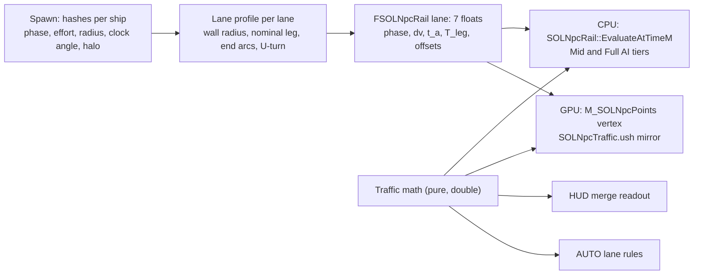
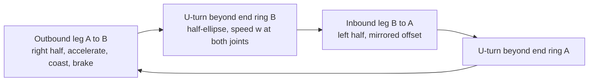

<!-- SOLTest / Copyright © 2026 Acid Rain Studios LLC -->

# SDD 50: Lane traffic flow

**Issue:** [#50](https://github.com/DieSlower/SOLTest/issues/50). Plan:
[`Plans/50-lane-traffic-flow-plan.md`](../Plans/50-lane-traffic-flow-plan.md). Builds on SDD 11 (the NPC rails, tiers
and the GPU far points), SDD 38 (the lane lines and their crossfade), SDD 49 (the guidance tunnel, its basis, end rings,
radius and labels), SDD 18 / 20 / 32 (the autopilot, route fly-through and Chase Down guidance) and SDD 21 (the HUD
event bus).
**Persistence change: none planned.** `SOL::Settings::SAVE_VERSION` stays 13 and `KEY_BINDING_LAYOUT_VERSION` stays 10
(D11). No setting, no key binding, no `UPROPERTY` of a save class changes. If the work shows that one is needed, stop
and report (section 12).
Status: **draft (2026-11-13), grill-me done (D1-D12), questions Q1-Q8 answered by the user (2026-11-13, D13-D20),
one open question left (Q9, section 12).** No code is written before Q9 is answered (it only affects part 50d).

## 1. Problem

Since #11 every lane ship rides a triangle wave between the two body **centres** at a random constant speed (20-150
km/s), with its lateral offset uniform over the lane disc and its direction an independent coin flip
(`SOLNpcScale::MakeSpawn`, `SOLNpcScale::LaneParamAt`). So the ships ignore the keep-right rule that the #38 lines and the
#49 tunnel display, reverse instantly at each end, fly straight through both planets, and move at the same speed
whether they are on the axis or at the wall. Issue #50 asks for real lane traffic: keep right, fast in the middle and
slow at the wall, some traffic just outside the tunnel, a way for the player to merge in, and AUTO flight that obeys
the lane.

## 2. Decisions (user, grill-me 2026-11-13)

- **D1: Keep right, U-turn outside the tunnel.** A ship's side follows its **current** direction: outbound (A -> B)
  ships on the right of the axis, inbound on the left, the convention of the #38 lines and the #49 chevrons and guide
  dots (12 o'clock = ecliptic north, SDD 49 section 4.3). At a lane end a ship leaves through the end ring, makes a
  **U-turn outside the tunnel** (a half-circle of about 2 tunnel radii beyond the end ring, at reduced speed) and
  re-enters on the opposite side, so it swaps sides there. *Reasoning (user):* the rule the display shows must be what
  the traffic does; turning outside the tube keeps the tube's two directions clean. **Future, record only:** with the
  market / trade system ships get destinations (planet, station, asteroid), leave the tunnel and go there; the data is
  designed so a destination can later replace the U-turn (section 4.11).
- **D2: Speed by radial position.** A smooth profile, fastest at the axis, falling smoothly to the comfortable wall
  speed at the tunnel wall. The per-ship random speed is replaced by the burn profile of D4. *Reasoning:* the issue's
  first idea, and the basis of merging (match the slow outer traffic, then move inward).
- **D3: Wall ("comfortable") speed = 20 km/s relative to the nearest body**, a global tunable. Outside traffic and the
  merge band move at it; the lane's end bodies' velocities matter (a ship matches the body's speed at each end).
  *Reasoning:* a speed a pilot can match and dock from, and one number for the whole system.
- **D4: Along-lane flip-and-burn.** A ship accelerates over the first half of the lane, flips at the midpoint and
  brakes over the second half, arriving at the end body at the body-matched wall speed. Per-ship effort is hashed in
  **50-100 %** of the peak acceleration; the design peak is **1.5 G + 10 % = 1.65 G (16.18 m/s^2)**; the unbraked
  peak is `v = sqrt(w^2 + a L)` at mid-lane (lane length `L`, `w` = 20 km/s); the peak is **capped at 300 km/s**, so
  long lanes run accelerate / coast / brake. *User note, recorded:* 1.65 G is above the human sustained limit (Pilot G,
  `GAME_MECHANICS.md` section 2: sustained 1.5 G, drain above); the user wants a future concept of **AI NPC pilots
  versus human NPC pilots** (AI may exceed human limits, humans obey the G limit). The design keeps that representable
  (an effort cap per pilot kind, section 4.12); for now every ship uses 1.65 G with its 50-100 % effort.
- **D5: Radial x along combination.** At the wall the wall speed everywhere along the lane; at the axis the along-lane
  profile; a smooth monotone blend between, shape chosen by this design (section 4.3, shown with its formula).
- **D6: Outside traffic (halo).** About **25 %** of lane ships travel outside the tunnel wall, out to 2x the radius,
  keeping right, following the same along-lane burn profile at the slower wall-speed factor (they speed up a little
  mid-lane; the factor is this design's, section 4.3). **Halo ships do not widen the tunnel:** the #49 width counts the
  ships inside the wall only. They still draw as points. Spawn: uniform over the disc inside the wall for 75 %, uniform
  over the annulus wall .. 2x for 25 % (a parameterised constant). The #49 label's ship count includes them (D15).
- **D7: Time warp.** Traffic speeds scale with warp as today (lane time = sim time). The player's HUD readout shows the
  real-time (unscaled, sim-second) speed and a note while warp is active.
- **D8: Player merge in manual flight.** No gameplay rule: purely visual and emergent, plus a HUD readout shown near
  the tunnel label from the outer halo (2x radius) inward: the **traffic speed here** (relative to the nearest body),
  the mean profile speed at the player's position (radial and along-lane) for the lane direction closest to the
  player's heading (defined precisely in section 4.8), and the player's difference to it with the text **TOO FAST /
  TOO SLOW / MATCHED** and a colour: **green within 5 %, amber to 20 %, red beyond**. Hidden outside 2x radius. No new
  setting unless unavoidable (none is); follows the HUD glow and the Lanes row like #49. No sound cue.
- **D9: AUTO follows the lane.** When the ship is on AUTO (autopilot, route waypoint or chase) and its path enters a
  lane tunnel it follows the traffic rules: it slows to the local traffic speed at the entry radius, enters on the
  correct (right-hand for its direction) side, holds the local traffic speed while inside and leaves normally. Outside
  lanes nothing changes. The flight model changes are minimal and listed (section 4.9); no save-schema change.
- **D10: Realism versus performance, delegated to this design.** The rail stays **closed form per ship with no per-ship
  state**: position along the lane and track radius are an analytic function of time and the ship's hashed spawn
  values; the radial speed factor is constant per ship (its lateral radius is fixed), so it enters as a per-ship
  factor; the C++ (`SOLNpcRail`) and the shader evaluate the same formula, and the near tiers (Mid and Full AI) read
  the same closed form, so there is no seam at a tier change. This design recommends the piecewise form (leg, U-turn,
  leg, U-turn), the cycle period and the per-ship phase (section 4.4), checks the 1M budget and float precision
  (sections 4.6, 9) and proposes profiling gates (section 8 item 6).
- **D11: No save-schema or key-layout change planned** (`SAVE_VERSION` 13, `KEY_BINDING_LAYOUT_VERSION` 10). A change
  found necessary goes to the open questions, never assumed approved.
- **D12: Out of scope:** VR work; destinations and the market; **security patrols** (record as future: the user's
  intent is that trade lanes carry safe traffic patrolled by security forces, and flying outside the lanes is the
  dangerous option); the thruster flame, ticket **#51** (a consumer of this ticket's burn profile: each ship's thrust
  state is derivable from the closed form, section 4.12).
- **D13: Wall radius = the drawn tunnel radius, frozen at spawn** (user, Q1, 2026-11-13). The wall is the #49 tunnel
  radius computed from the in-wall ship count and frozen for the population; the halo of D6 reaches 2x that radius.
- **D14: End rings move out to 3 tunnel radii above the surface** (user, Q2): `NPC_TUNNEL_END_MARGIN_RADII` 1 -> 3, so
  the 2-radius U-turn (D1) has its apex one wall radius above the planet. This **amends SDD 49 D12** (a one-line
  amendment note is added there).
- **D15: The label's ship count includes the halo** (user, Q3): every ship using the lane; only the tunnel width uses
  the in-wall count.
- **D16: Nominal lane length = the lane's maximum length** (user, Q4), with exact (metric) distances near the end rings
  (section 4.5): the 300 km/s cap and the 1.65 G bound hold at every geometry and the ends stay exact.
- **D17: Engine-first hull flip** (user, Q5): hulls face their thrust, flipping over about 60 s (`NPC_LANE_FLIP_S`)
  while braking; this is also what #51's flame needs.
- **D18: Readout fallback** (user, Q6): when no tunnel label is placed, the merge readout falls back to a fixed line
  under the speed readout.
- **D19: AUTO obeys lane traffic rules by default, with an override** (user, Q7, changed from the recommendation): the
  autopilot follows the lane profile (accepting the slower trip, Earth - Mars about 9 days at 1x instead of about 2.9).
  **But** it can fly around lanes, or ignore the safe space, when the player tells it to. How the player tells it is
  **open question Q9** (not chosen here). Whatever the mechanism, it is not saved (D11) unless the user approves a
  setting.
- **D20: AUTO paths count as using a lane only when they run inside the halo for 20 or more wall radii along the
  lane** (user, Q8): a path that only crosses a lane is left unchanged.

## 3. What exists today (code survey, HEAD `f336e10`)

| Piece | Where | Facts that matter here |
|---|---|---|
| Lane spawn | `Npc/SOLNpcScaleMath.cpp` `MakeSpawn` (lane branch), `FSpawn`, `FLayout` | Hash streams: group, faction, start param, direction (+1 / -1), speed uniform in `LaneMinSpeedMps` .. `LaneMaxSpeedMps` (2e4 .. 1.5e5, `DefaultLayout`), lateral offset uniform over the lane disc `R sqrt(h)` at a uniform angle |
| Lane motion | `SOLNpcScale::TriangleWave01`, `LaneParamAt`, `LanePositionM`, `LaneBasis` | Param in [0, 1] from body centre A to body centre B (ships pass through both bodies), rate per **nominal** length, position `A + s (B - A)` on the **current** lane, lateral basis `U = Z x a`, `V = a x U` (reference +X when `|a.z| >= 0.9`): for an ecliptic lane `U` = the tunnel's `-Right`, `V` = its `Up` |
| Rail | `Npc/SOLNpcRail.{h,cpp}` `FSOLNpcRail` (32 bytes: kind, faction, group, `P[7]`) | Lane uses P0 start param, P1 signed rate, P2-P3 lateral offset; **P4-P6 free**. `FromSpawn(spawn, groupBase, laneLengthM, bodyGM)`, `EvaluateAtTimeM`, `VelocityMps` (central difference, 0.5 s), `AdvancedToEpoch` (wraps the period-2 param), `GroupDistanceM` (lane capsule of radius `R`) |
| Epoch | `ASOLNpcVisuals::FillRailTexels`, `NPC_GPU_RAIL_EPOCH_S` 1e4, min interval 2 s | The GPU copy is re-based so the shader's float time stays small; the lane histogram (`AccumulateLaneShips`) is counted there |
| GPU far points | `Tools/Npc/create_npc_assets.py` `VERTEX_HLSL` (kind 1 branch), `M_SOLNpcPoints` | Float: triangle wave, normalize, cross, `pA + axis s + u x + v y`; three vertices per point (the full rail evaluation runs per vertex); the Q5 crossfade reads `NpcTunnelTex`; group texture `NpcGroupTex` 64 x 2 (row 0 `A` rel + `R`, row 1 `B` rel + drawn flag) |
| Spawn | `USOLNpcSubsystem::Spawn` | Nominal lane length = body distance at the spawn epoch; rails built in parallel; per-lane speed bound `NPC_WAKE_SPEED_MARGIN` (1.25) x `LaneShipSpeedBoundMps(150 km/s, nominal, current, R, endpoint speed)` recomputed per frame |
| Tiers | `SOLNpcTierProcessor`, `SOLNpcFullAiProcessor`, `SOLNpcMidProcessor` | Every tier positions a ship as `SOLNpcRail::EvaluateM(rail, frame) + deviation`; heading `SOLNpcAi::HullForward(VelocityMps + deviation velocity, ...)` |
| Pilot kinds | `Flight/SOLNewtonianFlight.h` `ESOLPilotKind`, `EffectiveGCapG`, `HUMAN_MAX_G`; `SOLNpcAi` classes carry a `PilotKind` | Already used for NPC combat G caps; not used by lane traffic (D4: 1.65 G for all, for now) |
| Tunnel | `Npc/SOLNpcTunnelMath` (`TunnelBasis`, `TunnelRadiusM(R, shipCount)`, end arcs `R_body + NPC_TUNNEL_END_MARGIN_RADII x Rt`), `USOLNpcTunnelComponent` | Radius from the lane's **whole** ship count (`FSOLNpcLaneEntry::ShipCount`); label line 3 = that count |
| AUTO | `SOLFlight::AutopilotStep`, `SOLFlight::ChaseStep`, `USOLShipFlightProcessor` | Rendezvous guidance (`ComputeRendezvousGuidance`) toward a target with velocity and acceleration inputs, route fly-through (`PassSpeedMps`, `CaptureRadiusM`), then `FlyGuidance`; three AUTO kinds: body, route waypoint, chase |
| HUD | `UI/SOLFlightHud`, `UI/SOLLaneTunnelLabel`, `HudEvents/SOLHudBus` | Tunnel labels published by Npc on the bus; HUD formats and places them |

Known debt not to re-report (grep of `Docs/TECH_DEBT.md`): the NPC worst case with every Demo option at its maximum;
the Q5 extra points cost inside a tunnel (SDD 49 D21); the tunnel CPU cost at its budget (SDD 49 D20); the labels
avoiding last frame's HUD boxes and no UMG widgets; `Npc` leaning on the orbit lines' actor code; the `Npc <-> Menu`
cycle; the duplicated view-size helper of the profile smokes.

## 4. Design

### 4.1 Overview

A new pure math unit (`Traffic/SOLLaneTrafficMath`, section 4.10) defines the lane traffic as closed-form functions:
the radial factor, the per-ship leg profile, the metric end zones, the cycle (leg, U-turn, leg, U-turn) and the mean
speed field. At spawn each lane gets a frozen **lane profile** (wall radius, nominal leg, end arcs, U-turn depth) and
each ship a rail that holds its phase and its precomputed leg constants. The CPU tiers, the GPU far points (a new
`Shaders/Private/SOLNpcTraffic.ush` mirror), the HUD readout and the AUTO lane rules all call the same functions. No
per-ship state is added and no per-frame per-ship CPU work exists outside the tiers that already evaluate rails.

### 4.2 Lane geometry: wall, halo, end rings, U-turn

Per lane (frozen at spawn unless stated):

- `R`: the lane radius of the layout (`FLaneDef::RadiusM`), unchanged meaning for #38 (line fade) and #49.
- **Wall radius `Rw`** = `SOLNpcTunnel::TunnelRadiusM(R, inWallCount)`, the #49 tunnel radius computed from the
  **in-wall** ship count (D6), frozen for the population and stored in `FSOLNpcGroupTable::LaneWallRadiusM`. The tunnel
  draws at exactly this radius (it no longer recomputes it from the whole count), so the drawn wall and the ships'
  inside / outside split agree. *(D13: wall = tunnel radius.)*
- **Halo outer radius** `H x Rw`, `H` = `NPC_LANE_HALO_OUTER_WALL_RADII` (2). The lane's culling capsule
  (`GroupDistanceM`) uses `H x Rw` instead of `R`.
- **Nominal length `L0`** and **nominal leg `l0`** = `L0 - R_A - R_B - 2 m Rw` between the two end rings (`R_A`, `R_B`
  body radii from the registry, `m` = `NPC_TUNNEL_END_MARGIN_RADII`). Nominal is the lane's maximum length (D16,
  section 4.5).
- **End ring arcs** (SDD 49 section 4.3, now with `Rw`): `e_A = R_A + m Rw` from A; the arrival ring at `R_B + m Rw`
  before B.
- **U-turn depth** `D_U` = `NPC_LANE_UTURN_DEPTH_WALL_RADII` (2) x `Rw` beyond the end ring (D1). **Conflict found and resolved (D14):**
  with #49's margin `m` = 1 the apex of a 2-radius turn lies `1 Rw` *inside* the body's surface radius along the axis,
  so near-axis ships would fly through the planet (Earth - Mars: end ring 6.4e6 + 8.6e6 m from Earth's centre, apex at
  6.4e6 - 8.6e6 < 0, past the centre). The user moved the end rings out to `m` = 3
  (apex one wall radius above the surface).
- **Drivable:** a lane whose nominal leg is below `2 Z` (section 4.5) is not drivable; its ships stay on the lane's
  midpoint disc at rest. No default lane is close (asserted by a test).

### 4.3 Speed profile (D2-D6)

Constants: `w` = `NPC_LANE_WALL_SPEED_MPS` (2.0e4), `a` = `NPC_LANE_PEAK_ACCEL_G` (1.65) x `STANDARD_GRAVITY` = 16.18
m/s^2, `c` = `NPC_LANE_SPEED_CAP_MPS` (3.0e5), effort `eps` in [`NPC_LANE_EFFORT_MIN` 0.5, `NPC_LANE_EFFORT_MAX` 1.0],
the reference (mean) effort `eps_ref` = `NPC_LANE_EFFORT_MEAN` (0.75).

**Radial factor** `kappa = K(rho)` of a ship at `rho` wall radii from the axis (constant per ship):

- inside the wall (`rho` <= 1): `K = 1 - rho^2` (the laminar "pipe flow" parabola: 1 on the axis with zero slope, so
  smooth there; 0 at the wall; strictly decreasing);
- halo (`1 < rho <= H`): `K = kappa_h x smoothstep(1, 1 + r_h, rho)`, `kappa_h` = `NPC_LANE_HALO_KAPPA` (0.01), `r_h` =
  `NPC_LANE_HALO_RAMP_WALL_RADII` (0.25). Zero at the wall (continuous with the inside, D5: wall speed at the wall),
  rising to `kappa_h` a quarter radius out. A halo ship moves like a ship at `sqrt(1 - kappa_h)` = 0.995 wall radii
  inside the wall: at the wall speed near the ends and a little faster mid-lane (D6).

**Blend (D5), in squared speed.** A ship with factor `kappa` and effort `eps` uses the acceleration `alpha = kappa eps
a` and the cap `c_k` with `c_k^2 = w^2 + kappa (c^2 - w^2)`. Its speed at leg coordinate `u` (metres from the departure
end ring along a nominal leg `l0`) is

    v(u)^2 = min(w^2 + 2 alpha min(u, l0 - u),  c_k^2)
           = w^2 + kappa x [ min(w^2 + 2 eps a min(u, l0 - u), c^2) - w^2 ]

so `v^2 - w^2` is exactly `kappa` times the axis ship's `v^2 - w^2` at every point (accelerating, coasting and braking
phases start at the same `u` for every `kappa`). It equals the wall speed at the wall (`kappa` = 0) and at both end
rings, the axis profile at the axis, and is smooth and strictly monotone in `rho` in between. Peak (mid-lane or the cap)
`v_p = min(sqrt(w^2 + alpha l0), c_k)`: D4's `sqrt(w^2 + a L)` with the leg for `L`.

**Mean speed field** (HUD and AUTO): `vbar(u, rho)` = the speed above with `eps = eps_ref`: the speed of a
mean-effort ship at that radius. With `eps_ref` = 0.75 the axis acceleration is 1.24 G, below the human sustained 1.5 G,
so the player's AUTO can fly it (section 4.9).

Examples (axis ship, `eps` = 1, `Rw` from the default 1M population; times at 1x):

| Lane (leg) | Peak | Accelerate | Coast | Leg time |
|---|---|---|---|---|
| Earth - Moon (about 3.95e8 m) | 82 km/s (uncapped) | 1.1 h | none | 2.1 h |
| Earth - Mars (at 1.5 AU, 2.25e11 m) | 300 km/s (cap) | 4.8 h, 2.8e9 m | 8.5 d | 8.9 d |
| Halo, Earth - Mars | 36 km/s (cap `c_k` with `kappa_h` 0.01) | 27 h, 2.8e9 m | 71 d | about 73 d |

### 4.4 Closed-form cycle (D1, D10)

Per ship, precomputed in double at spawn (`MakeLegProfile`): `alpha`, `v_p`, `dv = v_p - w`, `t_a = dv / alpha`
(accelerate time; 0 when `kappa` = 0), `d_a = w t_a + dv t_a / 2` (accelerate distance), `t_c = (l0 - 2 d_a) / v_p`
(coast), `T_leg = 2 t_a + t_c`. Per lane: `T_U = pi D_U / w` (U-turn time). Cycle `T_cyc = 2 T_leg + 2 T_U`.

- **Cycle time** `tau = frac(phi + t / T_cyc) x T_cyc`, `phi` the ship's hashed phase in [0, 1), `t` the rail time
  (sim seconds since the population epoch, so D7 holds). Segments: `[0, T_leg)` outbound leg, `[T_leg, T_leg + T_U)`
  U-turn at B, then the inbound leg, then the U-turn at A. Uniform phases spread the ships evenly in time over the
  cycle, so the line density is proportional to `1 / v`: about 15 times denser near the end rings than mid-lane on a
  capped lane (traffic piles up near the planets, as it should).
- **Leg arc** `u(tl)`, `tl` the time into the leg: `w tl + alpha tl^2 / 2` while `tl <= t_a`; `d_a + v_p (tl - t_a)`
  while coasting; `l0 - (w tb + alpha tb^2 / 2)` with `tb = T_leg - tl` while braking (`alpha = dv / t_a`, written with
  selects, no divergent branch). `u(0) = 0`, `u(T_leg) = l0`, speed `w` at both ends.
- **Along position** on the current lane: `x = e_A + X(u)` from A (outbound), `x = e_A + l(t) - X(u)` (inbound), with
  the metric end-zone map `X` of section 4.5 and the current leg `l(t)`. Evaluated from the **nearer end** (from A
  while `X <= l / 2`, else from B: `B - a (R_B + m Rw + l - X)`), which halves the magnitudes and keeps ships near
  either body exact relative to it (section 4.6).
- **Lateral** (keep right): the ship's clock angle `psi` in [0, pi] (clockwise from 12 o'clock looking from A to B, the
  right half) and radius `rho Rw`: outbound offset `rho Rw (cos psi Up + sin psi Right)`, inbound `rho Rw (cos psi Up -
  sin psi Right)` (mirrored across the vertical plane, so the radius and the radial factor stay the same). `Up`, `Right`
  are the lane's #49 basis (`SOLNpcTunnel::TunnelBasis`, ecliptic north, pole blend), computed per lane per frame in
  double on the CPU and uploaded, so the ship sides match the drawn chevrons exactly and the shader needs no
  normalize / cross / pole branch. (Today's `LaneBasis` is dropped for lanes.)
- **U-turn at B**, `theta = pi (tau - T_leg) / T_U` in [0, pi]: position `B - a (R_B + m Rw) + a D_U sin(theta) + rho Rw
  (cos psi Up + cos(theta) sin psi Right)`: a half-ellipse in the plane of the axis and `Right`, depth `D_U` beyond the
  end ring, lateral from `+sin psi` to `-sin psi`. Its speed is `w` at both joints (`D_U theta' = w`), so position and
  velocity are continuous with both legs, and it slows to `rho sin(psi) Rw w / D_U` at the apex (the "reduced speed" of
  D1; near-axis ships nearly stop and reverse). **U-turn at A** mirrors it (`+ a (R_A + m Rw) - a D_U sin(theta)`, lateral
  `-cos(theta) sin psi`).
- **Planet clearance:** the apex lies `m Rw - D_U` above the body's surface along the axis (D14).
- **Hull facing** (mesh and instanced tiers): today the hull faces its velocity. Flip-and-burn implies the hull faces
  its thrust while braking (engine first). Adopted (D17): the hull turns over `NPC_LANE_FLIP_S` (about 60 s); the thrust state is derivable (section 4.12).

### 4.5 Lane length drift (D16)

The lanes stretch and turn as the planets move (Earth - Mars about 0.37-2.67 AU over a synodic period, reached in
about a minute of real time at the 30 d/s warp). The closed form cannot integrate a varying length per ship without
state, so the ship advances on the **nominal** leg `l0` and is mapped onto the **current** leg `l(t)` by a monotone map
that is **metric near both end rings**:

    X(u) = u + (l - l0) J(u) / J(l0)
    J(u) = Z P(u / Z)                   for u < Z,          P(s) = s^3 - s^4 / 2
         = Z / 2 + (u - Z)              for Z <= u <= l0 - Z
         = (l0 - Z) - Z P((l0 - u) / Z) for u > l0 - Z,     J(l0) = l0 - Z

`Z` = `NPC_LANE_METRIC_ZONE_FRACTION` (0.05) x `l0` (`J'` is a smoothstep ramp over the zone, so `X(0) = 0`, `X(l0) = l`,
`X' = 1` at both ends). The ship therefore leaves and reaches each end ring exactly at the wall speed relative to that
end's body (D3), the end rings and U-turns sit at their metric places whatever the length (planet clearance holds),
and the stretch goes into the middle. `X` is monotone whenever `l > Z` (every default lane: `l / l0` stays above 0.14
with the recommended nominal length). `l - l0` is computed in double on the CPU per lane per frame and uploaded, so the
shader never subtracts two large floats.

The mid-lane speed scales by about `l / l0`. **Nominal length (D16):** the lane's **maximum** length (sum
of the two bodies' aphelion distances; a moon's apoapsis for a planet - moon lane), so `l <= l0` always: the 300 km/s
cap and the 1.65 G bound hold at every geometry, the ends stay exact, and the middle slows when the bodies are close
(Earth - Mars mid-lane about 40 km/s at opposition, with the same leg time). The alternative is today's spawn-time
length, where the middle can run up to about 7x faster than the cap.

### 4.6 GPU evaluation, precision and cost (D10)

**Rail layout (lane kind)**, still 32 bytes and two texels: P0 `phi` at the epoch, P1 `dv` (m/s, stored directly so a
halo ship's tiny `dv` does not cancel in float), P2 the up offset `rho Rw cos psi` (m), P3 the right offset `rho Rw sin
psi` >= 0 (m), P4 `t_a` (s), P5 `T_leg` (s), **P6 reserved** (0; the future destination hook, section 4.11). `T_cyc` and
`alpha` are derived (`2 T_leg + 2 T_U`, `dv / t_a`). `AdvancedToEpoch` advances `phi` by `delta / T_cyc` in double and
wraps it into [0, 1).

**Group texture** `NpcGroupTex` grows from 64 x 2 to 64 x 6 rows (per frame, 8 lanes, about 6 KB per upload): row 0 and
1 unchanged (`A`, `B` relative to the viewpoint, `R`, drawn flag); row 2 `Up`, `Rw`; row 3 `Right`, `D_U`; row 4 `l - l0`
(double on the CPU), `e_A`, `l0`, `Z`; row 5 `R_B + m Rw`, `T_U`, spare. Cluster and battle columns ignore rows 2-5.
`SOL::NPC_GROUP_TEXTURE_ROWS` names the count.

**Shader.** The lane branch of the point vertex node calls `SOLNTR_LaneShipRelM(railA, railB, groupRows, t, w)` from
the new `Shaders/Private/SOLNpcTraffic.ush` (header: mirror of `Traffic/SOLLaneTrafficMath.cpp` and
`SOLNpcRail::EvaluateAtTimeM`, both ways). `M_SOLNpcPoints` is rebuilt once by `create_npc_assets.py` (`-SOLRebuild`,
editor closed) to include it and pass the extra rows and `w`; later formula changes need no rebuild.

**Precision.** The shader evaluates in float relative to the viewpoint. Within one epoch window the along-lane error is
about `ulp(phi) x T_cyc x v`: Earth - Mars (cycle about 1.5e6 s) up to about 27 km mid-lane at 300 km/s and about 2 km
near the ends at 20 km/s; the endpoint float error (about 9 km at 1 AU) is avoided near either body by the nearer-end
evaluation. **Today's lane error is the same order** (`ulp(param) x L`, about 27 km on Earth - Mars), and it only shows
at the Mid-radius hand-over (2,000 km): ships closer than that are evaluated on the CPU in double from the same rail
floats. The outer lanes (up to about 50 AU nominal) reach several hundred km, as today. A contract case (section 6 case
10) re-implements the shader formula in C++ float and asserts the bound per default lane; the smoke (section 8 V5)
checks the hand-over.

**Cost estimate at 1M NPCs.** About 400k lane ships, three vertices each, so about 1.2M lane-branch evaluations per
frame. Today: two rail texels and about 40 ALU. New: the same two rail texels, four extra group texels (one column,
cached), about 80-110 ALU with selects (the U-turn `sincos` only for the about 1 % of ships turning; the divergence cost
is that branch). Estimate **+0.02-0.05 ms GPU** at 1080p (gate +0.10 ms, section 8). CPU: the per-call rail cost is
about the same (the basis now comes from the frame instead of a per-call normalize and cross); the spawn gains one
counting pass (about 5-10 ms once, in parallel, on the spawn frame).

### 4.7 Spawn and the near tiers

- **`MakeSpawn` lane branch** returns dimensionless values only: lane (group hash, unchanged stream), faction
  (unchanged), `phi` (the start-param stream), effort `eps = lerp(0.5, 1, h)` (the speed stream), halo flag `h <
  NPC_LANE_HALO_FRACTION` (0.25, new stream), radius `rho = sqrt(h)` inside or `sqrt(1 + (H^2 - 1) h)` in the halo
  (uniform by area), clock angle `psi = pi h` (the angle stream). The direction stream is no longer used (each ship
  flies both legs). `FSpawn` loses `LaneStartParam`, `LaneDirection`, `LaneSpeedMps`, `LaneLateralOffsetM`; `FLayout`
  loses `LaneMinSpeedMps` / `LaneMaxSpeedMps` (replaced by the constants). Battle and cluster spawns are bit-identical.
- **Spawn order** (`USOLNpcSubsystem::Spawn`): (1) a parallel counting pass over every lane index (lane and halo
  hashes only) gives the in-wall and halo counts per lane; (2) the lane profiles (`MakeLaneProfile`: `Rw`, `L0`, `l0`,
  end arcs, `D_U`, `T_U`, `Z`, drivable) into the group table; (3) the rails (`FromSpawn(spawn, groupBase,
  laneProfile)` runs `MakeLegProfile`). Rails never change afterwards except the GPU epoch re-base.
- **Rail frame** (`FSOLNpcRailFrame`) gains per lane `Up`, `Right` (double) and `l(t)`; `BuildFrame` fills them.
- **Tiers:** unchanged code paths. Mid and Full AI ships still sit at `EvaluateM + deviation`, so the tier hand-overs
  are seam-free by construction; the velocity (central difference over 0.5 s) is continuous across the segment joints.
- **Wake bound:** `LaneShipSpeedBoundMps` takes the lane's largest `v_p` (computed at spawn, at most `c`), the length
  ratio `max(1, l / l0)`, the halo outer radius `H Rw` (the turning lever) and the endpoint speed. The bound grows from
  150 to at most 300 km/s on capped lanes, so lane chunks wake more often (risk R4, profiled).
- **Lane histogram:** `AccumulateLaneShips` counts all lane ships (the label, D15) and the new in-wall count;
  `FSOLNpcLaneEntry` gains `InWallShipCount` and `WallRadiusM` (frozen `Rw`), which `BuildTunnelLaneData` uses instead
  of `TunnelRadiusM(R, ShipCount)`. `ShipCount` keeps its meaning (all lane ships) for the #38 line width.

### 4.8 HUD merge readout (D7, D8)

Pure function `SOLLaneTraffic::MergeReadout(...)` on the UI side (no `UI -> Npc` edge, section 4.10), per frame:

- **Lane:** the lanes whose halo contains the player (`rho_p <= H` and foot arc between the two end rings); several
  -> the smallest `rho_p`. None -> hidden. Also hidden while the map, a menu or warp-jump shows, the HUD is hidden, or
  the Lanes row (with the master O) is off (D8: follows the Lanes row like #49).
- **Lane frame velocity** at the player's foot: `lerp(V_A, V_B, s)` (registry body velocities, `s` the foot fraction):
  exactly the nearest body's velocity near either end (D3), a blend mid-lane.
- **Direction** `d` (the traffic the player would merge into): the sign of `(v_player - v_frame) . a` when its size is
  at least `NPC_LANE_MERGE_DIRECTION_MIN_MPS` (1 km/s); otherwise the sign of the ship's forward on `a`; if that is
  within 0.1 of 0, the player's half (right of the axis = outbound). The speed field is the same for both directions at
  a point (the profile is symmetric), so the direction only signs the comparison.
- **Traffic speed** `v_t = vbar(u_d, rho_p) x X'(u_d)`, `u_d` the player's nominal leg coordinate for direction `d`
  (`X` inverted by Newton steps, CPU double).
- **Player speed** `v_pl = (v_player - v_frame) . d` (the along-lane component; crossing motion counts as too slow).
- **Verdict** `delta = (v_pl - v_t) / v_t`: MATCHED for `|delta| <= 0.05` (green), else TOO FAST / TOO SLOW, amber for
  `|delta| <= 0.20`, red beyond (`NPC_LANE_MERGE_MATCH_FRACTION`, `NPC_LANE_MERGE_AMBER_FRACTION`; the boundaries belong
  to the better class).
- **Text** (`SOLMenuText::LANE_TRAFFIC_*`): `Traffic 182 km/s   You 175 km/s   MATCHED`, plus `(at 1x)` while time warp is
  above 1x (D7: both numbers are in sim seconds, unscaled). Formatted with `SOLHudFormat`'s speed format; rebuilt only
  when the printed values or the verdict change (keyed like the #49 label lines).
- **Where:** a fourth line in the readout lane's tunnel label when that label is placed (the label box grows by one
  line; placement rules unchanged). When the label is not placed (SDD 49 D19 views, crowded screens), the readout is drawn as a fixed line under the speed
  readout (D18).
- **Look:** HUD glow text at the label's alpha, coloured by the verdict (green / amber / red from the HUD palette
  constants), the HUD glow setting applies. No sound (D8).

### 4.9 AUTO lane rules (D9)

Applies to the three AUTO kinds (body autopilot, route waypoint, Chase Down), only while a population with lanes
exists; independent of the Lanes overlay row (a display setting never changes flight). Pure functions in
`Traffic/SOLLaneTrafficMath` (`FindLaneLeg`, `LaneMergeTarget`, `LaneHoldGuidance`), called from
`USOLShipFlightProcessor`:

1. **Per frame (not per substep):** `FindLaneLeg(shipM, targetM, lanes)` tests the straight path ship -> current AUTO
   target against each lane's halo capsule between its end rings and returns the first lane the path runs **along**:
   inside `H Rw` for at least `NPC_LANE_AUTO_MIN_OVERLAP_WALL_RADII` (20) wall radii of axis length (D20: crossings are
   left unchanged), with the direction `d` = the target's side along the axis and the exit arc (the target end's end
   ring for a body at that end, else the foot of the target's projection clamped to the leg). The result is held in a
   transient fragment field (not saved).
2. **Approach (outside the halo):** the AUTO step targets the **merge point** instead of its own target: the point on
   the right-hand track (clock 90 degrees for direction `d`, radius `NPC_LANE_AUTO_TRACK_WALL_RADII` 0.25 `Rw`) at the
   entry arc, moving with the lane frame plus `d x v_t` (its velocity and acceleration from the profile), through the
   existing `AutopilotStep` (moving-target rendezvous). Arriving co-moving with it means "slowed to the local traffic
   speed at the entry radius, on the right side". The step switches to hold when the ship is inside the halo, within
   `0.25 Rw` of the track's radius and within 5 % of `v_t`.
3. **Hold (inside):** `LaneHoldGuidance` returns a normal `FSOLGuidanceOutput`: desired velocity `v_frame + d vbar(u,
   rho) X'(u)` plus a lateral term toward the track (`NPC_LANE_AUTO_LATERAL_GAIN_PER_S`, capped at
   `NPC_LANE_AUTO_LATERAL_MAX_MPS`), desired net acceleration `(v_des - v) x VelocityGainPerS` (the guidance law's own
   gain, 2/s) plus the profile acceleration, clamped by `FlyGuidance` to the pilot's autopilot limit (sustained 1.5 G;
   the mean-effort axis profile needs 1.24 G); `DesiredForward` = `d` while accelerating and coasting, `-d` while
   braking (the ship flips like the traffic); `Phase` from the profile (Accelerate / Cruise / Brake); `SpeedLimitMps` =
   `v_t`; `DistanceM` to the AUTO target. `FlyGuidance` and the G meter run as today.
4. **Leave:** at the exit arc the normal AUTO step to the real target resumes (for a body at the lane end the ship is
   at the wall speed relative to that body at the end ring, and the autopilot brakes to its standoff point as usual).
   A ship already inside the halo when AUTO engages skips the approach. Chase Down holds at the sustained limit inside
   a lane (no bursts).

**Behaviour changes (complete list):** AUTO paths along a lane follow its profile (slower: Earth - Mars about 9 days at
1x instead of about 2.9, D19); AUTO ships move to the right half before merging and fly a right-hand track; AUTO ships
flip at the lane's midpoint; the AUTO ETA counts the lane leg (profile time plus the rest); the top-centre AUTOPILOT /
CHASE marker shows `LANE` while holding (new token in `SOLMenuText`); no change to manual flight, to AUTO paths that
only cross a lane (D20), to AUTO with no NPC population, to the flight model, to `FSOLGuidanceParams` or to the save
data.

### 4.10 Module edges (for `ARCHITECTURE.md`)

- **New folder `Traffic/`**: `SOLLaneTrafficMath.{h,cpp}` (pure: the profile, cycle, map, mean field, merge readout,
  AUTO rules, thrust state) and `SOLLaneTrafficSubsystem.{h,cpp}` (a world subsystem holding the population's lane
  table: per lane the body indices, `Rw`, `L0`, `l0`, end arcs, `D_U`, `T_U`, `Z`, the largest `v_p`; written by the NPC
  subsystem at spawn, cleared at despawn; no per-frame data). New edges `Npc -> Traffic`, `Ship -> Traffic`, `UI ->
  Traffic`; `Traffic -> Universe` (body registry) and `Traffic -> Const`. No `Ship -> Npc` or `UI -> Npc` edge is added.
  The lane basis function moves from `SOLNpcTunnel::TunnelBasis` into `Traffic/` (`SOLLaneTraffic::LaneBasis`); the
  `SOLNpcTunnel` name stays as a forwarding inline, so the #49 tests do not change.
- `Npc`: `SOLNpcScaleMath` (spawn), `SOLNpcRail` (rail, frame, epoch), `SOLNpcSubsystem` (counting pass, lane profiles,
  wake bound, publishes the lane table), `SOLNpcVisuals` (group texture rows), `SOLNpcLaneMath` (`InWallShipCount`,
  `WallRadiusM`), `SOLNpcTunnelMath` / component (radius from `WallRadiusM`, label count per D15).
- `Ship`: `USOLShipFlightProcessor` (lane leg per frame, merge / hold / leave per substep), `FSOLShipControlFragment`
  transient lane fields. `UI`: `SOLFlightHud` (readout line), `SOLLaneTunnelLabel` (fourth line), `SOLMenuText`.
- New files: `Traffic/SOLLaneTrafficMath.{h,cpp}`, `Traffic/SOLLaneTrafficSubsystem.{h,cpp}`,
  `Shaders/Private/SOLNpcTraffic.ush`, `Npc/SOLNpcTrafficSmoke.{h,cpp}`, `Tests/LaneTrafficMathTest.cpp`; flags
  `-SOLSmokeNpcTraffic`, `-SOLSmokeNpcTrafficProfile`; no new cvar (the A/B baseline is the pre-#50 commit, section 8).

### 4.11 Future hooks (record only)

- **Destinations (D1):** the cycle is a segment table (leg, turn, leg, turn). A destination ship replaces a turn by a
  "leave the tunnel toward body N" segment; P6 (reserved) and the group bits carry the destination; the closed form
  still holds per segment.
- **Security patrols (D12):** lanes are the safe, patrolled option and flying outside them the dangerous one; patrols
  would be another rail kind along the lanes. Nothing is built.
- **AI versus human pilots (D4):** the effort becomes `min(eps_hash, eps_cap(pilotKind))` with `eps_cap` = 1 for AI
  pilots and `PILOT_SUSTAINED_G / NPC_LANE_PEAK_ACCEL_G` (0.909) for human pilots, so human ships never exceed 1.5 G;
  the NPC classes already carry `ESOLPilotKind`. For now `eps_cap` = 1 for every ship.

### 4.12 Thrust state (consumer: #51)

`SOLLaneTraffic::LaneThrustAt(rail, laneProfile, t)` returns the segment and the thrust: Accelerate (thrust `alpha`
along travel), Coast (none), Brake (`alpha` against travel, the hull flipped per D17), Turn (centripetal, toward the
turn's centre). Pure and CPU-side; #51 decides how a flame uses it (a shader mirror is #51's call).

### 4.13 What does not change

The #38 line look and dashes, the Q5 crossfade (halo ships fade by their own distance like every lane point), the #49
tunnel look, rings, dots, chevrons and labels (except the radius source, the label count per D15 and the readout line;
the end margin 1 -> 3 per D14), cluster and battle rails, NPC combat, tier budgets and hysteresis, the flight model,
manual flight, every setting, the save schema and the key layout, the map.

## 5. Player-facing text and docs

- **Info, overlay paragraph:** the #49 sentence "The lane's rule is keep right ..." becomes a statement of what the
  ships do: "Lane ships keep right (out from the inner body on the right, back on the left), turn round just past
  each end ring, run fastest near the axis and at about 20 km/s at the wall, and about a quarter of them fly just
  outside the tunnel. Inside the outer traffic a readout beside the tunnel label shows the traffic speed there and how
  far yours is from it (green matched, amber close, red far); on AUTO your ship merges on the right and keeps to the
  traffic speed." (final wording checked against the constants in 50e).
- **Help glossary:** a new HUD entry "Lane traffic readout" (the line, the three verdicts and colours, the warp note).
- **Controls:** no change (no binding).
- `Docs/GAME_MECHANICS.md`: section 9 gains a "Lane traffic" row (every constant of section 6 case 1, keep right,
  U-turn, radial profile, halo, metric zones, nominal length); the "Lane tunnel" row notes the radius from the in-wall
  count (and the end margin per D14); section 2's Autopilot / Chase rows note the lane rules; a "Lane traffic readout"
  HUD row.
- `Docs/PLAYER_GUIDE.md` regenerated (`Tools\WritePlayerGuide.bat`) for the glossary entry.
- `Docs/ARCHITECTURE.md`: the `Traffic/` folder and its edges, the `Npc/` row (rails, spawn passes, group texture rows,
  `.ush`), the `Ship/` row (lane rules), the frame-update note (the lane table at spawn), flags.
- SDD notes: SDD 11 (lane rail layout and spawn changed), SDD 38 (the line width keeps the whole count), SDD 49 (radius
  from the in-wall count, label count, end margin per D14, `TunnelBasis` moved).
- `Docs/Plans/STATUS.md`, `Docs/TECH_DEBT.md` (new debt only), the README gallery (section 8 item 3).

## 6. Contract for the test author

Pure functions and plain data only, written from this section without seeing the implementation. Names are proposals.
Tolerance 1e-9 relative for doubles unless stated; constants referenced by name, and where a case says "proposed value"
the test asserts it. New file `Tests/LaneTrafficMathTest.cpp` (`SOLTest.LaneTrafficMath.*`, namespace
`SOLLaneTraffic`) unless stated.

1. **Constants:** `NPC_LANE_WALL_SPEED_MPS` 2.0e4; `NPC_LANE_PEAK_ACCEL_G` 1.65 (= 1.1 x `PILOT_SUSTAINED_G`) and the
   derived m/s^2 within 1e-12 of 1.65 x 9.80665; `NPC_LANE_SPEED_CAP_MPS` 3.0e5 (> wall speed); effort min 0.5, max
   1.0, mean 0.75 (inside the range); `NPC_LANE_HALO_FRACTION` 0.25; `NPC_LANE_HALO_OUTER_WALL_RADII` 2;
   `NPC_LANE_HALO_KAPPA` 0.01 (in (0, 1)); `NPC_LANE_HALO_RAMP_WALL_RADII` 0.25 (< outer - 1);
   `NPC_LANE_UTURN_DEPTH_WALL_RADII` 2; `NPC_LANE_METRIC_ZONE_FRACTION` 0.05 (< 0.5); merge match 0.05 < amber 0.20;
   `NPC_LANE_MERGE_DIRECTION_MIN_MPS` 1000; `NPC_LANE_AUTO_TRACK_WALL_RADII` 0.25; `NPC_LANE_AUTO_MIN_OVERLAP_WALL_RADII`
   20. (`NPC_TUNNEL_END_MARGIN_RADII` 3, D14; `NPC_LANE_FLIP_S` 60, D17.)
2. **`double RadialFactor(double rho)`:** 1 at 0, 0 at 1, `1 - rho^2` at 0.3 / 0.7; strictly decreasing on [0, 1];
   derivative 0 at 0 (finite difference); halo: 0 at 1, `kappa_h` at and beyond `1 + r_h`, smoothstep between (one
   interior point against the closed form), non-decreasing on [1, 2], continuous at 1 and `1 + r_h`; negative rho as
   its magnitude; NaN -> 0.
3. **`FSOLLaneLeg MakeLegProfile(double kappa, double effort, double legM)`** (`Alpha`, `PeakMps`, `DvMps`, `AccelS`,
   `AccelM`, `CoastS`, `LegS`, `bValid`): effort clamped to [min, max]; uncapped short leg (`kappa` 1, effort 1, 3.95e8
   m): peak `sqrt(w^2 + a l0)` (82.4 km/s within 0.1 %), coast 0, `AccelM = l0 / 2`; long leg (2.25e11 m): peak `c`,
   `AccelS = (c - w) / a`, `AccelM = (c^2 - w^2) / (2 a)`, `CoastS = (l0 - 2 AccelM) / c`; always `LegS = 2 AccelS +
   CoastS`, every time and distance >= 0; `kappa` 0: peak `w`, `LegS = l0 / w`; `LegS` continuous as `kappa -> 0`
   (1e-6, 1e-9, 0); the cap blend `c_k^2 = w^2 + kappa (c^2 - w^2)` (kappa 0.5, long leg); `legM <= 0` or NaN ->
   `bValid` false.
4. **`double LegArcM(const FSOLLaneLeg&, double legM, double tl)` and `LegSpeedMps`:** `u(0) = 0`, `u(LegS) = l0`,
   strictly increasing; speed `w` at both ends and `PeakMps` at mid-leg (uncapped) or over the coast; symmetric `u(LegS
   - t) = l0 - u(t)`; `v(u)^2 = min(w^2 + 2 Alpha min(u, l0 - u), PeakMps^2)` at 50 sampled times; second differences
   never above `Alpha` (1e-6 relative); `tl` clamped to [0, LegS].
5. **`double MeanSpeedMps(double u, double rho, double legM)`:** equals `LegSpeedMps` of `MakeLegProfile(K(rho),
   eps_ref, l0)` at the same `u`; `w` at `rho` = 1 for every `u`; `w` at `u` = 0 and `l0` for every `rho`; strictly
   decreasing in `rho` on [0, 1] mid-leg; symmetric in `u`; never above `c`; halo values in [w, MeanSpeedMps(u, sqrt(1 -
   kappa_h))].
6. **`double MetricMapM(double u, double l0, double l)` and `MetricMapInverseM`:** `X(0) = 0`, `X(l0) = l`; identity
   when `l == l0`; `X' = 1` at both ends (finite difference, 1e-6) for `l / l0` in {0.15, 0.5, 2, 7}; `X(u) - u` below
   1e-3 of the zone size at `u = 0.01 Z`; strictly monotone for `l / l0` in {0.06, 0.15, 1, 7}; `J` continuous at `Z`
   and `l0 - Z`; inverse round trip 1e-9; `Z` = `l0 / 2` when the leg is shorter than `2 Z`.
7. **`FSOLLaneCycle` / `CycleSegmentAt(...)`:** `T_U = pi D_U / w`, `T_cyc = 2 LegS + 2 T_U`; the four segment
   boundaries; `tau` identical for `t` and `t + k T_cyc` (k = -3 .. 3) and for negative `t`; phase in [0, 1).
8. **`FVector3d LaneShipPositionM(lane, ship, t)`** (pure; lane = A, B, Up, Right, current leg, profile constants;
   ship = phase, dv, offsets, t_a, T_leg): at 200 sampled times per ship and 20 ships per lane: outbound legs have a
   positive `Right` component (`psi` in (0, pi)), inbound legs a negative one, from the lane's own basis; the lateral
   radius on legs equals `rho Rw` (1e-9); position continuous across every joint (1e-6 m at 1 AU scale with the joint
   evaluated from both sides) and velocity continuous (central difference, speed `w` at the joints, 1e-3); the U-turn
   reaches `D_U` beyond its end ring at `theta = pi / 2` with a zero `Right` component there; with the D14
   margin no sample is inside either body's sphere; each direction keeps to the right of its own travel when seen from
   behind A and from beyond B (the SDD 49 case 5 check); the leg starts and ends exactly at the end rings for `l / l0`
   in {0.15, 1}.
9. **Spawn (`NpcScaleMathTest.cpp`, re-validated lane cases):** over 100k lane indices: halo fraction 0.25 +- 0.01;
   in-wall `rho^2` mean 0.5 +- 0.01 (uniform disc); halo `rho^2` uniform in [1, 4] (mean 2.5 +- 0.03); `psi` in [0, pi];
   effort uniform in [0.5, 1]; phase uniform in [0, 1); deterministic per (seed, index); battle and cluster spawns
   bit-identical to the current implementation (regression copy of three samples each).
10. **Rail (`NpcRailTest.cpp`):** `FromSpawn` lane fields equal the profile values (P6 = 0); `EvaluateAtTimeM` equals
    `LaneShipPositionM` (1e-6 relative); `AdvancedToEpoch` keeps `phi` in [0, 1) and `EvaluateM(advanced, t)` matches
    `EvaluateM(rail, t + delta)` within the float rounding of the wrapped phase; **GPU float mirror** (a C++ float copy
    of the shader formula in the test, like `NpcRailGpuTheta`): within one epoch window the error per default lane is
    below `2 x ulp(phi) x T_cyc x v_max + 2 x ulp(|pB|)` (logged per lane; Earth - Mars below 30 km); `VelocityMps`
    magnitude equals `LegSpeedMps` on a leg (1e-3).
11. **`FSOLLaneProfile MakeLaneProfile(R, inWallCount, L0, R_A, R_B)`:** `Rw == SOLNpcTunnel::TunnelRadiusM(R,
    inWallCount)`; `e_A`, `l0`, `D_U`, `T_U`, `Z` from section 4.2; every default lane drivable at its nominal length;
    a lane shorter than its end rings plus `2 Z` -> not drivable.
12. **Wake bound:** `LaneShipSpeedBoundMps` is at or above the largest sampled ship speed relative to A (brute force over
    1,000 ships of a lane, `l / l0` in {0.15, 1, 2}, endpoint speed 0 and 30 km/s).
13. **Merge readout `FSOLLaneMergeReadout MergeReadout(...)`:** lane choice (smallest `rho_p`, hidden beyond `H` and
    outside the leg); direction rules (velocity sign; below 1 km/s the forward sign; then the side); `v_t` equals
    `MeanSpeedMps x X'`; verdicts at `delta` = 0, +-0.05 (MATCHED), +-0.0501, +-0.20 (amber), +-0.2001 (red); the
    warp-note flag above 1x; NaN inputs -> hidden.
14. **AUTO rules:** `FindLaneLeg`: a path along Earth - Mars inside the halo -> that lane, direction toward the target,
    exit at Mars's end ring; a crossing path (overlap under 20 wall radii) -> none; no lanes -> none; a ship already
    inside -> hold without approach. `LaneMergeTarget`: on the right half at the track radius, velocity = frame + `d
    v_t`. `LaneHoldGuidance`: desired acceleration toward `v_des` (never above the autopilot limit after `FlyGuidance`),
    `DesiredForward` flips to `-d` in the braking half, phase from the profile. **Regression:** with no lane leg the
    autopilot, route and chase steps are bit-identical to today's (`RouteGuidanceTest`, `ChaseTest`,
    `NewtonianFlightMathTest` unchanged).
15. **`LaneThrustAt`:** Accelerate / Coast / Brake / Turn at sampled times, magnitudes `Alpha`, 0, `Alpha`,
    `w^2 / D_U`-scale.
16. **Text:** the readout tokens resolve, the glossary entry exists, the player guide is current (`InfoText`,
    `PlayerGuide`, glossary tests).

Not unit-testable (smoke and screenshots, section 8): the shader on screen, the visible flow, the U-turn fountain, the
label line placement, the AUTO merge in real flight.

## 7. Tests to re-validate

- `NpcScaleMathTest.cpp`: the lane spawn cases (around lines 860-905: direction, speed range, lateral offset inside `R`,
  swapped speeds) are rewritten for case 9; `TriangleWave01` and `LaneParamAt` have no caller after #50: the functions
  and their tests (around lines 1060-1120) are deleted; `DefaultLayout` cases lose the speed fields; every other case
  unchanged.
- `NpcRailTest.cpp`: `EpochMatches`, `EvaluateAtTimeMatches`, `RailVelocity` (lane parts), `GpuFloatPrecision` (a lane
  twin added); `BuildFrameGroupBody` gains the per-lane basis and length.
- `NpcLaneMathTest.cpp` (`AccumulateLaneShips` in-wall count, `BuildLaneFrame` `WallRadiusM`), `NpcTunnelMathTest.cpp`
  (`BuildTunnelLaneData` radius source; the end margin constant 3 (D14); `TunnelBasis` via the forwarding name),
  `LaneTunnelLabelTest.cpp` (the fourth line, the count per D15), `HudEventBusTest.cpp` if the label snapshot grows.
- `RouteGuidanceTest`, `ChaseTest`, `NewtonianFlightMathTest`: unchanged (regression of case 14).
- `InfoText`, `PlayerGuide`, Help glossary tests: the new entry and wording.
- Every settings and migration test: no change expected; an edit there is a red flag to report.

## 8. Verification

1. **Tests:** section 6 (TDD, separate author, red for the right reason first), then the full suite
   (`Tools\RunTests.bat`).
2. **New smoke `-SOLSmokeNpcTraffic`** (1M NPCs, fixed seed, lane and tunnel verification overrides so no player
   setting is read or written, space dust off in memory): **V1** keep right: on the Earth - Mars axis a quarter of the
   way from Earth looking toward Mars, sampled CPU ships (every lane, 100 each) on the side of their direction (C++),
   two screenshots 0.5 s apart (right half streaming away, left half toward); **V2** radial speeds: Mid-tier ships
   inside the tunnel mid-lane, measured speed against `MeanSpeedMps` within the effort spread, rank correlation with
   `rho` below -0.8, wall ships at `w` +- 10 %; **V3** U-turn beside Earth's end ring of Earth - Mars (side view):
   ships turning beyond the ring, the closest sampled turn ship outside Earth by the D14 clearance; **V4** halo: 25 % +-
   2 % of sampled lane ships beyond `Rw`, the tunnel texel radius equals the frozen `Rw`; **V5** hand-over: ships
   crossing the Mid radius, CPU position against the float mirror within case 10's bound, a screenshot sequence with no
   visible jump; **V6** readout: the player placed at `rho` 1.5, 0.8, 0.2 mid-lane with velocities 0.9, 1.0 and 1.3 x
   `v_t` (TOO SLOW amber, MATCHED green, TOO FAST red), hidden at 2.5, the warp note at 1000x; **V7** AUTO: autopilot
   Earth -> Mars under warp: entered on the right half, matched within 5 % at the halo boundary, held within 5 % of
   `vbar` through the leg, left at Mars's end ring, arrived; a crossing path unchanged (D20).
3. **Screenshots** at 1280x720, 1920x1080, 3840x2160, HUD glow 0 / 100 / 200 %: flow and keep right, the halo outside
   the rings, the U-turn fountain, the readout colours; candidate shots deleted after use; **README gallery ideas:**
   (a) inside the Earth - Mars tunnel looking toward Mars, right-half ships streaming away and left-half ships toward,
   the halo beyond the rings; (b) side view of the U-turn fountain past Earth's end ring with Earth in frame; (c) the
   readout `MATCHED` in green beside the tunnel label at mid-lane (or the AUTO `LANE` marker).
4. **Existing smokes:** `-SOLSmokeNpcLanes` 35 / 35 (crossfade unchanged), `-SOLSmokeNpcTunnel` 39 / 39 (the radius and
   label count checks updated for the frozen `Rw` and D15), `-SOLSmokeOverlay`, `-SOLSmokeHud`, `-SOLSmokeHoloMenu`,
   `-SOLSmokeSolidMenu` (Info text), the route and chase smokes, the 1M `-SOLNpcRamp` PASS at every stage.
5. **PIE check** via unreal-mcp when the editor is open (Demo 1M, fly into Earth - Mars, merge by hand, AUTO to Mars);
   noted in the plan if not run.
6. **Profiling** (`-SOLSmokeNpcTrafficProfile`, review items 9 and 11, the SDD 38 / 49 method): standalone `-game`,
   `-corelimit=16`, vsync off, 1M NPCs, orbit lines off; views T2 (inside Earth - Mars) and T5 (Earth spawn) plus a far
   inner-system view; **baseline: the pre-#50 commit (`f336e10`) built and run in the same session**, three runs each,
   medians, `stat dumpave` over 240 frames and three `ProfileGPU` frames. **Gates at 1920x1080:** the points draw (base
   pass of `M_SOLNpcPoints`) **<= +0.10 ms GPU**; the NPC update (`STAT_SOL_NpcUpdate` and the tier passes) **<= +0.10
   ms CPU**; the readout **<= 0.01 ms CPU**; the AUTO lane rules **<= 0.01 ms CPU per frame**; the spawn frame recorded
   (expected +5-10 ms once). 3840x2160 and one XR-4 eye (3840x3744) **recorded only** (no VR work, two eyes skipped).

Temporary screenshots and captures are deleted once looked at; only the README gallery shots are kept.

## 9. Performance

- **CPU per frame:** unchanged structure; rail evaluation only where the tiers already evaluate; the per-lane basis and
  length (8 lanes, double) in `BuildFrame`; the readout O(lanes); the AUTO lane leg O(lanes) per frame and O(1) per
  substep. No allocation, tick, UObject churn or per-frame strings (text keyed on value changes).
- **GPU:** +0.02-0.05 ms estimated at 1M (section 4.6); the group texture upload grows to 6 KB.
- **Temporal cull:** the larger lane speed bound and capsule wake lane chunks more often near lanes (R4); measured in the
  profile, levers: the per-lane largest `v_p` instead of the cap, a tighter halo capsule.
- **VR (record only):** the cost is per vertex, not per pixel, so the eye resolution barely matters; recorded.

## 10. Risks

- **R1 Planet clearance and the U-turn (D14):** with #49's 1-radius end margin the 2-radius U-turn would enter the planet, so the margin is 3.
- **R2 Lane length drift (D16):** under warp the lanes stretch 0.15-7x; mid-lane speeds scale with it.
- **R3 Float parity at the Mid hand-over:** same order as today (tens of km on 1-2 AU lanes, hundreds on the outer
  lanes); case 10 and V5 measure it; lever: a two-float phase if a jump shows.
- **R4 Temporal cull efficiency:** speed bound 150 -> up to 300 km/s and the capsule `R` -> `2 Rw` (up to about 6x)
  wake lane chunks more often; CPU gate.
- **R5 Density near the ends:** `1 / v` piles ships near the end rings (about 15x mid-lane), and about 1 % of lane ships
  are in a U-turn at any time; near Earth more lane ships fall inside the Mid and Full radii (budgets hold them).
- **R6 #49 semantics:** the tunnel radius now comes from the in-wall count (about 3 % narrower on Earth - Mars) and the
  label count per D15; tests and the tunnel smoke updated.
- **R7 Shader cost and divergence:** selects for the leg phases, one rare `sincos` branch; gate +0.10 ms.
- **R8 AUTO plug-in:** a moving merge point at up to 300 km/s under warp substeps; the existing moving-target
  rendezvous is reused; slower lane trips are a visible gameplay change (D19) and the override of Q9 must leave the no-lane path bit-identical.
- **R9 Mirror drift** (C++ / `SOLNpcTraffic.ush`): file headers, the float-mirror test.
- **R10 Hull flip** (D17): a 180-degree flip at mid-lane must look smooth (a rotation over `NPC_LANE_FLIP_S`).
- **R11 Overlapping halos** near Earth (three lanes): halo ships of one lane pass through another's tunnel; accepted.
- **R12 Removed fields:** any reader of `LaneDirection` / `LaneSpeedMps` (stats, combat, smokes) is found by the
  implementer's grep and updated.

## 11. Resolved questions

D1-D12 (grill-me) and D13-D20 (the user's answers to Q1-Q8, 2026-11-13, section 2). Q1 = D13, Q2 = D14, Q3 = D15, Q4 =
D16, Q5 = D17, Q6 = D18, Q7 = D19 (changed from the recommendation), Q8 = D20.

## 12. Open questions (for the user; each with the recommended answer)

- **Q9: How does the player tell AUTO to fly around lanes or ignore the safe space (D19)?** Options: a console argument
  (an ignore-lanes flag), an interaction-menu entry on the AUTO target or route, or a setting (a setting would be
  persisted and needs the user's approval of a schema change, D11). *Recommended:* a console flag plus an
  interaction-menu entry (neither is saved), to be asked in the 50d interview. Also to settle there: whether "around"
  means outside the halo and whether the override is per command or sticky for the session. **Not chosen here; part 50d
  does not start before it is answered.**

## 13. Change log

- 2026-11-13: first draft from the grill-me decisions D1-D12; open questions Q1-Q8.
- 2026-11-13: Q1-Q8 answered by the user and folded in as D13-D20 (Q7 changed from the recommendation: AUTO obeys lane
  rules by default with an override); Q9 added (how the override is given).
